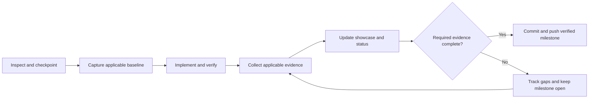

# FIRELINE: ADRIATIC

## Project Overview

**Status:** existing Unity HDRP starter project + design documentation + development prompts. The original development pack contained **no imported commercial assets, downloaded models, Unity project, working server or implemented gameplay**. It is now stored alongside the user's existing Unity project. Gameplay, flight/fire simulation and server functionality remain unimplemented in the inspected source; proposed mechanics and numeric budgets are design targets pending testing.

A persistent, self-hosted, cooperative Croatian/Herzegovinian aerial and ground firefighting simulator. Unity 6 HDRP, C#, up to 100 players per server (target, **not demonstrated**), up to 9 aircraft (design cap), server-authoritative fire/wind/water/combustion, modding, 60 FPS client target.

## Current Development Status

The 2026-10-22 filesystem inspection found Unity **6000.6.7f1**, declared HDRP **17.6.0**, `SampleScene`, HDRP settings and tutorial scripts. This is source/configuration evidence only: Editor compilation, client/server builds and gameplay have not been verified. M00–M09 remain pending. See [development status](docs/DEVELOPMENT_STATUS.md) for evidence and limitations.

## Latest Development Updates

- **2026-10-22 — Permanent documentation workflow:** added project-wide evidence rules, README showcase sections, visual/physics/gameplay/performance templates, a changelog and performance history. Existing Unity content and configuration were checkpointed before documentation edits. No game feature was added. See the [workflow report](docs/reports/2026-10-22-documentation-workflow.md) and [changelog](docs/CHANGELOG.md).

## Visual Progress — Before & After

**No baseline was captured.** No implementation screenshots are available yet; this update changes documentation only. Future significant visual changes must embed representative real Game View/build captures here, using side-by-side comparisons when possible. Concept art and the starter project's HDRP icon are not evidence of implemented FIRELINE content.

Capture reports and compressed images belong in [docs/previews/](docs/previews/README.md). The [visual report template](docs/templates/VISUAL_CHANGE.md) records revisions, capture conditions, assets and measured or unmeasured performance impact.

## Physics & Simulation Improvements

No implemented physics change or numerical comparison is claimed. [Simulation specification](docs/SIMULATION_SPEC.md) and [aircraft specifications](docs/AIRCRAFT_SPECIFICATIONS.md) describe proposed models. Future implementation comparisons belong in [docs/physics/](docs/physics/README.md), with actual equations, SI variables, BEFORE/AFTER diagrams, equivalent test inputs, results and source references.

## Gameplay Systems

Dispatch, aerial sorties, ground operations, persistent incidents and cooperative suppression are **planned**, not playable systems. See [game design](docs/GAME_DESIGN.md). Each implemented change will summarize player impact here and link a [gameplay/architecture report](docs/templates/GAMEPLAY_ARCHITECTURE_CHANGE.md) covering behavior, authority and tests.

## Architecture & Technical Diagrams

[Technical architecture](docs/TECHNICAL_ARCHITECTURE.md), [network architecture](docs/NETWORK_ARCHITECTURE.md) and [system diagrams](docs/DIAGRAMS.md) are design references, not proof of implemented server/client separation. The documentation workflow now follows this process:

## Performance Benchmarks

**No benchmark measurements exist.** The target is 60 FPS at 1080p on named reference hardware in representative populated/coastal/smoky builds. No 100-player capacity is demonstrated. See [performance plan](docs/PERFORMANCE_60FPS.md) and [performance history](docs/PERFORMANCE_HISTORY.md); planning budgets must never be reported as results.

## Development Roadmap

| Milestone | Planned outcome | Status |
|---|---|---|
| M00 | Unity/tooling audit, assemblies, build and benchmark foundation | Pending |
| M01 | Authoritative fire and wind | Pending |
| M02 | Multi-process replication and persistence proof | Pending |
| M03 | CL-415 flight and water physics | Pending |
| M04 | HDRP coastal art and VFX | Pending |
| M05 | Ground crews and working hose | Pending |
| M06 | Operations and regional incidents | Pending |
| M07 | PostgreSQL and permanent world | Pending |
| M08 | Streaming and measured 100-user scalability | Pending |
| M09 | Modding, hosting, performance and release | Pending |

See [TASKS.md](TASKS.md) for dependencies and acceptance criteria. Every milestone must follow [AGENTS.md](AGENTS.md) and the [documentation workflow](docs/DOCUMENTATION_WORKFLOW.md), with missing evidence tracked before completion.

## Usage with existing Unity project

The instructions below are retained for the original development pack. This repository already contains the Unity project; continue in place without re-extracting or recreating it.

1. Back up or commit the Unity project. Extract this pack **into the project root** (next to `Assets/`, `Packages/`, `ProjectSettings/`). Merge existing `AGENTS.md`/`README.md` rather than blindly overwriting them.
2. Open `docs/GAME_VISION.md` and `docs/GAME_DESIGN.md` first. Read the architectural constraints in `docs/TECHNICAL_ARCHITECTURE.md`, `docs/NETWORK_ARCHITECTURE.md` and `docs/PERFORMANCE_60FPS.md`.
3. Use `prompts/00_KICKOFF.md` as the **first Codex message**. It tells Codex to inspect and document the current project, not recreate it.
4. Use one subsequent prompt per implementation stage. Check actual build/test evidence, commit, push, update `TASKS.md` and `docs/DEVELOPMENT_STATUS.md`.
5. Download licensed assets from the verified/flagged links in `docs/ASSET_MANIFEST.md`; asset files are deliberately not included in this archive.

## Core docs

| Document | Purpose |
|---|---|
| `docs/GAME_VISION.md` | World, audience, game pillars and success criteria |
| `docs/GAME_DESIGN.md` | Player roles, incidents, gameplay flows, station/base operation, scoring |
| `docs/TECHNICAL_ARCHITECTURE.md` | Unity package decisions, boundaries, server/client contracts |
| `docs/SIMULATION_SPEC.md` | Server fire, wind, drops, water/vegetation and deterministic testing |
| `docs/AIRCRAFT_SPECIFICATIONS.md` | Aircraft reference data and calibrated physics approach |
| `docs/ASSET_MANIFEST.md` | Asset URLs, source download workflow, statuses, formats |
| `docs/ASSET_LICENSES.md` | Licensing obligations and audit checklist |
| `docs/ART_DIRECTION.md` | Croatian environment, HDRP rendering, VFX and asset consistency |
| `docs/NETWORK_ARCHITECTURE.md` | 100-player target, interest management, synchronization, 9 aircraft |
| `docs/DEDICATED_SERVER.md` | Self-hosting, persistence, security, server operations |
| `docs/DATABASE_SCHEMA.md` | PostgreSQL entity model, example schema and ER diagram |
| `docs/MODDING_SPEC.md` | Safe, versioned community content |
| `docs/PERFORMANCE_60FPS.md` | Client GPU/CPU frame budget, presets, QA and stress plan |
| `docs/MARKETING_PLAN.md` | Naming, positioning, community, release communications |
| `docs/DIAGRAMS.md` | Mermaid gameplay and system flows |
| `docs/DEVELOPMENT_STATUS.md` | Honest status and implementation handoff |
| [Documentation workflow](docs/DOCUMENTATION_WORKFLOW.md) | Permanent evidence requirements and publishing gate |
| [Changelog](docs/CHANGELOG.md) | Chronological development updates |
| [Performance history](docs/PERFORMANCE_HISTORY.md) | Measured runs and explicitly outstanding benchmarks |
| [Report templates](docs/templates/README.md) | Visual, physics, gameplay/architecture and performance reports |
| `TASKS.md` | Ordered milestones and objective acceptance criteria |
| `AGENTS.md` | Rules for Codex / AI coding agents |
| `prompts/*.md` | Copy-ready Codex instructions per milestone |

## Operating principles

- No Unity project recreation; don't delete existing code or modify project version without approval.
- Fire **state** and wind and water impact are server-owned. Client-only flame/smoke/spark/water particles may differ, but smoke density used for gameplay and ignitions must come from server state.
- Real geography can be **regionally compressed** for travel; local runways, physics, aircraft, firefighting geometry remain in meters at correct scale.
- HDRP is for visually capable Windows clients; Linux/Windows dedicated servers are **headless**.
- 60 FPS means measured **≤16.67 ms/frame at 1080p on named hardware**, not 60 FPS in an empty Unity Editor scene.
- 100-player concurrency is a *hypothesis* until realistic network, physics, wildfire, and bandwidth load tests pass.
- Community servers must remain independently hostable; avoid mandatory proprietary cloud dependencies.

## Authoritative source links

- De Havilland CL-415: https://dehavilland.com/aerial-firefighters/
- Air Tractor AT-802F: https://airtractor.com/wp-content/uploads/2022/09/Air-Tractor_802F-Brochure_2022.pdf
- Poly Haven CC0: https://polyhaven.com/license
- Unity Dedicated Server guidance: https://docs.unity3d.com/2022.3/Documentation/Manual/dedicated-server-introduction.html
- Unity 100+ multiplayer sample (URP, not HDRP): https://unity.com/demos/megacity-competitive-action-sample
- Unity profiler guidance: https://docs.unity3d.com/2022.2/Documentation/Manual/profiler-profiling-applications.html
