# FIRELINE: ADRIATIC

## Project Overview

**Status:** M00/M01/source comments/M02 verified for their documented prototype scopes; M03 has verified isolated flight/contact cores and remains In Progress; a temporary CL-415 exterior is now imported and verified in a separate static preview build. The existing HDRP project has modular C# assemblies, direct-IP client/server startup, tests, Windows/Linux build entry points and an imported coastal render benchmark. A bounded server-side fire/wind/suppression prototype now exists; M02 adds live authoritative fire replication, read-only client display and verified local checkpoint/restart integration; an isolated debug flight solver now exists, while playable flight, player controls, dispatch and production persistence remain planned. The original documentation pack and project guidance are preserved; proposed mechanics and numeric budgets remain design targets pending testing.

A persistent, self-hosted, cooperative Croatian/Herzegovinian aerial and ground firefighting simulator. Unity 6 HDRP, C#, up to 100 players per server (target, **not demonstrated**), up to 9 aircraft (design cap), server-authoritative fire/wind/water/combustion, modding, 60 FPS client target.

## Current Development Status

M03 now has **71 passing tests**, a fresh Windows dedicated build and two exact-replay numerical contact proofs. The existing aircraft-preview build/1080p capture and connection smoke are from the preceding import increment; no fresh client/Linux build is claimed for this contact change. The numerical flight/contact solver remains separate from the static visual model. [Current contact scope](docs/physics/runway-contact/COMPARISON.md), [preceding import/capture](docs/previews/m03-cl415-prototype/COMPARISON.md), [free-flight scope](docs/reports/2026-10-24-m03-debug-flight.md).

Unity **6000.6.7f1** / HDRP **17.6.0** are retained; Netcode for Entities, Entities and Transport **6.6.0** remain resolved. **71 EditMode tests pass**, including the closed-Editor path. Windows client/server and Linux x64 server builds succeeded with zero errors; the Windows server/two-client smoke passed. Linux also passed its headless/clock negative startup test under WSL2. Five licensed PBR surfaces and a real Petrčane DSM crop are imported into a separate benchmark scene. See the [latest M00 evidence](docs/reports/2026-10-22-m00-coastal-foundation.md). M00 and the bounded M01 headless prototype are verified. The requested source-comment pass and M02 bounded Windows replication/restart proof are verified. [Actual current builds, three-client evidence and limitations](docs/reports/2026-10-23-m02-replication.md). Cold/jittered startup remains NET-01; constant-delay/loss passed. Aircraft animation/live-flight integration, the planned production-model replacement and graphics/performance qualification remain open under M03/M04/M09. [Scope/dependency closeout](docs/reports/2026-10-23-m00-closeout.md). M05A and later gameplay milestones remain pending.

## Latest Development Updates

- **2026-10-24 — M03 runway-contact prerequisite:** three tire points, spring/damper support, combined friction, braking/steering and invalid-contact rejection. 71 tests and two actual 19,800-sample headless runs pass; existing free-flight/fire results replay unchanged. [Actual equations, BEFORE/AFTER diagrams, matched numerical results and limits](docs/physics/runway-contact/COMPARISON.md). Live flight, general collision and water operations remain pending.
- **2026-10-24 — M03 CL-415 prototype exterior:** reused the audited official archive; 144 named meshes, eleven HDRP materials and nine textures now render in a separate inspection client. 60 tests, zero-error client/headless builds and actual connection/capture smoke pass. [Screenshot, source/part inventory, BEFORE/AFTER SVGs and measured hitch](docs/previews/m03-cl415-prototype/COMPARISON.md). Temporary model authorized by the user; replacement planned before launch. M03 remains open for live flight and water operations.
- **2026-10-24 — M03 independent debug flight core:** SI forces/moments, estimated stall/controls, payload/CoG/inertia and quaternion 6DOF stepping. 57 tests, current Windows headless build, exact two-process numerical replay and unchanged fire-network regression pass. [Actual data, scope and limits](docs/reports/2026-10-24-m03-debug-flight.md). At that earlier increment no aircraft was imported; live/networked flight and the playable route remain pending.

- **2026-10-23 — M02 live replication/restart verified:** three actual rendered clients converge through baselines/deltas/gap repair; late join sees existing char, and a fresh server restores identical bytes. Direct and constant 80 ms each-way/5% UDP loss initial/restart cases pass; blackout/corrupt-load negatives pass. 48 tests and fresh Windows builds have zero errors. [Evidence, failed startup attempts, screenshots, diagrams and graph guide](docs/reports/2026-10-23-m02-replication.md). Jittered startup is unresolved; no production/60 FPS/capacity claim.

- **2026-10-23 — M02 checkpoint helpers implemented:** bounded binary codec, validated candidate restoration and single-writer local checkpoint store, with 41/41 Unity tests; live startup/transport/three-client/restart acceptance remains open. [Implementation and checks](docs/reports/2026-10-23-m02-checkpoints.md).

- **2026-10-23 — Source explanations verified:** all 144 C# function/property declarations and 14 tooling scripts now have human-readable explanations; executable-code identity checks and 34 Unity tests pass. [Scope and evidence](docs/reports/2026-10-23-source-comments.md). M02 starts next.

- **2026-10-23 — M01 headless fire/wind implemented:** bounded 5 Hz cells, seeded wind/gusts, fuel/moisture/slope response, graded manual water, smoke hazard and irreversible vegetation char. 34 tests and two independent Windows headless scenario runs pass; Linux/WSL replays also pass with the recorded cross-OS gust precision limit. Real client replication is M02 work. [Implementation and evidence](docs/reports/2026-10-23-m01-fire-wind.md).

- **2026-10-23 — M00 closed; M01 active:** verified the recorded foundation acceptance evidence and assigned aircraft/art/release gaps to their actual dependencies. [Closeout and open follow-ups](docs/reports/2026-10-23-m00-closeout.md). No gameplay or 60 FPS pass is implied by the foundation closeout.

- **2026-10-23 — M05A added to the roadmap:** planned Player Experience, Controls, UI/UX & Settings after M05 and before M06. [Scope and staged dependencies](docs/PLAYER_EXPERIENCE_SPEC.md). Documentation only; M05A is not implemented and does not interrupt the active milestone.

- **2026-10-22 — Coastal import and build acceptance follow-up:** five audited CC0 surface sets, a 6 km Copernicus DSM crop, an initial coastal proxy workload, longer benchmark instrumentation and a verified local batch/Windows/Linux startup path. The aircraft archive was downloaded after sign-in, but conflicting CC BY/GPL notices block its import; see the [source audit](AssetSources/Aircraft/CL415/AUDIT.md). [Actual implementation, diagrams, numerical checks and limits](docs/reports/2026-10-22-m00-coastal-foundation.md).
- **2026-10-22 — Frame-loss locations recorded; optimization deferred:** marked all 896 diagnostic intervals, including the 83.47 ms hitch at sample #2, and separated source suspects from proven findings. Added rendered SVG timeline/flowchart and permanent SVG/math formatting rules. [Investigation register](docs/performance/FRAME_LOSS_REGISTER.md).
- **2026-10-22 — M00 foundation verified increment:** six assembly boundaries, direct-IP bootstrap, 15 passing tests, two successful Windows release builds and an accepted headless-server/two-rendered-client smoke. Added actual captures and limited calibration diagnostics. [Implementation, commands and verification](docs/reports/2026-10-22-m00-foundation.md).
- **2026-10-22 — Permanent documentation workflow:** added project-wide evidence rules, README showcase sections, visual/physics/gameplay/performance templates, a changelog and performance history. Existing Unity content and configuration were checkpointed before documentation edits. No game feature was added. See the [workflow report](docs/reports/2026-10-22-documentation-workflow.md) and [changelog](docs/CHANGELOG.md).

## Visual Progress — Before & After

The temporary CL-415 exterior now has an actual running-build capture. **No baseline was captured**: no earlier imported aircraft existed. This is a static inspection scene; flight controls, animation and runway contact remain pending. [Capture conditions, conversion, measured callback gaps and limits](docs/previews/m03-cl415-prototype/COMPARISON.md).

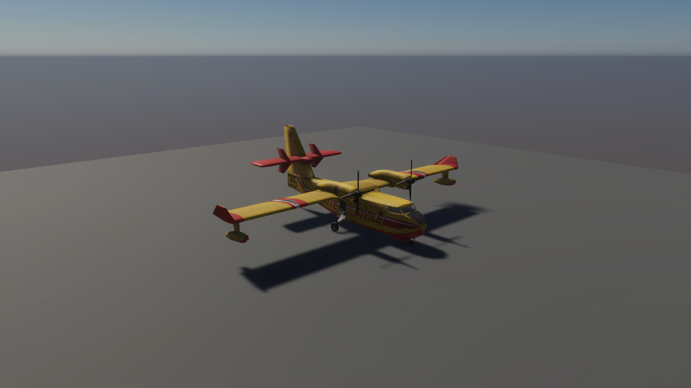

M02 now displays received authoritative phase IDs, char, wind, water and canonical digest over the original calibration scene. These are actual separate-process game captures; this diagnostic is not world-space fire/VFX or M05A gameplay UI. [Provenance, six client captures and limits](docs/previews/m02-replication/COMPARISON.md).

| BEFORE — calibration only | AFTER — live authoritative replica |
|---|---|
| 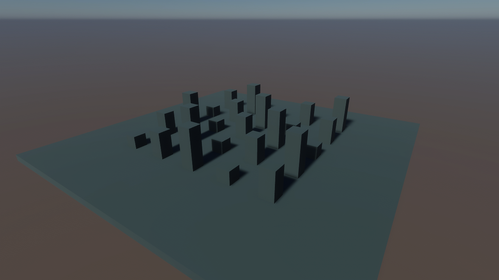 | 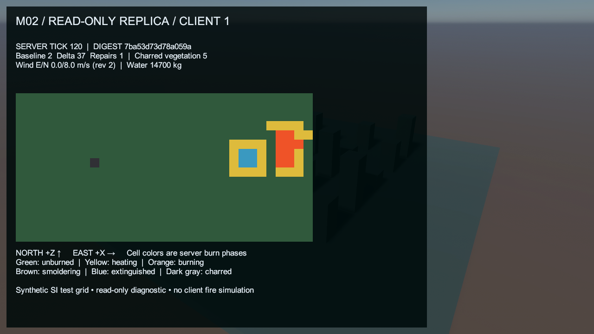 |

M00 adds a separate calibration scene containing generated boxes and a neutral HDRP material. The starter scene remains intact. These are actual Unity captures; camera/workload differences mean they are not a matched performance comparison. [Capture conditions and provenance](docs/previews/m00-foundation/COMPARISON.md).

| BEFORE — starter Game View | AFTER — Windows release client |
|---|---|
| 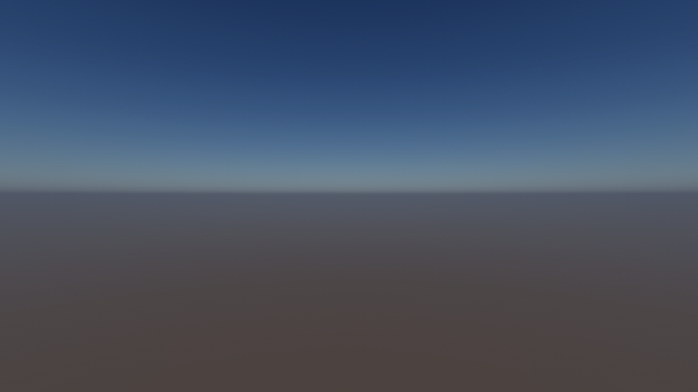 | 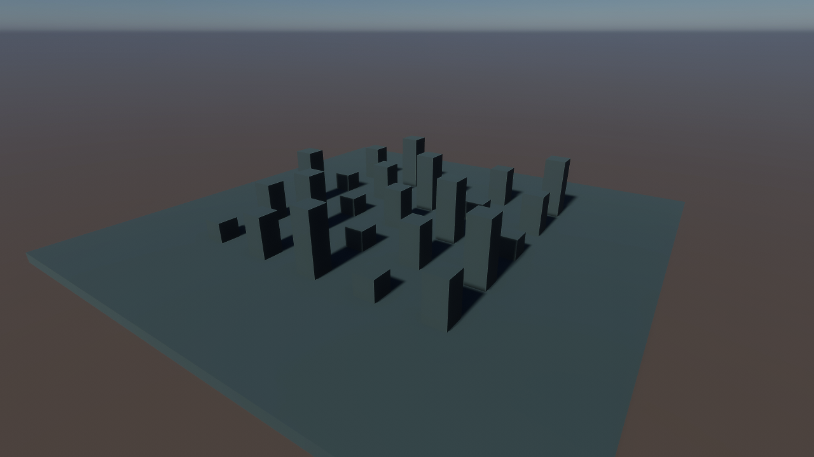 |

Capture reports and compressed images belong in [docs/previews/](docs/previews/README.md). The [visual report template](docs/templates/VISUAL_CHANGE.md) records revisions, capture conditions, assets and measured or unmeasured performance impact.

The separate M00 coastal workload now imports an actual 6 km Petrčane DSM crop and five PBR surface sets. Generated vegetation/buildings and a flat sea provide an initial render workload. This is an actual 1080p Balanced release capture; [provenance, earlier content and limitations](docs/previews/m00-coastal/COMPARISON.md).

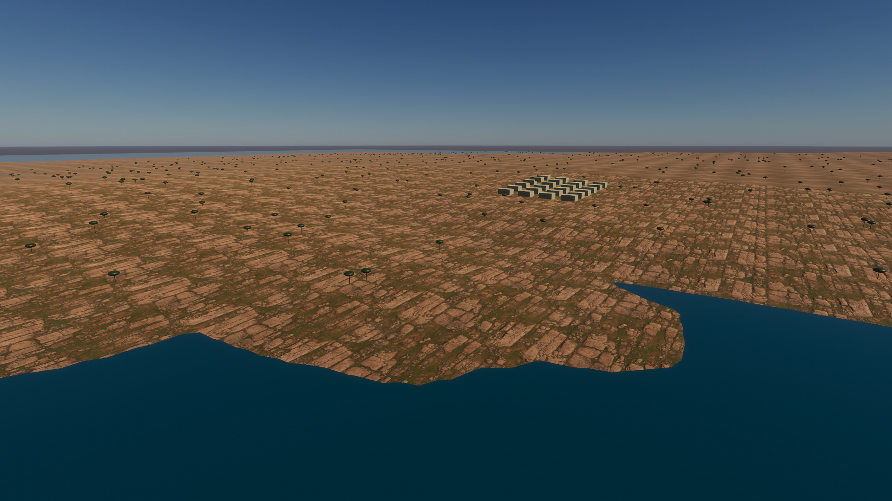

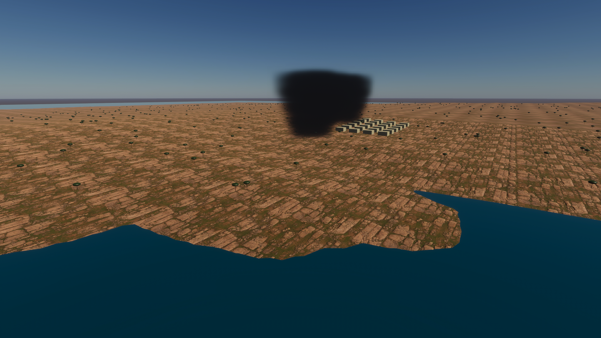

The fog boxes are a static render fixture, not production smoke or authoritative fire. The first invisible-fog attempt was rejected before this corrected capture.

## Physics & Simulation Improvements

The optional debug contact adapter now prevents accepted in-envelope tire states from falling through its finite test runway, and adds dissipative braking/steering. These are real headless numerical plots, **not graphical landing gameplay or calibrated CL-415 performance**. [Equations, actual BEFORE/AFTER flow, matched inputs, data and limitations](docs/physics/runway-contact/COMPARISON.md).

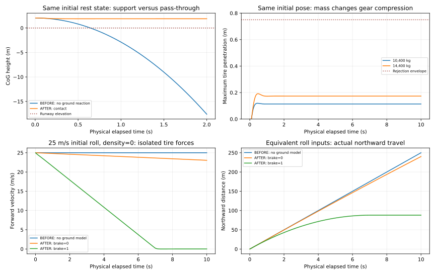

[M03 debug-flight comparison](docs/physics/debug-flight/COMPARISON.md) records actual SI equations, all estimated parameters, BEFORE/AFTER SVGs, payload response and analytic time-step convergence. These are numerical plots from real headless runs, **not aircraft gameplay screenshots or CL-415 calibration**.

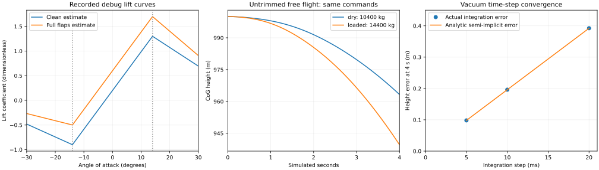

[M01 comparison](docs/physics/fire-wind/COMPARISON.md) documents actual governing logic, SI units, six burn phases, fuel/water accounting, BEFORE/AFTER SVGs and reproducible numerical cases. Parameters are estimated gameplay tuning, not field-validated wildfire prediction.

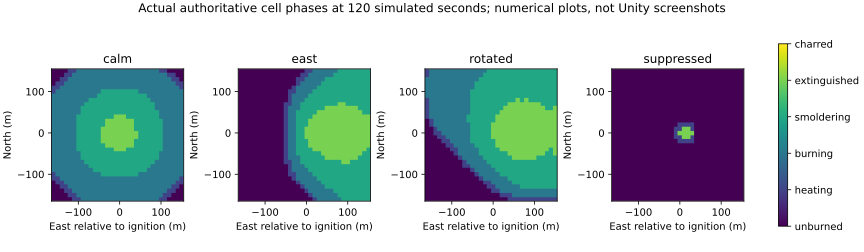

The [M00 fixed tick clock comparison](docs/physics/foundation-clock/COMPARISON.md) documents the pure scheduling utility, its equations and unit assertions. M01 now implements an estimated fire/wind/manual-suppression model; aircraft/drop physics and replicated player interactions remain unimplemented. [Simulation specification](docs/SIMULATION_SPEC.md) and [aircraft specifications](docs/AIRCRAFT_SPECIFICATIONS.md) describe proposed models. Implementation comparisons belong in [docs/physics/](docs/physics/README.md).

The [coastal conversion report](docs/reports/2026-10-22-m00-coastal-foundation.md#height-and-material-conversion) typesets the actual geographic/height conversion and verifies native Unity height checkpoints within 0.002 m of the imported data. This is a client geometry check, not a new authoritative physics model or a survey-accuracy claim.

## Gameplay Systems

M03 now has an isolated numerical flight solver in the dedicated verification harness. A pure bounded runway-contact adapter is verified separately; no live aircraft/pilot/contact host/replication/flight loop is installed. [Implemented behavior and remaining dependencies](docs/reports/2026-10-24-m03-debug-flight.md).

The dedicated server now advances a bounded synthetic fire/wind fixture, accepts manual server water events and retains char/hazard state. Two headless process runs match every scenario digest; the normal server also advanced 349 fire steps during the connection regression. M02 now exposes that authority in a read-only client phase display with baseline/delta synchronization; player-operated ignition/suppression and world-space fire visuals remain unimplemented. [Model, actual curves and limits](docs/physics/fire-wind/COMPARISON.md).

Dispatch, aerial sorties, ground operations, persistent incidents and cooperative suppression are **planned**, not playable systems. See [game design](docs/GAME_DESIGN.md). Each implemented change will summarize player impact here and link a [gameplay/architecture report](docs/templates/GAMEPLAY_ARCHITECTURE_CHANGE.md) covering behavior, authority and tests.

## Architecture & Technical Diagrams

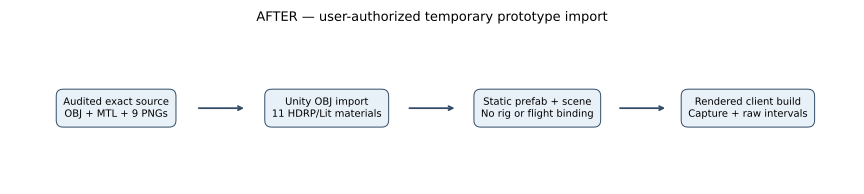

[Previous path, editable generator and actual asset/build boundaries](docs/previews/m03-cl415-prototype/COMPARISON.md).

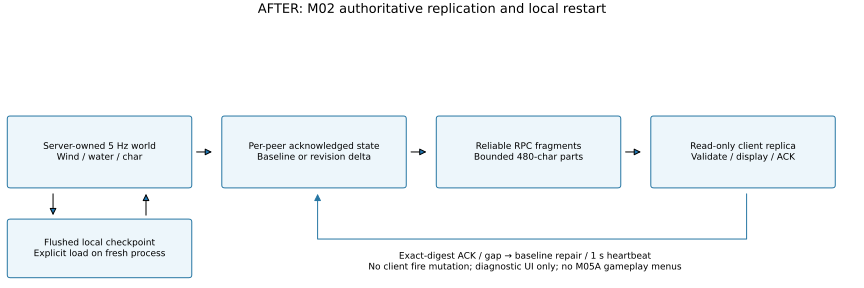

[Actual protocol/restart flow and bounded scope](docs/reports/2026-10-23-m02-replication.md), [editable SVG generator](scripts/render_m02_replication.py). Reliable RPCs are a bounded prototype; production interest/traffic/load qualification remains M08/M09.

[M00's implemented architecture](docs/reports/2026-10-22-m00-foundation.md) separates Client, Server, Shared, Simulation, Authoring and Tests. Role-specific builds use separate scenes and assembly constraints. The coastal authoring/benchmark path is drawn below; [editable generator](scripts/render_m00_coastal_diagrams.py). The broader [technical architecture](docs/TECHNICAL_ARCHITECTURE.md), [network protocol](docs/NETWORK_ARCHITECTURE.md) and [gameplay diagrams](docs/DIAGRAMS.md) remain proposed beyond this foundation. The [documentation workflow](docs/DOCUMENTATION_WORKFLOW.md) retains the inspection, evidence and publishing gates.

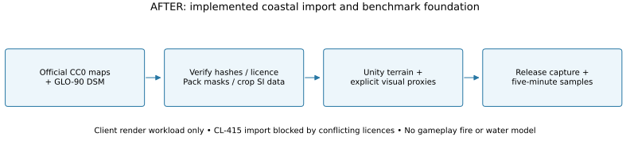

## Performance Benchmarks

The new contact Step diagnostic records p95 **7.2/7.3 µs** in two isolated dedicated processes. These are function elapsed measurements, not full host ticks or client frames; no equivalent contact-cost baseline or optimization is claimed. [Raw calls, conditions, SVG and graph guide](docs/physics/runway-contact/COMPARISON.md#measured-call-timing-and-graph-guide).

The single static aircraft preview recorded 1489 callback intervals over 25.001 s: 59.56 average FPS, 32.51 1% low, p95 16.925 ms and a **206.632 ms gap at sample #2**. [Raw data, SVG, graph ticks/interval explanation and limitations](docs/previews/m03-cl415-prototype/COMPARISON.md#performance-diagnostic-and-graph-guide). This is not representative gameplay qualification or an optimization; CPU/GPU execution and confirmed dropped presentations remain unmeasured. [Deferred FL-07 investigation](docs/performance/FRAME_LOSS_REGISTER.md#m03-static-aircraft-callback-overrun--2026-10-24).

M03's one-body pure-Step microdiagnostic records elapsed function cost separately from whole-host ticks/rendering. [Two-process timing, raw data and graph interpretation](docs/reports/2026-10-24-m03-debug-flight.md#timing-method-measured-results-and-graph-guide). It establishes no client FPS, optimization or server-capacity pass.

M02 marks real concurrent-client callback overruns, including **1193.136 ms at direct client #1 sample #602**. [All six recordings, UDP payload counts, full/detail SVG and plain-language tick/interval guide](docs/reports/2026-10-23-m02-replication.md#callback-measurements-and-graph-reader-guide), [deferred FL-06 attribution](docs/performance/FRAME_LOSS_REGISTER.md#m02-measured-callback-overruns--2026-10-23). No cause, improvement, dropped-presentation count or 1080p/60 FPS pass is inferred.

M01 maximum-budget headless `World.Step`: p95 **9.631 ms**, maximum **10.173 ms**, at most **5120 visited cells per step**, on i5-9400F. This fits its 200 ms interval for the synthetic fixture and excludes networking/serialization/the rest of the host tick. It is not client FPS or 100-player evidence. [Measured scope and graph guide](docs/reports/2026-10-23-m01-fire-wind.md#performance-and-graph-interpretation).

The initial **720p High Fidelity calibration diagnostic** on an i5-9400F / GTX 1660 SUPER averaged **59.73 FPS**, with **38.23 FPS 1% low** and **17.36 ms p95 frame interval** over 15 seconds while two clients ran. [Raw data, method and limits](docs/performance/2026-10-22-m00-calibration.md). This is not representative 1080p/60 FPS acceptance or an optimization comparison. No 100-player capacity is demonstrated. See [performance plan](docs/PERFORMANCE_60FPS.md) and [history](docs/PERFORMANCE_HISTORY.md).

The [frame-loss register](docs/performance/FRAME_LOSS_REGISTER.md) marks the three intervals above 20 ms, source locations to investigate and deferred attribution tasks. Causes remain unproven; optimization is deferred. Its [rendered vector timeline](docs/performance/m00-frame-loss/frame-interval-timeline.svg) uses the existing data, with no new benchmark claim.

The new **1080p Balanced five-minute clear/static-fog pair** averaged 60.00/60.00 FPS, with 1% lows 57.93/58.11 and p95 intervals 16.994/16.988 ms. Both exceed the 16.67 ms gate. CPU/GPU/draw-call and allocated-memory counters are recorded; generated proxy content and missing VRAM/server/bandwidth counters prevent broader acceptance. [Actual results, SVG chart, graph reader guide and limits](docs/performance/2026-10-22-m00-coastal.md). Different conditions do not prove the earlier hitch was fixed.

## Development Roadmap

| Milestone | Planned outcome | Status |
|---|---|---|
| M00 | Unity/tooling audit, assemblies, build and benchmark foundation | Verified |
| M01 | Authoritative fire and wind | Verified |
| M02 | Multi-process replication and local checkpoint proof | Verified (bounded Windows scope) |
| M03 | CL-415 flight and water physics | In Progress; numerical flight/contact cores and static exterior verified; live flight/water pending |
| M04 | HDRP coastal art and VFX | Pending |
| M05 | Ground crews and working hose | Pending |
| M05A | Player experience, controls, UI/UX, settings and training | Pending |
| M06 | Operations and regional incidents | Pending |
| M07 | PostgreSQL and permanent world | Pending |
| M08 | Streaming and measured 100-user scalability | Pending |
| M09 | Modding, hosting, performance and release | Pending |

See [TASKS.md](TASKS.md) for dependencies and acceptance criteria. Every milestone must follow [AGENTS.md](AGENTS.md) and the [documentation workflow](docs/DOCUMENTATION_WORKFLOW.md), with missing evidence tracked before completion.

## Usage with existing Unity project

The instructions below are retained for the original development pack. This repository already contains the Unity project; continue in place without re-extracting or recreating it.

1. Back up or commit the Unity project. Extract this pack **into the project root** (next to `Assets/`, `Packages/`, `ProjectSettings/`). Merge existing `AGENTS.md`/`README.md` rather than blindly overwriting them.
2. Open `docs/GAME_VISION.md` and `docs/GAME_DESIGN.md` first. Read the architectural constraints in `docs/TECHNICAL_ARCHITECTURE.md`, `docs/NETWORK_ARCHITECTURE.md` and `docs/PERFORMANCE_60FPS.md`.
3. Use `prompts/00_KICKOFF.md` as the **first Codex message**. It tells Codex to inspect and document the current project, not recreate it.
4. Use one subsequent prompt per implementation stage. Check actual build/test evidence, commit, push, update `TASKS.md` and `docs/DEVELOPMENT_STATUS.md`.
5. Review `docs/ASSET_MANIFEST.md` before acquiring further content. Audited M00 terrain/PBR derivatives are included; original downloads remain local. Candidate listings remain unimported. The CL-415 is a user-authorized temporary prototype with retained notices and planned replacement before launch.

## Core docs

| Document | Purpose |
|---|---|
| `docs/GAME_VISION.md` | World, audience, game pillars and success criteria |
| `docs/GAME_DESIGN.md` | Player roles, incidents, gameplay flows, station/base operation, scoring |
| `docs/TECHNICAL_ARCHITECTURE.md` | Unity package decisions, boundaries, server/client contracts |
| `docs/SIMULATION_SPEC.md` | Server fire, wind, drops, water/vegetation and deterministic testing |
| `docs/AIRCRAFT_SPECIFICATIONS.md` | Aircraft reference data and calibrated physics approach |
| `docs/ASSET_MANIFEST.md` | Asset URLs, source download workflow, statuses, formats |
| `docs/ASSET_LICENSES.md` | Licensing obligations and audit checklist |
| `docs/ART_DIRECTION.md` | Croatian environment, HDRP rendering, VFX and asset consistency |
| `docs/NETWORK_ARCHITECTURE.md` | 100-player target, interest management, synchronization, 9 aircraft |
| `docs/DEDICATED_SERVER.md` | Self-hosting, persistence, security, server operations |
| `docs/DATABASE_SCHEMA.md` | PostgreSQL entity model, example schema and ER diagram |
| `docs/MODDING_SPEC.md` | Safe, versioned community content |
| `docs/PERFORMANCE_60FPS.md` | Client GPU/CPU frame budget, presets, QA and stress plan |
| `docs/MARKETING_PLAN.md` | Naming, positioning, community, release communications |
| `docs/DIAGRAMS.md` | Mermaid gameplay and system flows |
| `docs/DEVELOPMENT_STATUS.md` | Honest status and implementation handoff |
| [Documentation workflow](docs/DOCUMENTATION_WORKFLOW.md) | Permanent evidence requirements and publishing gate |
| [Changelog](docs/CHANGELOG.md) | Chronological development updates |
| [Performance history](docs/PERFORMANCE_HISTORY.md) | Measured runs and explicitly outstanding benchmarks |
| [Report templates](docs/templates/README.md) | Visual, physics, gameplay/architecture and performance reports |
| `TASKS.md` | Ordered milestones and objective acceptance criteria |
| `AGENTS.md` | Rules for Codex / AI coding agents |
| `prompts/*.md` | Copy-ready Codex instructions per milestone |

## Operating principles

- No Unity project recreation; don't delete existing code or modify project version without approval.
- Fire **state** and wind and water impact are server-owned. Client-only flame/smoke/spark/water particles may differ, but smoke density used for gameplay and ignitions must come from server state.
- Real geography can be **regionally compressed** for travel; local runways, physics, aircraft, firefighting geometry remain in meters at correct scale.
- HDRP is for visually capable Windows clients; Linux/Windows dedicated servers are **headless**.
- 60 FPS means measured **≤16.67 ms/frame at 1080p on named hardware**, not 60 FPS in an empty Unity Editor scene.
- 100-player concurrency is a *hypothesis* until realistic network, physics, wildfire, and bandwidth load tests pass.
- Community servers must remain independently hostable; avoid mandatory proprietary cloud dependencies.

## Authoritative source links

- De Havilland CL-415: https://dehavilland.com/aerial-firefighters/
- Air Tractor AT-802F: https://airtractor.com/wp-content/uploads/2022/09/Air-Tractor_802F-Brochure_2022.pdf
- Poly Haven CC0: https://polyhaven.com/license
- Unity Dedicated Server guidance: https://docs.unity3d.com/2022.3/Documentation/Manual/dedicated-server-introduction.html
- Unity 100+ multiplayer sample (URP, not HDRP): https://unity.com/demos/megacity-competitive-action-sample
- Unity profiler guidance: https://docs.unity3d.com/2022.2/Documentation/Manual/profiler-profiling-applications.html
