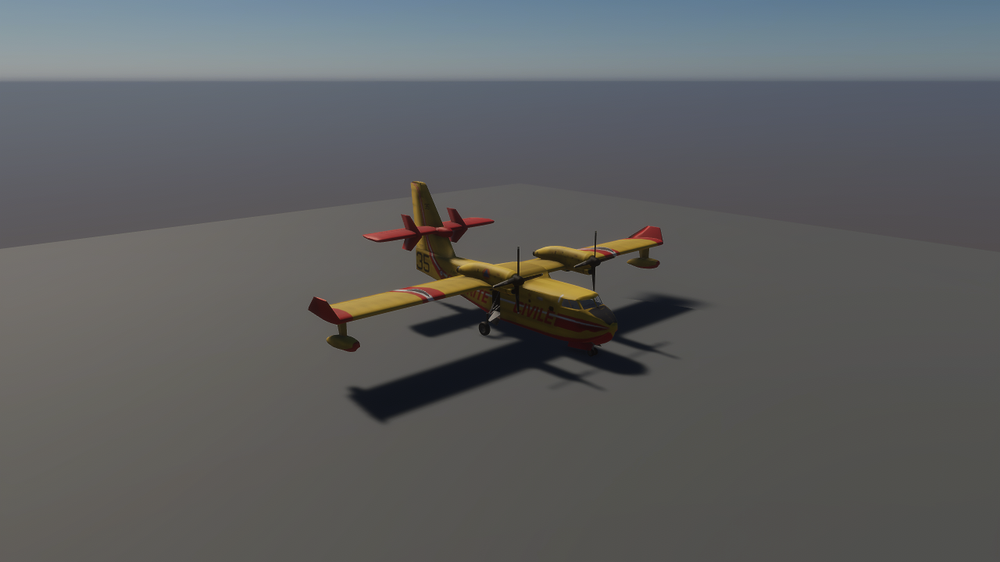
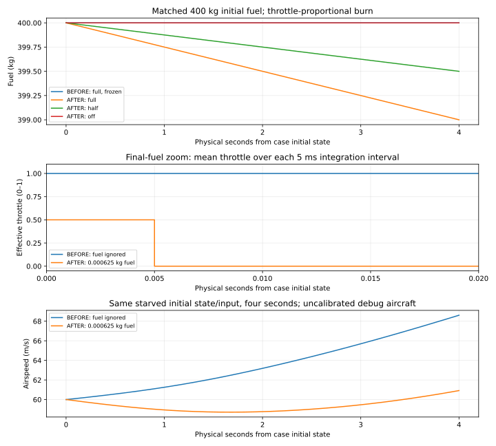
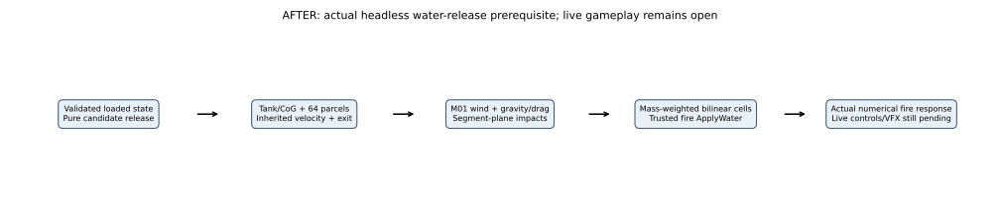
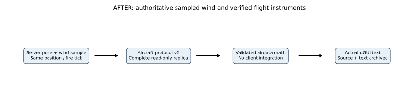
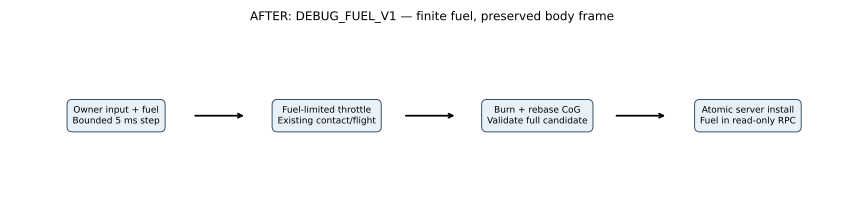
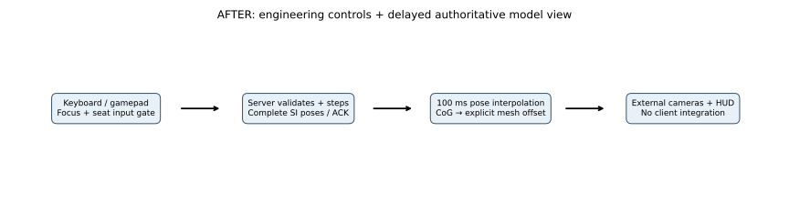

# FIRELINE: ADRIATIC

## Project Overview

**Status:** M00/M01/source comments/M02 are verified for their documented prototype scopes. M03 has a live server-owned debug aircraft, finite fuel/starvation thrust, keyboard/gamepad test controls, external cameras, receipt-time pose interpolation and server-wind instruments. Two actual automated local calm-air takeoff/landing tests pass on the synthetic runway. The temporary CL-415 exterior is bound in a separate flight-test view; its original static preview remains available. M03 stays In Progress for manual flight and the wider flight envelope, cockpit/animation, general collision/calibration/refueling and water operations. Dispatch, production persistence, 100-player capacity and representative 60 FPS remain unverified design targets.

A persistent, self-hosted, cooperative Croatian/Herzegovinian aerial and ground firefighting simulator. Unity 6 HDRP, C#, up to 100 players per server (target, **not demonstrated**), up to 9 aircraft (design cap), server-authoritative fire/wind/water/combustion, modding, 60 FPS client target.

## Current Development Status

Current M03 verification: **128 EditMode + 3 PlayMode tests**, zero-error headless server build and two actual numerical processes verify the water-release prerequisite: candidate tank/CoG debit, inherited-motion parcels, wind/gravity/drag, planar impact and conserved graded fire coverage. [Actual water results, equations, five SVGs and limitations](docs/physics/water-parcels/COMPARISON.md), [build/raw data](docs/reports/2026-10-26-m03-water-parcels.md). Earlier actual local dedicated/rendered-pilot/late-observer takeoff/landing/stop remains [verified at its original revision](docs/reports/2026-10-26-m03-realtime-flight.md). **M03 stays open** for live water controls/scooping/flow/terrain/replication/VFX, manual flight and broader envelope, collision/calibration/cockpit/refueling. Speed-dependent propellers are deferred to final polish.

Unity **6000.6.7f1** / HDRP **17.6.0** / Netcode, Entities and Transport **6.6.0** are retained; installed Input System **1.20.1** is referenced by Client for test controls. No package was added. Latest Windows server has **0 errors / 506 warnings**; the earlier rendered-flight client has **0 errors / 499 warnings** and is not rebuilt by this headless-only change. Earlier Linux/WSL foundation results remain historical. [M00 scope](docs/reports/2026-10-22-m00-coastal-foundation.md), [M02 bounded fire replication/restart](docs/reports/2026-10-23-m02-replication.md). NET-01 cold/jittered startup, aircraft calibration/refueling/water/full collision, production-model replacement and representative populated coast/smoke qualification remain open. M05A and later gameplay milestones remain Pending.

## Latest Development Updates

- **2026-10-26 — M03 water-release core:** candidate tank/CoG debit, wind-driven representative parcels, planar impacts and bilinear conserved fire coverage pass 128 EditMode/3 PlayMode tests and two actual dedicated numerical runs; original flight/fuel/authority results remain exact. [Actual equations/diagrams/plots, raw evidence and limits](docs/reports/2026-10-26-m03-water-parcels.md). Live release/scooping/flow/terrain/VFX remain pending; speed-dependent propellers deferred to final polish.

- **2026-10-26 — M03 actual rendered/network flight:** two automated local calm-air takeoff/landing/stop runs through actual server authority and rendered owner/late observer pass, including acknowledged release/disconnect. 119 EditMode + 3 PlayMode tests, zero-error Windows builds and unchanged numerical physics replay. [Actual screenshots/SVGs/source checks, retained failed cleanup attempt and limits](docs/reports/2026-10-26-m03-realtime-flight.md). M03 remains open; FL-11 records callback gaps for later optimization.

- **2026-10-26 — M03 authority runway-route proof:** bounded QA controller completes takeoff/approach/landing/stop through actual seat/input/fuel/contact authority in two accelerated headless replays. 113 EditMode + 3 PlayMode tests and zero-error server build pass. [Actual data, independent tire/resource/gate checks, retained older failures and limits](docs/reports/2026-10-26-m03-authority-route.md). No physics coefficient changed; real-time rendered flight/water still pending, M03 open.

- **2026-10-25 — M03 server-wind instruments:** read-only airdata/resource/attitude panel and corrected horizontal ground speed, protocol v2 with actual sampled wind. 110 EditMode + 3 PlayMode tests and zero-error Windows builds pass; 1,721 actual text values independently verified. [Actual screenshots, rendered diagrams, unchanged numerical regression and two failed route attempts](docs/reports/2026-10-25-m03-flight-instruments.md). M03 stays open. FL-10 records 184.623/172.498 ms callback gaps; optimization deferred.

- **2026-10-24 — M03 finite fuel:** server-owned accepted-step burn, starvation-limited thrust and mass/CoG rebase; 102 EditMode + 3 PlayMode tests, zero-error Windows builds, two exact numerical replays and actual rendered/network checks. [403 matched source poses, 1,724 display frames, 0.647945 kg live fuel use, real screenshots/SVGs and limits](docs/reports/2026-10-24-m03-fuel.md). FL-09 records 182.221/160.174 ms callback gaps; optimization remains deferred. [Future map/quality and playability gates](docs/LARGE_MAP_AND_QUALITY_PLAN.md) are planned, not implemented.

- **2026-10-24 — M03 engineering flight view:** server-owned test controls, explicit model/CoG binding, two external cameras, 100 ms cosmetic interpolation and telemetry. 94 EditMode + 3 PlayMode tests, zero-error Windows builds and actual rendered-owner/late-observer proof pass. [401 matched source poses, 1,723 independently checked display frames, actual screenshots and limits](docs/reports/2026-10-24-m03-flight-view.md). FL-08 records the accepted #499 hitch (178.723 ms) and separately retains the initial 418.063 ms diagnostic; optimization remains deferred.

- **2026-10-24 — M03 live debug-aircraft authority:** bounded 5 ms server substeps, actual server wind, validated seat-owner inputs with expiry, complete read-only pose replicas and disconnect/fault handling. 89 tests, zero-error Windows builds and real two-client proof pass; 154 received poses match actual publications. [Evidence, limitations and next dependencies](docs/reports/2026-10-24-m03-live-flight-host.md). HOST-01 records one 51.698 ms startup callback gap and 13.257 ms discarded wall time; optimization remains deferred. M03 stays open.

- **2026-10-24 — M03 runway-contact prerequisite:** three tire points, spring/damper support, combined friction, braking/steering and invalid-contact rejection. 71 tests and two actual 19,800-sample headless runs pass; existing free-flight/fire results replay unchanged. [Actual equations, BEFORE/AFTER diagrams, matched numerical results and limits](docs/physics/runway-contact/COMPARISON.md). Live flight, general collision and water operations remain pending.
- **2026-10-24 — M03 CL-415 prototype exterior:** reused the audited official archive; 144 named meshes, eleven HDRP materials and nine textures now render in a separate inspection client. 60 tests, zero-error client/headless builds and actual connection/capture smoke pass. [Screenshot, source/part inventory, BEFORE/AFTER SVGs and measured hitch](docs/previews/m03-cl415-prototype/COMPARISON.md). Temporary model authorized by the user; replacement planned before launch. M03 remains open for live flight and water operations.
- **2026-10-24 — M03 independent debug flight core:** SI forces/moments, estimated stall/controls, payload/CoG/inertia and quaternion 6DOF stepping. 57 tests, current Windows headless build, exact two-process numerical replay and unchanged fire-network regression pass. [Actual data, scope and limits](docs/reports/2026-10-24-m03-debug-flight.md). At that earlier increment no aircraft was imported; live/networked flight and the playable route remain pending.

- **2026-10-23 — M02 live replication/restart verified:** three actual rendered clients converge through baselines/deltas/gap repair; late join sees existing char, and a fresh server restores identical bytes. Direct and constant 80 ms each-way/5% UDP loss initial/restart cases pass; blackout/corrupt-load negatives pass. 48 tests and fresh Windows builds have zero errors. [Evidence, failed startup attempts, screenshots, diagrams and graph guide](docs/reports/2026-10-23-m02-replication.md). Jittered startup is unresolved; no production/60 FPS/capacity claim.

- **2026-10-23 — M02 checkpoint helpers implemented:** bounded binary codec, validated candidate restoration and single-writer local checkpoint store, with 41/41 Unity tests; live startup/transport/three-client/restart acceptance remains open. [Implementation and checks](docs/reports/2026-10-23-m02-checkpoints.md).

- **2026-10-23 — Source explanations verified:** all 144 C# function/property declarations and 14 tooling scripts now have human-readable explanations; executable-code identity checks and 34 Unity tests pass. [Scope and evidence](docs/reports/2026-10-23-source-comments.md). M02 starts next.

- **2026-10-23 — M01 headless fire/wind implemented:** bounded 5 Hz cells, seeded wind/gusts, fuel/moisture/slope response, graded manual water, smoke hazard and irreversible vegetation char. 34 tests and two independent Windows headless scenario runs pass; Linux/WSL replays also pass with the recorded cross-OS gust precision limit. Real client replication is M02 work. [Implementation and evidence](docs/reports/2026-10-23-m01-fire-wind.md).

- **2026-10-23 — M00 closed; M01 active:** verified the recorded foundation acceptance evidence and assigned aircraft/art/release gaps to their actual dependencies. [Closeout and open follow-ups](docs/reports/2026-10-23-m00-closeout.md). No gameplay or 60 FPS pass is implied by the foundation closeout.

- **2026-10-23 — M05A added to the roadmap:** planned Player Experience, Controls, UI/UX & Settings after M05 and before M06. [Scope and staged dependencies](docs/PLAYER_EXPERIENCE_SPEC.md). Documentation only; M05A is not implemented and does not interrupt the active milestone.

- **2026-10-22 — Coastal import and build acceptance follow-up:** five audited CC0 surface sets, a 6 km Copernicus DSM crop, an initial coastal proxy workload, longer benchmark instrumentation and a verified local batch/Windows/Linux startup path. The aircraft archive was downloaded after sign-in, but conflicting CC BY/GPL notices block its import; see the [source audit](AssetSources/Aircraft/CL415/AUDIT.md). [Actual implementation, diagrams, numerical checks and limits](docs/reports/2026-10-22-m00-coastal-foundation.md).
- **2026-10-22 — Frame-loss locations recorded; optimization deferred:** marked all 896 diagnostic intervals, including the 83.47 ms hitch at sample #2, and separated source suspects from proven findings. Added rendered SVG timeline/flowchart and permanent SVG/math formatting rules. [Investigation register](docs/performance/FRAME_LOSS_REGISTER.md).
- **2026-10-22 — M00 foundation verified increment:** six assembly boundaries, direct-IP bootstrap, 15 passing tests, two successful Windows release builds and an accepted headless-server/two-rendered-client smoke. Added actual captures and limited calibration diagnostics. [Implementation, commands and verification](docs/reports/2026-10-22-m00-foundation.md).
- **2026-10-22 — Permanent documentation workflow:** added project-wide evidence rules, README showcase sections, visual/physics/gameplay/performance templates, a changelog and performance history. Existing Unity content and configuration were checkpointed before documentation edits. No game feature was added. See the [workflow report](docs/reports/2026-10-22-documentation-workflow.md) and [changelog](docs/CHANGELOG.md).

## Visual Progress — Before & After

The existing exterior now flies in an actual automated dedicated-server/owner/observer short-hop test. Earlier instrument-taxi BEFORE and accepted airborne AFTER are different motion/fixture conditions, not a matched speed comparison. [Landed state, actual repeat captures, provenance and limits](docs/previews/m03-realtime-flight/COMPARISON.md).

| BEFORE — earlier actual instrument taxi | AFTER — actual accepted airborne state |
|---|---|
|  |  |

The engineering view now shows actual server-sampled airdata, attitude and resources. These are real earlier fuel-build BEFORE/current v2 AFTER captures. [Second camera, unchanged asset provenance, equations and measured limits](docs/previews/m03-flight-instruments/COMPARISON.md).

| BEFORE — existing pose HUD | AFTER — server-wind instruments |
|---|---|
|  |  |

The temporary aircraft now follows received authoritative poses in the separate engineering test scene, with basic controls and HUD. These are actual game captures: static 720p BEFORE and 1080p live AFTER are different workloads, not a matched speed comparison. [Full report, second camera, provenance and measured limits](docs/previews/m03-flight-view/COMPARISON.md).

| BEFORE — static preview | AFTER — server-owned engineering view |
|---|---|
|  |  |

The separate static inspection scene remains available. Its earlier actual capture established the imported model baseline; no model existed before that import. The new live view above reuses the same exterior, with animation, real gear/CoG calibration and cockpit coverage still pending. [Earlier import/capture conditions and provenance](docs/previews/m03-cl415-prototype/COMPARISON.md).

M02 now displays received authoritative phase IDs, char, wind, water and canonical digest over the original calibration scene. These are actual separate-process game captures; this diagnostic is not world-space fire/VFX or M05A gameplay UI. [Provenance, six client captures and limits](docs/previews/m02-replication/COMPARISON.md).

| BEFORE — calibration only | AFTER — live authoritative replica |
|---|---|
|  |  |

M00 adds a separate calibration scene containing generated boxes and a neutral HDRP material. The starter scene remains intact. These are actual Unity captures; camera/workload differences mean they are not a matched performance comparison. [Capture conditions and provenance](docs/previews/m00-foundation/COMPARISON.md).

| BEFORE — starter Game View | AFTER — Windows release client |
|---|---|
|  |  |

Capture reports and compressed images belong in [docs/previews/](docs/previews/README.md). The [visual report template](docs/templates/VISUAL_CHANGE.md) records revisions, capture conditions, assets and measured or unmeasured performance impact.

The separate M00 coastal workload now imports an actual 6 km Petrčane DSM crop and five PBR surface sets. Generated vegetation/buildings and a flat sea provide an initial render workload. This is an actual 1080p Balanced release capture; [provenance, earlier content and limitations](docs/previews/m00-coastal/COMPARISON.md).

The fog boxes are a static render fixture, not production smoke or authoritative fire. The first invisible-fog attempt was rejected before this corrected capture.

## Physics & Simulation Improvements

The new [water-release comparison](docs/physics/water-parcels/COMPARISON.md) records actual candidate tank/CoG mass transfer, inherited parcel motion, wind/gravity/drag, planar impact and bilinear fire-cell dose, with 30/100 m and calm/8 m/s base crosswind cases. This is a verified numerical prerequisite; live controls, flow/scooping, terrain and VFX remain open.

[Current QA-control BEFORE/AFTER comparison, SI equations, unchanged equivalent numerical replay and live verification](docs/physics/realtime-route/COMPARISON.md). No force-law or calibration improvement is claimed from a different input policy.

The unchanged physical kernel now has a bounded **headless authority route** proof with a revised QA control strategy. The older offline strategies remain recorded failures; the new evidence independently checks commands, tire geometry/support, finite runway, fuel and five-second airborne/settled gates. [Actual equations, BEFORE/AFTER SVGs, equivalent legacy replay and physical-clock plots](docs/physics/runway-route/COMPARISON.md). This is not a calibrated or rendered gameplay flight pass.

The latest instrument algorithm separates horizontal ground speed from 3D air-relative speed using actual authoritative wind, with unit-quaternion attitude and existing mass/CoG math. [Equivalent-input display comparison, SI formulas and unchanged actual physical replay](docs/previews/m03-flight-instruments/COMPARISON.md). Two offline flight-route strategies failed; the airborne acceptance remains open.

The dedicated debug aircraft now starts with 400 kg fuel, debits only accepted physical steps, limits final-packet thrust and stops thrust when empty. The estimated 0.25 kg/s full-throttle flow updates mass/CoG/inertia while preserving fixed body points/velocities. [Actual equations, BEFORE/AFTER diagrams, equivalent-input numerical results, exact legacy replay and limitations](docs/physics/aircraft-fuel/COMPARISON.md). No calibrated CL-415 flow/startup/refueling or water integration is claimed.

The debug flight/contact kernel now runs in an explicit live server session. A bounded clock prevents unbounded sleep catch-up, validated pilot controls expire, and both client replicas retain actual authoritative SI poses. [Unchanged-solver numerical checks, actual BEFORE/AFTER diagrams, clock equations and raw host/replica plots](docs/physics/live-flight-host/COMPARISON.md). This is one estimated aircraft, not calibrated CL-415 or water-operation completion.

The optional debug contact adapter now prevents accepted in-envelope tire states from falling through its finite test runway, and adds dissipative braking/steering. These are real headless numerical plots, **not graphical landing gameplay or calibrated CL-415 performance**. [Equations, actual BEFORE/AFTER flow, matched inputs, data and limitations](docs/physics/runway-contact/COMPARISON.md).

[M03 debug-flight comparison](docs/physics/debug-flight/COMPARISON.md) records actual SI equations, all estimated parameters, BEFORE/AFTER SVGs, payload response and analytic time-step convergence. These are numerical plots from real headless runs, **not aircraft gameplay screenshots or CL-415 calibration**.

[M01 comparison](docs/physics/fire-wind/COMPARISON.md) documents actual governing logic, SI units, six burn phases, fuel/water accounting, BEFORE/AFTER SVGs and reproducible numerical cases. Parameters are estimated gameplay tuning, not field-validated wildfire prediction.

The [M00 fixed tick clock comparison](docs/physics/foundation-clock/COMPARISON.md) documents the pure scheduling utility, its equations and unit assertions. M01 now implements an estimated fire/wind/manual-suppression model; calibrated aircraft/drop behavior and replicated player interactions remain pending. [Simulation specification](docs/SIMULATION_SPEC.md) and [aircraft specifications](docs/AIRCRAFT_SPECIFICATIONS.md) describe proposed models. Implementation comparisons belong in [docs/physics/](docs/physics/README.md).

The [coastal conversion report](docs/reports/2026-10-22-m00-coastal-foundation.md#height-and-material-conversion) typesets the actual geographic/height conversion and verifies native Unity height checkpoints within 0.002 m of the imported data. This is a client geometry check, not a new authoritative physics model or a survey-accuracy claim.

## Gameplay Systems

The isolated water kernel now feeds actual numerical impact weights into existing fire cooling; [live release/scooping/event/replication work remains pending](docs/reports/2026-10-26-m03-water-parcels.md). No normal pilot water command or cosmetic water effect is installed by this increment.

Actual automated local calm-air takeoff/landing now crosses normal seat/input RPCs, server physics and read-only owner/observer presentation, with acknowledged release and disconnect. [Independent proof and remaining manual/envelope/water scope](docs/reports/2026-10-26-m03-realtime-flight.md). This QA fixture is not a gameplay autopilot or complete sortie.

The current debug pilot view adds validated read-only air/ground/vertical speed, pitch/bank/heading, wind and resources. [Actual UI/source proof](docs/reports/2026-10-25-m03-flight-instruments.md). No production cockpit/settings or M05A implementation is implied.

M03 now exposes the opt-in server aircraft through a separate engineering runway view. Users can request/release the seat, send bounded keyboard/gamepad controls, switch two external cameras and read actual received aircraft state plus explicitly labeled local requests. Only the server integrates flight/contact; presentation uses tested 100 ms receipt-time interpolation and never extrapolates. [Actual device/render/network proof and remaining dependencies](docs/reports/2026-10-24-m03-flight-view.md). The same view now receives finite fuel and correct mass-derived offsets; [resource implementation/evidence](docs/reports/2026-10-24-m03-fuel.md). This is a debug taxi/control increment; airborne route, cockpit/animations, qualifications, prediction/correction and water/suppression remain pending.

The dedicated server now advances a bounded synthetic fire/wind fixture, accepts manual server water events and retains char/hazard state. Two headless process runs match every scenario digest; the normal server also advanced 349 fire steps during the connection regression. M02 now exposes that authority in a read-only client phase display with baseline/delta synchronization; player-operated ignition/suppression and world-space fire visuals remain unimplemented. [Model, actual curves and limits](docs/physics/fire-wind/COMPARISON.md).

Dispatch, aerial sorties, ground operations, persistent incidents and cooperative suppression are **planned**, not playable systems. See [game design](docs/GAME_DESIGN.md). Each implemented change will summarize player impact here and link a [gameplay/architecture report](docs/templates/GAMEPLAY_ARCHITECTURE_CHANGE.md) covering behavior, authority and tests.

## Architecture & Technical Diagrams

[Previous boundary, equations, actual results and editable source](docs/physics/water-parcels/COMPARISON.md).

[Before boundary, editable drawings, actual source/pose/control checks and limits](docs/previews/m03-realtime-flight/COMPARISON.md).

[Previous failed offline-control boundary, editable source and scope](docs/physics/runway-route/COMPARISON.md). This QA path is opt-in and does not enable a gameplay autopilot.

[Previous v1 path, current message/readout boundary and editable drawing source](docs/previews/m03-flight-instruments/COMPARISON.md). Matching rebuilt players are required; Shared remains free of client/HDRP references.

[Previous path, editable generator and actual asset/build boundaries](docs/previews/m03-cl415-prototype/COMPARISON.md).

[Actual protocol/restart flow and bounded scope](docs/reports/2026-10-23-m02-replication.md), [editable SVG generator](scripts/render_m02_replication.py). Reliable RPCs are a bounded prototype; production interest/traffic/load qualification remains M08/M09.

[M00's implemented architecture](docs/reports/2026-10-22-m00-foundation.md) separates Client, Server, Shared, Simulation, Authoring and Tests. Role-specific builds use separate scenes and assembly constraints. The coastal authoring/benchmark path is drawn below; [editable generator](scripts/render_m00_coastal_diagrams.py). The broader [technical architecture](docs/TECHNICAL_ARCHITECTURE.md), [network protocol](docs/NETWORK_ARCHITECTURE.md) and [gameplay diagrams](docs/DIAGRAMS.md) remain proposed beyond this foundation. The [documentation workflow](docs/DOCUMENTATION_WORKFLOW.md) retains the inspection, evidence and publishing gates.

## Performance Benchmarks

Latest accepted flight diagnostic: **59.019 average / 20.534 1% low FPS**, one 1080p Balanced synthetic-runway rendered owner with headless observer/server. Independent repeat: **59.582/30.458 FPS**. **FL-11** records real callback locations; spacing includes waits/presentation and is not CPU/GPU execution or proven dropped frames. [Exact samples, conditions and ruler/interval/clock/zoom guide](docs/reports/2026-10-26-m03-realtime-flight.md#performance-and-current-scope). No matched speedup, optimization, representative coast/smoke/Ultra 60 FPS or capacity claim.

The preceding 1080p Balanced engineering run records **59.263 average / 25.650 1% low FPS**, p95/p99 callback intervals **17.394/17.924 ms**, maximum **178.723 ms at #499** (8.450635–8.629358 recording seconds). This is one dry aircraft/runway and one headless observer; **no representative 60 FPS pass**. The initial trace-rejected attempt's 418.063 ms callback is retained separately. [Actual raw positions, SVGs, units/ticks/interval/warm-up explanations and deferred attribution](docs/previews/m03-flight-view/COMPARISON.md#performance-graph-guide).

The live M03 headless proof records 835 host callbacks: adapter execution p95/max **0.0633/6.3483 ms**; callback-gap p95/max **18.3073/51.6976 ms**. HOST-01 marks callback #2 and its 13.2569 ms catch-up discard. These are headless host observations, not rendered FPS or a capacity pass. [Actual raw plots, source sites, clocks/rulers/sample explanation and deferred attribution](docs/physics/live-flight-host/COMPARISON.md#measured-timing-and-graph-guide).

The new contact Step diagnostic records p95 **7.2/7.3 µs** in two isolated dedicated processes. These are function elapsed measurements, not full host ticks or client frames; no equivalent contact-cost baseline or optimization is claimed. [Raw calls, conditions, SVG and graph guide](docs/physics/runway-contact/COMPARISON.md#measured-call-timing-and-graph-guide).

The single static aircraft preview recorded 1489 callback intervals over 25.001 s: 59.56 average FPS, 32.51 1% low, p95 16.925 ms and a **206.632 ms gap at sample #2**. [Raw data, SVG, graph ticks/interval explanation and limitations](docs/previews/m03-cl415-prototype/COMPARISON.md#performance-diagnostic-and-graph-guide). This is not representative gameplay qualification or an optimization; CPU/GPU execution and confirmed dropped presentations remain unmeasured. [Deferred FL-07 investigation](docs/performance/FRAME_LOSS_REGISTER.md#m03-static-aircraft-callback-overrun--2026-10-24).

M03's one-body pure-Step microdiagnostic records elapsed function cost separately from whole-host ticks/rendering. [Two-process timing, raw data and graph interpretation](docs/reports/2026-10-24-m03-debug-flight.md#timing-method-measured-results-and-graph-guide). It establishes no client FPS, optimization or server-capacity pass.

M02 marks real concurrent-client callback overruns, including **1193.136 ms at direct client #1 sample #602**. [All six recordings, UDP payload counts, full/detail SVG and plain-language tick/interval guide](docs/reports/2026-10-23-m02-replication.md#callback-measurements-and-graph-reader-guide), [deferred FL-06 attribution](docs/performance/FRAME_LOSS_REGISTER.md#m02-measured-callback-overruns--2026-10-23). No cause, improvement, dropped-presentation count or 1080p/60 FPS pass is inferred.

M01 maximum-budget headless `World.Step`: p95 **9.631 ms**, maximum **10.173 ms**, at most **5120 visited cells per step**, on i5-9400F. This fits its 200 ms interval for the synthetic fixture and excludes networking/serialization/the rest of the host tick. It is not client FPS or 100-player evidence. [Measured scope and graph guide](docs/reports/2026-10-23-m01-fire-wind.md#performance-and-graph-interpretation).

The initial **720p High Fidelity calibration diagnostic** on an i5-9400F / GTX 1660 SUPER averaged **59.73 FPS**, with **38.23 FPS 1% low** and **17.36 ms p95 frame interval** over 15 seconds while two clients ran. [Raw data, method and limits](docs/performance/2026-10-22-m00-calibration.md). This is not representative 1080p/60 FPS acceptance or an optimization comparison. No 100-player capacity is demonstrated. See [performance plan](docs/PERFORMANCE_60FPS.md) and [history](docs/PERFORMANCE_HISTORY.md).

The [frame-loss register](docs/performance/FRAME_LOSS_REGISTER.md) marks the three intervals above 20 ms, source locations to investigate and deferred attribution tasks. Causes remain unproven; optimization is deferred. Its [rendered vector timeline](docs/performance/m00-frame-loss/frame-interval-timeline.svg) uses the existing data, with no new benchmark claim.

The new **1080p Balanced five-minute clear/static-fog pair** averaged 60.00/60.00 FPS, with 1% lows 57.93/58.11 and p95 intervals 16.994/16.988 ms. Both exceed the 16.67 ms gate. CPU/GPU/draw-call and allocated-memory counters are recorded; generated proxy content and missing VRAM/server/bandwidth counters prevent broader acceptance. [Actual results, SVG chart, graph reader guide and limits](docs/performance/2026-10-22-m00-coastal.md). Different conditions do not prove the earlier hitch was fixed.

## Development Roadmap

The next playable gate is the M03 aerial loop plus M04 visual fire/water presentation in one bounded coastal sector; ground co-op follows in M05 and the complete controls/settings/tutorial experience in M05A with M06 operations bindings. Dates remain uncommitted while flight/water dependencies are open. The user's planned ~30 × 4 km map, HDRP textures/lighting, view-distance/animation/effect settings and **Ultra 1080p/60 FPS target on i5-9400F / 16 GB / GTX 1660-class hardware** are assigned to M04/M05A/M08/M09. [Exact planned scope, dependencies and measurement gates](docs/LARGE_MAP_AND_QUALITY_PLAN.md). The map and Ultra target are not yet verified implementations.

| Milestone | Planned outcome | Status |
|---|---|---|
| M00 | Unity/tooling audit, assemblies, build and benchmark foundation | Verified |
| M01 | Authoritative fire and wind | Verified |
| M02 | Multi-process replication and local checkpoint proof | Verified (bounded Windows scope) |
| M03 | CL-415 flight and water physics | In Progress; debug authority/view/fuel/instruments + automated local rendered hop verified; manual/envelope/cockpit/calibration/water pending |
| M04 | HDRP coastal art and VFX | Pending |
| M05 | Ground crews and working hose | Pending |
| M05A | Player experience, controls, UI/UX, settings and training | Pending |
| M06 | Operations and regional incidents | Pending |
| M07 | PostgreSQL and permanent world | Pending |
| M08 | Streaming and measured 100-user scalability | Pending |
| M09 | Modding, hosting, performance and release | Pending |

See [TASKS.md](TASKS.md) for dependencies and acceptance criteria. Every milestone must follow [AGENTS.md](AGENTS.md) and the [documentation workflow](docs/DOCUMENTATION_WORKFLOW.md), with missing evidence tracked before completion.

## Usage with existing Unity project

The instructions below are retained for the original development pack. This repository already contains the Unity project; continue in place without re-extracting or recreating it.

1. Back up or commit the Unity project. Extract this pack **into the project root** (next to `Assets/`, `Packages/`, `ProjectSettings/`). Merge existing `AGENTS.md`/`README.md` rather than blindly overwriting them.
2. Open `docs/GAME_VISION.md` and `docs/GAME_DESIGN.md` first. Read the architectural constraints in `docs/TECHNICAL_ARCHITECTURE.md`, `docs/NETWORK_ARCHITECTURE.md` and `docs/PERFORMANCE_60FPS.md`.
3. Use `prompts/00_KICKOFF.md` as the **first Codex message**. It tells Codex to inspect and document the current project, not recreate it.
4. Use one subsequent prompt per implementation stage. Check actual build/test evidence, commit, push, update `TASKS.md` and `docs/DEVELOPMENT_STATUS.md`.
5. Review `docs/ASSET_MANIFEST.md` before acquiring further content. Audited M00 terrain/PBR derivatives are included; original downloads remain local. Candidate listings remain unimported. The CL-415 is a user-authorized temporary prototype with retained notices and planned replacement before launch.

## Core docs

| Document | Purpose |
|---|---|
| `docs/GAME_VISION.md` | World, audience, game pillars and success criteria |
| `docs/GAME_DESIGN.md` | Player roles, incidents, gameplay flows, station/base operation, scoring |
| `docs/TECHNICAL_ARCHITECTURE.md` | Unity package decisions, boundaries, server/client contracts |
| `docs/SIMULATION_SPEC.md` | Server fire, wind, drops, water/vegetation and deterministic testing |
| `docs/AIRCRAFT_SPECIFICATIONS.md` | Aircraft reference data and calibrated physics approach |
| `docs/ASSET_MANIFEST.md` | Asset URLs, source download workflow, statuses, formats |
| `docs/ASSET_LICENSES.md` | Licensing obligations and audit checklist |
| `docs/ART_DIRECTION.md` | Croatian environment, HDRP rendering, VFX and asset consistency |
| `docs/NETWORK_ARCHITECTURE.md` | 100-player target, interest management, synchronization, 9 aircraft |
| `docs/DEDICATED_SERVER.md` | Self-hosting, persistence, security, server operations |
| `docs/DATABASE_SCHEMA.md` | PostgreSQL entity model, example schema and ER diagram |
| `docs/MODDING_SPEC.md` | Safe, versioned community content |
| `docs/PERFORMANCE_60FPS.md` | Client GPU/CPU frame budget, presets, QA and stress plan |
| `docs/MARKETING_PLAN.md` | Naming, positioning, community, release communications |
| `docs/DIAGRAMS.md` | Mermaid gameplay and system flows |
| `docs/DEVELOPMENT_STATUS.md` | Honest status and implementation handoff |
| [Documentation workflow](docs/DOCUMENTATION_WORKFLOW.md) | Permanent evidence requirements and publishing gate |
| [Changelog](docs/CHANGELOG.md) | Chronological development updates |
| [Performance history](docs/PERFORMANCE_HISTORY.md) | Measured runs and explicitly outstanding benchmarks |
| [Report templates](docs/templates/README.md) | Visual, physics, gameplay/architecture and performance reports |
| `TASKS.md` | Ordered milestones and objective acceptance criteria |
| `AGENTS.md` | Rules for Codex / AI coding agents |
| `prompts/*.md` | Copy-ready Codex instructions per milestone |

## Operating principles

- No Unity project recreation; don't delete existing code or modify project version without approval.
- Fire **state** and wind and water impact are server-owned. Client-only flame/smoke/spark/water particles may differ, but smoke density used for gameplay and ignitions must come from server state.
- Real geography can be **regionally compressed** for travel; local runways, physics, aircraft, firefighting geometry remain in meters at correct scale.
- HDRP is for visually capable Windows clients; Linux/Windows dedicated servers are **headless**.
- 60 FPS means measured **≤16.67 ms/frame at 1080p on named hardware**, not 60 FPS in an empty Unity Editor scene.
- 100-player concurrency is a *hypothesis* until realistic network, physics, wildfire, and bandwidth load tests pass.
- Community servers must remain independently hostable; avoid mandatory proprietary cloud dependencies.

## Authoritative source links

- De Havilland CL-415: https://dehavilland.com/aerial-firefighters/
- Air Tractor AT-802F: https://airtractor.com/wp-content/uploads/2022/09/Air-Tractor_802F-Brochure_2022.pdf
- Poly Haven CC0: https://polyhaven.com/license
- Unity Dedicated Server guidance: https://docs.unity3d.com/2022.3/Documentation/Manual/dedicated-server-introduction.html
- Unity 100+ multiplayer sample (URP, not HDRP): https://unity.com/demos/megacity-competitive-action-sample
- Unity profiler guidance: https://docs.unity3d.com/2022.2/Documentation/Manual/profiler-profiling-applications.html
