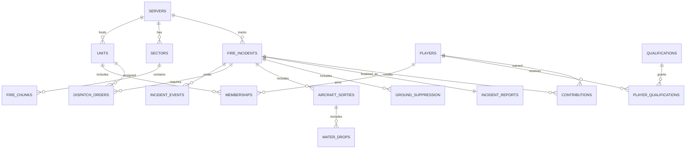

# PostgreSQL database and event store design

## Principle

Hot simulation (fire cells, wind interpolator, aircraft rigid bodies, hose particles) stays **in memory on authoritative server**. PostgreSQL stores durable identity/permissions, mission metadata, resource states, meaningful events, periodic compressed sector snapshots, scores and audit logs. No per-fire-cell database writes at every sim tick.

## Core schema (logical)

| Table | Keys & key fields | Purpose |
|---|---|---|
| `servers` | `id uuid pk`, name, version, settings_hash | independent self-hosted worlds |
| `players` | `id uuid pk`, provider_id nullable, display_name, created_at | profile and reconnect |
| `units` | `id uuid pk`, server_id, name, type, parent_unit_id | squadron, brigade, crew, command |
| `memberships` | `id uuid pk`, player_id, unit_id, rank, status, valid_from | persistent belonging |
| `qualifications` | `id text pk`, description, scope | in-game cockpit/driver/equipment permissions |
| `player_qualifications` | player_id, qualification_id, granted_by, expires_at | permission claims |
| `shifts` | id, player_id, unit_id, started_at, ended_at | voluntary operational shifts |
| `sectors` | id, server_id, world_coord, scale, lod | streamed regions |
| `world_snapshots` | id, server_id, tick, created_at, manifest_hash, storage_uri, checksum | consistent world checkpoints |
| `fire_chunks` | (server_id, sector_id, chunk_x, chunk_y), revision, serialized_compressed_blob, tick | latest authoritative burn state |
| `fire_incidents` | id, server_id, sector_id, state, started_at, resolved_at | individual emergencies |
| `incident_events` | id, incident_id, event_type, simulation_tick, payload_json, unique_command_id | idempotent significant actions |
| `weather_snapshots` | id, server_id, sector_id, tick, wind_seed, serialized_field | authority wind/weather |
| `vehicle_types` | id, type, config_version, config_hash | normalized game definitions |
| `vehicles` | id, server_id, type_id, unit_id, state_json, status, lease_revision | deployed vehicles |
| `aircraft_sorties` | id, incident_id, aircraft_id, pilot_player_id, started_at, ended_at | flight history |
| `dispatch_orders` | id, incident_id, issuer_id, assigned_unit, status, deadline | operational authority |
| `water_drops` | id, sortie_id, tick, water_mass_kg, footprint_digest, coverage_blob_ref | verified simulation events |
| `ground_suppression` | id, incident_id, player_id, tool_id, tick, coverage_digest | logged ground contributions |
| `incident_reports` | id, incident_id unique, summary_json, finalized_at | After Action Report |
| `contributions` | id, incident_id, player_id, unit_id, score_components_json | contribution evidence |
| `admin_audit` | id, server_id, actor_id, action, at, before_after_json | permissions moderation accountability |

## ER diagram



## Minimal SQL illustration (not full migrations)

```sql
CREATE TABLE fire_incidents (
    id UUID PRIMARY KEY,
    server_id UUID NOT NULL,
    sector_id TEXT NOT NULL,
    state TEXT NOT NULL CHECK (state IN ('DISPATCHED','RESPONDING','ACTIVE','CONTAINED','MONITORING','RESOLVED','CANCELED')),
    started_at TIMESTAMPTZ NOT NULL,
    resolved_at TIMESTAMPTZ,
    generation_seed BIGINT NOT NULL,
    last_sim_tick BIGINT NOT NULL DEFAULT 0
);
CREATE INDEX fire_incidents_server_state ON fire_incidents(server_id, state);

CREATE TABLE incident_events (
    id UUID PRIMARY KEY,
    incident_id UUID NOT NULL REFERENCES fire_incidents(id),
    sim_tick BIGINT NOT NULL,
    event_kind TEXT NOT NULL,
    payload JSONB NOT NULL,
    command_id UUID UNIQUE,
    written_at TIMESTAMPTZ NOT NULL DEFAULT NOW()
);
CREATE INDEX incident_events_incident_tick ON incident_events(incident_id, sim_tick);
```

## Transactions and replay

- Acquisition of an aircraft role/lease must be compare-and-set or transaction-protected to prevent 10 players taking one plane.
- A fire chunk snapshot and its revision/tick must correspond to one consistent sim state. Use snapshot manifest for multi-chunk all-or-nothing recovery.
- Every water drop, equipment purchase/assignment and resolved incident has unique command/event ID to make replay idempotent.
- Append operations that update balances/permissions must be transaction-safe. Never allow a client to write database rows directly.
- Store compressed cells and associated `contentHash`, schemaVersion, simTick; use migration/test fixtures for backwards compatibility.
- Keep db users least-privileged; game server uses only its own DB credentials from environment.

## Data retention/privacy

Self-hosters own retention policy, backups and exports. Provide player deletion/export and admin audit retention options. Avoid collecting real names, home locations or other unnecessary personal data for the game.
