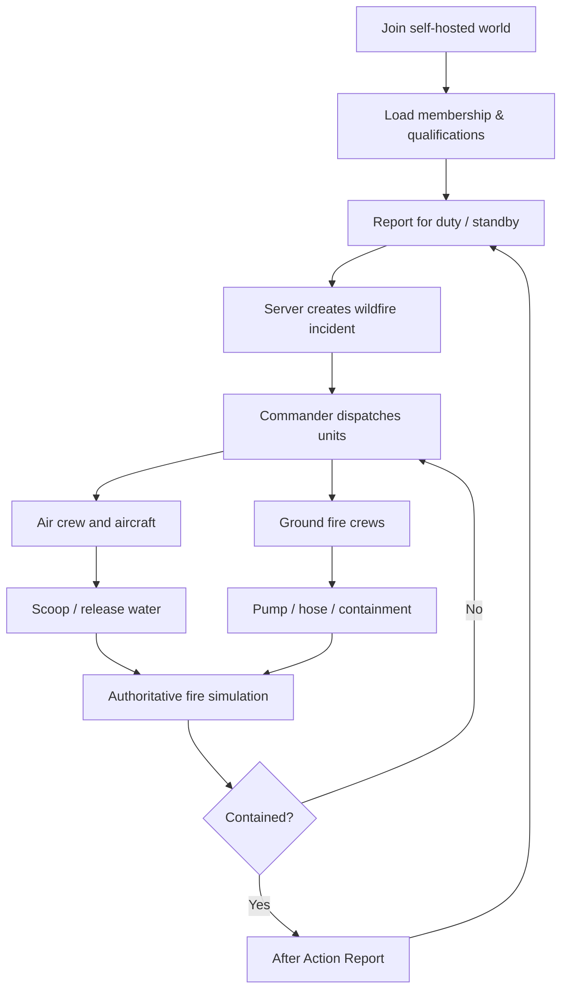
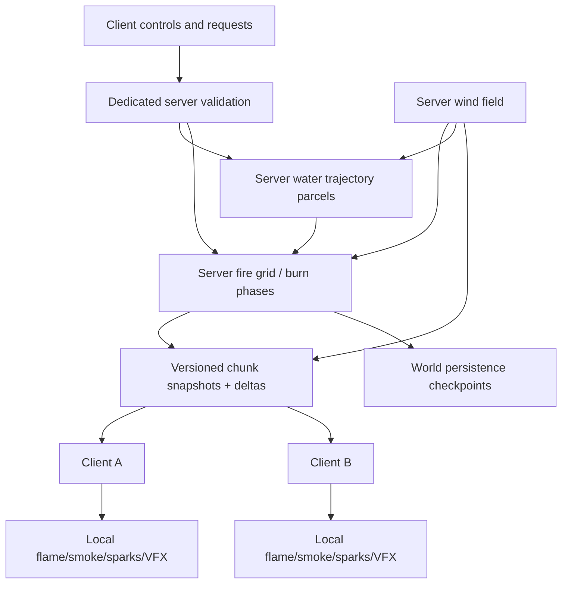
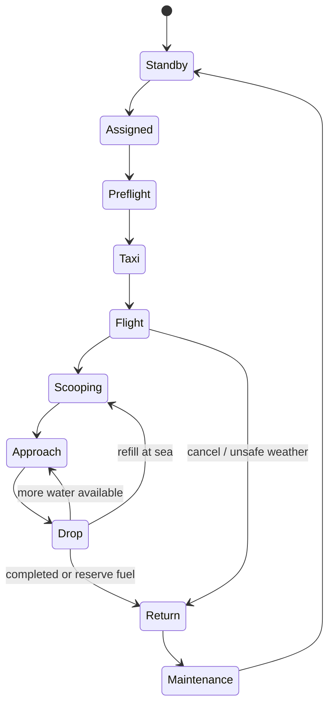
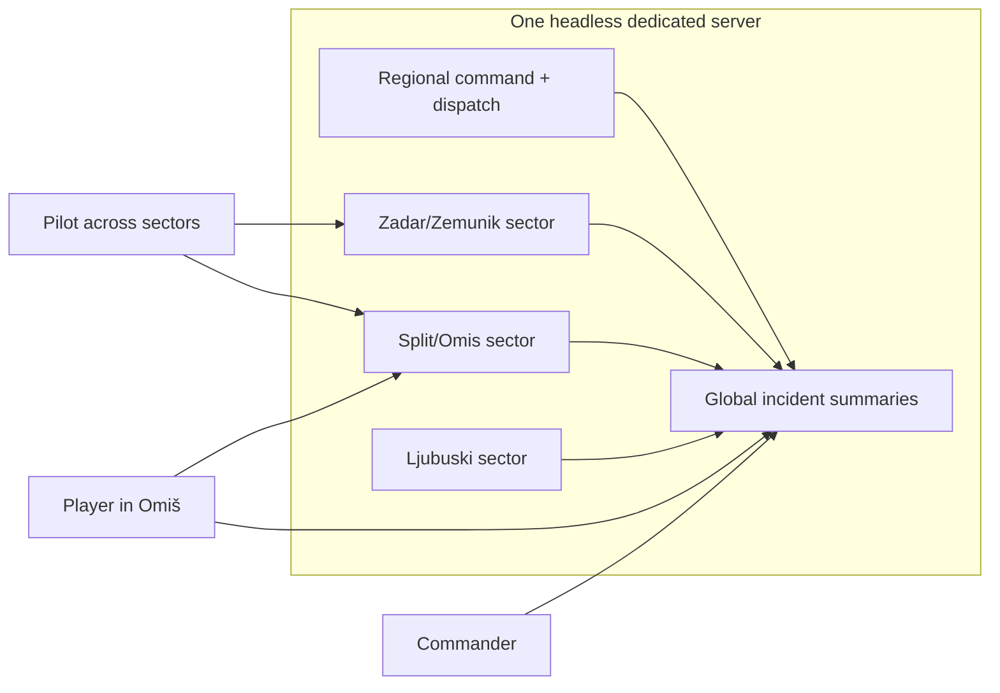

# System diagrams (Mermaid)

## Entire player / incident loop

## Authoritative world and VFX

## Aircraft resource lifecycle

## Operations and server geography

## Database and event processing

See `DATABASE_SCHEMA.md` for detailed ER diagram. High-frequency simulation remains in memory; persistence uses atomic snapshots + append-only meaningful incident events.
