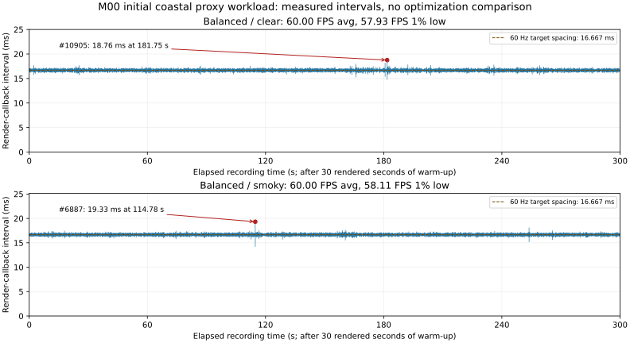

# M00 coastal release benchmark — 2026-10-22

**Status note — 2026-10-23:** historical M00-open statements below describe the capture/report checkpoint. [Foundation closeout](../reports/2026-10-23-m00-closeout.md) supersedes their scheduling; all raw results, failures and deferred qualification tasks remain unchanged.

**Initial proxy workload measured; strict 60 FPS acceptance not passed. Optimization remains deferred.** This is the first matched clear/static-fog pair for the new scene, not production S1–S6 acceptance or a before/after optimization comparison.

## Conditions and evidence

Unity 6000.6.7f1 / HDRP 17.6.0, Windows x64 Mono non-development build, Direct3D 12, **1920×1080 native**, existing **Balanced** preset, VSync=1, dynamic resolution disabled. Hardware: Intel i5-9400F, GTX 1660 SUPER, approximately 16 GiB RAM, Windows 11 build 26300, NVIDIA driver 32.0.16.1742. [Current host query with exact OS-reported memory bytes](../reports/m00-coastal-evidence/benchmarks/20261022-214410/hardware.json). The Editor was closed, builds and connection smoke finished first, and one visible benchmark client ran at a time. Ordinary desktop apps, the signed-in browser and light documentation/inspection work remained present; this was not a dedicated idle laboratory machine. No server or second client ran during either measurement.

Fixed camera: (2680, 115, 2450) m, rotation (14°, 55°, 0°), FOV 60°, far clip 12 km. Stored scene: 6 km Copernicus DSM, five 2K PBR surfaces, 640 generated trunk/canopy pairs, 24 static building proxies and a flat static sea. Smoky adds eight local volumetric fog boxes with 2500 m volumetric depth. **Zero gameplay aircraft, vehicles, actors, burning cells or networked fire entities.** [Provenance, screenshots and fixture rejection/fix](../previews/m00-coastal/COMPARISON.md).

Each fresh process warmed up for 30 seconds from its first rendered callback, then recorded at least 300 seconds of main-camera callback intervals. Screenshots were taken after five seconds, outside the measurement window. Clear ran before smoky; each ran once. Small differences are not a statistically established improvement or isolated fog cost.

[Raw clear CSV](../reports/m00-coastal-evidence/benchmarks/20261022-214410/balanced-clear.csv) · [raw smoky CSV](../reports/m00-coastal-evidence/benchmarks/20261022-214410/balanced-smoky.csv) · [recorded summaries](../reports/m00-coastal-evidence/benchmarks/20261022-214410/runs.json) · [process exits, markers and executable/managed-assembly hashes](../reports/m00-coastal-evidence/benchmarks/20261022-214410/run-summary.json) · [recomputed analysis](../reports/m00-coastal-evidence/benchmarks/20261022-214410/analysis.json).

The current binary follows the [fog-fix build/tests/smoke](../reports/2026-10-22-m00-coastal-foundation.md#verification-record). The original 720p diagnostic and an earlier clear-only run remain preserved; neither is an equivalent coastal BEFORE baseline. The first invisible-fog attempt was rejected and terminated, not counted as a smoky pass.

## Measured results

| Metric | Clear | Static fog |
|---|---:|---:|
| Samples | 18,000 | 18,001 |
| Summed interval duration (s) | 300.00757 | 300.02413 |
| Average FPS | 59.99849 | 59.99851 |
| 1% low FPS | 57.93009 | 58.11117 |
| p95 callback interval (ms) | 16.99410 | 16.98840 |
| p99 callback interval (ms) | 17.13110 | 17.11150 |
| Worst callback interval (ms) | 18.75800 | 19.32590 |
| Intervals above 20 ms / 33.333 ms | 0 / 0 | 0 / 0 |
| CPU frame p50 / p95 / p99 (ms) | 16.66660 / 16.74410 / 16.79040 | 16.66690 / 16.74290 / 16.78300 |
| CPU main p50 / p95 / p99 (ms) | 2.20220 / 2.51690 / 2.68220 | 2.31570 / 2.61370 / 2.76090 |
| GPU p50 / p95 / p99 (ms) | 6.10688 / 6.15270 / 6.29530 | 6.11738 / 6.15424 / 6.26688 |
| Draw calls p50 / p95 / p99 | 58 / 58 / 58 | 66 / 66 / 66 |
| Peak Unity allocated bytes | 513,013,546 | 512,400,548 |
| Process exit | 0 | 0 |

All five instrumented counter columns supplied positive values for every stored callback. FrameTimingManager values may refer to a preceding frame and can repeat; they are not guaranteed to align with a particular callback spike. **CPU frame includes waits**, and CPU main/GPU numbers must not be added into a serial frame total or treated as an attribution trace. Unity allocated bytes are not VRAM, process working set or GC allocation per frame.

Both p95 callback values exceed **16.67 ms**. Average FPS near 60 does not pass that gate; the scene also lacks the representative gameplay required for production acceptance. There is no measured optimization, aircraft/vegetation asset readiness, server capacity or dropped-presentation claim.

## Rendered timeline and reader guide



[PNG fallback](../reports/m00-coastal-evidence/benchmarks/20261022-214410/frame-intervals.png). The generator retains editable plotting code and checks the original summaries before drawing.

- **Horizontal ruler:** elapsed recording time in seconds, with ticks at 0, 60, 120, 180, 240 and 300. Zero is 30 seconds after the first rendered callback, not application launch. The first stored interval can straddle this threshold; its start may be slightly negative. The recorded duration is the sum of intervals, not simply the last x coordinate.
- **Vertical ruler:** milliseconds between consecutive main-camera render-completion callbacks, marked every 5 ms from 0 to 25. Higher means a longer gap. It includes scheduling/waiting as well as work; it is not a direct GPU-execution or display-loss trace.
- **Dashed brown line:** 16.667 ms, the spacing for 60 evenly timed frames per second. Tiny crossings do not establish an entire missed refresh.
- **Red point/arrow:** the longest interval in that case. `#10905` means sample 10,905, not a time or simulation tick. Points are drawn at interval ends; exact bounds are below.
- **Panels:** top is clear and bottom is the separate static-fog run, at the same scales. Neither is a zoom. These graph ticks are ruler marks, **not the dedicated server's fixed-step ticks**.

| Case | Worst sample | Start → end in recording (s) | Duration (ms) |
|---|---:|---:|---:|
| Clear | #10905 | 181.732928 → 181.751686 | 18.75800 |
| Static fog | #6887 | 114.761683 → 114.781009 | 19.32590 |

[Marked overruns CSV](../reports/m00-coastal-evidence/benchmarks/20261022-214410/marked-overruns.csv) contains only its header because no interval exceeded its explicit 20 ms threshold. Full per-callback values remain in the raw CSVs. There is no measured spatial hotspot in this fixed-camera test and no cause attribution. The [frame-loss register](FRAME_LOSS_REGISTER.md) preserves the old 83.47 ms hitch and the follow-up work.

For $N$ positive intervals $\Delta t_i$ in milliseconds, average FPS is

$$
\overline{F}=\frac{1000}{\frac{1}{N}\sum_{i=1}^{N}\Delta t_i}.
$$

The 1% low is 1000 divided by the mean of the slowest $\lceil0.01N\rceil$ intervals. Percentiles use nearest rank: sorted index $\lceil pN\rceil$ with one-based indexing. All six recorded summary fields were recomputed from raw samples and matched within $10^{-7}$ absolute / $10^{-9}$ relative tolerance.

## Reproduce and remaining gates

```powershell
# Build first, close the clean project Editor, and finish other build/test jobs.
pwsh -File scripts/Test-M00CoastalBenchmark.ps1
$env:PYTHONPATH = Join-Path $PWD 'Builds/AnalysisTools'
python scripts/analyze_coastal_benchmarks.py docs/reports/m00-coastal-evidence/benchmarks/20261022-214410
```

Python 3.14 / Matplotlib 3.11.2 generated the SVG/PNG; the analysis phase ran after both benchmark processes exited. Both release captures and the rendered chart were visually inspected. The unchanged Performant tier disables volumetrics; its smoky combination is explicitly rejected before player launch. High Fidelity/Performant clear matrices were not measured here.

- [ ] Collect VRAM/residency, GC allocation/pause, render-thread execution and triangle counters; the current release recorder does not instrument them. Missing is unavailable, not zero.
- [ ] Instrument dedicated-server tick **duration**, queue backlog and inbound/outbound transport bytes in actual server/network runs. The existing tick count proves clock progression only.
- [ ] Resolve the aircraft licence/import gate, then use actual actors/assets and later implemented gameplay for the S1–S6 matrix. Generated proxies cannot satisfy those scenarios.
- [ ] Resume FL-01–FL-05 attribution and equivalent optimization comparisons only when the deferred optimization work resumes.

M00 remains open; these measurements do not waive its outstanding gates or unlock M01.
