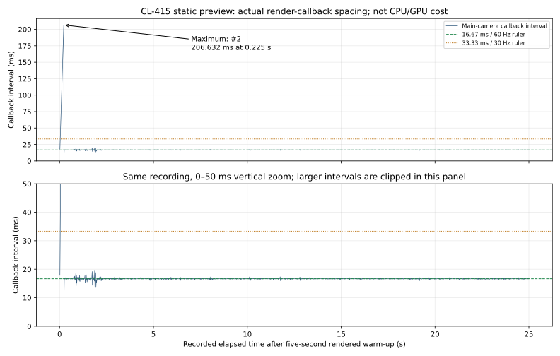
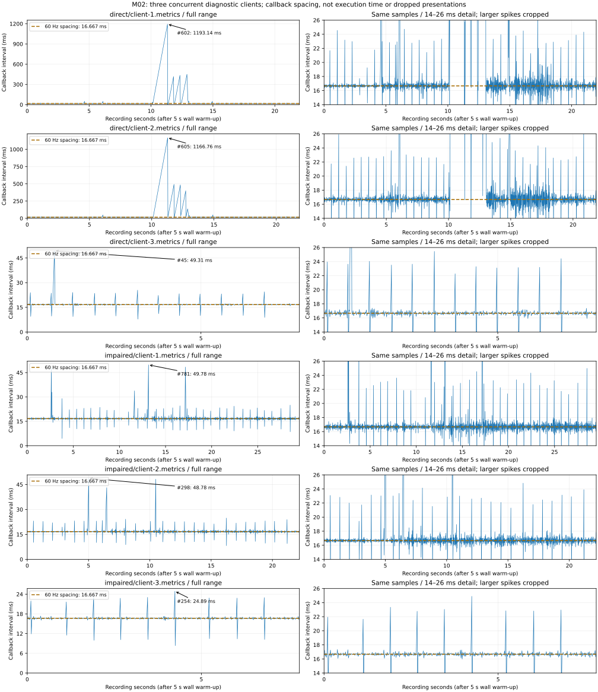
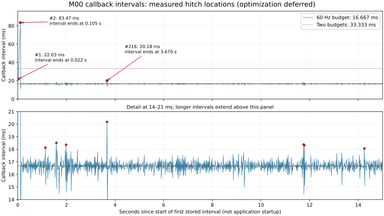
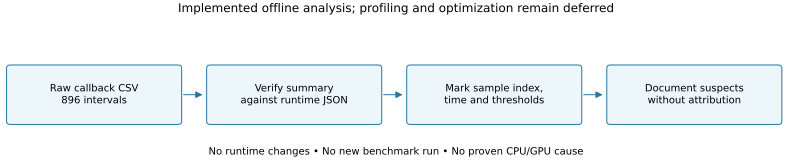

# Frame-loss investigation register

## M03 live-host catch-up observation — 2026-10-24

**HOST-01: measured headless scheduling location; attribution and optimization deferred.** This is no new rendered frame-loss result. One live debug aircraft, existing fire/wind, one dedicated and two real headless client worlds on loopback, Editor closed, i5-9400F / Windows 11 Pro 26300 / 16,324 MiB visible RAM. [Full conditions, SVGs, raw data and graph guide](../physics/live-flight-host/COMPARISON.md#measured-timing-and-graph-guide).

- Host callback **#2**, wall interval **0.0265593–0.0782569 s** after `ServerFlightSession.Start`: **51.6976 ms** spacing. Existing fractional remainder plus this gap exceeds the 40 ms accumulated-work cap; exactly **13.2569 ms** wall time is discarded. It is not silently counted as physical time. [Machine-readable exact event](../reports/m03-flight-network-evidence/verification.json), [all 835 raw callback rows](../reports/m03-flight-network-evidence/server.csv.gz).
- Stopwatch around `FlightAuthority.Advance` reaches **6.3483 ms at callback #1**; p95 **0.0633 ms**. This includes zero to eight 5 ms physical steps per call and excludes other server/network/fire/Unity/trace work. It is not a 6.3483 ms full-host tick or GPU frame. All startup callbacks retained; no warm-up removed.
- Source observation sites: `ServerFlightSession.Update` samples callback gaps and brackets `FlightAuthority.Advance`; that authority samples wind and calls contact/flight kernels. Input processing, Netcode dispatch, fire callbacks, Unity startup, proof-only CSV/JSONL buffers, JIT, GC and OS scheduling are candidate profiling sites. No synchronized timeline proves a cause or a bottleneck.
- Follow-up: reproduce with full host profiler/GC/transport timelines and diagnostic I/O off/on, keep per-step/callback clocks distinct, then qualify representative graphical flight/coast/smoke. No rendered client, presentation trace, FPS, draw-call or network-byte measurement was made. The eight-step cap is a bounded stability policy, not a measured performance optimization.

FL-06/FL-07 and NET-01 remain unresolved. This new host is installed only by explicit debug-session option; earlier isolated-contact observations below describe their original scope.

## M03 contact-call observations — 2026-10-24

The contact prerequisite is nonvisual and records **no new frame-loss measurement**. Its isolated contact Step maxima are **61.0 µs at retained call #1** and **98.9 µs at #322**, after 100 explicit warm-ups in each of two dedicated processes. [Raw data, SVG, hardware and complete graph guide](../physics/runway-contact/COMPARISON.md#measured-call-timing-and-graph-guide). These elapsed call gaps are not renderer callbacks, whole server ticks or confirmed dropped presentations. No CPU/GC/OS timeline attributes them.

Future host profiling sites: the two `RunwayContact.Evaluate` calls (current/candidate gate), `FlightDynamics.Evaluate`, `FlightDynamics.Integrate`, validation and the fixed-substep scheduler still to be installed. These are source inspection locations, not demonstrated bottlenecks. Existing FL-06/FL-07 and NET-01 remain unchanged; optimization stays deferred until representative synchronized profiling.

## M03 static aircraft callback overrun — 2026-10-24

**FL-07: measured location; attribution and optimization deferred.** One static aircraft/pad client at 1920×1080 Balanced/VSync=1 D3D11, one local headless server; Editor closed, i5-9400F / GTX 1660 SUPER / driver 32.0.16.2101. [Actual run, raw samples, SVG and graph guide](../previews/m03-cl415-prototype/COMPARISON.md#performance-diagnostic-and-graph-guide).

- Maximum: retained callback **#2**, **206.632495 ms**, start **0.017872 s**, end **0.224504 s** after the recording origin near the five-second rendered warm-up boundary.
- Recording: **1489 samples / 25.000917 s**; 744 intervals >16.667 ms, one >33.333 ms. These are measured callback overruns, **not 744 confirmed lost frames**. No presentation trace exists.
- [Every interval with exact start/end and threshold flags](../reports/m03-aircraft-evidence/callback-intervals.marked.csv), [ten largest gaps and plot scales](../reports/m03-aircraft-evidence/callback-analysis.json). Upper SVG panel uses 5 s X / 25 ms Y rulers; lower 0–50 ms zoom uses 10 ms Y rulers and clips the large spike. Neither ruler is the server's 0.2 s fire tick.
- Observation site: `ClientProbe.OnCameraRendered`. Capture/readback/PNG encoding begins around the same warm-up boundary in `ClientProbe.Capture`; shader/asset warm-up, driver activity and OS scheduling are also potential investigation locations. **No synchronized CPU/GPU/GC/capture timeline proves any cause.** 144 mesh renderers are an imported geometry count, not a draw-call measurement or demonstrated bottleneck.
- M04/M09 follow-up: reproduce with synchronized capture/event and profiler/presentation timelines, separate capture-on/off diagnostic runs, qualify representative coastal/smoky/flight scenes, then optimize only with equivalent BEFORE/AFTER measurements. Keep this raw observation and existing presets. No optimization was performed in this increment; FL-06/NET-01 remain unchanged.



## M03 numerical Step cost observations — 2026-10-24

The new debug-flight headless path records isolated function intervals, **not frame-loss evidence**. p95 is 1.700/2.000 µs across the two runs; maxima 45.700/47.900 µs occur at retained call #1 after 100 warm-ups. [All actual samples, SVG and graph reader guide](../reports/2026-10-24-m03-debug-flight.md#timing-method-measured-results-and-graph-guide). No rendered client is active in this timing diagnostic, and no causal JIT/CPU/GC trace exists. Do not count these as dropped presentations, infer client smoothness or claim an optimization.

Future profiling locations when flight is attached to the actual host: `FlightDynamics.Evaluate` (validation/forces), `FlightDynamics.Step` (inertia/rotation/candidate validation), existing wind sampling, and host scheduling/contact/network work still to be introduced. Preserve these observations; optimize later only after representative host/client timelines establish a cost. M00/M02 frame-hitch locations below and NET-01 remain unchanged.

## M02 measured callback overruns — 2026-10-23

**FL-06: measured locations; attribution/optimization deferred.** New independent M02 diagnostic; historical M00 data below are unchanged. Three concurrent 720p Balanced D3D11 release clients, late join, local headless server, optional proxy; i5-9400F / GTX 1660 SUPER, driver 32.0.16.2101, Editor closed. [Full conditions/raw CSV/SVG and graph reader guide](../reports/2026-10-23-m02-replication.md#callback-measurements-and-graph-reader-guide).

| Case / client | Samples / seconds | Average FPS | 1% low FPS | p95 / p99 (ms) | Worst sample, start–end (s), duration |
|---|---:|---:|---:|---:|---|
| direct/client-1 | 1157 / 21.985 | 52.63 | 4.19 | 19.034 / 32.578 | #602, 10.134332–11.327469, **1193.136 ms** |
| direct/client-2 | 1145 / 21.868 | 52.36 | 4.04 | 18.670 / 27.136 | #605, 10.116415–11.283178, **1166.763 ms** |
| direct/client-3 | 468 / 7.834 | 59.74 | 33.97 | 17.177 / 23.953 | #45, 0.734047–0.783360, **49.314 ms** |
| impaired/client-1 | 1760 / 29.517 | 59.63 | 33.10 | 17.541 / 23.141 | #781, 13.101187–13.150962, **49.775 ms** |
| impaired/client-2 | 1324 / 22.202 | 59.63 | 33.54 | 17.514 / 23.012 | #298, 4.968062–5.016839, **48.777 ms** |
| impaired/client-3 | 469 / 7.817 | 60.00 | 42.70 | 17.133 / 22.845 | #254, 4.216946–4.241839, **24.893 ms** |



`#602` marks a measured **1.193-second callback gap**, from recording 10.134332 to 11.327469 seconds; it does not count dropped presentations or measure pure GPU/CPU execution. Each recording has its own origin; timestamps are not aligned across client processes or server events. The first two direct clients' large gaps occur while the run includes a late client startup, but no event-timestamp/timeline evidence proves causation. The impaired case's smaller hitches do not demonstrate an optimization.

All samples have location/threshold flags in each `*.metrics.marked.csv` beside [direct](../reports/m02-evidence/direct/initial/) and [impaired](../reports/m02-evidence/impaired/initial/) evidence. [Summary and exact maximum positions](../reports/m02-evidence/performance-analysis.json). Graph x ruler ticks are 5 s; full-range y spacing differs per row, detailed panels use 2 ms ticks across 14–26 ms. Left panels retain every spike; right panels crop larger gaps. The report explains warm-up origin, statistics and the separate 0.2 s authoritative simulation tick.

Deferred investigation locations: `ServerFireReplication.Prepare` (capture/encode/compress per peer), `ClientFireReplication.Receive` (decompress/validate/patch), `FireStateView.Show` (texture/text updates), `ClientFireReplication.Rendered` (actual interval observation), and concurrent process/driver startup and OS scheduling. These are **source suspects**, not demonstrated causes. M08/M09 follow-up: capture synchronized player/host CPU/GPU/GC/presentation timelines and startup events, reproduce under equivalent hardware/workload, then optimize only with matched BEFORE/AFTER measurements. Keep presets. Do not infer a fixed hitch from this data or erase the failure.

NET-01 is separate: cold/jittered handshake startup failures are in the [M02 report](../reports/2026-10-23-m02-replication.md#failed-attempts-and-open-startup-limitation). No causal relationship to FL-06 is established.

**Status note — 2026-10-23:** historical M00-open statements below describe the capture/report checkpoint. [Foundation closeout](../reports/2026-10-23-m00-closeout.md) supersedes their scheduling; all raw results, failures and deferred qualification tasks remain unchanged.

**2026-10-22 · Locations measured; cause attribution and optimization deferred at the user's request.**

The largest recorded hitch is **83.47170 ms at sample #2**, from **0.022026 to 0.105498 seconds** relative to the start of the first stored interval. Three of 896 intervals exceed 20 ms. This report marks slow callback intervals, not confirmed dropped display frames: no presentation-loss counter, CPU timeline or GPU timestamps were captured.

## Recording and scope

This is offline analysis of the accepted M00 diagnostic already published in implementation commit `3d006ae1aecb8ba15a850d66c7a5aae96fc0c943` and indexed at checkpoint `7e11ca9`. There is **no new benchmark run or runtime change**. [Original conditions and raw artifacts](2026-10-22-m00-calibration.md): Unity 6000.6.7f1 / HDRP 17.6.0, Windows x64 Mono release client, i5-9400F / GTX 1660 SUPER, driver 32.0.16.1742, 16,323 MiB RAM, Windows 11 build 26300, 1280×720 High Fidelity, VSync=1. Two rendered clients, one headless server, the Editor and ordinary desktop applications shared the machine. The fixed-camera scene contains 26 calibration boxes and starter lighting/sky; no aircraft, fire or smoke.

The first client recorded 896 chronological main-camera completion intervals totaling 15.000975 s after approximately five rendered seconds of warm-up. The CSV contains durations only. Its reconstructed time origin is the **start of the first stored interval**, not application startup or an exact event timestamp. That first interval straddles the five-second sampling threshold; adding exactly five seconds would imply unavailable precision. There is no camera route or spatial hotspot to identify in this static scene.

## Marked timeline



[PNG fallback](m00-frame-loss/frame-interval-timeline.png) · [Every sample, reconstructed times and threshold flags](m00-frame-loss/marked-intervals.csv) · [Machine-readable analysis summary](m00-frame-loss/analysis-summary.json)

### How to read the first graph

- **Horizontal axis: elapsed recording time, in seconds.** The tick marks `0, 2, 4, …, 14` are two seconds apart. Zero means the start of the first stored interval, after roughly five seconds of rendered warm-up; it does not mean the game just launched. These graph ticks are ruler markings, **not server simulation ticks**.
- **Vertical axis: callback interval, in milliseconds.** An interval is the time gap between two consecutive main-camera render-completion callbacks. For example, 20 ms is 0.020 seconds. A taller spike means a longer gap, so the client updated its rendered view less smoothly at that moment. The gap includes rendering, waiting and scheduling; it is not a direct measurement of GPU work.
- **Dashed brown line: the 60 FPS target spacing.** Sixty evenly spaced frames each second leaves about **16.67 ms per frame**. A point near that line is near the target spacing. The dotted red line at **33.33 ms** marks twice that budget; it does not count dropped display frames.
- **Red dots and labels: the three intervals longer than 20 ms.** `#2` means the second recorded interval, not the second second of the run. Its label says **83.47 ms** because that one gap lasted about five target frame intervals. Its point is drawn at the interval's end, **0.105 s** into the recording. The table below also gives its start time; the capture does not prove which engine operation caused it.
- **Lower panel: a closer view of the same recording.** Its vertical scale spans only 14–21 ms, making smaller variations visible. It is not a second test. The two longest intervals extend above this cropped scale; the top panel shows their full height. Red dots in this detail panel mark the remaining members of the slowest nine samples.

The full recording still averages **59.73 FPS**. One large spike can make motion stutter even when that average is close to 60; this is why the report also preserves the slow intervals and 1% low. No exact number of dropped presentations can be read from these callback timings.

The following are the nine slowest intervals, listed in chronological order. CSV data-row numbering is one-based, excluding its header. Times are reconstructed from the full-precision samples; displayed values are rounded.

| Sample | Interval start (s) | Interval end (s) | Duration (ms) | Location / observation |
|---|---:|---:|---:|---|
| #1 | 0.000000 | 0.022026 | 22.02620 | Start of recording; above 20 ms |
| #2 | 0.022026 | 0.105498 | **83.47170** | Largest hitch; only interval above two 60 Hz budgets |
| #64 | 1.117308 | 1.135434 | 18.12660 | Isolated smaller overrun |
| #91 | 1.567877 | 1.586385 | 18.50830 | Isolated smaller overrun |
| #115 | 1.967366 | 1.985725 | 18.35930 | Isolated smaller overrun |
| #216 | 3.650318 | 3.670500 | **20.18150** | Third interval above 20 ms; cause unknown |
| #701 | 11.734155 | 11.752533 | 18.37810 | Near another smaller overrun at #703 |
| #703 | 11.766961 | 11.785278 | 18.31750 | #702 separates these two overruns |
| #851 | 14.233696 | 14.251761 | 18.06480 | Late smaller overrun |

| Strict threshold | Intervals exceeding it | Interpretation |
|---|---:|---|
| 16.66667 ms (60 Hz budget) | 444 / 896 | Includes tiny scheduling/VSync fluctuations around the budget |
| 18 ms | 9 / 896 | Exactly the slowest nine in this run |
| 20 ms | 3 / 896 | #1, #2 and #216 |
| 33.33333 ms (two budgets) | 1 / 896 | #2 only |
| 50 ms | 1 / 896 | #2 only |

An interval just above 16.66667 ms is not evidence of an entire missed refresh. The 83.47170 ms interval spans approximately 5.01 nominal budgets, but this does not establish how many frames the display actually dropped.

## Definitions and verification

Let $d_i$ be the numerical duration of callback interval $i$ in milliseconds, $t_i$ its reconstructed end time in seconds, and $N$ the sample count. The budget and chronological reconstruction are:

$$
B = \frac{1000}{60}\,\mathrm{ms} \approx 16.66667\,\mathrm{ms},
\qquad t_0=0,\qquad t_i=\frac{1}{1000}\sum_{j=1}^{i}d_j.
$$

Average FPS and the recorded 1% low definition use the arithmetic mean of intervals, with $d_{(j)}$ sorted from shortest to longest and $m=\lceil 0.01N\rceil$:

$$
\mathrm{FPS}_{\mathrm{avg}}=\frac{1000N}{\sum_{i=1}^{N}d_i},
\qquad
\mathrm{FPS}_{1\%}=\frac{1000m}{\sum_{j=N-m+1}^{N}d_{(j)}}.
$$

For this run $N=896$ and $m=9$. Recomputed results match all six recorded summary fields (sample count, duration, average, 1% low, p95 and p99), within relative tolerance $10^{-10}$ or absolute tolerance $10^{-9}$ in each field's unit: **59.72945 FPS average, 38.22727 FPS 1% low, p95 17.36010 ms, p99 18.06480 ms**. Percentiles use nearest rank. The script rejects invalid durations or a mismatch against the recorded JSON before writing derived evidence.

As a sensitivity check only, removing the first two intervals leaves 894 intervals averaging 60.01822 FPS, with maximum 20.18150 ms. This describes their influence; it does **not** replace the full-run result or demonstrate an optimization. No matched BEFORE benchmark exists, and representative 1080p acceptance remains open.

## Source locations to revisit later

Source links and line numbers below are pinned to the original measured implementation; subsequent benchmark instrumentation does not rewrite this historical attribution record.

| ID / priority | Observed issue and source location | Confidence / missing evidence | Deferred investigation |
|---|---|---|---|
| FL-01 · first | #1/#2 at recording start. [`ClientProbe.Capture`](https://github.com/itsmangooo/FIRELINE-ADRIATIC/blob/3d006ae1aecb8ba15a850d66c7a5aae96fc0c943/Assets/Fireline/Client/ClientProbe.cs), lines 80–94, waits for end of frame, reads back a screenshot texture, encodes PNG and writes synchronously. Capture scheduling and metrics both use the five-rendered-second threshold (lines 50–54 and 75–76). | Source path and timing threshold are confirmed. **Capture causing #2 is a hypothesis**: no timestamp aligns readback/encoding/I/O with a particular sample. | Add timestamped capture markers; compare equivalent runs with capture disabled and enabled; inspect main/render-thread and GPU timelines before changing code. |
| FL-02 · next | #216 at 3.650318–3.670500 s and the smaller overruns listed above. | Location confirmed; no CPU, GPU, GC, disk or scheduling attribution recorded. | Correlate repeated intervals with CPU/GPU counters, GC events and presentation waits. Do not assign a rendering pass or model to these samples yet. |
| FL-03 · measurement overhead | [`OnCameraRendered`](https://github.com/itsmangooo/FIRELINE-ADRIATIC/blob/3d006ae1aecb8ba15a850d66c7a5aae96fc0c943/Assets/Fireline/Client/ClientProbe.cs), lines 69–77, checks `Camera.main` and samples every callback. [`FoundationMetrics.Sample`](https://github.com/itsmangooo/FIRELINE-ADRIATIC/blob/3d006ae1aecb8ba15a850d66c7a5aae96fc0c943/Assets/Fireline/Client/FoundationMetrics.cs), lines 17–21, grows a list and queries Unity allocated memory per interval. | These operations execute in the measured path. Their cost and any list-growth/GC contribution were **not measured**. | Compare sampling configurations and record allocation/GC markers; preserve render validation while isolating instrumentation overhead. |
| FL-04 · run isolation | Two visible clients, a server, the Editor and desktop processes compete for the same machine; VSync=1. | Run conditions confirmed; CPU/GPU contention or VSync waits causing a specific hitch remain unproven. | Repeat with one rendered client, then the original two-client conditions, on the same hardware/preset; record background load and presentation timing. |
| FL-05 · cold startup | A prior rejected run produced an unready white capture during initialization; it is outside this accepted warm sample. | Startup readiness issue observed previously; no duration or pass attribution was recorded. | Profile startup separately, with first-render/capture-ready timestamps; do not mix cold initialization with steady-run FPS. |

`FoundationMetrics.Save` (lines 24–50) sorts and writes files when the smoke run ends, **after** the collected intervals. Those final CSV/JSON writes cannot explain earlier spikes in this dataset. No implemented fire, aircraft, water or terrain-streaming system exists to blame for these calibration timings. Dedicated-server tick execution time remains uninstrumented.

## Reproduction and deferred work



[PNG flowchart fallback](m00-frame-loss/analysis-flow.png). The [generator](../../scripts/analyze_frame_intervals.py) retains editable source for both vector drawings and recomputes all marked samples from the original CSV. Run from repository root with Python 3.10+:

```powershell
python scripts/analyze_frame_intervals.py
```

Core analysis uses the standard library. To reproduce the SVG/PNG drawings, install Matplotlib into the ignored tools directory (no Unity packages change):

```powershell
python -m pip install --target Builds/AnalysisTools matplotlib==3.11.2
$env:PYTHONPATH = Join-Path $PWD 'Builds/AnalysisTools'
python scripts/analyze_frame_intervals.py --plot
```

This report was generated with Python 3.14 and Matplotlib 3.11.2. The summary includes a SHA-256 of the CSV normalized to UTF-8 without BOM and LF newlines. Original CSV/JSON evidence is unchanged. Drawings were visually inspected; 141 local links across 50 Markdown files, required README sections, code/display-math delimiters and SVG XML were checked. Every derived CSV row and reconstructed time was verified; a deliberately mismatched metrics JSON was rejected. No new client/server build or unit/integration/network run is applicable to this offline report. Runtime screenshots and physics BEFORE/AFTER comparisons are not applicable because no scene, gameplay or physical model changed; the plots are data visualizations, not game captures. Asset/provenance records are unaffected.

- [x] Locate slow intervals and preserve an annotated dataset plus rendered vector timeline.
- [x] Recompute the accepted metrics and document source suspects without treating them as proven causes.
- [ ] **Deferred:** perform FL-01–FL-05 attribution runs when optimization work resumes.
- [ ] **Deferred:** choose and implement optimizations only after attribution; compare equivalent BEFORE/AFTER runs.
- [ ] Collect the representative five-minute 1080p preset matrix and missing CPU/GPU/server/bandwidth counters under [M00](../../TASKS.md).

M00 remains **In Progress**. This register does not unlock future gameplay milestones or waive performance acceptance.

## Later coastal measurements — original diagnostic preserved

The [new five-minute 1080p clear/static-fog runs](2026-10-22-m00-coastal.md) have their own raw CSVs, marked vector timeline, graph reader guide and source/binary evidence. Their longest callback gaps are:

| Case | Sample | Recording start → end (s) | Gap (ms) |
|---|---:|---:|---:|
| Clear | #10905 | 181.732928 → 181.751686 | 18.75800 |
| Static fog | #6887 | 114.761683 → 114.781009 | 19.32590 |

Neither new run has an interval above 20 ms. Their recording origin is 30 seconds after the first rendered callback, unlike the reconstructed first-interval origin of the original graph above. They used a different scene, preset, process count and warm-up. They **do not prove the original 83.47 ms hitch was fixed**. The capture/readback occurs before their 30 s recording window, and final sorting/file writes occur after sampling; neither can explain the two later interval locations. No CPU/GPU timeline attribution was performed. FL-01–FL-05 investigation/optimization remains deferred; the current CPU/GPU timing samples may lag callbacks and do not identify a cause.
