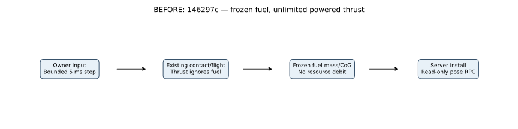
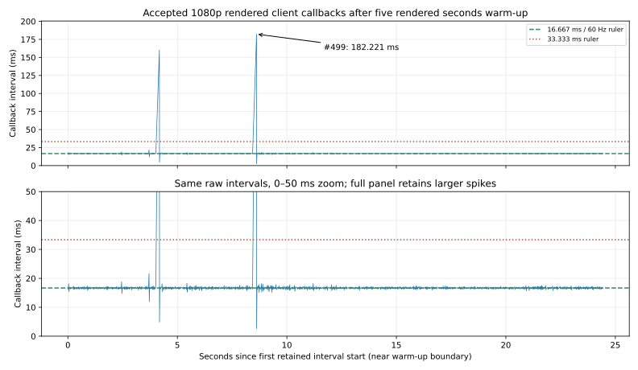

# M03 finite-fuel flight — implementation comparison

**M03 remains In Progress.** This increment installs finite-fuel propulsion in the existing generic debug aircraft. It does not calibrate a CL-415, implement refueling/startup, change the water tank, or complete takeoff/scoop/drop. [Build/runtime checks and results](../../reports/2026-10-24-m03-fuel.md), [future map/quality requirements](../../LARGE_MAP_AND_QUALITY_PLAN.md).

## Actual previous behavior

At `146297c`, the live aircraft started with **zero fuel**, but the force kernel still produced throttle-driven thrust. Its frozen fuel/water inputs could change mass in isolated test fixtures, not through an installed resource process. The existing `FlightDynamics` and `RunwayContact` functions remain unchanged for reproducible previous-version comparisons; the live host now calls `FuelFlight.Step` instead.



The old estimated thrust law was:

$$
T=40000u\frac{\rho}{1.225}\max\left(0.25,1-\frac{V_a}{150}\right)\ \mathrm{N}.
$$

Here $u\in[0,1]$ is requested throttle, $\rho$ is air density in $\mathrm{kg\,m^{-3}}$, and $V_a=\lVert\mathbf v-\mathbf w\rVert$ is airspeed in $\mathrm{m\,s^{-1}}$. **No fuel condition appeared in that law.** These constants are debug estimates, not manufacturer charts. The new adapter retains the force law but supplies fuel-limited effective throttle.

## Installed resource step


The server starts with **400 kg** fuel under `DEBUG_FUEL_V1`, with the existing 1000 kg capacity and generic dry-body profile. In each accepted $\Delta t=0.005\ \mathrm{s}$ physical step:

$$
D_n=k_f u_n\Delta t,\qquad b_n=\min(m_{f,n},D_n),\qquad m_{f,n+1}=m_{f,n}-b_n,
$$

$$
u_{\mathrm{eff},n}=\begin{cases}
u_n\dfrac{b_n}{D_n},& D_n>0,\\
0,&D_n=0.
\end{cases}
$$

$k_f=0.25\ \mathrm{kg\,s^{-1}}$ is an explicitly **estimated full-throttle burn rate**; $D_n$ is requested fuel, $b_n$ actual burned fuel, and $m_f$ remaining fuel in kg. Empty fuel produces zero thrust. The final insufficient packet produces proportional **mean throttle over that integration interval**, not a claimed substep engine cutoff time. Water remains unchanged. Zero requested throttle consumes no fuel: idle consumption, engine switches, spool dynamics, altitude-dependent flow, refueling and manufacturer calibration are absent.

The contact/flight kernel integrates using the starting mass and effective throttle, then fuel is removed. The resulting candidate is validated again before the server installs it. Invalid controls, time/density/wind/contact envelopes or final states throw before return; the caller's value state and fuel ledger remain unchanged. `FlightAuthority` exposes consumed kg as initial minus current fuel, advances only accepted steps and retains its existing eight-step catch-up cap. **Discarded wall time is not fuel-burning physical time.** Lease expiry or vacant-seat fallback requests zero throttle; this is not airborne autopilot.

## Changing CoG without moving the mesh or tire points

The inherited centerline mass approximation is:

$$
m=10000+m_f+m_w,\qquad c=\frac{-0.8m_f+1.2m_w}{m}\ \mathrm{m}.
$$

$m_w$ is water mass in kg; $c$ is body-Z CoG offset relative to the dry-body origin. The existing parallel-axis inertia calculation is reevaluated from the changed masses on the next step. Removing fuel shifts the CoG, so merely changing `FuelKg` while keeping a CoG pose unchanged would shift the physical model's fixed points. `RebaseFuel` preserves the dry-body origin and its instantaneous point velocity:

$$
\Delta\mathbf c=(c_{n+1}-c_n)\mathbf e_z,\qquad
\mathbf p_{n+1}=\widetilde{\mathbf p}+R\Delta\mathbf c,
$$

$$
\mathbf v_{n+1}=\widetilde{\mathbf v}+R\left(\boldsymbol\omega\times\Delta\mathbf c\right).
$$

$R$ is the candidate body-to-world attitude, $\boldsymbol\omega$ body angular rate in $\mathrm{rad\,s^{-1}}$, and tildes denote the accepted contact/flight result before fuel removal. $\mathbf p$ and $\mathbf v$ are world CoG position/velocity in meters and $\mathrm{m\,s^{-1}}$. For any fixed dry-body point $\mathbf a$, its position $\mathbf p+R(\mathbf a-c\mathbf e_z)$ and rotational point velocity remain continuous under the rebase. Attitude/angular rate do not change during removal; modeled departing mass takes local rigid-body velocity. Exhaust recoil, tank slosh and engine angular momentum are omitted; propeller thrust is already represented by the force law.

No client pose/fuel command is added. The existing read-only `FuelKg` snapshot field now varies; clients use the existing mass-derived visual offset. The view checker derives that offset from each recorded fuel/water state instead of assuming the historical dry body's zero CoG. It still verifies old zero-fuel archives without changing their outcomes. `FuelFlight.RebaseFuel` allows only fuel removal, not client refueling.

Source: [pure transaction/rebase](../../../Assets/Fireline/Simulation/FuelFlight.cs), [server installation and ledger](../../../Assets/Fireline/Server/FlightAuthority.cs), [actual dedicated cases](../../../Assets/Fireline/Server/FuelVerification.cs), [resource/authority unit checks](../../../Assets/Fireline/Tests/Editor/FuelFlightTests.cs), [independent raw-data checker](../../../scripts/analyze_m03_fuel.py), [editable SVG generator](../../../scripts/render_m03_fuel.py). The original [flight force/integrator](../../../Assets/Fireline/Simulation/FlightDynamics.cs) and [contact law](../../../Assets/Fireline/Simulation/RunwayContact.cs) are unchanged.

## Reproducible checks and comparison inputs

The new dedicated harness records ten four-second cases at 5 ms (one 2.5 ms convergence case), every post-step state, actual requested/burned fuel, effective throttle, force/mass/inertia telemetry and the unchanged kernel's pre-rebase state. Matched BEFORE/AFTER cases have identical initial pose/velocity/mass, throttle, calm wind, density, duration and time step. The separate live default changes from 0 to 400 kg and is not a matched mass/performance comparison. No random forcing is used in these numerical pairs; live authority still samples the existing seeded server wind.

Recorded `forces` are reevaluated at the post-step state using the just-finished interval's effective throttle; they are not an instantaneous engine cutoff trace or the earlier integration force. The last partly fueled interval can therefore end at zero fuel while retaining positive mean-throttle force telemetry. The **following** interval is unpowered. The empty-initial-tank case is unpowered in every interval.

- Full: 400 kg / throttle 1; half: 400 kg / 0.5; off: 400 kg / 0.
- Starved pair: 0.000625 kg / throttle 1; half-power first interval, zero thereafter in the new path; frozen fuel and powered thrust in the actual legacy path.
- Empty: 0 kg / throttle 1. Loaded: 400 kg fuel + 4000 kg water. Finer full step: 2.5 ms. Runway case: 400 kg, rest at Y=2.05 m on the existing synthetic rectangle.
- Legacy nine flight trajectories and lift curves must equal the prior committed actual player data. Two independent dedicated runs must exactly replay all physical resource samples.
- Independent tolerances: per-step fuel $10^{-12}$ kg; cumulative balance $10^{-8}$ kg; CoG rebase position/velocity $10^{-10}$ m / $10^{-10}\ \mathrm{m\,s^{-1}}$; mass/CoG/inertia and thrust checked from recorded states; full/finer north-position difference below 0.1 m at four seconds. These are numerical regression tolerances, not real-aircraft accuracy.


Both actual dedicated processes exited 0. All **8,800 resource samples per process** replay exactly; the nine original free-flight trajectories and lift polar remain identical to their earlier committed player data. Maximum cumulative fuel-balance error is **2.185e-11 kg**. Independently reconstructed rebase position/velocity differences are both **0** for the recorded values; the nontrivial arbitrary-attitude/angular-rate unit test also preserves all three wheel points and their velocities within $10^{-10}$. Full/finer north-position difference at four seconds is **0.005681 m**, below the 0.1 m regression gate.

| Identical-input comparison at 4 physical s | Fuel before / after (kg) | Airspeed before / after (m/s) | North position before / after (m) |
|---|---:|---:|---:|
| 400 kg initial, full throttle | 400 / 399 | 68.341169 / 68.341424 | 250.346358 / 250.346582 |
| 0.000625 kg initial, full throttle | 0.000625 / 0 | 68.609775 / 60.917479 | 250.631992 / 232.996759 |

The new half/off cases consume **0.5 / 0 kg** respectively over four seconds. With 4000 kg water, full throttle still consumes 1 kg fuel and preserves all water. Empty fuel produces no thrust in every sample. The runway case reaches **28.245423 m north / 13.806865 m/s** after four seconds under continuous full throttle; it is an accelerated numerical fixture, not a pilot takeoff result. These changes demonstrate finite-resource behavior and the same estimated force model, not calibrated real-aircraft response. [Every case and tolerance result](../../reports/m03-fuel-evidence/numerical/verification.json), [first actual raw file](../../reports/m03-fuel-evidence/numerical/run-1.json.gz), [second actual raw file](../../reports/m03-fuel-evidence/numerical/run-2.json.gz), [real process IDs/exits/hashes](../../reports/m03-fuel-evidence/numerical/process-summary.json).

Numerical graph guide: upper/lower X rulers are **one physical second** from each case's initial state; all four seconds are retained, with **no warm-up removal**. One point is one post-step numerical sample (5 ms, except the explicitly labeled finer case in raw data). Upper Y is remaining fuel in kg, **0.25 kg** ruler spacing. Middle panel zooms the starved case to 0–0.02 s with **0.005 s** X spacing and **0.25** dimensionless effective-throttle Y spacing. Its step values represent interval means beginning at the displayed left edge. Lower Y is airspeed in $\mathrm{m\,s^{-1}}$, **2 m/s** ruler spacing. There is no FPS threshold or dropped-frame meaning in this physical-time plot. All parameters are uncalibrated debug estimates.

The upper graph's old frozen-full and new throttle-off lines coincide at 400 kg; the red off line covers the blue previous line. Initial fuel/pose/velocity are explicitly in each raw case, not inferred from a screenshot.

Actual results and raw files are linked from the [verification report](../../reports/2026-10-24-m03-fuel.md); they are acceptance evidence only after the real processes and independent checker pass. Reproduction from the checkout root:

```powershell
./scripts/Test-M03Fuel.ps1 -Port 8360
python scripts/analyze_m03_fuel.py
$env:PYTHONPATH=(Join-Path $PWD Builds/AnalysisTools)
python scripts/render_m03_fuel.py
```

Use fresh `-EvidenceRoot` for subsequent captures and pass it to the analyzer; do not overwrite published process records. Matplotlib is for offline SVG rendering; all game/simulation code remains C#. [Full build/test/runtime commands](../../M03_BUILD_AND_TEST.md#finite-fuel-propulsion).

## Actual visual evidence and deferred performance

The separate [running-build captures](../../previews/m03-fuel/COMPARISON.md) retain the previous actual 1080p view and new chase/inspection captures. The scene, mesh, materials, controls/cameras/HUD and lighting configuration are unchanged. Different startup, exact commands/admission and fuel mass prevent a controlled rendering-speed comparison.



Callback graph guide: X spacing **5 recording seconds**, origin the start of the first retained main-camera callback interval near the **five rendered seconds** warm-up boundary. One sample measures time between adjacent callbacks; graph ruler ticks are not 5 ms flight steps. Dashed 16.667 ms and dotted 33.333 ms are diagnostic rulers. Full-panel Y spacing is **25 ms**, also recorded in [exact scales](callback-timing-scales.json); the lower **0–50 ms** zoom uses **10 ms** Y spacing and clips larger spikes, which remain visible and annotated above. Callback spacing is not CPU/GPU execution or proof of dropped presentations. No representative 60 FPS or optimization result is implied. Exact slow intervals and deferred source sites belong in the [frame-loss register](../../performance/FRAME_LOSS_REGISTER.md).

## Remaining limits

Fuel accounting is installed, but the generic body and constant burn rate are uncalibrated; production variant data/curves and real gear/CoG/inertia still need work. There is no refuel command, engine-start procedure, resource persistence, mass transfer for scoop/drop, general airframe collision, usable cockpit/animated controls, normal-control airborne route, predictive correction or impaired-network qualification. M03 remains open and M04/M05A are not started by this increment.
