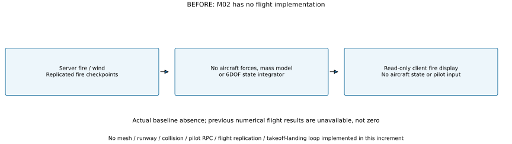
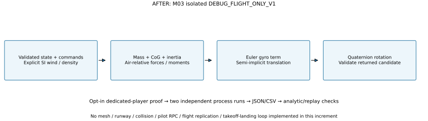

# M03 debug flight core — implementation comparison

**2026-10-24. Verified numerical/build increment; M03 remains In Progress.** Baseline `8af54d1a5eee658570a36601e04cb7f615370547`. The independent flight path is allowed by [the M03 prompt](../../../prompts/04_FLIGHT_CL415.md) while the [CL-415 source-rights gate](../../../AssetSources/Aircraft/CL415/AUDIT.md) remains unresolved. No disputed model or texture was imported.

## Previous implementation

M02 implemented server fire/wind, read-only client replicas and local checkpoints. It contained no aircraft mass model, aerodynamic force evaluation, attitude state or aircraft integrator. **Previous numerical flight results are unavailable**, not zero. The analytic references below are mathematical checks, not a fabricated previous flight implementation. **No baseline was captured** for flight imagery because no flight scene existed; this increment changes no scene, material, UI or graphical asset, so new runtime screenshots are not applicable.

## Current implementation and authority

[`FlightMath.cs`](../../../Assets/Fireline/Simulation/FlightMath.cs) provides double-precision vectors/unit quaternions. [`FlightDynamics.cs`](../../../Assets/Fireline/Simulation/FlightDynamics.cs) validates inputs, evaluates aerodynamic/gravity/thrust loads and returns one complete candidate state. [`FlightVerification.cs`](../../../Assets/Fireline/Server/FlightVerification.cs) runs these calculations only in an explicitly requested dedicated-player numerical proof. Normal server fire behavior is unchanged when the flag is absent. There is no installed live aircraft entity, pilot-ownership service, aircraft RPC or client prediction/interpolation. Normalized input checks are numerical validity checks, **not authorization**.

Both SVG drawings and numerical/performance plots are generated by [`scripts/render_m03_flight.py`](../../../scripts/render_m03_flight.py), using actual player artifacts. Reproduce from the repository root with `python scripts/render_m03_flight.py` in a Python environment containing Matplotlib. Source remains editable; exported drawings must be visually inspected before closeout.

## Frames, quantities and debug configuration

World position is the center of gravity (CoG), in meters; world velocity is m/s. Body axes are right X, up Y and forward Z. The algebra uses a right-handed cross product and body-to-world unit quaternion $R$; the later Unity model/mesh adapter must explicitly verify its axis/sign conversion. Angular velocity $\boldsymbol\omega$ is body-frame rad/s. Positive pitch input gives nose-up moment about **negative X**, positive roll lowers the right wing about **negative Z**, and positive yaw turns the nose right about **positive Y**.

Every value in `DebugFlightProfile` is **CALIBRATE / synthetic estimate**. Identifier **`DEBUG_FLIGHT_ONLY_V1`** is deliberately distinct from CL-415. These constants do not constitute the proposed production JSON aircraft/variant definition or actual CL-415 performance data.

| Quantity | Implemented debug value | Unit / status |
|---|---:|---|
| Dry mass / fuel capacity / water capacity / gross limit | 10000 / 1000 / 4000 / 16000 | kg; synthetic |
| Wing area $S$ / span $b$ / chord $c$ | 100 / 28 / 3.5 | m² / m / m; synthetic |
| Dry-body principal inertias | 50000 / 100000 / 120000 | kg m²; synthetic diagonal tensor |
| Fuel/water centerline positions $z_f,z_w$ | −0.8 / +1.2 | m from dry CoG; point-mass approximation |
| Gravity magnitude $g$ / reference density | 9.80665 / 1.225 | m/s² / kg/m³; constant environment assumptions |
| Static thrust scale | 40000 | N; estimated, not engine power or manufacturer thrust |
| Lift intercept / slope / full-flap increment | 0.2 / 4.5 / 0.4 | dimensionless / rad⁻¹ / dimensionless; estimated |
| Stall break $\alpha_s$ / decay span / floor | 14° / 0.6 rad / 0.15 | estimated coefficient shaping, not a measured stall polar |
| Base / induced / flap / gear drag coefficients | 0.035 / 0.06 / 0.08 / 0.025 | dimensionless; estimated |

Dry and loaded numerical cases use **400 kg fuel**, giving total mass 10400 and 14400 kg. No mass is consumed/released within a step or these trajectories. The solver accepts at most 20 ms per call; proofs compare 20, 10 and 5 ms steps. Ground/water contact is absent: the aircraft is a free rigid body initialized at 1000 m, with no runway or takeoff/landing claims.

## Governing logic actually implemented

The standard dynamic-pressure/lift framework follows [NASA's lift equation](https://www1.grc.nasa.gov/beginners-guide-to-aeronautics/lift-equation/). NASA explicitly notes that coefficients depend on geometry/flow and generally require experimental determination; that source does **not** validate these estimated debug coefficients. The rigid-body gyroscopic term follows the Newton–Euler form described in the [JSBSim reference manual](https://jsbsim.sourceforge.net/JSBSimReferenceManual.pdf); no JSBSim code or aircraft data was copied, and its Earth-frame/rotation model is not implemented here.

Let $\mathbf v$ be world CoG velocity and $\mathbf w$ the supplied world wind, both m/s. Relative velocity and body components are:

$$
\mathbf u=\mathbf v-\mathbf w,\qquad V=\lVert\mathbf u\rVert,\qquad \mathbf u_b=R^{-1}\mathbf u,
\qquad q=\frac{1}{2}\rho V^2.
$$

$\rho$ is kg/m³, $q$ is Pa. For nonzero speed:

$$
\alpha=\operatorname{atan2}(-u_{b,y},u_{b,z}),\qquad
\beta=\operatorname{atan2}\!\left(u_{b,x},\sqrt{u_{b,y}^2+u_{b,z}^2}\right).
$$

For zero speed, both angles are zero and aerodynamic force is zero. Write flap fraction $f\in[0,1]$, gear fraction $h\in[0,1]$, $a_c=\operatorname{clamp}(\alpha,-\alpha_s,+\alpha_s)$ and:

$$
d=\max\!\left(0.15,1-\frac{\max(0,|\alpha|-\alpha_s)}{0.6}\right),\qquad
C_L=(0.2+4.5a_c+0.4f)d\cos^2\beta.
$$

$$
C_D=0.035+0.06C_L^2+0.08f+0.025h+1.2\sin^2\alpha+0.3\sin^2\beta,
\qquad L=qSC_L,\quad D=qSC_D.
$$

For reverse flow ($u_{b,z}<0$), lift is disabled and $C_D=1$; at zero forward component lift is also disabled. These guards produce finite diagnostic behavior rather than a validated reverse-flight model. Lift direction is normalized $\mathbf u\times R\mathbf e_x$; a degenerate direction gives zero lift. Drag is opposite $\mathbf u$. Side force is $R(-0.6qS\beta,0,0)$. Thus lift is perpendicular to air-relative velocity and drag/side force dissipate air-relative kinetic power in the tested cases.

Throttle fraction $t\in[0,1]$ uses this deliberately simple, uncalibrated thrust law:

$$
T=40000t\frac{\rho}{1.225}\max\!\left(0.25,1-\frac{V}{150}\right).
$$

Thrust acts along body +Z; gravity is world $(0,-mg,0)$. There is no engine RPM, propeller efficiency, fuel burn, altitude performance chart or actuator lag. Density is an explicit input, not a derived atmosphere.

### Mass, CoG and inertia

With dry mass $m_d$, fuel $m_f$, water $m_w$, and centerline locations $z_f,z_w$:

$$
m=m_d+m_f+m_w,\qquad z_c=\frac{m_fz_f+m_wz_w}{m},
$$

$$
\Delta I=m_dz_c^2+m_f(z_f-z_c)^2+m_w(z_w-z_c)^2,
\qquad I=\operatorname{diag}(50000+\Delta I,100000+\Delta I,120000).
$$

All inertia terms are kg m². The diagonal form is exact **for this assumed centerline point-mass layout and diagonal dry tensor**, not a general off-center tank solution. The lumped aerodynamic resultant acts at the dry-body origin, giving lever moment $(0,0,-z_c)\times R^{-1}\mathbf F_a$. Thrust's centerline lever contributes zero moment. Changing mass between steps would require explicit variable-mass/momentum/resource rules; none are supplied or claimed here.

### Control/stability moments and stepping

Define $Q=qS$, $d_v=2\max(V,1)$, inputs $p,r,y$ (pitch, roll, yaw), and body angular rates $\omega_x,\omega_y,\omega_z$:

$$
M_x=-Qc\left(-0.6\alpha+0.08p+0.4\frac{\omega_xc}{d_v}\right),
$$

$$
M_y=Qb\left(0.04y+0.15\beta-0.2\frac{\omega_yb}{d_v}\right),\qquad
M_z=-Qb\left(0.05r+0.2\frac{\omega_zb}{d_v}\right).
$$

These are estimated stability/control/damping coefficients. Add the CoG lever moment to form $\boldsymbol\tau$. The full rigid-body gyroscopic term is retained:

$$
\dot{\boldsymbol\omega}=I^{-1}\left(\boldsymbol\tau-\boldsymbol\omega\times(I\boldsymbol\omega)\right),\qquad
\dot{\mathbf v}=\frac{\mathbf F_a+R(0,0,T)+(0,-mg,0)}{m}.
$$

Semi-implicit stepping evaluates forces at the old state, updates velocity/rates first, then position with the new velocity. Attitude is right-multiplied by the body-local rotation-vector quaternion for $\boldsymbol\omega_{n+1}\Delta t$ and normalized. This is first-order integration, not a high-order flight integrator. The vacuum reference has exact discrete height $y_n=y_0-\tfrac12gt(t+\Delta t)$ for zero initial vertical velocity; its continuous-position error after duration $t$ is $\tfrac12gt\Delta t$.

### Bounds and failure behavior

Inputs must be finite and in their stated intervals. External state requires a unit quaternion (squared-norm tolerance $10^{-8}$), world position magnitude ≤$10^7$ m, speed ≤500 m/s, angular-rate magnitude ≤10 rad/s, wind magnitude ≤100 m/s, density 0–1.5 kg/m³ and step $10^{-6}$–0.02 s. Tank capacities are validated. The candidate is validated before return; exceptions never mutate the caller's value-type state. These numerical guards do not replace collision, envelope protection or a server emergency policy.

## Numerical evidence and limits

Results, exact commands, built-player identities, raw lossless JSON/CSV archives, timing and verification appear in the [increment report](../../reports/2026-10-24-m03-debug-flight.md). The full Unity regression currently passes **57/57**, including nine new tests covering analytic forces/wind-frame invariance, parallel-axis mass, flap/gear/stall trends, vacuum convergence, quaternion/control signs, gyro coupling, degenerate flow, invalid inputs and proof-mode isolation.

The two trajectories for dry/loaded flight share initial position (0,1000,0) m, velocity (0,0,60) m/s, identity attitude, 400 kg fuel, density 1.225 kg/m³, half throttle, neutral controls/flaps/gear, zero wind, 5 ms step and four simulated seconds. They are **untrimmed**; descent does not establish a calibrated climb or stall-speed result. Vacuum cases differ only in step size. The actual existing `WindField`, seed 415, is also sampled in one separate headless case; its 0.2 s weather tick and capped height multiplier are preserved. That diagnostic is not live aircraft/fire synchronization.

**Graph guide:** the left panel uses angle-of-attack ruler ticks every 10 degrees, coefficient ticks every 0.5, and dotted ±14° debug stall breaks. Those are samples of the implemented estimated curve, not measured aircraft coefficients. The middle panel uses one-second simulated-time ticks and CoG height in meters; both bodies begin at 1000 m, and the legend gives their actual fixed masses. Its height ruler ticks are 15 m apart; exported scales are retained in [plot-scales.json](../../reports/m03-flight-evidence/plot-scales.json). The right panel compares integration steps in milliseconds (5 ms ruler spacing) against height error after four seconds (0.1 m ruler spacing). Dots are actual vacuum trajectories; the line is the analytic discretization error, **not previous gameplay**. These are accelerated numerical samples, not wall-clock callbacks, monitor presentations or server tick durations.

BEFORE values/differences for all flight metrics remain unavailable because there was no flight implementation. Required future M03 checks remain open: licensed aircraft/variant definition and verified axes/pivots, tuned curves/inertia/engine data, fuel consumption, real collision/runway/gear/scoop handling, server pilot ownership, flight replication/correction, client telemetry and keyboard/controller route/takeoff/landing tests with actual screenshots. Water parcels/suppression integration follow the flight prerequisites; M05A remains Pending.
