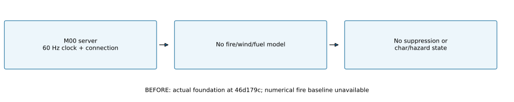
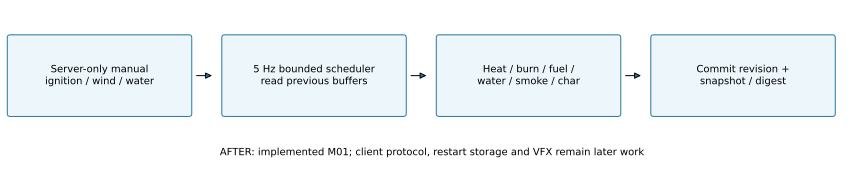

# M01 fire, wind, suppression and smoke-hazard comparison

**2026-10-23. Implemented numerical model; verification results are linked below.** This is a bounded gameplay approximation on a synthetic grid, not a scientifically calibrated wildfire forecast, production map or client fire effect.

## BEFORE — actual M00 behavior

At `46d179c`, the server had a 60 Hz monotonic scheduling clock and connection smoke checks. It had no fire cells, wind field, combustion, suppression, smoke hazard or char lifecycle. Previous burned-area, fuel, wind-response and water-coverage results are **unavailable**, not zero. No baseline was captured for a Unity fire view because no such view existed. M01 changes no rendered scene; screenshots of flames would be fabricated implementation evidence.



## AFTER — implemented authority and data



Editable source: [analysis/drawing generator](../../../scripts/analyze_m01.py). The server adapter owns the model; clients have no mutation protocol in M01. The simulation assembly has no Unity dependency. Source: [FireWorld](../../../Assets/Fireline/Simulation/FireWorld.cs), [WindField](../../../Assets/Fireline/Simulation/WindField.cs), [state/snapshot contracts](../../../Assets/Fireline/Simulation/FireState.cs), [authority boundary](../../../Assets/Fireline/Server/AuthoritativeFireService.cs), [dedicated-server adapter](../../../Assets/Fireline/Server/FireSimulationRunner.cs).

| Quantity | Definition / units |
|---|---|
| $\Delta t$ | Active step 0.2 s (5 Hz); independent of rendering and the 60 Hz foundation clock |
| $x,z,h$ | East, north, elevation in metres; horizontal velocity in m/s, no vertical gust solver |
| $L,A$ | Cell side $L=10\,\mathrm{m}$ in fixtures; area $A=L^2$ in m²; valid side 5–100 m |
| $F_0,F$ | Initial/remaining fuel loading, kg/m²; grass/brush/pine-litter coefficient 1.2/1/0.8 |
| $M,W$ | Moisture fraction $0\ldots1$; retained water loading kg/m² |
| $H,I,Q$ | Heat, fire intensity and smoke-hazard proxies in $[0,1]$, all dimensionless; not kelvin, kW/m or optical measurements |
| $d_{ij},\hat e_{ji},s_{ji}$ | Neighbor distance in metres; unit direction from source $j$ to target $i$; uphill rise/run |
| IDs/revisions | Stable `(sector, chunkX, chunkZ, cellIndex)`, monotonic world ticks/chunk/wind revisions |

### Wind and seeded variation

The server sets base east/north wind and gust amplitude, incrementing the wind revision. Direction changes take effect at the next active step for all active chunks. Each 100 m spatial block uses deterministic integer-hash samples interpolated between 20-tick epochs (4 s at 5 Hz). No global random state or frame time is used.

$$
\mathbf v_w(x,z,h,k)=\left(1+0.001\,\operatorname{clamp}(h,0,300)\right)\mathbf v_0
+G\left(2\operatorname{lerp}(\mathbf n_e,\mathbf n_{e+1},b)-1\right),
\quad e=\lfloor k/20\rfloor,\quad b=(k\bmod20)/20.
$$

$G$ is gust amplitude in m/s and each component of $\mathbf n$ is a seeded number in $[0,1]$. The height coefficient is $0.001\,\mathrm{m^{-1}}$; this multiplier is a coarse explicit approximation, not resolved orographic flow. Base components are limited to ±40 m/s and $G$ to 0–10 m/s. Spatial block edges are discontinuous; vertical wind and turbulence spectra remain future aircraft/weather work.

### Neighbor heating and spread

Each cell reads the **previous** buffers of its eight neighbors, including adjacent loaded chunks in the same sector. Missing chunks contribute no heat/smoke (closed finite domain). Let $\kappa$ be the fuel-type coefficient and $J_i\in[0.9,1.1]$ a fixed seeded cell multiplier. Before evaporation in the current step:

$$
R_{ji}=\min\!\left(2,
0.8\,\kappa\,\operatorname{clamp}(F_i/2,0,1)
\frac{(1-M_i)^2}{1+W_i}
J_i\exp\!\left[\operatorname{clamp}\!\left(0.18\,\mathbf v_w\cdot\hat e_{ji}+3s_{ji},-1.4,1.4\right)\right]\right).
$$

$R$ is the chosen gameplay spread coefficient in m/s, capped at 2 m/s. The numeric loading/velocity/water scales have implied SI units: 2 kg/m² fuel, 1 kg/m² water and 0.18 s/m wind coupling. The dimensionless slope gain is 3. These are **estimated tuning parameters**, not measured Croatian fuel properties or a full Rothermel implementation. [Rothermel's primary publication](https://research.fs.usda.gov/treesearch/32533) motivates explicit fuel/environment inputs; this smaller surrogate does not claim its equations, calibration or validity.

$$
W_i^+=\max(0,W_i-0.02\Delta t),\qquad
H_i^+=\operatorname{clamp}\!\left(H_i+\Delta t\left[\sum_j I_j\frac{R_{ji}}{d_{ij}}+S_i-0.04H_i-0.8W_i^+\right],0,1\right).
$$

Evaporation is 0.02 kg/(m²·s). $S_i=0.4(1-M_i)/(1+W_i^+)$ s⁻¹ only while burning, otherwise zero. Heat-decay coefficient is 0.04 s⁻¹ and water cooling is 0.8 m²/(kg·s). Neighbor/source intensity is from the previous buffer; evaporation precedes local heat/intensity/fuel updates. There is no resolved radiation, convection, oxygen or spotting solver.

### Combustion, vegetation and smoke

The implementation uses the **six named phases** in `SIMULATION_SPEC.md`: UNBURNED, HEATING, BURNING, SMOLDERING, EXTINGUISHED, CHARRED. The kickoff's phrase “7 burn stages” does not enumerate a seventh state; no invented phase was added.

- Unburned cells above heat 0.02 enter HEATING; at 0.8, with remaining fuel, $M<0.85$ and $W<0.75$ kg/m², they ignite. In this prototype an extinguished cell retains EXTINGUISHED while warming, then directly re-enters BURNING at that same eligibility/heat threshold; it does not emit an intermediate HEATING phase. Manual server ignition supplies heat but enforces fuel/moisture/wetness eligibility and cannot ignite fully CHARRED cells.
- BURNING intensity is $I=H/(1+W^+)$; SMOLDERING uses $0.15H/(1+W^+)$. Intensity below 0.05 or water at least 0.75 extinguishes without deleting remaining fuel.
- Fuel decrement is $\min(F,\Delta t\,b(0.2+0.8I))$, with $b=0.04$ kg/(m²·s) while burning and 0.01 while smoldering. At 15% initial fuel it smolders; zero fuel becomes CHARRED. Fuel cannot become negative or regrow.
- Vegetation IDs pack sector/chunk/index into a stable 64-bit value within declared coordinate limits. Vegetation transitions living → burning → charred; charred vegetation does not become living again. Remaining ground fuel in an extinguished cell can reignite when it dries and receives sufficient heat; its damaged vegetation stays charred.

Smoke uses the prior cell's intensity/hazard and cardinal upwind neighbors. With $u=|v_x|+|v_z|$ and $\alpha=\min(0.5,u\Delta t/L)$:

$$
Q_i^+=\operatorname{clamp}\!\left((1-\alpha)Q_i+\alpha Q_{\mathrm{upwind}}+\Delta t(0.4I_i-0.15Q_i),0,1\right).
$$

$Q_{\mathrm{upwind}}$ is the speed-weighted mean of the west/east and south/north source cells appropriate to wind signs; missing cells contribute zero. This coarse bounded hazard is not mass-conserving atmospheric smoke or particle simulation. M02 will replicate it; M04/M05A must preserve its gameplay visibility meaning across graphic presets.

### Manual server water and conservation

For mass $m$ kg and validated nonnegative hit weights $w_i$ summing to one within $10^{-9}$:

$$
D_i=\frac{m}{A_i}\frac{w_i}{\sum_j w_j},\quad
W_i\leftarrow W_i+D_i,\quad
(H_i,I_i)\leftarrow(H_i,I_i)\exp\!\left(-\frac{D_i}{0.5\,\mathrm{kg/m^2}}\right).
$$

The whole event is validated before mutation; invalid mass, weights or target cells leave the digest unchanged. Dose at least 0.75 kg/m² or cooled intensity below 0.15 extinguishes a burning/smoldering cell, setting intensity to zero while retaining fuel. Small doses reduce intensity without binary extinguishing. All applied mass is retained or explicitly evaporated; no runoff/absorption-capacity or aerial trajectory model exists. Manual events are server-only; the M01 client-water API always rejects and has no exposed network handler. This is not an authentication/anti-cheat implementation.

$$
m_{\mathrm{applied}}=\sum_i A_iW_i+m_{\mathrm{evaporated}},\qquad
m_{\mathrm{initial\ fuel}}=\sum_i A_iF_i+m_{\mathrm{consumed}}.
$$

Independent verification uses $10^{-6}$ kg absolute / $10^{-10}$ relative tolerance for final accounting. Unit cases include tighter $10^{-9}$ kg water tolerances on small fixtures.

### Bounded scheduling and state contracts

At most 16 chunks, each 4–32 cells per side, fit this prototype. At most four active chunks and one round-robin inactive chunk are advanced per world tick: maximum 5120 visited cells at side 32, capacity 16384 cells. Selected chunks read old state before any selected buffer commits, removing insertion/traversal-order feedback. Active steps are 0.2 s; inactive chunks use their full elapsed interval (at most 3.2 s with fixed membership), deliberately coarser and less accurate. Wind changes apply immediately to active chunks; inactive chunks use current wind at their next scheduled update, without historical weather reconstruction. Backlog is reported as total age since chunk updates, not a growing task queue. Adversarial/dynamic interest-membership changes need separate scheduling tests in M08; this fixture does not qualify them.

Detached versioned snapshots include wind, cells, IDs, revisions, accounting and scheduler position. Last-step cell deltas expose previous/next revision and wind revision. FNV-1a over sorted IDs and explicit IEEE-754 bits is a regression digest, **not a security signature or cross-platform determinism guarantee**. Manual command revisions can require a repaired baseline in the future protocol. M02 owns actual serialization, restart restoration, delta application, ordering and client convergence; the snapshot-store interface alone implements none of those.

## Numerical evidence and reproduction

[Dedicated-server raw JSON](../../reports/m01-evidence/simulation.json) · [raw CSV](../../reports/m01-evidence/simulation.csv) · [independent recomputation](../../reports/m01-evidence/analysis.json) · [headless replay/process hashes](../../reports/m01-evidence/headless-proof-summary.json) · [Unity tests](../../reports/m01-evidence/editmode-tests.json).

The nine cases share seed 415, 32×32 cells, 10 m cells, 2 kg/m² brush fuel, 0.1 moisture, center ignition and 600 fixed steps (120 simulated seconds), except the named variation. Calm/east/north change base wind; rotated changes east 8 m/s to north 8 m/s at 60 s; suppressed applies 14,700 kg over a 7×7 patch at 10 s (3 kg/m²); moist uses moisture 0.7; uphill uses eastward rise/run 0.2; gust adds 2 m/s seeded gusts. East-repeat repeats identical inputs. The finite boundary clips/saturates spread; this is not an unbounded rate-of-spread estimate. Numerical BEFORE deltas are unavailable because M00 had no model.


### Read the graphs

The left measurement panel shows **simulated time** in seconds, with ruler ticks every 30 s; each sample is one 0.2 s simulation step, not a rendered frame. Vertical values are m² of cells that have ignited (including extinguished/charred), marked every 20,000 m², not current flame area. The right panel shows a separate accelerated 120-step budget run, ruler ticks every 6 simulated seconds; vertical values are measured `World.Step` elapsed CPU-body milliseconds, marked every 2 ms. Its dashed line is that run's p95; the 5 Hz deadline is 200 ms, identified in the title above the plotted range, not the 16.67 ms client budget. Stopwatch duration includes OS scheduling/preemption, not just executing instructions. Neither run removes a warm-up; first-step/JIT effects are retained. Simulated time is not wall-clock run duration. No panel is a zoom of client render intervals, and graph ruler ticks are not simulation calls.

Grid panels show actual cell phases after 120 simulated seconds. Axes are metres east/north relative to the ignition center, marked every 100 m, with the same 320 m domain and legend in all panels; color codes the six phases, not temperature. These are numerical plots, **not Unity Game View screenshots** or VFX. The legend includes all possible phases even when a phase is absent from a particular final grid.

```powershell
unity command test run --caller plugin --skill unity-cli --project-path "$PWD" --mode EditMode --filter Fireline.Tests
# Build the dedicated server using the build guide, close the project Editor, then:
pwsh -File scripts/Test-M01Simulation.ps1
$env:PYTHONPATH = Join-Path $PWD 'Builds/AnalysisTools'
python scripts/analyze_m01.py
```

Tests exercise reproducibility, wind rotation, moisture/slope/fuel-class response, graded suppression/reignition, exact accounting, char irreversibility, stable cross-chunk behavior, bounded work, detached state, revision ordering, gusts, smoke transport and rejected client mutation. The headless runner executes the same model in real server processes. Timing includes the world calculation and delta creation, excluding CSV/JSON output, snapshot construction, networking and the rest of the host tick. It does not establish full-host capacity, a 100-player result or client FPS. Calibration against field/lab data, spotting/crown fire, refined thermodynamics, vertical/orographic weather, proper water breakup/runoff, physical vegetation collapse and production scenario qualification remain future work.

Linux/WSL independently replayed both processes successfully. [Cross-OS raw state and precision comparison](../../reports/m01-evidence/linux/headless-proof-summary.json) records the gust heat difference; no cross-OS bit identity is claimed. Separate perimeter/front extraction is not implemented; later overlays must derive/display the authoritative cells without claiming a stored front already exists.
