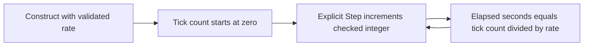

# Fixed tick clock — M00 foundation

## Previous implementation

At baseline `f93ad75`, no FIRELINE simulation clock existed. There is no numerical baseline and no previous physics model to compare.

## New implementation

[`TickClock`](../../../Assets/Fireline/Simulation/TickClock.cs) stores an unsigned 64-bit tick count and an integer rate constrained to 1–240 steps per second. Each explicit `Step()` increments the count by one using checked arithmetic. Elapsed logical time is derived rather than accumulated:

$$
n_{k+1}=n_k+1,\qquad t_k=\frac{n_k}{f},\qquad \Delta t=\frac{1}{f}.
$$

| Symbol | Meaning | Unit |
|---|---|---|
| $n_k$ | Number of explicit completed clock steps | dimensionless |
| $f$ | Configured step rate | s$^{-1}$ |
| $t_k$ | Logical elapsed simulation time | s |
| $\Delta t$ | Logical step duration | s |

The server smoke probe calls `Step()` from `FixedUpdate` with a rate of 60. The clock does not schedule catch-up work, measure wall time or supply Netcode's own tick state. It contains no combustion, wind, water or flight equations. There is no performance or physical-fidelity improvement claim.

## Why this exists

This small pure type establishes a testable Simulation assembly and explicit time units before future numerical models. Logical time derives from the count, avoiding repeated floating-point time accumulation. Engine scheduling, pause behavior and long-run real-time drift remain outside this clock's contract.

## Numerical verification

The EditMode test `ClockUsesFixedStepSecondsAndMonotonicTicks` makes 120 explicit calls at 60 s$^{-1}$ and checks tick=120 and elapsed=2 s. The zero-rate constructor is rejected. No environment or random seed affects this pure test.

| Case | BEFORE | AFTER / observed assertion |
|---|---|---|
| 120 steps at 60 s$^{-1}$ | Unavailable: no clock | 120 ticks, exactly 2 s |
| Rate=0 | Unavailable | `ArgumentOutOfRangeException` |

Evidence: [EditMode results](../../reports/m00-evidence/editmode-tests.json). Reproduce with the [M00 test command](../../M00_BUILD_AND_TEST.md). A source-dependency test also confirms the clock assembly references no Unity or Client assembly. A physical plot would add no information to these integer/rate assertions; there is no trajectory or spread field to plot.
