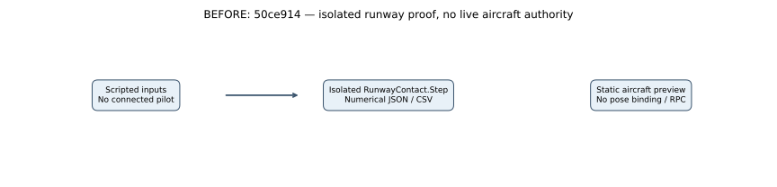
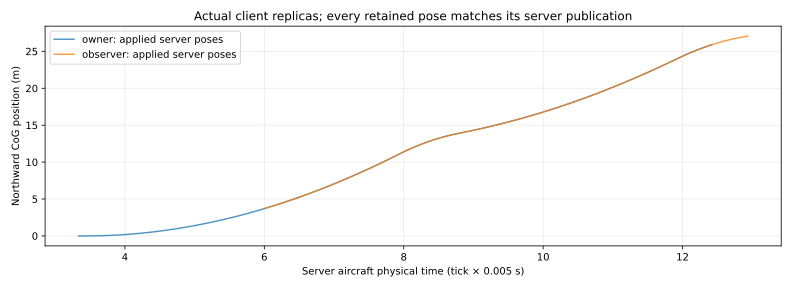

# M03 live debug-aircraft authority and bounded host

**Scope:** an opt-in single-aircraft server session and read-only network replicas. M03 remains In Progress. The temporary CL-415 mesh remains in its static preview; no graphical flight, keyboard/controller controls, prediction/correction, calibrated CL-415 handling or water gameplay is claimed.

## Actual baseline and change

Baseline `50ce91439a536678af1d39022f7a664e27b32d84` had the pure contact kernel and isolated accelerated runway proofs. Ordinary server operation advanced fire, with no live aircraft host, seat ownership, pilot commands or aircraft snapshots. **Live-host baseline measurements are unavailable because no live host existed.** The equations and numerical evidence for the unchanged [flight core](../debug-flight/COMPARISON.md) and [contact kernel](../runway-contact/COMPARISON.md) remain valid; this increment changes scheduling and authority integration.

The explicit `--fireline-flight-session debug` option now installs one `FlightAuthority` on the dedicated server. It samples the actual server `FireSimulationRunner.Authority.World.Wind` at the aircraft position and current **fire tick**, then advances the existing contact/flight solver. A complete pose is sent to each subscribed client over its actual Netcode connection. Clients validate and retain the snapshot; they never run an aircraft Step. Without the option, previous fire runtime and static preview behavior remain unchanged.

## Scheduling equations and units

Let $h=0.005\,\mathrm{s}$ be one physical aircraft step, $K=8$ the maximum steps in a Unity `Update`, $\Delta t\geq0$ its monotonic wall-clock gap, and $a$ the retained fractional remainder. Before stepping:

$$
b=a+\Delta t,\qquad d=\max(0,b-Kh),\qquad b'=\min(b,Kh).
$$

$$
n=\left\lfloor\frac{b'}{h}\right\rfloor\leq K,\qquad a'=b'-nh,\qquad T'=T+n,\qquad D'=D+d.
$$

$T$ counts completed aircraft steps; physical time is $Th$ seconds. $D$ is cumulative discarded **wall time**, not a simulated interval. The implementation includes a $10^{-12}\,\mathrm{s}$ rounding tolerance at the step boundary and clamps the residual to nonnegative. It drops excess time instead of a potentially unbounded catch-up after sleep or a stall. This is an explicit prototype slowdown policy; it does not preserve wall-time alignment during stalls.

For each substep, at position $(x,y,z)$ in meters:

$$
\mathbf{u}=\bigl(W_x(x,z,y,T_f),\ 0,\ W_z(x,z,y,T_f)\bigr),\qquad
S_{T+1}=\operatorname{RunwayStep}(S_T,c,\mathbf{u},1.225,h,\beta).
$$

$T_f$ is the **existing fire-world tick** (5 Hz nominal), $\mathbf{u}$ is wind in $\mathrm{m\,s^{-1}}$, $c$ contains normalized controls, $\beta\in[0,1]$ is wheel brake and density is the debug reference $1.225\,\mathrm{kg\,m^{-3}}$. The fire and aircraft clocks remain separate adapters; this is no synchronized production multi-rate scheduler. The aircraft keeps the same SI CoG/quaternion/contact equations and estimated constants. Fuel and water masses remain fixed; no new conservation claim is made.

## Seat, input and replication behavior

- Server transport supplies identity from `ReceiveRpcCommandRequest.SourceConnection` and its `NetworkId`. No payload identity can substitute for it. This is authorization among connected peers, **not authentication, public admission or a pilot qualification system**.
- A vacant seat can be claimed; another peer cannot claim, release or command it. Assignment and release increment the seat epoch. Commands require that epoch, a nonzero strictly increasing sequence, and an observed aircraft tick no more than 200 steps (one physical second) old and never in the future.
- All controls and brakes must be finite and in their existing normalized bounds. Accepted commands are limited to 50 Hz. Invalid commands do not consume the sequence or refresh the lease.
- An accepted command lasts 0.5 wall seconds. On expiry, release or disconnect, throttle/axes/flaps become zero, gear extends and brakes apply. This is a debug fallback, **not an airborne autopilot or safe-landing guarantee**. A solver/envelope failure freezes the last valid state, releases ownership and ends the live host with failure code 12.
- One complete version-1 aircraft snapshot, using unquantized SI doubles, is sent at most every 0.1 wall seconds per peer; only one may remain unacknowledged. Exact-tick ACK is required; no ACK for five seconds requests a disconnect. Poses contain aircraft/fire ticks, wind revision, seat/sequence, position/velocity/angular velocity, attitude and masses.
- Requests are limited to 64 processed per host callback, eight per subscribed peer; excess requests request disconnect. This debug session admits at most eight identities over its lifetime, bounding retained diagnostics as well as active peers. It is no transport-level denial-of-service guarantee: Netcode receive/deserialization and temporary query-array construction occur outside this application budget.
- Client-published poses and replies are discarded. Client snapshots require the actual server connection, version/range/unit-quaternion validity and increasing aircraft ticks/nondecreasing epoch/fire tick. Reliable stop-and-wait RPCs are a prototype; production ghosts, interpolation, prediction, corrections, congestion/interest management, reconnect and traffic qualification remain pending.

Player impact: connected clients can now observe the same live server aircraft state through the replica adapter. Only the explicit proof role scripts issue controls in this increment; no new UI or physical aircraft renderer is attached. The existing static aircraft scene and materials are unchanged. **New runtime screenshots are not applicable:** there is no visual change and the network clients deliberately use Null graphics. The [preceding actual aircraft capture](../../previews/m03-cl415-prototype/COMPARISON.md) remains the visual evidence.

## Verification and equivalent inputs

`FlightAuthorityTests` exercises actual authorization boundaries, stale/future/duplicate commands, finite/range/rate checks, lease expiry, fractional accumulation, sleep recovery, solver-envelope failure and artifact serialization. The comparison does not invent a previous live aircraft result:

| Case | Before | New implementation / independent reference |
|---|---|---|
| 40 × 5 ms steps, dry body at $(0,2.05,0)$ m, identity attitude, gear=1, throttle=1, brake=0, density=1.225; wind seed 415, base east=8/gust=2 m/s, fire tick=13 | Existing pure contact Step, called directly | Live authority matches every checked X/Z position and quaternion W exactly against direct calls with equivalent spatial wind sampling |
| 10 s callback gap, freshly accepted throttle at wall 0 s, dry initial state, zero wind | No live host; unavailable | Exactly 8 steps / 0.04 physical s; 9.96 wall s discarded; input expires; state matches eight direct neutral/braked steps exactly |
| 2 ms + 4 ms + 4 ms elapsed, zero wind | No live host; unavailable | Step counts 0, 1, 1; retained fractions produce 10 ms physical time |
| Gear-up unsupported ground impact | Kernel rejects the candidate | Host retains last valid height ≥0.5 m, freezes its physical tick and vacates the seat; later claim/Advance cannot resume it |

Source: [authority](../../../Assets/Fireline/Server/FlightAuthority.cs), [server adapter](../../../Assets/Fireline/Server/ServerFlightSession.cs), [wire schema](../../../Assets/Fireline/Shared/FlightMessages.cs), [client replica/probe](../../../Assets/Fireline/Client/ClientFlightSession.cs), [tests](../../../Assets/Fireline/Tests/Editor/FlightAuthorityTests.cs). Exact comparisons use identical operations; the discarded-time assertion tolerates $10^{-12}\,\mathrm{s}$. Unchanged physics tests retain their original tolerances.

## Actual process/build results

Final results: **89/89 tests**, successful Windows dedicated/client builds with **0 errors** (505/501 warnings), and actual dedicated/owner/observer exits **0**. **87 + 67 received poses** match the recorded server publications exactly; 134 owner inputs accepted, all scripted invalid cases rejected, two lease expirations and one owner disconnect release observed. The no-peer negative returns expected exit **12**. Server completed 2797 aircraft steps and 69 fire ticks without a physics fault. [Full counts, provenance and limits](../../reports/2026-10-24-m03-live-flight-host.md).

The linked [increment report](../../reports/2026-10-24-m03-live-flight-host.md) records completed build/process/test results and remaining dependencies. [Independent verification and event positions](../../reports/m03-flight-network-evidence/verification.json), [process/binary/hardware identities](../../reports/m03-flight-network-evidence/process-summary.json), and compressed raw JSON/JSONL/CSV live beside it. Raw Unity logs remain ignored because they can include credentials.

The real owner sends bounded controls, receives deliberate sequence/epoch/NaN/future-tick rejections, pauses long enough for lease expiry, resumes, then exits. The later observer tries to take the occupied seat, command it and publish a forged pose. The server must reject these and vacate the owner seat after disconnect. The Python checker matches **every applied client snapshot** against the publication for that identity and tick, checks late join, ownership, quaternion/mass invariants, completed-step counts, discard events and measured timing. This is two local client worlds, not a capacity or impaired-network acceptance test. Flight persistence is explicitly excluded from this debug mode; existing M02 checkpoint data does not silently gain an aircraft record.

## Measured timing and graph guide

This graph retains every host `Update` from the server aircraft adapter's `Start`. **No warm-up is removed**, so initial JIT/loading/scheduling effects remain. The horizontal ruler uses **2-second wall-time spacing** in all three panels. Each sample is one recorded callback, which may complete zero to eight physical aircraft steps. The ruler ticks are not aircraft simulation ticks or 5 Hz fire ticks.

Top: elapsed time **between host callbacks**, in milliseconds; vertical rulers are **10 ms** apart, with a 40 ms accumulated-work cap line. A cap event depends on the gap **plus the carried remainder**; the line alone is not an exact event classifier. The maximum is annotated by retained callback index and observed gap: **#2, 51.6976 ms**, ending at **0.0782569 wall s**. These gaps include all scheduling/other work between observations; they are not CPU/GPU execution or proof of dropped rendered presentations.

Middle: `Stopwatch` elapsed milliseconds around `FlightAuthority.Advance` only, including validation, wind sampling, substeps and guards; vertical rulers are **1 ms** apart. It excludes network processing, fire steps and much of the Unity host. The 5 ms dotted ruler is the **physical step interval**, not a measured CPU budget or full-host capacity threshold; a callback can contain several steps. Maximum is annotated separately: **#1, 6.3483 ms** (p95 **0.0633 ms**). No panel is a clipped/zoomed version of another.

Bottom: cumulative discarded wall seconds, with **0.0025 s (2.5 ms)** vertical ruler spacing. The single rise at callback #2 reaches **0.0132569 s**. A rise identifies exactly when the host refused excess catch-up. Raw event indices, elapsed locations and discarded increments are retained in `verification.json`. Startup is intentionally included and no attribution to JIT, GC, disk, driver or other code is claimed without synchronized profiling. These observations are also indexed in the [investigation register](../../performance/FRAME_LOSS_REGISTER.md); optimization remains deferred.

This separate graph uses **aircraft physical time** ($T\times0.005$ seconds), with **2-second horizontal / 5-meter vertical** ruler spacing, versus northward CoG position in meters. Each point is a received snapshot, at most 10 Hz and potentially less due to ACK scheduling; it is not every 200 Hz physics step. The observer begins later. Overlapping traces are expected because both retain the authoritative pose; each exact identity/tick match is verified against the server log rather than inferred from the drawing or assuming both clients sample identical ticks. No warm-up is removed, no threshold/zoom applies, and this plot is numerical network evidence, not a gameplay screenshot.

FPS, 1% low, GPU/draw calls/VRAM are not applicable to these headless players. Full CPU stages, allocations/GC, RTT, network-byte counters and representative smoke/coast/frame measurements remain unavailable in this probe. No before/after speedup, 60 FPS, 100-player or production aircraft claim follows.

## Reproduce and remaining work

Use [build/run instructions](../../M03_BUILD_AND_TEST.md#live-debug-aircraft-and-two-client-network-proof) and fresh evidence paths to preserve these recordings. Render with `python scripts/render_m03_flight_network.py` after setting the existing ignored matplotlib environment if needed. This script is the editable source for all four SVGs and PNG inspection fallbacks. Inspect arrows, labels and unclipped plots after regeneration.

Next M03 dependencies: connect test controls/cameras/telemetry and a correctly offset visual body to the authoritative state; interpolation/correction and impaired-network tests; general airframe/terrain/obstacle collision and calibrated mass/fuel controls; a takeoff/landing route and water scooping/release/dispersion/conservation/suppression proof. Current tire-only contact, approximate static friction, synthetic flat runway and debug airframe constants retain all preceding limitations. M04 and M05A do not begin here.
