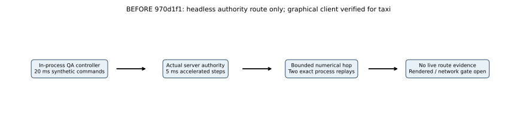
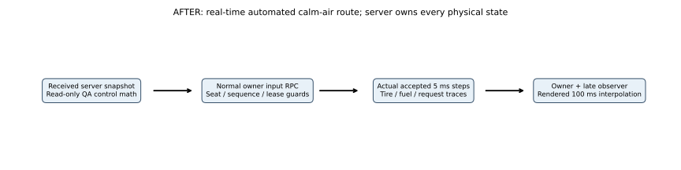

# M03 real-time QA control and physics verification — comparison

**2026-10-26; verified bounded increment, M03 open.** Baseline `970d1f1` verified an accelerated authority hop. No aerodynamic/contact/fuel law, profile coefficient or integration step changes here. The new client QA policy sends received-state requests across actual transport; manual controls remain unchanged outside the explicit proof.

The previous headless QA pilot used a 10 m height reference, phase switch at CoG Y>3 m, approach after Z>1400 m, gain 32 and exactly held 20 ms commands. No earlier real-time rendered airborne route existed; its results are unavailable, not zero. The current received-state policy uses 8 m / 2.2 m / 1200 m / gain 16 with the view's nominal 50 ms gate and real arrival/callback timing. Requests cross the existing owner/epoch/sequence/tick/range/rate/lease guards. Full-flap/gear and the underlying SI rigid body remain the same. This changes a QA control policy and observability, not calibrated aircraft behavior.

For received calm-air speed $V=\lVert\mathbf v\rVert$ (m/s), mass $m=10000+m_f+m_w$ (kg), density $\rho=1.225\ \mathrm{kg\,m^{-3}}$, gravity $g=9.80665\ \mathrm{m\,s^{-2}}$ and area $S=100\ \mathrm{m^2}$:

$$
C_L^*=\frac{mg}{\tfrac12\rho\max(V^2,100)S},\quad
\alpha^*=\frac{C_L^*-0.6}{4.5},\quad
\theta^*=\alpha^*+\operatorname{atan2}(v_y^*,\max(V,1)),
$$

$$
u_p=\operatorname{clamp}\left(7.5\alpha^*+16(\theta^*-\theta)+3\omega_x,-1,1\right).
$$

$\theta,\alpha^*$ are radians, $\omega_x$ is body X rad/s (nose-up negative); 7.5/16 have inverse-radian and 3 second-per-radian units. $u_p$ is a normalized request. The denominator floors correspond to 10 m/s and 1 m/s. Climb $v_y^*=\operatorname{clamp}(0.4(8-Y),-1,1.5)$ m/s; approach is -1 m/s. $Y,Z$ are CoG datum height/north position (m), not radar clearance. Rotation requests full pitch above 46 m/s; throttle cuts/brake latches below Y=2.1 m on approach. This approximate lift reference/control is not a measured CL-415 equilibrium or production autopilot. The controller rejects nonzero wind rather than claiming a crosswind envelope.

The server-selected live fixture uses the actual seed-415 wind field with zero components/gust, 400 kg initial fuel, no water and unchanged 5 ms accepted physical steps. Each step is independently reconciled with real accepted RPCs, tire geometry/support, finite footprint and fuel. At least five continuous physical seconds above 5 m/no wheel support, later contact and five settled seconds are required. The trusted observer receives value copies after validation/installation; it cannot replace a pose. Callback-null original behavior is independently tested and numerically replayed.

All nine original flight trajectories/polar, ten fuel cases and the 13,943-step old authority route remain exact in two fresh dedicated processes under identical original inputs/environment/dt/duration. The two new live runs use a different policy and real timing; they are separate accepted executions, not bit-identical or a matched coefficient/performance improvement. [Actual per-run numerical table, tolerances, source/request/step comparisons and raw artifact index](../../previews/m03-realtime-flight/COMPARISON.md#accepted-runs-and-independent-verification).

[Actual live physical trajectory](../../previews/m03-realtime-flight/server-route.svg), [received/displayed trajectory](../../previews/m03-realtime-flight/received-displayed.svg), [real screenshots](../../previews/m03-realtime-flight/COMPARISON.md#actual-game-view-captures-and-provenance), [every axis/ruler/origin/warm-up/interval/zoom explanation](../../previews/m03-realtime-flight/COMPARISON.md#physical-presentation-and-callback-graph-guide), [editable SVG/plot generator](../../../scripts/render_m03_realtime.py), [reproducible commands](../../M03_BUILD_AND_TEST.md#real-time-rendered-runway-route).

Sources: [received-state QA request math](../../../Assets/Fireline/Client/FlightRouteControls.cs), [normal view submission](../../../Assets/Fireline/Client/FlightTestView.cs), [server transport adapter](../../../Assets/Fireline/Server/ServerFlightSession.cs), [trusted per-step observation](../../../Assets/Fireline/Server/FlightAuthority.cs), [tire/resource evidence](../../../Assets/Fireline/Server/ServerRouteProbe.cs), [independent checker](../../../scripts/analyze_m03_realtime.py). The rejected first cleanup/payload-evidence attempt remains rejected and documented, with strict expiry retained after the fix.

Physical-controller/native-focus, impairment/crosswind/payload, full collision/calibration/rig/cockpit/animation/refueling/water and representative FPS/capacity gates remain open. Actual callback measurements do not identify CPU/GPU execution or dropped presentations; FL-11 and prior profiling work remain deferred. No milestone or acceptance requirement is waived.
