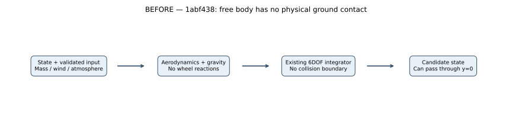
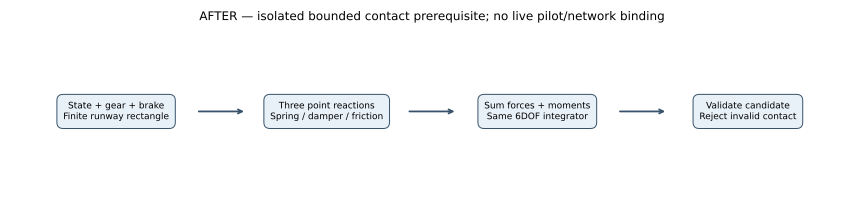
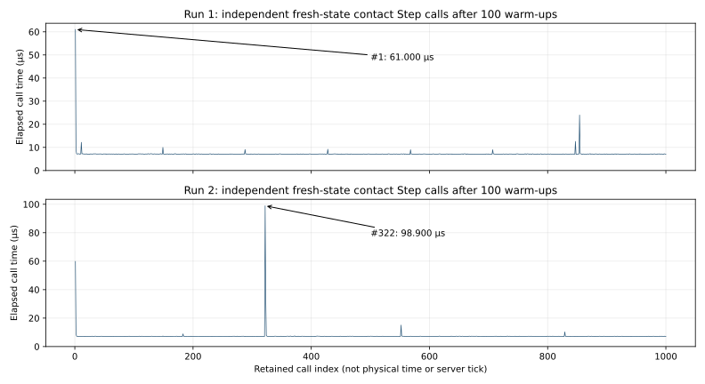

# M03 debug runway contact — implementation comparison

**2026-10-24; verified numerical prerequisite, M03 remains In Progress.** Baseline: 1abf438a2f625c4b139853ba792cd5399e042ef4. The imported aircraft remains a separate static preview; this increment adds no playable flight scene or pilot RPC. No new asset, texture, lighting, camera or interface is changed. New runtime screenshots are **not applicable**; **No baseline was captured** for moving aircraft/contact imagery because no graphical flight binding exists. The drawings and quantitative plots below are numerical evidence, not gameplay screenshots.

## Previous behavior and reason for change

[FlightDynamics.Step](../../../Assets/Fireline/Simulation/FlightDynamics.cs) previously advanced only aerodynamic, thrust and gravity loads. It had no surface reaction, wheel braking or collision boundary: a body near ground level fell through elevation zero. The imported model did not make its wheels physical. The existing free-body path remains available and unchanged.

The new [RunwayContact](../../../Assets/Fireline/Simulation/RunwayContact.cs) adapter adds explicit three-point reactions before the same 6DOF integrator. This is a prerequisite for later live server flight/contact integration. It prevents accepted states from exceeding its limited contact envelope; it does not provide general terrain/airframe collision or certify landing performance.

The BEFORE runs use the preserved free-body path in the current executable, not a rebuilt old executable. A separate actual headless regression reproduces all nine previously published free-flight cases exactly, including every recorded state and force. [Raw regression and comparison result](../../reports/m03-runway-evidence/free-flight-regression.json).

## Actual model, equations and units

Coordinates remain X right/east, Y up, Z forward/north. Position is the aircraft CoG in meters; R maps body vectors to world coordinates; angular velocity is body-relative in radians per second. Wheel points relative to the dry-body origin are (-3,-2,-3), (3,-2,-3) and (0,-2,6) m. They are **CALIBRATE estimates**, independent of the CL-415 mesh or real gear measurements.

For wheel i, subtract the existing mass model's CoG offset, then include angular motion in the contact-point velocity:

$$
\mathbf r_i=\mathbf r_i^{\mathrm{dry}}-(0,0,z_{\mathrm{CG}}),\qquad
\mathbf p_i=\mathbf x+R\mathbf r_i,\qquad
\mathbf v_i=\mathbf v+R(\boldsymbol\omega\times\mathbf r_i).
$$

The level, stationary test rectangle has height h=0 m, X in [-22.5,22.5] m and Z in [-500,2500] m. This synthetic 45×3000 m surface is not surveyed Zemunik geography and has no Unity scene mesh. Only wheel points inside that finite rectangle, at/below its height, with gear extension strictly above 0.99 receive reactions:

$$
\delta_i=\max(0,h-p_{i,y}),\qquad
N_i=\operatorname{clamp}(k\delta_i-cv_{i,y},0,N_{\max}).
$$

k=300,000 N/m, c=50,000 N·s/m, and the per-wheel load cap is 250,000 N. Normal force never attracts the wheel toward the runway. These are compliant penalty contacts: penetration estimates compression, not exact rigid-body nonpenetration.

Project each wheel's forward direction onto the horizontal plane and normalize it to obtain f; its right direction is s=n×f, with n=(0,1,0). Main wheels have zero steering; nose steering is 0.35 times the normalized rudder command, in radians. Brake b is in [0,1] on both mains; nose brake is zero. Compute longitudinal and lateral demands:

$$
d_{\ell,i}=-(800+50000b_i)(\mathbf v_i\cdot\mathbf f_i),\qquad
d_{s,i}=-20000(\mathbf v_i\cdot\mathbf s_i),
$$

$$
\mu_{\ell,i}=0.02+0.58b_i,\qquad \mu_s=0.65,\qquad
D_i=\sqrt{\left(\frac{d_{\ell,i}}{\mu_{\ell,i}}\right)^2+
          \left(\frac{d_{s,i}}{\mu_s}\right)^2},
$$

$$
a_i=\begin{cases}\min(1,N_i/D_i),&D_i>0,\\1,&D_i=0,\end{cases}\qquad
\mathbf F_{t,i}=a_i(d_{\ell,i}\mathbf f_i+d_{s,i}\mathbf s_i).
$$

The damping coefficients in the first equation are in N·s/m; friction coefficients and a are dimensionless. Zero normal load produces zero tire force. The demand normalization avoids squaring ratios divided by extremely small loads. Both directions share one anisotropic Coulomb ellipse; they do not each receive an independent full friction budget.

$$
\mathbf F_i=N_i\mathbf n+\mathbf F_{t,i},\qquad
\mathbf F_{\mathrm{ground}}=\sum_i\mathbf F_i,\qquad
\mathbf M_{\mathrm{ground}}=\sum_i\mathbf r_i\times R^{\mathsf{T}}\mathbf F_i,
$$

$$
E_{\mathrm{spring}}=\sum_i\frac12 k\delta_i^2,\qquad
P_{\mathrm{friction}}=\sum_i\mathbf F_{t,i}\cdot\mathbf v_i\leq0.
$$

Forces are N, moments N·m, spring energy J and friction power W. Ground reactions are added once to the existing [flight forces and gyroscopic 6DOF integration](../debug-flight/COMPARISON.md); aerodynamic coefficients, mass/CoG/inertia and the free-flight method are unchanged.

This contact adapter accepts steps from 1 µs through **5 ms**, independently of the existing free-flight method's 20 ms maximum. Actual tests use 5 and 2.5 ms. It validates both current and candidate states, rejects compression above **0.75 m** or contact with body-up Y below **0.5**, and rejects CoG height below h+0.5 m when the CoG is over the runway (unsupported belly impact). A rejection throws before returning any candidate; input structs remain unchanged. The force cap is a clamp, not a structural damage model.

The general spring/damper and load-proportional friction approach was researched against the primary [JSBSim reference manual, Ground Reactions](https://jsbsim.sourceforge.net/JSBSimReferenceManual.pdf). This is original project code with its own stated approximations and synthetic values, not a port of JSBSim or an aircraft configuration.

## Assumptions and remaining limits

- Flat stationary surface, three compliant tire points and fixed estimated coefficients. No wheel spin, tire deformation/contact patch, static-friction constraint solver, wet runway, slope, moving deck or mesh/terrain collision.
- Friction is regularized by velocity damping, so it allows creep. The 8 m/s crosswind case moves the body **0.439085 m sideways in 5 s**, with final lateral velocity **0.081282 m/s**; it is not a zero-drift parking model.
- No swept collision, general high-speed/wingtip/belly/obstacle response or damage. The explicit envelope rejects unsupported states; it cannot substitute for complete airframe collision. It is not an energy-conserving impact solver.
- Mass is frozen per step and conserved in these runs. Fuel burn, water release/reaction flux and configuration calibration remain open. The added brake is a separate validated scalar; existing FlightInput serialization remains unchanged.
- This adapter is exercised only in tests and an opt-in dedicated numerical harness. Normal fire runtime is unchanged; live aircraft entities, seat/pilot authorization, RPCs, prediction/interpolation, persistence, player controls and landing gameplay are **not implemented by this increment**.

## Matched numerical evidence and tests

[RunwayVerification](../../../Assets/Fireline/Server/RunwayVerification.cs) records thirteen cases, every post-step state and post-step reevaluated wheel reaction. These forces are not the earlier integration input. Two distinct Windows dedicated processes each recorded **19,800 samples**, with exact physical replay. [Process exits, hardware and executable assembly hashes](../../reports/m03-runway-evidence/process-summary.json), [independent analysis](../../reports/m03-runway-evidence/analysis.json). Physical-data SHA-256: **60f228f58c5dac98df5d51d8cf5584e3fb22dd6c27db041921e2b8ecd48c2f77**.

Unless stated otherwise: fuel 400 kg, water zero, initial identity attitude, fully extended gear, zero throttle/control rates, wind zero, density **zero** to isolate contact from aerodynamics, brake=1, time step 0.005 s. Rest begins with CoG height 2.05 m and zero speed; roll begins at height 1.85 m and forward speed 25 m/s. There is no random seed in the contact model. Crosswind uses explicit constant (8,0,0) m/s, density 1.225 kg/m³; airborne cases also use 1.225 kg/m³. No real-world landing-distance claim follows from the zero-density brake experiment.

| Case / equivalent comparison | Actual result |
|---|---|
| Previous / new rest, same first 2 s | CoG height **-17.612333250 / 1.886672655 m**; previous body passes through the absent surface |
| New rest, 10 s, 10,400 kg | Height **1.886672636 m**, maximum recorded penetration **0.119097 m** |
| New rest, 10 s, 14,400 kg (4000 kg water) | Height **1.842227290 m**, maximum penetration **0.191545 m** |
| New rest, 2.5 ms steps, same 10 s | Height differs from 5 ms result by **2.89×10⁻¹⁵ m**; maximum penetration **0.119615 m** |
| Previous no-contact roll, 10 s | Northward travel **250.000000 m**, forward speed **25 m/s**; no actual runway support |
| New coast (brake=0), 10 s | Travel **240.187713 m**, forward speed **23.038670 m/s** |
| New braking (brake=1), 10 s | Travel **88.019784 m**, forward speed below 10⁻⁶ m/s; first below 0.2 m/s at **7.005 s** |
| Touchdown: height 4 m, vertical speed -1 m/s, 8 s | Settles to **1.886672636 m**; maximum penetration **0.354273 m**, below 0.75 m envelope |
| Analytic stationary check: zero fuel/water, 10,000 kg | Height **1.891037222 m**, reactions sum to weight, moments cancel |
| Airborne previous / new, 2 s at initial 1000 m / 60 m/s | Every recorded state exactly equal; no contact forces |

Final equilibrium agreement at two steps does not establish complete transient convergence or physical calibration: maximum rest penetration differs by about **0.000518 m**. The other retained cases exercise lateral slip and crosswind creep. Fuel/water masses remain exactly unchanged. Analytic checks use:

$$
y_{\mathrm{free}}(t)=y_0+v_{y,0}t-\frac{g}{2}(t^2+\Delta t\,t),\qquad
y_{\mathrm{static}}=2-\frac{mg}{3k},
$$

with g=9.80665 m/s²; the static formula is for the symmetric, zero-fuel/zero-water body only. Its wheel moments cancel at equal loads. The more general fuel/water cases shift CoG and settle with different tire loads.

The **physical plot** uses elapsed simulation seconds from the common initial state at t=0, with no warm-up removal. Every point is a post-step sample; initial pose/velocity are in case metadata. Upper-left X ticks are **0.5 s**, Y ticks **5 m**; it compares the same first two seconds. Other X ticks are **2 s**. Upper-right Y ticks are **0.2 m**, showing the maximum wheel penetration for each body and the **0.75 m** rejection boundary. Lower-left Y ticks are **5 m/s**; lower-right ticks **50 m**. The dotted zero-height line is runway elevation. These are physical trajectories, not FPS, CPU timing or graphical frames; ruler spacing is independent of 0.005/0.0025 s integration steps. No zoom panel or removed spike is used.

**71/71 Unity EditMode tests pass**, including eleven new cases for analytic equilibrium, unchanged airborne motion, rotating contact velocity, unilateral force, dissipative/Coulomb-limited friction, steering, finite bounds/retraction, braking, dry/loaded settling and invalid/current/candidate rejection plus launch isolation. [Actual XML](../../reports/m03-runway-evidence/editmode.xml), [test source](../../../Assets/Fireline/Tests/Editor/RunwayContactTests.cs).

[Independent analyzer](../../../scripts/analyze_m03_runway.py) reconstructs contact geometry with a rotation matrix, checks each normal force/lever moment/power/friction limit, verifies mass/unit quaternion bounds and raw CSV/JSON agreement, compares the analytic cases and exact two-process physical replay. Declared absolute tolerances: force/moment/power/energy **10⁻⁶ in their respective SI units**, geometry **10⁻⁹ m**, CSV height **10⁻¹⁰ m**, equilibrium support **0.1 N**. It also allows 10⁻¹² relative decimal-roundtrip error. Raw files are losslessly gzip-compressed with their original SHA-256 recorded in the process summary: [run 1 JSON](../../reports/m03-runway-evidence/run-1.json.gz), [CSV](../../reports/m03-runway-evidence/run-1.csv.gz), [run 2 JSON](../../reports/m03-runway-evidence/run-2.json.gz), [CSV](../../reports/m03-runway-evidence/run-2.csv.gz).

The fresh Windows dedicated build succeeded: **0 errors / 505 warnings**, **152.745 s**, **141,384,135 build-summary bytes**; release Mono, Null graphics, zero cameras, no aircraft/HDRP presentation assets. [Build and complete inventory](../../reports/m03-runway-evidence/builds/). Besides the free-flight regression above, an actual legacy M01 proof passed all nine scenarios: final states, digests and physical samples exactly match published evidence, excluding elapsed step timing. [Fire regression result](../../reports/m03-runway-evidence/fire-regression.json), [raw data](../../reports/m03-runway-evidence/fire-regression.json.gz).

No fresh client/Linux build, rendered flight, M02 network test, full real-time host workload, persisted aircraft or human-controlled landing is claimed. The static aircraft's previous [build/screenshot](../../previews/m03-cl415-prototype/COMPARISON.md) remains historical and unchanged. All original configuration/package hashes and the user's sky edit are preserved.

## Measured call timing and graph guide

Two separate Mono dedicated players on **i5-9400F / Windows 11 Pro build 26300 / 16,324 MiB visible RAM** (CIM query), Editor closed and one proof process at a time. After **100 excluded warm-up calls**, record **1000** independent contact Step calls from the same fresh three-wheel-contact state: height 1.85 m, 400 kg fuel, zero water/velocity/wind, density 1.225 kg/m³, gear/brake=1, physical step 0.005 s. Percentiles use nearest-rank indexing. Timer overhead is not subtracted. A monotonic Stopwatch encloses the entire Step, including force evaluation, integration and current/candidate checks; trajectory recording and file output are outside this timer.

| Process | p50 / p95 / p99 (µs) | Maximum (µs) / retained call |
|---|---:|---:|
| Run 1 | 7.1 / 7.2 / 7.6 | **61.0 / #1** |
| Run 2 | 7.1 / 7.3 / 7.4 | **98.9 / #322** |

Each panel contains all 1000 elapsed calls for its process. X is **retained call index**, beginning at 1, with ruler ticks every **200 calls** (the zero ruler precedes the first retained call). Calls reset to the same initial state; they are not sequential flight states, seconds or server simulation ticks. Y is elapsed wall time in **microseconds**, with **10 µs** major spacing in the upper panel and **20 µs** in the lower. One microsecond is 0.001 ms. Arrows mark the actual maximum/call position; no spike is removed, no zoom panel or FPS threshold is shown. The **5 ms physical integration step is not 5 ms of measured CPU work**.

These are function elapsed observations, not complete server-tick execution or client frame intervals. No causal CPU/GC/OS timeline identifies the maxima; no allocation, GC, memory residency, network traffic or full-host timing counter was collected. Graphics/FPS/draw calls/VRAM are not applicable to Null graphics. There is no equivalent historical contact-cost baseline or optimization claim. Representative 60 FPS and dedicated-server capacity gates remain open; frame-loss observations FL-06/FL-07 are unchanged.

## Reproduce and next dependency

[Commands and proof flag](../../M03_BUILD_AND_TEST.md#runway-contact-prerequisite), [runner](../../../scripts/Test-M03Runway.ps1). Render all diagrams/plots with the linked [editable generator](../../../scripts/render_m03_runway.py) using Matplotlib. SVG and PNG exports were visually inspected for clipping, overlaps and arrow direction.

Next: install server-owned aircraft state with bounded fixed substeps/catch-up, pilot/seat authorization and network input/state validation; then bind the preview, controls/cameras/telemetry and runway/terrain collision. Full airframe/terrain collision, calibration, fuel and scoop/drop conservation stay open M03 tasks. M04/M05A are not started.
