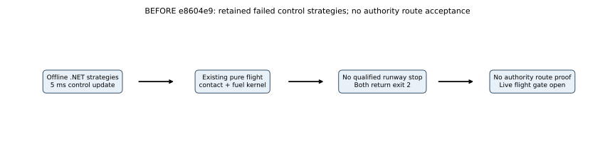
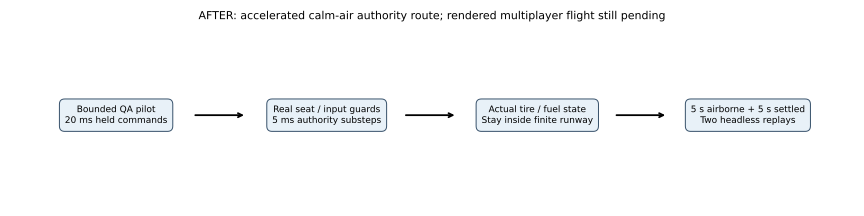
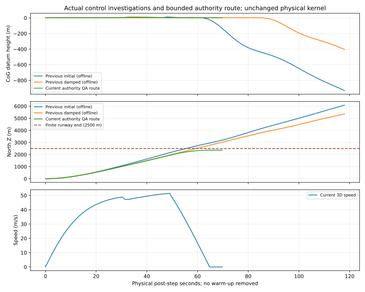
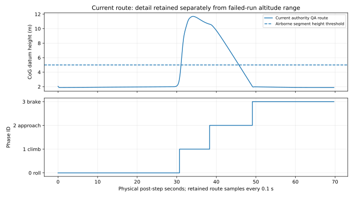

# M03 — bounded authority runway-route proof

**2026-10-26, verified numerical increment; M03 remains In Progress.** Baseline `e8604e9f1022f826f5249111ba6aaf9cc264e3fa`. The unchanged physical kernel can complete a repeatable calm-air takeoff/short approach/landing/stop with a revised QA controller. This now runs through the real server authority's seat/input/lease/fuel/contact path in an explicitly requested accelerated dedicated-player numerical proof. It is a straight northbound short hop, not a circuit or return-to-base sortie. It is not a rendered multiplayer/manual flight pass or a shipped aircraft autopilot.

## Previous behavior and reason

The [two retained offline strategies](../../reports/m03-instrument-evidence/route-investigation/) returned exit 2 without a landing/stop inside the finite runway. Their full 120-second maxima/final-north values remain 13.419045 m/6203.982300 m and 4.251864 m/5462.904011 m. No authority-controlled route evidence existed. Original row times begin at 0.005 s with 2 s spacing; no failure is erased. No earlier Unity route baseline was captured, so previous dedicated-route results are unavailable.

The early traces spent most of the runway at near-level pitch. The initial half-flap controller requested 0.8 pitch above 40 m/s; the damped full-flap strategy requested 0.15 and started airborne control at only 2.1 m. Both used a height-dependent descent target that tapered toward a low descent rate. The revised exploratory strategy uses full-flap/full-rotation above 46 m/s, attitude-error and rate feedback after CoG Y>3 m, then a fixed -1 m/s approach target after Z>1400 m. These are deliberately different control policies, not a change to aerodynamic/contact coefficients or a matched rendering-cost experiment. The retained .NET failures and new Unity route also differ in runtime and control update spacing (5 ms vs held 20 ms).

## Implemented control and authority flow

`FlightRouteVerification.Run` is called only from the existing explicit `--fireline-flight-proof` numerical path. It creates a fresh `FlightAuthority` with 400 kg fuel and a seed-415 `WindField` set to zero east/north/gust (revision 1). Claim identity 1, submit current epoch/tick/increasing sequence every **20 ms**, and advance exactly **one 5 ms** step per call. No client/entity transport, actual player identity, wall scheduling or network packets are implied by this synthetic identity. Fire tick is the harness schedule `floor(stepIndex/40)`, not a separately running live fire world. The ordinary opt-in live flight session is unchanged.

The pilot receives only accepted state. It never installs pose/velocity/attitude, creates thrust, mutates fuel or snaps contact. Each command is held over four physical steps. Phases latch **0 roll → 1 climb/hold → 2 approach → 3 throttle-cut/brake**. Roll leaves phase 0 at Y>3 m; approach starts after Z>1400 m; phase 3 starts below Y=2.1 m during approach and never restarts throttle after a bounce. These are QA command phases, not production aircraft/incident state.

Let $V=\lVert\mathbf v\rVert$ in this calm-air fixture, $m$ be actual debug mass (kg), $\rho=1.225\ \mathrm{kg\,m^{-3}}$, $g=9.80665\ \mathrm{m\,s^{-2}}$, $S=100\ \mathrm{m^2}$. For a crude full-flap reference, the QA pilot computes:

$$
C_L^*=\frac{mg}{\tfrac12\rho\max(V^2,100)S},\qquad
\alpha^*=\frac{C_L^*-0.2-0.4}{4.5},\qquad
\theta^*=\alpha^*+\operatorname{atan2}(v_y^*,\max(V,1)).
$$

Angles are radians; speed floors above are 10 m/s for the dynamic-pressure denominator and 1 m/s for the flight-path estimate. This is an approximate reference, not an exact equilibrium solver or CL-415 calibration. Positive pitch $\theta=\arcsin((R\mathbf e_z)_y)$ is nose up. Body angular rate $\omega_x$ is rad/s; nose-up rate is negative X. During airborne control:

$$
u_p=\operatorname{clamp}\left(7.5\alpha^*+32(\theta^*-\theta)+3\omega_x,-1,1\right).
$$

Gains 7.5 and 32 have inverse-radian units and 3 has seconds-per-radian units for a dimensionless command. Before rotation $u_p=0$; phase-0 speed>46 m/s gives $u_p=1$. Climb target is $v_y^*=\operatorname{clamp}(0.4(10-Y),-1,2)$ m/s, with 0.4 s⁻¹ height gain. Approach target is **-1 m/s**, not an asymptotic height hold. Gear/full flaps remain 1; throttle is 1 until phase 3, then 0; wheel brake is 0 until phase 3, then 1. No roll/yaw commands in the calm symmetric case. CoG Y uses the scene datum, not radar altitude.

The existing force/mass/contact/fuel algorithms, debug profiles, `FlightAuthority`, Simulation sources, scene/model and v2 wire schema are unchanged. Under identical inputs all nine previous flight trajectories/polar and all ten fuel cases exactly match the previous dedicated evidence. The changed control strategy is separately measured here; no flight-coefficient improvement or calibration is claimed.

## Actual gates and independent results

Every accepted post-step observation records full state, held input/brake, QA phase, authority/fire ticks and actual contact count/compression. Every tire coordinate must remain inside the original **X ±22.5 m, Z -500…2500 m** rectangle, even while airborne. Faults, rejected commands, expiry, discarded time, footprint departure or the 120-second physical deadline fail closed. Acceptance requires a continuous **five seconds above CoG Y=5 m with zero supported wheels**, subsequent approach contact on at least two tires, then **five seconds with all three supported, speed<0.2 m/s and |vertical speed|<0.1 m/s**. No artificial ground projection or state reset supplies a pass.

13,943 accepted 5 ms substeps, 3,486 guarded commands, 69.715 physical seconds. Two actual headless Unity processes exit 0 and serialize **exactly identical route data**. max CoG height **11.702127 m**, continuous above-5-m/no-wheel-support segment **14.620 s**, settled period **5.005 s**, final north **2363.927837 m**, final speed **0.000000 m/s**, fuel consumed **12.260000 kg**. Minimum tire-to-footprint-edge margin **19.500000 m**; first post-airborne two-wheel touchdown **49.170 s**. All route state and inputs are retained, rather than just a success flag.

The independent Python checker recomputes all commands at their exact update schedule, unit-quaternion tire offsets, point velocities, spring/damper supported-wheel counts, compression, footprint bounds, fuel debit and continuous flight/settle durations. Command difference tolerance 1e-10; fuel per-step 1e-12 kg; tire compression 1e-9 m; accumulated fuel 1e-7 kg; quaternion norm 1e-8; replay is exact serialized equality. It also rejects deliberate **command/fuel/contact/early-stop/footprint** corruptions. This validates the evidence/route gates independently; it is not a second full force integrator.

**113/113 EditMode + 3/3 PlayMode tests passed**; three new route tests cover zero-speed/invalid state, phase latching and actual accepted authority route. Fresh Windows server build: **0 errors / 510 warnings**, 770.491 s, 141,571,724 bytes; no visual assets. Existing client binary is unchanged and no fresh client/render/network acceptance is claimed. [Actual build/test/replay/raw records](../../reports/2026-10-26-m03-authority-route.md#verification-artifacts), [commands](../../M03_BUILD_AND_TEST.md#bounded-authority-runway-route).

## Recorded trajectories and graph guide

Comparison X is physical post-step seconds, ruler spacing **20 s**, origin simulation start (first sample 0.005 s), no warm-up removal. Previous lines use retained **2 s** rows through 118.005 s; the current line uses every twentieth recorded 5 ms row (**0.1 s** display sampling) plus its final row and ends when acceptance is met; it is not extrapolated to 120 s. All current **5 ms** rows remain in the raw archive. Lines connect recorded data, not predicted states. Top Y is CoG datum height **m**, ruler spacing **200 m**, retaining the old below-datum failure outside the finite floor; middle is north position **m**, spacing **1000 m**, dashed line marks the real **2500 m runway end**. Bottom is current 3D speed **m/s**, spacing **10 m/s**. Old speed is omitted for clarity, not treated as zero. No panel depicts FPS, CPU/GPU work or presentation loss; different control policies/runtime/update rates preclude a coefficient or cost attribution.

Detail X uses the same physical origin, ruler labels **10 s** apart; top Y is CoG height **m**, labels **2 m** apart, dashed **5 m** height gate. Lower Y uses discrete phase IDs 0/1/2/3, named roll/climb/approach/brake, not seconds. A 0.1 s plotting interval, a 5 ms aircraft substep, a 20 ms held input and a graph ruler tick are different quantities. No warm-up, FPS threshold, callback time or profiler zoom is encoded. This detail plot expands the current-route altitude scale; the full comparison above retains the entire old failure range.

All four self-contained SVGs have [editable generation source](../../../scripts/render_m03_route.py) and PNG fallbacks inspected for label/arrow clipping. Quantitative input is immutable actual player data; no new scene/UI/visual system exists, so new Game View screenshots are **not applicable**. The [last actual instrument captures](../../previews/m03-flight-instruments/COMPARISON.md) remain the graphical baseline; numerical plots are not gameplay screenshots.

## Limits and next task

This is an accelerated **single calm symmetric debug authority route**, not real-time input transport, manual piloting, gust/crosswind/payload range, rollout obstacle/terrain collision, calibrated CL-415, animated gear/propellers/cockpit, water/scoop/drop/shared suppression, Linux/WAN/capacity or representative performance. The flat finite tire-only envelope and estimated model remain. The QA controller is unavailable as a normal gameplay autopilot.

No frame callbacks run in this headless proof; FPS/1% lows, CPU/GPU frames, draw calls, VRAM, bandwidth and real-time server-tick timing are unavailable/not applicable. The existing old micro-timing array still times the old force call only, not this whole route; it cannot establish route throughput or a speedup. **FL-10/HOST-01/NET-01 and optimization remain deferred**. Next M03 task is repeatable **real-time rendered owner/observer takeoff/landing through normal network controls**, then impaired-network/crosswind cases and collision/calibration/animation before the water-operations gates. M03 remains open and M04/M05A remain Pending.
