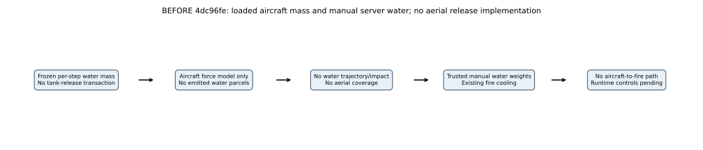
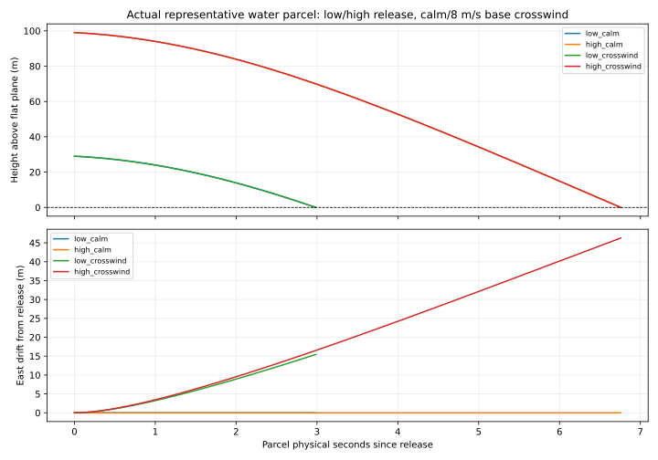
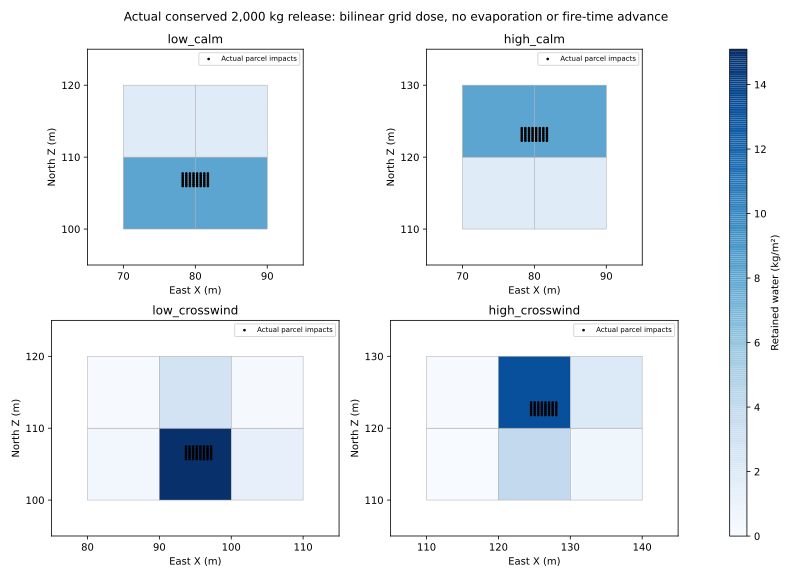
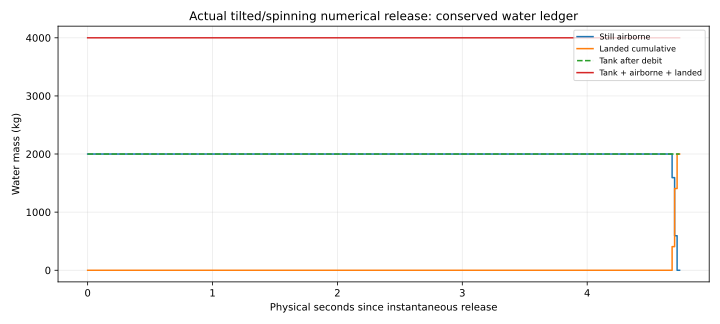

# M03 water parcels — implementation comparison

**2026-10-26; verified numerical prerequisite, M03 remains In Progress.** Baseline `4dc96fec9074ab600963ef615cd595866a0c789d` has real dry runway flight and generic water payload mass/inertia, but no aircraft release, water parcels or impact raster. It has a separate trusted `FireWorld.ApplyWater` method supplied with manual weights. Prior aerial-release results are **unavailable because no implementation existed**; no zero-valued baseline is invented.

The new pure C# `WaterDrop` creates a complete **candidate** tank debit and 32–512 representative parcels (default 64), simulates a point-mass drop and rasterizes landed mass into existing fire-cell weights. The opt-in dedicated `--fireline-flight-proof` fixture runs the complete chain and applies its actual coverage to a synthetic burning grid. No live `FlightAuthority` tank is changed: seat-authorized release controls, event/parcel scheduling, continuous door flow, scoop/refill, actual terrain/water and cosmetic VFX remain open. The numerical harness is the implemented server consumer in this increment.

## Release, mass and coordinates

East/right X, up Y, north/forward Z are meters; velocities m/s, body angular rates rad/s, water/fuel kg. The unchanged generic dry mass is 10,000 kg, fuel is centered at body Z=-0.8 m and water at +1.2 m. For fuel $m_f$, tank water $m_w$ and released mass $M$:

$$
c(m_f,m_w)=\frac{-0.8m_f+1.2m_w}{10000+m_f+m_w},\qquad
\Delta c=c(m_f,m_w-M)-c(m_f,m_w).
$$

With body-to-world unit rotation $R$, old CoG position/velocity $\mathbf p_a,\mathbf v_a$ and body angular rate $\boldsymbol\omega$, the candidate rebases its CoG without moving the dry-body origin or changing instantaneous rigid-body point velocities:

$$
\mathbf p_a'=\mathbf p_a+R(0,0,\Delta c),\qquad
\mathbf v_a'=\mathbf v_a+R\left[\boldsymbol\omega\times(0,0,\Delta c)\right].
$$

Fuel, attitude and angular rate remain unchanged. An estimated **4 m × 2 m** horizontal body patch is centered at body $(0,-1,1)$ m. Equal-area parcel centers span the patch, with CoG-relative offsets $\mathbf r_i$. Release uses the old state, including rotation-induced point velocity and estimated 2 m/s body-down exit speed:

$$
\mathbf p_i=\mathbf p_a+R\mathbf r_i,\qquad
\mathbf v_i=\mathbf v_a+R\left[\boldsymbol\omega\times\mathbf r_i+(0,-2,0)\right],\qquad
m_i=\frac{M}{N}.
$$

The last parcel receives the residual after preceding masses, so rounding cannot create an unaccounted tank remainder. The complete candidate is returned only after tank/aircraft/parcel validation; value-type caller state is never mutated on failure. Ground-intersecting apertures, nonfinite inputs, over-tank requests and unbounded counts are rejected. These geometry/rate/drag estimates are **DEBUG_WATER_PARCELS_V1**, not a calibrated CL-415 door arrangement. This is an instantaneous slug, not an emptying curve. Exit recoil, intake momentum and redistribution of angular momentum are not modeled; geometry preservation is not a claim of a complete variable-mass momentum model.

## Drag and impact

For parcel world velocity $\mathbf v$, supplied server wind $\mathbf w$, gravity $g=9.80665\ \mathrm{m\,s^{-2}}$, air density $\rho=1.225\ \mathrm{kg\,m^{-3}}$ and estimated effective drag area per mass $\kappa=C_DA/m=0.04\ \mathrm{m^2\,kg^{-1}}$:

$$
\mathbf a=(0,-g,0)+\frac12\rho\kappa\lVert\mathbf w-\mathbf v\rVert(\mathbf w-\mathbf v),
$$

$$
\mathbf v'=\mathbf v+\mathbf a\Delta t,\qquad
\mathbf p'=\mathbf p+\mathbf v'\Delta t.
$$

The kernel accepts 1 µs–20 ms steps; cases use **10 ms**, with a matched **5 ms** convergence case. Parcels are representative masses with common effective drag, not individually resolved physical droplets. If the segment crosses horizontal $y_g$, its first intersection is retained:

$$
f=\frac{p_y-y_g}{p_y-p_y'},\qquad
\mathbf p_{hit}=\mathbf p+f(\mathbf p'-\mathbf p),\qquad
t_{hit}=t+f\Delta t.
$$

Velocity is linearly interpolated over the same fraction. This is a segment-plane approximation of the integrated path; it is not a vertical ground ray. Impact fixes Y exactly at the plane and latches the parcel; later valid steps return it unchanged. No evaporation, turbulent dispersion, sheet breakup, slope/obstacle/sea-surface collision, splash or wetting loss occurs.

The dedicated numerical fixture creates a seed-415 **M01 `WindField` instance**, with zero gust and base east wind 0 or 8 m/s. Its existing height multiplier is retained: $1+0.001\operatorname{clamp}(Y,0,300)$. Thus “8 m/s” denotes base wind; the sample starts slightly faster aloft. The fixture advances its supplied weather tick from physical step time at 0.2 s intervals. This is not a live aircraft/fire scheduling integration. Its separate synthetic `FireWorld` is not time-stepped during the fall; coverage is applied once after all parcels land, isolating spatial mass/cooling tests from fire evolution.

## Coverage and existing graded fire response

For a square fire-cell width $s$, locate the impact relative to cell centers with $q_x=x/s-1/2$, $q_z=z/s-1/2$. Let $i=\lfloor q_x\rfloor$, $j=\lfloor q_z\rfloor$, $u=q_x-i$, $v=q_z-j$. One parcel contributes weights:

$$
(w_{00},w_{10},w_{01},w_{11})=((1-u)(1-v),u(1-v),(1-u)v,uv).
$$

Its mass is split, not multiplied, across those cells; global negative coordinates use floor division into signed chunk coordinates. Cell masses are aggregated in sorted chunk/cell order, then normalized into the existing `WaterHit` API. Unknown/unloaded destinations are not clipped and renormalized; `FireWorld.ApplyWater` rejects the whole invalid footprint before changing cells. Coverage preserves total mass and its cell-center centroid.

For accumulated cell mass $M_c$, dose is $D_c=M_c/s^2$ kg/m². Existing unchanged fire rules multiply heat/intensity by $e^{-D_c/0.5}$ and extinguish burning/smoldering cells when retained dose is at least 0.75 kg/m² or resulting intensity falls below 0.15. The fixture uses a 32×32 grid, 10 m cells, one active chunk, fuel 2 kg/m²/moisture 0.1, all cells ignited initially. Actual affected before/after cells, retained mass and unchanged remaining fuel are recorded. No binary raycast deletes fire and no score/incident/persistence event is created.

## Actual cases and independent verification

Each case starts with 4,000 kg tank water, 400 kg fuel, CoG X=80/Z=40 m and 60 m/s north velocity. It releases 2,000 kg in 64 parcels, leaving 2,000 kg in the candidate tank. Low/high CoG Y are 30/100 m; parcel Y starts 1 m lower for level attitude. Tilted/spinning uses CoG Y=60 m, rotation vector (0.05,0.1,0.08) rad and angular rate (0.1,0.2,0.1) rad/s. Vacuum sets air density to zero. All final impacts and every accepted first-parcel step/wind sample are retained; other trajectories are independently reconstructed from all 64 initial states and compared at impact.

| Case | Last impact (s) | Mass centroid east X (m) | Mass centroid north Z (m) | Affected cells | Retained fire water (kg) |
|---|---:|---:|---:|---:|---:|
| low_calm | 2.982732 | 80.000000 | 106.847527 | 4 | 2000.000000000 |
| high_calm | 6.755274 | 80.000000 | 123.154241 | 4 | 2000.000000000 |
| low_crosswind | 2.985136 | 95.449919 | 106.566563 | 6 | 2000.000000000 |
| high_crosswind | 6.758032 | 126.293166 | 122.695769 | 6 | 2000.000000000 |
| fine_high_crosswind | 6.763407 | 126.285684 | 123.069377 | 6 | 2000.000000000 |
| tilted_spinning | 4.716545 | 109.192350 | 117.128739 | 4 | 2000.000000000 |
| vacuum | 2.231957 | 80.000000 | 174.606328 | 6 | 2000.000000000 |

Both actual dedicated processes exit 0 and produce **identical seven-case water data**. Each case conserves 2,000 kg through parcels/coverage/fire and balances the original 4,000 kg against candidate tank + released mass. Maximum recorded tank-to-grid error is **4.55×10⁻¹³ kg**. The independent Python checker reconstructs release/CoG/point velocity, M01 wind samples, every parcel trajectory, fractional impact, bilinear cells, cell-center centroid and actual fire equations. Position/velocity tolerances are 1e-8 m / m/s; clocks/wind/mass and weights use 1e-10 where applicable, weight sum 1e-12 and total retained mass 1e-8 kg. All outputs must be finite. Five deliberate corruptions (tank, launch, wind, impact and coverage) are rejected.

Halving the matched high-crosswind step from 10 to 5 ms changes its centroid by **0.373682 m** (predeclared <0.5 m gate). This finite-step error remains; no sub-centimeter or calibrated footprint claim follows. High vs low increases drift/time in this model, but no height-dependent sheet breakup/dispersion law is implemented. Prior airborne-release results remain unavailable, so no before/after accuracy or speedup is claimed. Under equivalent original inputs, all nine existing flight cases/polar, ten fuel cases and the 13,943-step authority route remain exactly unchanged in two fresh processes.

The vacuum case also checks the continuous ballistic solution independently of the numerical update. With initial parcel height $y_0$, vertical speed $v_{y0}$ and north speed $v_{z0}$:

$$
t_* = \frac{v_{y0}+\sqrt{v_{y0}^2+2g(y_0-y_g)}}{g},\qquad z_*=z_0+v_{z0}t_*.
$$

The actual 10 ms semi-implicit case differs by **0.004580305 s / 0.274818313 m**, within its one-step-time / 0.6 m north gates. This exposes the first-order integration error rather than treating agreement between two implementations of the same update as an exact analytic trajectory.

**128 EditMode + 3 PlayMode tests pass.** The server build succeeds with 0 errors / 506 warnings and no detected visual assets. Human comments cover **62 C# files / 479 members**. Unit checks include release rollback/rebase/inherited motion, vacuum segment intersection, crosswind, idempotent impact, negative seams, bilinear mass/graded suppression and unknown-cell atomic rejection. The Editor was already open: live CLI tests were used, with asynchronous PlayMode polling. The initial batch test request was refused (Editor already open); the first synchronous PlayMode request ran zero tests and is not a pass. The actual later async result passes all three tests. Client binaries are not rebuilt by this headless-only increment; the prior rendered-flight evidence retains its original revision.

## Rendered numerical graphs and reader guide

Trajectory X is parcel physical seconds from release, ruler spacing 1 s. Upper Y is height above the horizontal ground plane in m, rulers 20 m; dashed zero is the plane. Lower Y is east displacement from release in m, rulers 5 m. Every actual first-parcel accepted step is plotted, normally 10 ms apart with a fractional final impact step. Near-overlapping height curves and overlapping zero-drift calm curves are expected. No warm-up is removed. These are physical clocks, not CPU/GPU durations, camera callback spacing or graph ruler ticks standing for simulation ticks.

Footprint X/Z axes are east/north meters, rulers 10 m, equal physical scale within each panel. Black dots are the actual 64 impacts. Colored squares are the actual 10×10 m fire cells after bilinear application, with one shared kg/m² color scale (2 kg/m² ruler spacing). Panel windows follow their own footprints; read world coordinates rather than comparing pixel positions. Color is retained dose, not particle appearance or an actual water-VFX screenshot. No smoothing, evaporation, later fire evolution or hidden terrain surface is shown; bilinear grid filtering broadens the affected area beyond the 4×2 m source patch.

Mass X is physical seconds from the tilted/spinning instantaneous release, rulers 1 s; Y is kg, rulers 1,000 kg. The 20 ms plotting queries reconstruct airborne/landed totals from actual retained impact times/masses. The tank line starts **after** its 2,000 kg debit; pre-release filling/door duration is not shown. Total tank + airborne + landed stays 4,000 kg. The narrow impact window is real for this fixture; raw impact times remain available rather than being inferred from the plotted query spacing. No warm-up, target-FPS lines, CPU timing or zoom panel applies.

The BEFORE/AFTER drawings show the actual missing/implemented numerical boundaries. [Editable generator](../../../scripts/render_m03_water.py) reproduces all five inspected self-contained SVGs and PNG fallbacks from [actual raw archives](../../reports/m03-water-evidence/numerical/). These graphs are numerical evidence. **No baseline was captured** for rendered water VFX because none is implemented; running-build screenshots are not applicable to this pure numerical change. Real release/scoop/VFX integration will require new actual Game View/build captures. Existing aircraft/terrain/lighting/materials/presets are unchanged; no asset or package is imported.

## Performance and remaining work

The proof records a separate warmed microdiagnostic: 100 warm-up calls then 1,000 timed calls, each advancing 64 initial airborne parcels once for 10 ms with a supplied constant (8,0,0) m/s wind. Warm-up calls are not included in the following wall-duration distributions. It excludes wind-field sampling, creation, rasterization, fire stepping, JSON evidence, world scheduling, transport and rendering. [Raw counters and environment](../../reports/2026-10-26-m03-water-parcels.md).

| Actual process | Mean 64-parcel batch (ms) | p95 (ms) | Max (ms) | Gen-0 collections during timed loop |
|---|---:|---:|---:|---:|
| Process 1 | 0.0203563 | 0.0203000 | 0.0935000 | 0 |
| Process 2 | 0.0228097 | 0.0282000 | 0.4130000 | 0 |

The Editor remained open/background desktop active after the live build. These are Stopwatch elapsed times, not thread CPU execution or a full-server budget. No comparable previous parcel kernel exists. FPS/1% low, CPU/GPU frame times, draw calls, VRAM, full-server tick duration, fire execution time and bandwidth are unavailable/not applicable to this fixture, not zero. No new rendered callback trace or performance improvement is claimed; FL-11/HOST-01/NET-01 remain for later optimization and representative acceptance.

Next dependencies: atomic live seat-authorized release/tank/event scheduling, time-distributed door flow, authoritative scoop validity/water surface/intake momentum, shared live wind/terrain, robust event lifetime/budgets/idempotence, calibrated dispersion/evaporation, replicated water/resource/suppression outcomes and actual controls/VFX/captures. Manual flight, broader envelope, collision/calibration/cockpit/refueling remain open. Speed-dependent **propeller rotation is deferred to final polish at the user's request**: audit pivots and the RPM/airspeed mapping/engine-state signal then, without letting cosmetic animation drive forces. M03 stays open; M04/M05A remain Pending.

Sources: [pure model](../../../Assets/Fireline/Simulation/WaterDrop.cs), [actual server fixture](../../../Assets/Fireline/Server/WaterDropVerification.cs), [unit boundaries](../../../Assets/Fireline/Tests/Editor/WaterDropTests.cs), [independent checker](../../../scripts/analyze_m03_water.py), [existing unchanged fire application](../../../Assets/Fireline/Simulation/FireWorld.cs), [reproduction commands](../../M03_BUILD_AND_TEST.md#water-parcel-prerequisite).
