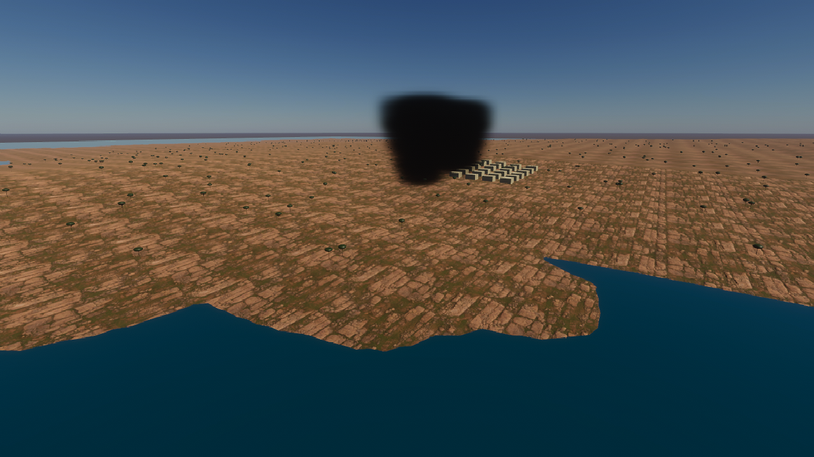

# M00 coastal benchmark — visual evidence

## Before

The previous implemented scene contained generated calibration boxes and starter lighting. The actual earlier Windows capture is preserved below; it is a content-progress reference, not an equivalent coastal performance baseline.

No baseline was captured for a matched coastal benchmark: there was no coastal DSM/PBR implementation at that checkpoint. The older capture is 1280×720 with a different scene, camera and two-client workload; it cannot be used to calculate a speedup against later 1080p runs.

## Implemented change

The separate scene uses an actual Copernicus GLO-90 Petrčane DSM crop (6 km square, SI heights) and five imported 2K Poly Haven CC0 surfaces. It adds 640 generated trunk/canopy pairs, 24 static building proxies and a static sea reference plane. The optional smoky case uses eight scene-local volumetric fog volumes; it does not implement combustion, wind, smoke transport or gameplay visibility.

The initial actual Editor Game View capture revealed a layout problem: building proxies had been placed in sea-level cells. Their source authoring coordinates and serialized scene positions were corrected onto land before the release benchmark. That initial image is retained as [rejected layout evidence](coastal_editor_initial.png), not the final showcase image. Renderer advancement was independently observed before that capture.

## Release capture — clear coastal workload

This actual Windows release image was captured after five rendered seconds, before the 30-second benchmark measurement warm-up ended. It was inspected: the imported terrain and surfaces are visible, and the corrected building proxies sit on land. Preset Balanced, fixed camera (2680, 115, 2450) m / (14°, 55°, 0°), FOV 60°, far clip 12 km, dynamic resolution disabled. The static sea and generated objects retain the limitations above.

No concept render or fabricated baseline is used. The earlier clear-only run's capture is preserved separately as [initial clear image](balanced-clear_initial.png); its raw data is retained with its original binary hashes.

## Rejected smoky fixture and correction

The [first smoky capture](balanced-smoky_rejected_no_visible_fog.png) looked clear. It was rejected visually and its player was stopped before a completed smoky dataset existed. The local columns were approximately 700 m away, beyond HDRP's default 64 m volumetric depth. The corrected runtime fixture extends volumetric depth to 2500 m and explicitly enables atmospheric scattering/volumetrics on the camera, using a runtime copy of the scene's global profile. Original starter settings remain unchanged.

Advancing frame/time counters were verified independently; eight local volumes were present. This is a deliberately crude static volumetric workload. It has no combustion, advection, wind response, gameplay opacity, animation or production smoke-art claim. Matched release-run evidence is recorded separately after completion.

## Release capture — corrected static fog

Both five-minute release runs completed with exit 0 and their actual captures were inspected. Clear/static-fog average FPS was 59.99849/59.99851, with p95 intervals 16.99410/16.98840 ms. These exceed the strict 16.67 ms gate; this proxy content does not establish production 60 FPS acceptance. [Raw data, counters, measurement limits and rendered chart](../../performance/2026-10-22-m00-coastal.md). No matched earlier coastal BEFORE implementation exists, so no optimization percentage is claimed.

## Provenance and limits

- [Exact creator/licence/source and derivative hashes](../../../AssetSources/Environment/acquisition-manifest.json); [human-readable notices](../../../THIRD_PARTY_ASSETS.md).
- The surface files use sRGB albedo, normal-map imports with DX green-channel conversion, and linear HDRP terrain masks (metal=0, AO, neutral height, inverted roughness).
- The coastline is a nominally 90 m DSM resampled to 257×257; this adds no source detail and does not establish survey accuracy. The sea is a flat material reference, and generated vegetation/buildings are render proxies. No game-ready aircraft, rig, actors or gameplay physics are shown.
- Performance is recorded separately with actual resolution, preset and workload. The Editor snapshot and rejected layout image do not pass 1080p/60 FPS acceptance. Optimization remains deferred.
- [Implementation, verification and rendered BEFORE/AFTER data-flow diagrams](../../reports/2026-10-22-m00-coastal-foundation.md).
