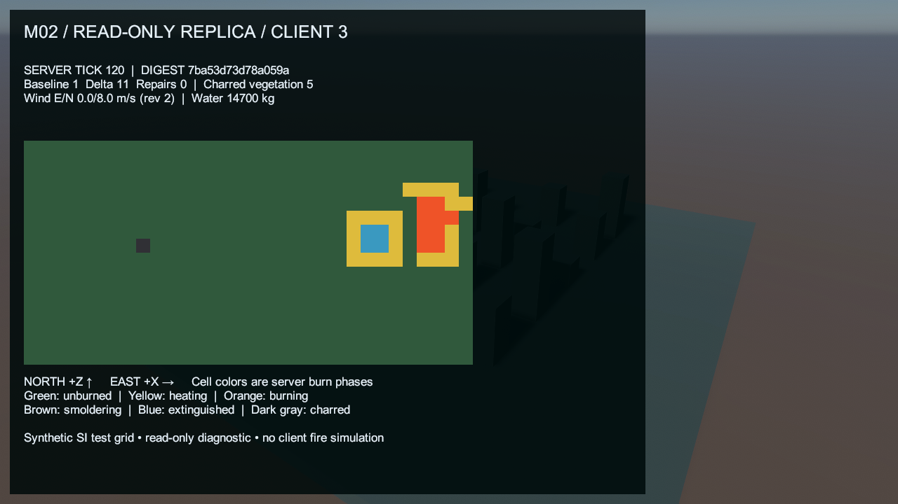

# M02 read-only authoritative fire display — actual before/after

**2026-10-23.** BEFORE is an actual pre-change Windows calibration client screenshot, captured before rebuilding; its launcher/managed identity and image hash are [recorded](../../reports/m02-evidence/baseline-capture.json). AFTER images come from six actual current release-client process captures, three direct and three under constant-delay/loss. These are Game View pixels from `ScreenCapture.CaptureScreenshotAsTexture`, not concept art, rendered diagrams or a single Editor window pretending to be several clients.

| BEFORE — handshake/calibration only | AFTER — direct client #1 |
|---|---|
|  |  |

| Direct late join, client #3 | Impaired late join, client #3 |
|---|---|
|  |  |

Other actual captures: [direct #2](direct-client-2_after.png), [impaired #1](impaired-client-1_after.png), [impaired #2](impaired-client-2_after.png). All are 1280×720. Labels, phase pixels, wind, water and digest were inspected; text is legible without clipping. Client identities and delivery counters can differ; canonical tick-120 fire/wind/water/char state and checkpoint SHA-256 match across every accepted client/server, including fresh restarts. [Process/state evidence](../../reports/2026-10-23-m02-replication.md#verification-results).

The new runtime uGUI overlay draws the server's two 16×16 chunks side by side as a generated 32×16 nearest-filtered texture, with color legend, IDs, tick/checksum, repair counters, SI wind and water. North is +Z and east +X. Dark gray is the fully exhausted Charred combustion phase; the separate five charred-vegetation flags also persist in cells still carrying other phases. This is an engineering view of authoritative data, not geographic terrain, player controls, a world-space fire/VFX implementation or M05A interface acceptance.

Provenance: project-authored phase colors/panels and Unity's built-in `LegacyRuntime.ttf`; original calibration geometry/material/lighting retained. No external texture/model/download or licence was added. Source: [FireStateView](../../../Assets/Fireline/Client/FireStateView.cs), [client replica](../../../Assets/Fireline/Client/ClientFireReplication.cs). The user's sky-profile edit is preserved.

Conditions: Balanced, VSync=1, i5-9400F / GTX 1660 SUPER / Windows 11 build 26300. BEFORE used the previous D3D12 binary; AFTER uses D3D11 to recover from the documented D3D12 Editor build crash. No API-matched before/after performance pair exists. Overlay cost is **unmeasured in isolation**; actual concurrent-client callback hitches, all measurement limits and graph scales are in the [main report](../../reports/2026-10-23-m02-replication.md#callback-measurements-and-graph-reader-guide). No 60 FPS or optimization claim.
