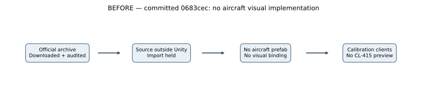

# M03 — CL-415 static prototype exterior

**2026-10-24; verified import increment, M03 remains In Progress.** Baseline revision: `0683cec3b8b393a76cb44caf4e538fda30a369e4`. The user explicitly requested temporary use of the official downloaded model and plans replacement with a commercial asset before launch. The model is isolated from the numerical flight solver so replacement does not change authoritative simulation data.

## Actual previous and new behavior

Before this increment, the official archive was downloaded/audited but held outside Unity. The committed flight implementation was an isolated numerical debug solver, with no graphical aircraft. Now there is a static HDRP exterior prefab and a separate inspection scene/client build. No live aircraft simulation, pilot input, animated control surface, collision, flight replication, runway or water operation is installed by this change. Existing environment textures/DSM remain in the separate coastal benchmark; no speculative truck/crew asset downloads or future gameplay milestones are introduced.

**No baseline was captured** for this aircraft: no earlier imported/rendered aircraft existed. Historical calibration/coastal screenshots are different scenes and are not presented as a matched aircraft BEFORE image. The BEFORE diagram describes the real missing visual path.

## Source, conversion and part inventory

- Official source: [cl415 by helijah](https://sketchfab.com/3d-models/cl415-bf3eaa6a1f4f4fc18df9b05cf40de927), downloaded through the normal signed-in original-OBJ download on 2026-10-22. Model creator: BARANGER Emmanuel; texture contributor credited by the archive: Gary BROWN. [Original notices, hashes and user's scoped decision](../../../AssetSources/Aircraft/CL415/AUDIT.md), [distributed credits](../../../THIRD_PARTY_ASSETS.md).
- Reused the existing 5,566,058-byte archive, SHA-256 `1b45ee5122ed6800bb5c5b5469f7ac29722e38c56d0e379dfe56bcc7bf9a6d8c`. All twelve nested original files are byte-identical to the recorded source. No redundant network download was needed.
- Unity's direct import merged the original OBJ's `o` declarations into one renderer named `default`. A separate deterministic OBJ changes only `o` declarations to `g` groups; its MTL changes only relative texture paths. All positions, faces, normals, UVs and original source files remain unchanged. [Independent byte/derivative verification](../../reports/m03-aircraft-evidence/source-verification.json), [bounded extractor](../../../scripts/extract_cl415_prototype.py). Git attributes preserve exact source/derivative bytes across Windows checkouts.
- [Actual Unity inventory](../../reports/m03-aircraft-evidence/import.json): **144 meshes/renderers, 144 submeshes, 35,799 triangles, 26,002 imported vertices**. Unity vertex splitting at mesh/normal/UV boundaries is distinct from the OBJ's 20,100 position records. These are geometry counts, not measured GPU draw calls.
- Eleven HDRP/Lit materials: nine diffuse/instrument maps, plus glass with original opacity 0.15 and 0.30. Exterior texture imports at 2048²; six instruments at 512²; interior/panel at 256². Color maps are sRGB, mipmapped/streaming and compressed with a 2048 cap. No PBR normal/metal/roughness map was supplied. Metallic=0, opaque smoothness=0.35 and glass smoothness=0.8 are visual estimates, not calibrated physical conversion of the original MTL's `Ns`/`Ks`. HDRP 17.6 `HDMaterial.ValidateMaterial` sets passes/keywords/blending.
- Root yaw=270° aligns the imported nose to +Z; model bounds are centered in X/Z and placed with minimum Y=0. Bounds: **28.785 × 8.816 × 19.795 assumed meters** (X span, Y height, Z length). Unity scale=1; source units are assumed meters, not independently certified engineering dimensions.

| Source part names retained | Actual scope / remaining work |
|---|---|
| `heliceG`, `heliceD` | Separate propeller geometry; no spin animation or propulsion coupling |
| `voletG/D`, `aileronG/D`, `direction`, `profondeur` | Named control geometry; pivots/ranges and solver-driven animation unverified |
| `roueA/G/D`, strut/gear objects | Static extended-wheel geometry; no gear animation, suspension, contact or wheel physics |
| `porteG/D`, `trappeG/D`, glazing | Separate door/glass geometry; no verified scoop-door or cockpit interaction |
| Panel/instrument/interior objects | Geometry and textures exist; complete usable cockpit and instrument calibration unverified |

Full names are retained in the linked JSON. No Animator, Collider or LODGroup exists. Names/separation do not establish usable animation pivots or a rig. Keep those tasks open and reassess after the planned production replacement.

## Implementation and scope

[Authoring code](../../../Assets/Fireline/Authoring/AircraftPrototypeAuthoring.cs) creates only the new prefab and `M03_AircraftPreview` scene, refuses existing generated outputs/unsaved scenes and restores the prior scene setup. Closed-Editor runs start a temporary empty scene when none is loaded. The scene copies existing starter lighting and uses a project-authored neutral inspection pad; the user's sky-profile bytes are preserved. Camera: (32,16,35) m looking at (0,3,0) m, vertical FOV 42°, near/far 0.1/2000 m. Geometry/lighting are static; no weather/time route or random visual population is exercised.

[Build entry](../../../Assets/Fireline/Authoring/FoundationBuild.cs): `BuildAircraftPreviewClient`, output `Builds/WindowsAircraftPreview/FirelineAircraftPreview.exe`. The existing M00/M02 client and coastal benchmark outputs/scenes are separate. The preview bundles original notices/audit/credits in `Legal/`. Dedicated-server package checks explicitly reject aircraft content as well as HDRP/material/settings assets. Client/server runtime assemblies remain separated. The client connects directly to the existing headless bootstrap; no aircraft state is exchanged.

Physics equations and numerical comparisons are **not applicable to this asset-only increment**: no force, mass, integration or wind code changes. The separate [debug-flight comparison](../../physics/debug-flight/COMPARISON.md) remains unchanged and uncalibrated for this model. The diagrams describe the import path, not a newly implemented flight loop.

## Reproduce and verification scope

[Commands](../../M03_BUILD_AND_TEST.md#temporary-aircraft-exterior-import-and-static-preview), [60 passing Unity tests](../../reports/m03-aircraft-evidence/editmode.xml). Three new tests check actual HDRP texture/glass mapping, oriented/grounded static geometry and contributor-notice preservation. The first notice test compared raw audit-copy line endings and failed (59/60); it now permits Git's CRLF normalization in that text copy. Independent source verification still checks exact archive bytes.

Initial authoring attempts also exposed a missing batch-mode loaded scene and Unity's merged OBJ objects. The scene guard and group derivative address those actual failures; failed raw logs remain locally under ignored `Builds/CL415ImportStart/`. Successful import reports actual geometry rather than treating names as proof of a rig. The maintained source-comment audit checks function/property explanations; it is not runtime correctness evidence.

## Actual running-build capture and diagrams

Captured by `ScreenCapture.CaptureScreenshotAsTexture` from the running **1920×1080 Balanced D3D11 Mono release client**, after five rendered seconds. No concept render, editor viewport composite or fabricated baseline. Inspection confirms visible original yellow/red exterior livery, both wing/float silhouettes, propellers, extended gear, glazing and ground shadows; no missing-magenta material is visible. The original Italian source livery is retained for this prototype, not presented as finished Croatian art. Interior coverage, close-up cockpit usability, animation and all quality/API variants remain unqualified. The image includes the unchanged user sky/template lighting; its subdued appearance is not new final art direction.

SVG/PNG exports were inspected for label bounds, overlap and arrow direction. Editable source/reproduction: `python scripts/render_m03_aircraft.py` (Matplotlib; see the build/test guide for this worker's ignored plotting dependency path).

| Verification | Actual result |
|---|---|
| Unity 6000.6.7f1 EditMode | **60/60 pass**, including three new import checks |
| Aircraft preview client | Succeeded; **0 errors / 501 warnings**; 368.288 s; 202,500,580 build-summary bytes |
| Dedicated Windows server | Succeeded; **0 errors / 505 warnings**; 262.213 s; 141,374,411 build-summary bytes; `containsVisualAssets=false` (isolation guard passed) |
| Real process smoke | One rendered client + one headless server, **both exits 0**; direct loopback connection, capture and metrics pass |
| Headless runtime | Graphics Null, **0 cameras**, headless guard valid; peak 1 client |
| Role/asset isolation | Opposite-role and Authoring DLLs absent; preview packs derivative model + all nine textures; server packs **no aircraft content or HDRP presentation assets** |

[Build results and complete asset inventories](../../reports/m03-aircraft-evidence/builds/), [runtime markers/binary and managed-DLL hashes](../../reports/m03-aircraft-evidence/smoke-summary.json). Warnings are retained in the counts, not represented as a warning-free build. Raw Unity logs remain ignored because unrelated licensing/diagnostic output may contain sensitive data. No Linux rebuild, long network soak, flight-state synchronization or 100-player pass is claimed.

## Performance diagnostic and graph guide

One fixed-camera static aircraft/pad client and one local headless server; Editor closed. CPU **i5-9400F**, GPU **GTX 1660 SUPER**, Windows 11 **26300**, visible RAM **16,323 MB**, driver **32.0.16.2101** ([fresh driver query](../../reports/m03-aircraft-evidence/gpu-driver.json)). Unity/HDRP remain **6000.6.7f1 / 17.6.0**, Netcode/Entities/Transport **6.6.0**; no new package. Balanced preset retains VSync=1. Output is 1920×1080; internal dynamic-resolution/upscaling state and storage/OS scheduling are not instrumented. No coastal population, smoke/VFX workload, moving aircraft or representative gameplay route is active. The existing synthetic server fire fixture runs at 5 Hz, seed 415, without aircraft authority.

| Measured callback diagnostic | AFTER | Matched BEFORE / improvement |
|---|---:|---|
| Retained intervals / duration | 1489 / 25.000917 s | Unavailable: no earlier aircraft scene |
| Average FPS, reciprocal mean interval | 59.558 | Unavailable |
| 1% low FPS, reciprocal mean slowest 15 intervals | 32.506 | Unavailable |
| p95 / p99 callback interval | 16.9248 / 17.3213 ms | Unavailable |
| Maximum callback interval | 206.632495 ms, sample **#2** | Unavailable |
| Intervals >16.667 / >33.333 ms | 744 / 1 | Not a dropped-presentation count |
| Peak Unity allocated bytes | 475,032,553 | Not total process RSS or VRAM |

[Unmodified runtime CSV](../../reports/m03-aircraft-evidence/client-diagnostic-metrics.csv), [hardware/statistics JSON](../../reports/m03-aircraft-evidence/client-diagnostic-metrics.json), [every interval with start/end/threshold flags](../../reports/m03-aircraft-evidence/callback-intervals.marked.csv), [maxima and graph scales](../../reports/m03-aircraft-evidence/callback-analysis.json).

The **horizontal axis is elapsed recorded seconds**, with ruler ticks every **5 s**. Zero is the start of the first retained interval at the five-second rendered warm-up boundary; warm-up is measured from the first main-camera callback, not program launch or server connection. The first retained interval can straddle that boundary. Each sample is the elapsed time between two `endCameraRendering` callbacks for the main camera, with no resampling or spike removal; samples are not fixed-duration bins. The plotted X position is the interval's end, calculated by cumulative sum. Samples are numbered from 1 in the raw marked CSV.

The **vertical axis is callback spacing in milliseconds**. The upper panel retains the full spike, with **25 ms** major ruler spacing. The lower panel is the same recording zoomed to **0–50 ms**, with **10 ms** ruler spacing; the 206.63 ms spike is clipped there, not omitted from data. The dashed green **16.667 ms** and dotted orange **33.333 ms** lines are 60/30 Hz duration rulers, not acceptance passes or simulation steps. The annotation identifies sample #2, ending at **0.224504 s**; its gap starts at **0.017872 s** and lasts **206.632495 ms**. Graph ruler ticks are separate from the server's **0.2 s fire tick**, foundation clock or physics integration step.

These intervals include waiting, scheduling, VSync and rendering/capture work. They do **not** isolate CPU/GPU execution time or count actual dropped presentations. Capture/readback/PNG encoding begins around the same warm-up boundary; no synchronized profiler timeline proves the cause of sample #2. The ordinary >16.667 ms counts also include small timing jitter around VSync and must not be called 744 lost frames. [FL-07 observation and deferred investigation](../../performance/FRAME_LOSS_REGISTER.md#m03-static-aircraft-callback-overrun--2026-10-24).

1% low uses the mean of the slowest $\lceil 0.01 \times 1489 \rceil=15$ intervals; it is not reciprocal p99. CPU/GPU execution, actual draw calls, VRAM/residency, GC/per-frame allocation, network bandwidth and complete server tick duration are **unavailable in this run** because the existing collector does not instrument them. This short single static run is not a representative five-minute 1080p coastal/smoky/production qualification or a measured optimization; p95 also exceeds 16.667 ms. The **60 FPS acceptance gate remains open**, as do separate server-capacity gates.

## Remaining M03 work

Live server-owned aircraft/pilot permissions, input/flight replication, physical runway contact, controls/cameras/telemetry, fuel and calibrated aircraft curves, scoop/drop conservation and authoritative suppression remain unchecked in TASKS. Animation pivots, cockpit and production replacement need their own import/runtime evidence. M04/M09 retain representative visuals/profiling and deferred optimization; M05A is not started. Original sky/settings/package snapshots were preserved, and temporary build-setting side effects were restored before publishing.
