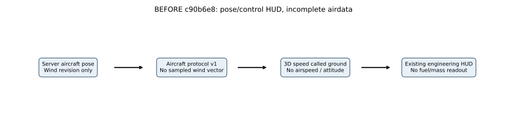
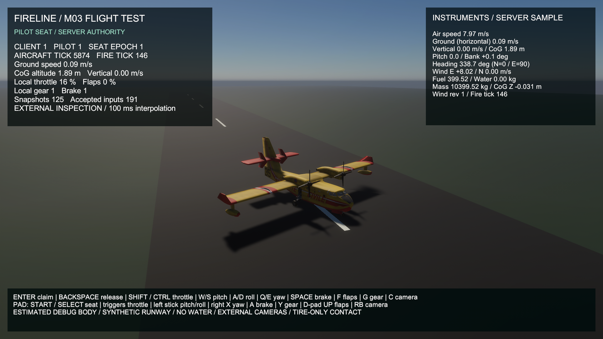

# M03 flight instruments — actual implementation comparison

**M03 remains In Progress.** The existing engineering view gains a read-only airdata/resource panel driven by the latest complete authoritative aircraft snapshot. This is test instrumentation for M03, not a production cockpit or M05A UI/settings implementation. Flight/contact/fuel/fire/wind kernels, model/scene, controls, interpolation and presets are unchanged.

## Previous and new behavior

At `c90b6e8`, aircraft protocol v1 sent a wind revision but no sampled wind vector. The HUD displayed 3D velocity magnitude under the label “Ground speed”; it showed no airspeed, attitude, heading, fuel or mass instruments. Airspeed baseline results are **unavailable because no airspeed readout existed**, not assumed equal to ground speed.

Protocol v2 now adds two horizontal wind components sampled by the server at **the published aircraft position and fire tick**. The existing server-owned field is unchanged. Client validates the version, pose/mass/quaternion and finite bounded wind before installing it. Matching rebuilt client/server binaries are required; mixed RPC schemas/old binaries are not qualified. Fire replication's own schema is unchanged; no client weather/fuel/pose mutation command is added.

`FlightTelemetry.Read` derives the readout from one immutable received snapshot. It never integrates motion or changes resources. `FlightTestView.InstrumentSource` retains the exact snapshot used in that `Update`; the proof records that source **and the actual UI text**, so a newer network callback cannot relabel older displayed values. Interpolated model placement still uses its separate 100 ms history. Latest-snapshot instruments and delayed cosmetic transforms intentionally have different sampling semantics.

## Actual equations and conventions

The old mislabeled value was $\sqrt{v_x^2+v_y^2+v_z^2}$. The new speeds are:

$$
V_a=\sqrt{(v_x-w_x)^2+v_y^2+(v_z-w_z)^2},\qquad
V_g=\sqrt{v_x^2+v_z^2}.
$$

$\mathbf v$ is authoritative world velocity in $\mathrm{m\,s^{-1}}$; $w_x,w_z$ are the actual server horizontal wind sample in the same units. The existing M01 approximation has no vertical wind. $V_a$ is 3D air-relative speed, $V_g$ horizontal ground speed; vertical speed is explicitly $v_y$. For the unit fixture $(3,4,12)\ \mathrm{m\,s^{-1}}$ with wind $(3,0,0)$, the previous label showed **13 m/s**, the new ground instrument **$\sqrt{153}\approx12.369317$ m/s** and airspeed **$\sqrt{160}\approx12.649111$ m/s**. These are analytic test inputs, not measured aircraft performance.

Let $R$ be the received unit-quaternion body-to-world rotation, and $\mathbf f=R\mathbf e_z$, $\mathbf r=R\mathbf e_x$, $\mathbf u=R\mathbf e_y$ its forward/right/up axes:

$$
\theta=\arcsin\left(\operatorname{clamp}(f_y,-1,1)\right),\quad
\phi=\operatorname{atan2}(-r_y,u_y),\quad
\psi=\operatorname{atan2}(f_x,f_z)\bmod2\pi.
$$

Angles are calculated in radians and displayed in degrees. Positive pitch raises the nose; positive bank lowers the right wing. Heading is world-Z/north-zero and world-X/east-90; it is not a calibrated magnetic/navigation instrument. Euler heading/bank are singular at vertical pitch; finite limiting numbers do not establish meaningful heading there. CoG altitude is server $Y$ in meters above the scene datum, **not radar altitude or terrain clearance**.

Fuel/water display actual received kg. Total mass and CoG Z use the unchanged debug point-mass model $m=10000+m_f+m_w$ and $c=(-0.8m_f+1.2m_w)/m$. These values are not CL-415 calibration. Text uses invariant decimal dots with 0.01 m/s speed, 0.01 kg resource and 0.01 m altitude resolution, 0.1 degree angle resolution and 0.001 m CoG-Z resolution. Formatting does not change authoritative precision. A stale pose remains labeled stale by the existing status/input gate.

Source: [readout equations/format](../../../Assets/Fireline/Client/FlightTelemetry.cs), [actual UI source binding](../../../Assets/Fireline/Client/FlightTestView.cs), [server wind sampling](../../../Assets/Fireline/Server/ServerFlightSession.cs), [v2 DTOs](../../../Assets/Fireline/Shared/FlightMessages.cs), [actual text recorder](../../../Assets/Fireline/Client/FlightViewVerification.cs), [unit cases](../../../Assets/Fireline/Tests/Editor/Client/FlightTelemetryTests.cs), [independent text/wind checker](../../../scripts/analyze_m03_instruments.py), [editable SVG generator](../../../scripts/render_m03_instruments.py).

No new force, wind, fuel or motion law is introduced, so a changed-physics flight-performance comparison is not applicable. The existing kernels' actual dedicated-player regression is checked separately. The readout comparison above documents the changed display algorithm; it does not turn the offline route experiment into a Unity flight pass.

## Asset and presentation provenance

The noninteractive top-right panel extends the existing runtime uGUI hierarchy and uses the same built-in `LegacyRuntime.ttf`; the scene, original left panel/guide, model (144 renderers, eleven materials, nine textures) and three project-authored runway materials are retained. [Original prototype/scene provenance](../m03-flight-view/COMPARISON.md#scene-assets-and-provenance). This small edit follows the project's existing text framework without importing a font, package, cockpit or other asset. Noninteractive panel backgrounds do not intercept raycasts.

The real 1080p BEFORE is copied byte-identically from the [previous accepted fuel build capture](../m03-fuel/after.png). Existing local user sky settings are preserved and used in captures; identical fresh-clone lighting also needs that saved profile. Debug fixed-gear penetration, static propellers/gear and missing cockpit remain unchanged. The scene is a synthetic runway, not the proposed large map or coastal effects workload. [Accepted runtime results, failed offline routes, performance/graph reader guides and remaining scope](../../reports/2026-10-25-m03-flight-instruments.md).

## Actual game captures

| BEFORE — accepted c90b6e8 fuel build | AFTER — rebuilt v2 instruments |
|---|---|
|  |  |

The right panel is visible and legible in both AFTER cameras. Static propellers/gear, debug contact/mesh penetration and absent cockpit remain real limitations. These are captures from the ordinary read-only client view under synthetic device verification; they do not show takeoff/water or the future large map.

**110 EditMode + 3 PlayMode tests**, zero-error client/server builds and three actual live process exits pass. **404** received poses, **1,715** independently reconstructed model frames and **1,721** exact instrument strings are checked. The independent server wind reconstruction checks **406** publications with zero difference. No previous airspeed readout existed; the analytic comparison above supplies equivalent display inputs, rather than invented previous flight data. Two new actual dedicated numerical replays retain the old flight/fuel trajectories exactly.

[Full graph explanations](../../reports/2026-10-25-m03-flight-instruments.md#graph-reader-guide) define every axis, ruler, tick, recording origin, interval, warm-up, threshold and zoom. The airdata plot uses physical time from the first instrument source, no warm-up removal; callback timing uses its separate post-five-second-warm-up origin. Five-second ruler ticks are not 5 ms aircraft ticks or callback execution time. **58.738 average / 17.840 1% low FPS** is a bounded synthetic-runway diagnostic; FL-10 marks #504 **184.623 ms** and #242 **172.498 ms**. This is not a representative 60 FPS/Ultra pass or a matched speed comparison. CPU/GPU timing, draw calls, VRAM and bandwidth remain unavailable. Optimization is deferred.

Reproduce drawings with `python scripts/render_m03_instruments.py` from the repository root using the existing analysis dependencies. [Editable source](../../../scripts/render_m03_instruments.py), [immutable runtime archives/checks](../../reports/m03-instrument-evidence/runtime/verification.json). The nonvisual route attempts both remain unqualified; see the dated report, not these taxi images, for their retained failures.
