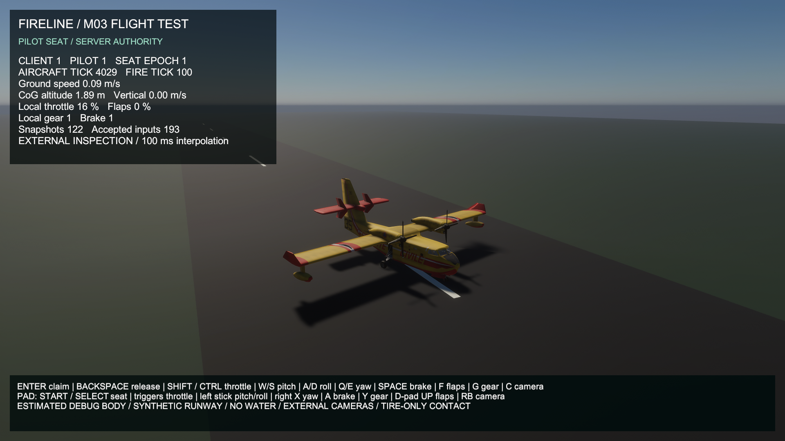
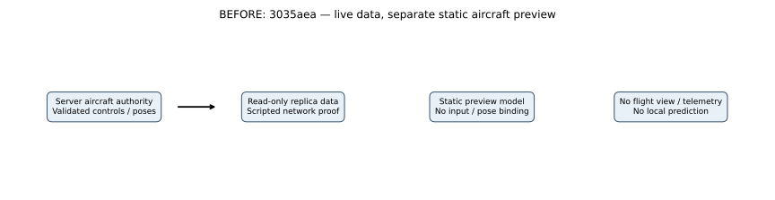
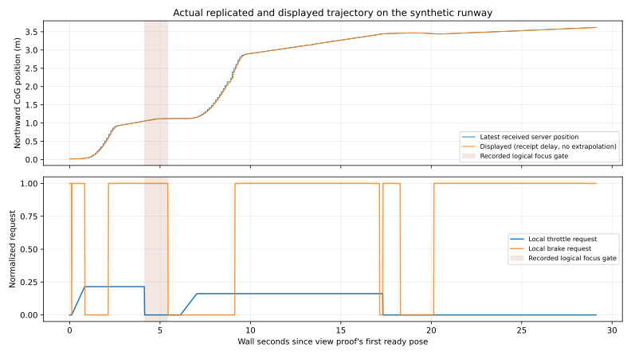

# M03 engineering flight view — actual presentation/control increment

**M03 remains In Progress.** This is an interactive view of the estimated server aircraft on its synthetic runway, with keyboard/gamepad test controls, two external cameras and engineering telemetry. It is not calibrated CL-415 handling, an airborne/cockpit sortie, a coast, movable gear/propellers, a water loop or M05A production UI. The dedicated flight/contact equations and constants are unchanged.

## Actual BEFORE and AFTER

Baseline `3035aeaa5927277f062ebafce6ea30eb65fa555c`: live aircraft data/seat/input/RPC proof existed, but the imported CL-415 stayed static in its separate preview. No model pose binding, manual test-input mapping, interpolation, cameras or aircraft telemetry existed.

The BEFORE is a new actual **1280×720** D3D11 capture of the unchanged aircraft-preview build. Its one-client/server connection smoke passed; [baseline process/metrics evidence](../../reports/m03-flight-view-evidence/baseline/). AFTER uses the new **1920×1080 Balanced** flight-test build. Scene, camera, UI, geometry, resolution and workload differ: **these are development comparisons, not matched performance runs or measured speedups**. An actual earlier version exists and was captured; no concept image or invented baseline is used.

The screenshot pipeline captures the running player's rendered end-of-frame pixels. The first AFTER capture is requested after nine rendered seconds; the second at the proof's later inspection stage. No desktop/user-window image is substituted. The original static scene/prefab/source textures/materials remain unchanged; a new generated scene holds the runtime pose anchor and runway geometry.

## Implemented flow and player impact

Launch the separate `M03_FlightTest` client with explicit direct IP and `--fireline-flight-session debug --fireline-flight-view debug`. It subscribes to the existing server aircraft; the user requests the vacant debug seat and sends normalized controls through the existing validated server API. The server still derives identity, owns seat generation/sequence, validates inputs, samples authoritative wind and integrates flight/contact. There is no client flight integrator or local pose authority.

The new uGUI overlay reports actual received pilot identity/seat epoch, aircraft/fire ticks, server CoG altitude, ground/vertical velocity, snapshot count and acknowledged input count. Throttle/flaps/gear/brake values are explicitly labeled **local requests**; they are not a claim that an unacknowledged request was installed. A stale pose (>0.5 s) blocks local control; real application focus loss clears local throttle and stops input transmission, allowing the server's existing 0.5 s lease fallback. Release/disconnect/fault semantics are unchanged. Connected-seat ownership is not production account admission or unit/pilot qualification.

| Function | Keyboard | Gamepad |
|---|---|---|
| Claim / release debug seat | Enter / Backspace | Start / Select |
| Increase / decrease throttle rate | Left Shift / Left Ctrl | Right / left trigger |
| Pitch, positive nose up | S up / W down | Pull left stick back for nose up |
| Roll, positive lowers right wing | D right / A left | Left stick X |
| Yaw | E right / Q left | Right stick X |
| Brake, held | Space | South/A |
| Flaps 0 → 0.5 → 1 → 0 | F | D-pad Up |
| Gear 1 ↔ 0 | G | North/Y |
| Switch external chase / inspection | C | Right shoulder/RB |

Throttle changes at $0.3\,\mathrm{s^{-1}}$ per full device request, with a maximum 0.1 s local update contribution after stalls; simultaneous devices sum before clamping. Axis sums remain in $[-1,1]$, throttle/flaps/gear/brake in $[0,1]$. The view transmits at most 20 Hz and fills metadata from the latest received state; server validation remains independent. Gear/flap physics inputs work in the debug model, but the imported parts do not animate. Gear-up ground impact is outside the supported envelope and can freeze/fail the debug host; this is no resolved crash/damage system.

## Actual pose and model-frame mathematics

Only complete validated server poses enter a two-sample presentation history. Let $r_0,r_1$ be monotonic receipt seconds, $\mathbf{p}_0,\mathbf{p}_1$ CoG positions in meters, $q_0,q_1$ unit body-to-world quaternions, and $t$ the render sample clock. The fixed **receipt-time delay** is $\tau=0.1\,\mathrm{s}$:

$$
u=\operatorname{clamp}\!\left(\frac{t-\tau-r_0}{r_1-r_0},0,1\right),\qquad
\mathbf{p}_{\mathrm{view}}=(1-u)\mathbf{p}_0+u\mathbf{p}_1.
$$

$$
\sigma=\begin{cases}-1&q_0\cdot q_1<0\\1&\text{otherwise}\end{cases},\qquad
q_{\mathrm{view}}=\frac{(1-u)q_0+u\sigma q_1}{\left\|(1-u)q_0+u\sigma q_1\right\|}.
$$

This normalized shortest-sign interpolation is cosmetic and does not reconstruct true intermediate dynamics or constant angular velocity. With one pose or identical receipt times, use that endpoint. There is **no extrapolation** beyond retained poses. A changed seat epoch or position jump greater than 100 m resets the history. Duplicate/backward ticks, epochs or receipt times fail validation. A stale connection holds the latest endpoint, reports staleness and blocks controls; it does not simulate a hidden aircraft continuation.

The imported prefab has a grounded min-Y=0 and centered X/Z bounds. Its existing child orientation already points the nose along +Z. Under a world CoG anchor, its explicit **debug** body offset is:

$$
\mathbf{r}_{\mathrm{visual}}=(0,-2,-z_{\mathrm{cg}})\,\mathrm{m},\qquad
\mathbf{x}_{\mathrm{mesh}}=\mathbf{p}_{\mathrm{view}}+R(q_{\mathrm{view}})\mathbf{r}_{\mathrm{visual}}.
$$

$z_{\mathrm{cg}}$ comes from the unchanged mass function (zero in this dry proof). The -2 m height uses the synthetic gear-point reference, not a newly measured real-aircraft CoG/gear rig. No ground snapping or mesh bounds feed back into server physics. The penalty tire model permits compression/penetration; fixed source gear may therefore intersect the runway by the numerical compression amount. Actual tire positions/strut deformation, airframe collision, pivot calibration and a usable cockpit remain pending. No physical law changed to make a screenshot look grounded.

## Scene, assets and provenance

- `Assets/Fireline/Scenes/M03_FlightTest.unity` is a separate copy of the existing static-preview lighting with a named CoG anchor and the reused temporary CL-415 prefab. The original Italian yellow/red livery, 144 named renderers, eleven HDRP materials and nine diffuse maps remain unchanged. [User authorization/provenance and source limits](../m03-cl415-prototype/COMPARISON.md).
- The visible **45×3000 m** runway spans X ±22.5 m and Z -500…2500 m, top Y=0, matching the existing pure server rectangle exactly. A 1000×4000 m flat visual surround and 29 centerline marks are synthetic primitives, **not Zemunik, surveyed terrain, coastline or client collision authority**. All Unity colliders are removed.
- Three project-authored flat-color HDRP/Lit materials (runway, surround, markings) are created by `FlightTestAuthoring`; no external PBR texture, artist asset or package is added. Existing sky/fog/profile and presets are reused, with their user edit preserved.
- Runtime uGUI text uses Unity's built-in `LegacyRuntime.ttf`. The engineering overlay has anchored panels/scaling; there are no menus/settings/tutorials or M05A implementation claims. Installed Input System **1.20.1** is referenced by Client only; Shared/Server gain no input-device or HDRP asset dependency.

Source: [scene authoring](../../../Assets/Fireline/Authoring/FlightTestAuthoring.cs), [view/cameras/HUD](../../../Assets/Fireline/Client/FlightTestView.cs), [input reader](../../../Assets/Fireline/Client/FlightTestControls.cs), [pure cosmetic track](../../../Assets/Fireline/Client/FlightPoseTrack.cs), [actual device/render proof](../../../Assets/Fireline/Client/FlightViewVerification.cs). [Build/run instructions](../../M03_BUILD_AND_TEST.md#engineering-flight-view-and-device-proof).

## Verification and limitations

The current checks include **94 EditMode** geometry/solver/authority/presentation tests plus **3 PlayMode** device tests, split so Input System button edges are exercised in the installed package's supported fixture context. Unity must explicitly start with `-standaloneBuildSubtarget Player`; the previous persisted Server subtarget intentionally excludes Client assemblies. [Unity command-line reference](https://docs.unity.com/en-us/engine/6000.7/manual/unity-editor/command-line-arguments/editor). Existing server tests remain part of the EditMode suite. The numeric half-way case (0→10 m, receipts 1.0→1.1 s, sample 1.15 s) yields exactly 5 m within $10^{-12}$ m; endpoint holds, equivalent opposite-sign quaternions, generation/teleport resets, invalid history, device signs, focus neutralization and bounded throttle slew are checked.

The rendered proof queues **synthetic Input System devices**, then uses the normal view/control/session/server path. It sends no native OS keypresses and does not claim physical keyboard/gamepad hardware validation. For the unattended proof only, process-local Input System background behavior keeps synthetic devices active; a separate logical focus gate exercises local neutralization/server lease expiry. Normal use checks actual `Application.isFocused`. The runtime trace retains source receipt time, server pose/tick/epoch, exact presentation sample time, displayed position/quaternion and actual float Transform/visual offset, plus local controls/camera/focus state. The Python checker independently recomputes the initialized interpolation history and checks every received source pose against real server publications.

Actual builds/process counts, raw hashes, accepted inputs, frame errors and remaining gates are recorded in the [increment report](../../reports/2026-10-24-m03-flight-view.md) and [verification JSON](../../reports/m03-flight-view-evidence/verification.json). They establish a bounded runway/device/render increment, not takeoff/landing, cockpit, calibration, water/suppression, WAN or 100-player acceptance. No flight/contact-physics comparison is required for changed governing laws because those laws are unchanged; the equations above describe only presentation/input mapping.

## Performance graph guide

This records **main-camera render callback spacing**, not CPU/GPU execution or actual lost presentations. Five rendered seconds are warmed up; the recording origin is the start of the first retained interval near that boundary. Every sample is the time between adjacent retained callback observations. Horizontal rulers are **5 seconds** apart; they are not the 200 Hz aircraft or 5 Hz fire ticks. Accepted full-panel Y spacing is **25 ms**, preserving/annotating maximum **#499, 178.722903 ms** at **8.450635–8.629358 recording s**. The lower panel displays the same raw samples in **0–50 ms**, with **10 ms vertical spacing**, and clips higher spikes only in that explicitly labeled zoom. The 16.667 ms (60 Hz) and 33.333 ms rulers are diagnostic thresholds, not counts of confirmed dropped frames. [Exact exported scales](callback-timing-scales.json).

Screenshots are taken during this diagnostic and may contribute to callback spacing; no synchronized CPU/GPU/GC/presentation trace attributes a cause. All interval start/end positions and threshold flags are retained in [marked CSV](../../reports/m03-flight-view-evidence/callback-intervals.marked.csv); the investigation register records the maximum for later profiling. Optimization remains deferred. Average FPS is $1000/\overline{\Delta t_{\mathrm{ms}}}$; 1% low is $1000$ divided by the mean of the slowest $\lceil0.01N\rceil$ intervals, not an interpolated single percentile.

This separate trace begins at the proof's **first ready received pose**, not the render warm-up origin. X rulers are **5 wall seconds** apart. Top Y is northward CoG meters with **0.5 m** ruler spacing: one line is the latest received server pose, the other the 100 ms delayed display; curves do not assert physical prediction accuracy. Bottom Y is dimensionless local throttle/brake requests, with **0.25** vertical spacing. The shaded span is the **recorded sampled logical focus gate**, derived from raw rows rather than assumed timing or the gate scheduled for the next frame. There are no camera CPU-time/physics-step or performance-threshold meanings on this plot. Epoch changes can reset history; the checker uses those exact boundaries. Startup presentation rows with insufficient prior receipt history are excluded only from interpolation reconstruction; they are not removed from the plots or render timing.

The first rendered attempt was rejected for its one-frame focus trace label, then rerun after recording the actual sampled value and gating actual late admission. Its callback data remains separately visible: **#1, 418.062896 ms**, recording **0–0.418063 s**. Same 5 s X / 10 ms zoom rulers, but **100 ms** full-panel Y spacing; [initial exact scales](initial-callback-timing-scales.json). This is not a matched BEFORE/performance improvement comparison or an accepted presentation run. [Initial diagnosis and separate raw callback archive](../../reports/m03-flight-view-evidence/attempt-history.json).

No matched BEFORE performance impact is claimed: the old capture uses a different scene/camera and 720p. The AFTER diagnostic is one 1080p aircraft/runway client plus a headless observer, not the representative populated coast/smoke matrix or five-minute qualification. CPU/GPU execution, draw calls, VRAM, GC allocations, RTT and network bytes remain unavailable; metrics record what is actually measured. See [performance history](../../PERFORMANCE_HISTORY.md) and [deferred frame-loss register](../../performance/FRAME_LOSS_REGISTER.md).

Recreate diagrams/plots with `python scripts/render_m03_flight_view.py` from checked evidence; the script is the editable drawing source. PNGs ending `-flow`, `-timing` or `-trace` are inspection fallbacks; only `before.png`, `after.png` and `after.inspection.png` are actual game captures.
