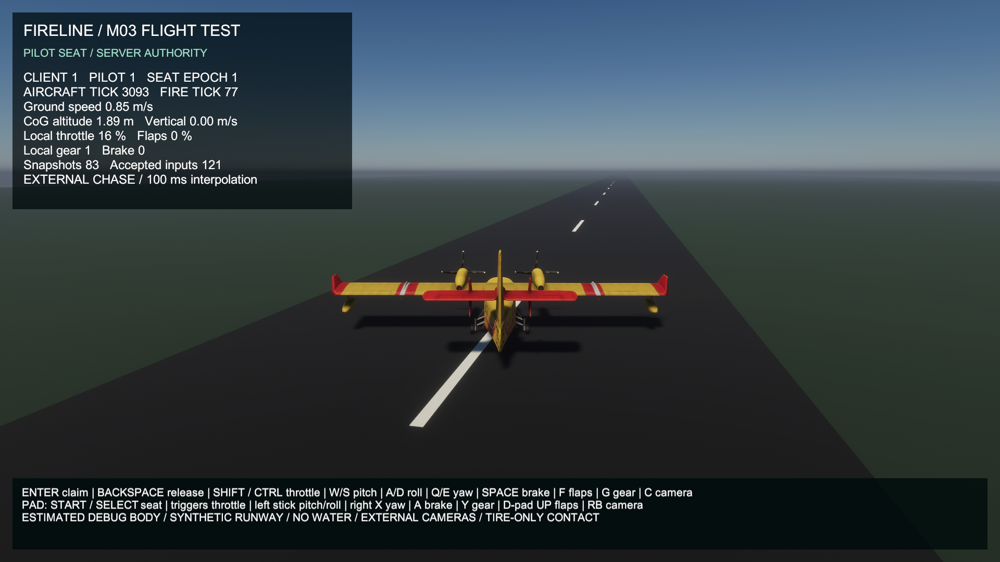
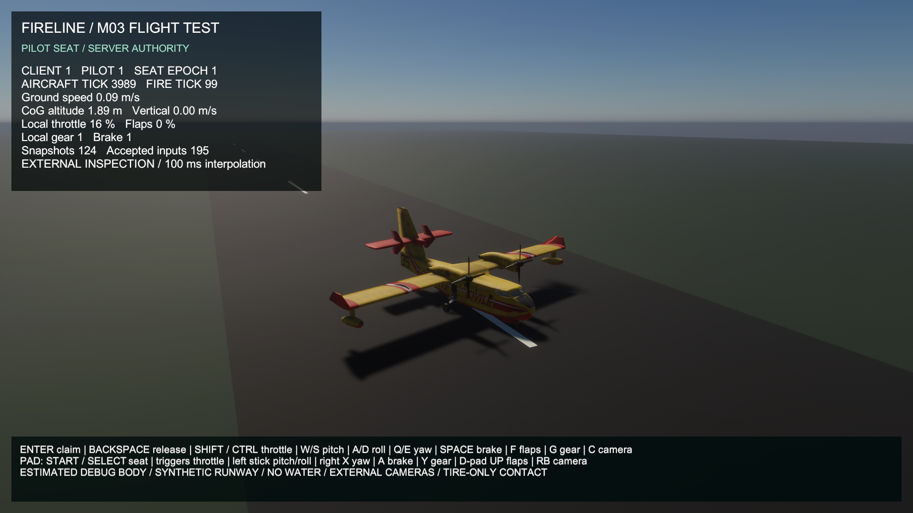

# M03 finite-fuel presentation regression — actual build captures

The existing scene, temporary prototype model/materials, lighting, cameras and HUD are unchanged. The server now starts with 400 kg fuel and debits accepted physical steps rather than producing unlimited thrust with zero fuel. Client placement still uses actual authoritative CoG/attitude and the existing mass-derived visual offset. [Actual equations/BEFORE-AFTER diagrams and numerical comparison](../../physics/aircraft-fuel/COMPARISON.md), [full build/runtime evidence](../../reports/2026-10-24-m03-fuel.md).

| BEFORE — actual earlier `146297c` build | AFTER — rebuilt finite-fuel session |
|---|---|
|  |  |

All images are **1920×1080 running Windows HDRP build captures**, existing Balanced/VSync=1 and per-process D3D11. BEFORE is copied byte-identically from the [previous verified capture](../m03-flight-view/after.png); a real baseline exists. AFTER chase and inspection are fresh captures from the accepted dedicated/owner/late-observer proof. The HUD does not expose fuel yet; **images alone do not prove fuel debit**. Full received fuel and fixed-frame placement are checked in the archived server/client data. No new texture/model or visual quality improvement is claimed.

The existing source model (144 renderers, eleven HDRP materials, nine textures), three project-authored flat-color runway materials, 31 primitive surfaces and built-in font retain [their previous provenance](../m03-flight-view/COMPARISON.md#scene-assets-and-provenance). The temporary prototype contributor notices remain in the client build. Debug fixed gear/mesh collision calibration is still absent; tire penetration under the estimated suspension is not visually snapped away. Gear/propellers remain static and there is no usable cockpit. The user sky edit is preserved/uncommitted and used by both captures; identical fresh-clone lighting needs that saved local profile.

Accepted runtime: **403 received source poses match the server; 1,724 initialized display frames** independently reconstruct, including the nonzero fuel-derived float visual offset. Both camera screenshots are inspected, text is readable, and actual control/focus/ownership checks pass. These are synthetic Input System events through the normal path, not physical-device/native-focus qualification. The proof observes 3.457877 m northward taxi travel and consumes 0.647945 kg fuel, not an airborne/scoop/drop result.

On i5-9400F / GTX 1660 SUPER / driver 32.0.16.2101 / Windows 11 26300, Editor closed, 1,448 retained intervals after five rendered warm-up seconds give **59.303 average / 25.811 1% low FPS**, p95/p99 **17.182/17.808 ms**. **FL-09** records 182.221 ms at #499 and 160.174 ms at #242. Different fuel mass, startup/admission and frame timing prevent a matched rendering-speed claim. No representative 60 FPS or future Ultra qualification. [Raw metrics and complete conditions](../../reports/2026-10-24-m03-fuel.md#actual-visual-and-performance-evidence), [all exact intervals and deferred profiling sites](../../performance/FRAME_LOSS_REGISTER.md#m03-finite-fuel-client-callbacks--2026-10-24).

Reader guide: X **5 recording seconds** from first retained interval start near the five-rendered-second warm-up boundary; full Y **25 ms**, lower 0–50 ms zoom **10 ms**. One sample is an adjacent camera-callback interval, not a physics step or CPU/GPU execution duration. Dashed 16.667 ms/dotted 33.333 ms are diagnostic rulers; higher spikes are clipped only in the zoom and retained above. The maximum is annotated. No dropped-presentation count or causal attribution is inferred. [Physical-time graph and formula/flow source](../../physics/aircraft-fuel/COMPARISON.md), [editable reproducible generator](../../../scripts/render_m03_fuel.py).
