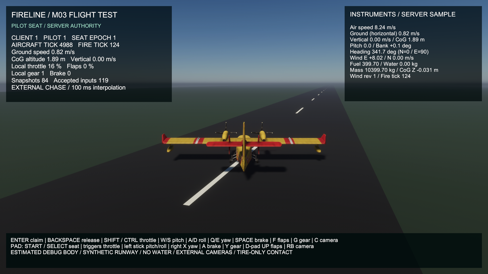
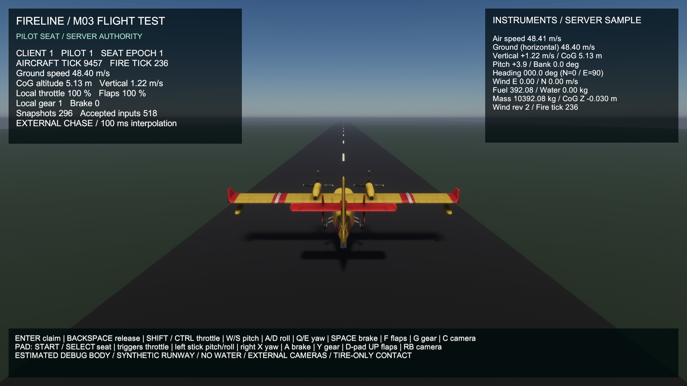
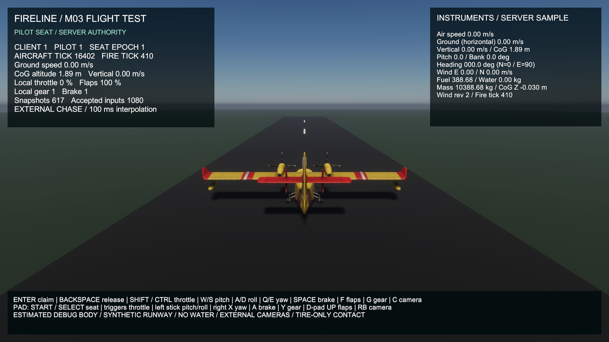
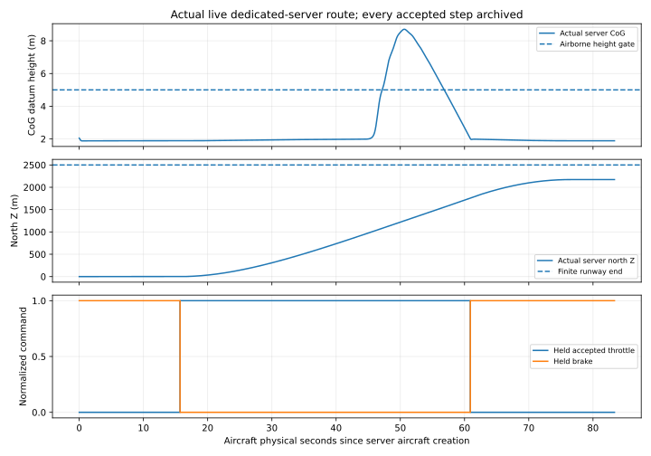
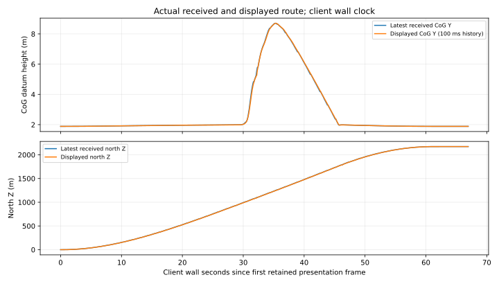
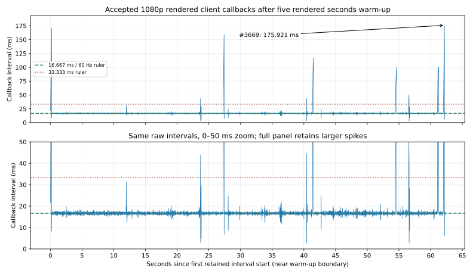

# M03 — actual real-time rendered runway flight

**2026-10-26, verified local calm-air automated increment; M03 remains In Progress.** Baseline `970d1f12e42b71285e2293e63c58633336484063` had an accelerated headless route and an earlier real graphical taxi/control proof. This increment actually flies a straight short hop through **dedicated server + rendered owner + late headless observer**, using the normal control RPC/seat/epoch/sequence/tick/rate/lease path. No client integrates physics and no production autopilot is installed. Manual controller/native focus, crosswind/payload envelope, general collision/calibration/animation/cockpit and water gates remain open.

## Previous and current implementation

Previously the in-process QA pilot drove 20 ms synthetic commands into 5 ms authority steps without real-time transport/rendering. The separate engineering view had real taxi/device evidence but no actual airborne route acceptance. Its real 1080p instrument screenshot is the visual BEFORE. No baseline was captured for an earlier rendered airborne route; no missing flight imagery or network result is invented.

The explicit `--fireline-flight-route-proof` / client `--fireline-flight-route-role owner|observer` flags select this QA fixture. The server alone sets its **existing shared wind field** to zero east/north/gust, seed 415/revision 2. Normal live weather/startup remains unchanged. The owner derives bounded requests from validated received poses; `FlightTestView` uses its existing nominal 20 Hz send gate and `ClientFlightSession.SubmitControls` attaches actual metadata. The input reader/focus gate is replaced only for this automated QA mode; physical keyboard/gamepad/native focus flight is not exercised here. Observer sends subscription/snapshot ACKs and never pilots.

Requests are recorded both when actually enqueued and when received by the server, with real source identity/result/pre-advance tick. An optional trusted `FlightAuthority.Advance` observer receives value copies **after each validated state is installed**; it never applies a force or replaces state. The dedicated recorder recomputes tire contact, rejects footprint departure and records every accepted 5 ms step. Normal sessions leave the callback null. Unit tests verify copy isolation, unchanged default authority results and explicit QA rejection/fault handling.

All Simulation kernels, physical coefficients, fuel rules, model/materials/scenes and RPC fields/wire version **2** are unchanged. The request DTO gains only `[System.Serializable]` so nested JSON evidence retains its fields; a regression test verifies that payload. Launch-option additions require rebuilt roles. The initial invalid GUID import was corrected; all four new script IDs are valid/unique. C# behavior is frozen for the accepted tests/builds; later function-comment edits are checked for executable identity.

## Actual QA policy and equations

This policy differs from the accelerated pilot: rotate request 1 above 46 m/s with full flaps/gear; switch to climb at CoG Y>2.2 m; approach after north Z>1200 m; cut throttle/apply brake below Y=2.1 m during approach and latch that state. Target height is **8 m**, approach vertical speed **-1 m/s**. These are generic QA estimates, not CL-415 operating data or a user-facing autopilot.

With received calm-air speed $V=\lVert\mathbf v\rVert$, received mass $m=10000+m_f+m_w$ (kg), $\rho=1.225\ \mathrm{kg\,m^{-3}}$, $g=9.80665\ \mathrm{m\,s^{-2}}$, $S=100\ \mathrm{m^2}$:

$$
C_L^*=\frac{mg}{\tfrac12\rho\max(V^2,100)S},\quad
\alpha^*=\frac{C_L^*-0.6}{4.5},\quad
\theta^*=\alpha^*+\operatorname{atan2}(v_y^*,\max(V,1)),
$$

$$
u_p=\operatorname{clamp}\left(7.5\alpha^*+16(\theta^*-\theta)+3\omega_x,-1,1\right).
$$

Angles are radians; $\theta$ is quaternion-derived nose-up pitch, $\omega_x$ body X angular rate (rad/s; nose-up negative). Gains 7.5/16 are inverse radians and 3 is seconds per radian for a normalized request. Speed floors are 10 m/s and 1 m/s respectively. Before approach, $v_y^*=\operatorname{clamp}(0.4(8-Y),-1,1.5)$ m/s; height gain 0.4 s⁻¹. Approach uses -1 m/s. Controller gain 16 and the earlier phase transition accommodate delayed received state; the original headless pilot used gain 32/height 10 m/approach 1400 m and is retained unchanged. Float requests cross the existing RPC; no client state integration occurs. CoG height is the synthetic datum, not radar altitude.

The server requires **1,000 consecutive accepted steps above Y=5 m with zero supported wheels**, later at least two-wheel contact and **1,000 consecutive steps with three-wheel support, speed<0.2 m/s, |vertical speed|<0.1 m/s, throttle 0 and brake≥0.99**. Every tire remains inside X ±22.5 m / Z -500…2500 m, including airborne projection. Fault/input expiry/footprint departure/deadline failure rejects the run. Client completion waits for the actual seat-release snapshot/epoch before allowing transport updates and quit; the observer must see and ACK vacancy. Shutdown cleanup is independently checked against server peers and the observer result.

## Accepted runs and independent verification

| Actual run | Server steps | Exact received poses | Longest qualifying airborne (s) | Max CoG Y (m) | Final qualifying settle (s) | Fuel consumed (kg) |
|---|---:|---:|---:|---:|---:|---:|
| Accepted run | 16,669 | 1,213 | 9.675 | 8.705711 | 6.935 | 11.315000 |
| Independent repeat | 14,794 | 1,221 | 9.915 | 8.835724 | 6.815 | 11.367500 |

Both three-process groups exited **0/0/0**, with actual later admission, source/received pose equality, owner release, observer vacancy ACK and both disconnects; no input expiry or physics fault. Live trajectories need not be bit-identical: real callback/transport schedules differ. The repeat is another actual execution, while archive replay separately revalidates retained bytes. Exact repeatability of the unchanged numerical flight/fuel/authority cases is verified in two fresh accelerated dedicated processes under identical commands/environment/dt/duration. No changed-physics or matched rendering speedup follows from the different live control policy/workload.

Accepted run: 16,669 server substeps, 1,213 exact received poses, 3,950 reconstructed display frames, 3,957 actual instrument texts. Independent repeat: 14,794 server substeps, 1,221 exact received poses, 3,989 reconstructed display frames, 3,996 actual instrument texts. The checker independently reconstructs queued control math/metadata, actual received requests, held inputs, every tire offset/velocity/normal-support count/footprint, per-step fuel and continuous physical gates. It matches every received snapshot to the actual targeted server publication and reconstructs receipt-history interpolation, float position/body offset and actual instrument text. It does not implement a second full force integrator. Tolerances: control float conversion 1e-6, installed input/fuel step 1e-12, tire compression 1e-9 m, position interpolation 1e-8 m, quaternion interpolation 1e-10, float position 1e-6 m. No source pose or successful flag alone establishes acceptance.

**119 EditMode + 3 PlayMode tests** pass; **59 C# files / 464 documented members** have human explanations with five-configuration executable-identity audit. Windows server/client builds have **0 errors**, **510 / 499 warnings**. [Full artifact/report index](../../reports/2026-10-26-m03-realtime-flight.md), [reproduce and archive replay](../../M03_BUILD_AND_TEST.md#real-time-rendered-runway-route).

The first post-fix process run exited 0/0/0 but its initial independent text check rejected a rounding expectation: actual mass `10399.754999999995` displays `10399.76`, while Python fixed formatting expected `10399.75`. The checker now models this player's Mono 15-significant-digit conversion before decimal half-up formatting, consistent with [Unity Mono formatter source](https://github.com/Unity-Technologies/mono/blob/unity-main/mcs/class/corlib/System/NumberFormatter.cs). An [installed-runtime diagnostic](../../reports/m03-realtime-evidence/formatting-probe.json) retains its C# source, compiler command, 210 inputs and all four actual/independent format results. All 840 outputs match. Both entire live text streams then pass exact label/value equality, with no widened physical tolerance, changed game binary or edited raw data. This checker correction is separate from the rejected first three-role flight attempt below.

## Rejected first live attempt

The first run recorded real takeoff/landing (server max 8.758020 m, 9.775 qualifying airborne seconds) and captured both states, but the overall test **failed**. Immediate client quit left the pilot seat occupied until its input lease expired; server exited **12**, owner reported route success and observer reported premature disconnection. Other OS exit codes were not retained after the harness stopped at the server failure. Nested request structs were also omitted from JSON, so complete command provenance could not be validated. That run is not counted as accepted or mixed into accepted performance.

The fix waits for a normal release/epoch snapshot and allows 0.15 wall seconds of transport updates before quit; the original expiry guard stays strict. The serializable DTO annotation plus nested-payload test fixes missing diagnostic fields without changing RPC layout. [Rejected result, raw archive hashes, markers and pre-rebuild role binaries/build identities](../../reports/m03-realtime-evidence/attempt1-failed/summary.json). Original ignored raw log/capture paths remain recorded. Initial compile/import corrections are documented separately; no unit verdict was fabricated for failed compilation.

## Actual Game View captures and provenance

| BEFORE — actual prior instrument taxi build | AFTER — actual accepted airborne state |
|---|---|
|  |  |

[Accepted run startup](after.png), [independent repeat airborne](repeat.airborne.png), [repeat landed](repeat.landed.png), [repeat startup](repeat.png). All are actual 1920×1080 running-build PNGs inspected for legibility/scene state; no illustrative generation/editing. Before is byte-identical to the previous accepted instrument capture. Same temporary user-authorized exterior (144 renderers/eleven materials/nine textures), built-in runtime font, three authored runway materials and original source notices. No new asset/package/scene/material/rig import. The user's saved sky/configuration remains byte-identical and unstaged; fresh clones need that saved profile for identical lighting.

Gear/propellers/flaps remain static, cockpit absent, visual gear/CoG/pivots uncalibrated and tire-only planar collision limited. The pictures show a synthetic runway short hop, not a coastal mission or complete operational sortie. [Original provenance](../m03-flight-view/COMPARISON.md#scene-assets-and-provenance). Production model replacement/rights limitations remain unchanged.

## Physical, presentation and callback graph guide

Server X is **aircraft physical seconds since authority creation**, tick ×0.005 s, ruler spacing **10 s**. First accepted state is at 0.005 s; idle/pre-claim simulation is retained, no warm-up removed. Plot selects every twentieth raw step (**0.1 s**) plus final row; all steps remain archived. Upper Y: CoG height **m**, rulers **2 m**, dashed **5 m** airborne threshold. Middle Y: north Z **m**, rulers **500 m**, dashed **2500 m** runway end. Lower Y: normalized held throttle/brake, rulers **0.5**, step lines show actual installed requests/fallbacks. Discarded wall time does not advance this clock; these are not CPU milliseconds, callback intervals or a 200 Hz wall-time capacity claim.

Presentation X is **client wall seconds from the first retained presentation frame**, ruler spacing **10 s**. Every sixth raw frame plus the final frame is plotted; variable callback spacing means this is **not a fixed 0.1 s sampler**. Raw frames remain archived. Y is CoG height **m / 2 m rulers** and north Z **m / 500 m rulers**. Received lines use actual complete snapshots; displayed lines use existing 100 ms receipt-history interpolation, clamped at endpoints with no extrapolation. Latest-snapshot instruments and delayed model intentionally differ. No warm-up is removed here. This client clock cannot be aligned to server physical time by matching X labels.

Callback X is seconds from the first retained interval start near **five rendered seconds warm-up**, labels **5 s** apart. Each point measures wall spacing between adjacent camera callbacks and is located at its interval end. Upper Y uses **25 ms** ruler spacing and preserves the complete spikes; lower panel is the **same samples at 0–50 ms**, rulers **10 ms**, clipping larger peaks only in the zoom. The arrow labels the actual maximum sample. Dashed/dotted **16.667/33.333 ms** lines are 60/30 Hz budget rulers, not proof of dropped presentations. Graph ruler ticks, 5 ms physics ticks, roughly 100 ms pose publication, nominal 50 ms request gates and measured render intervals are separate quantities.

The two flow SVGs above have no time axes; arrows mean data direction. All five vector exports have [editable source and reproducible generation](../../../scripts/render_m03_realtime.py), with inspectable PNG fallbacks. GitHub requires no live canvas/JavaScript.

## Measured performance and deferred locations

Both actual runs use Windows Mono release, Editor closed, **1920×1080 existing Balanced / VSync=1 / per-process D3D11**, i5-9400F / GTX 1660 SUPER / 16,323 MB Unity RAM / Windows 11 26300 / installed driver 32.0.16.2101. One rendered aircraft client, one headless observer and the dedicated server share the PC; actual synthetic route, zero-wind fixture, QA substep/frame/command files and readback/PNG captures. No upscaling/preset change. CPU/GPU execution, draw calls, VRAM, network bandwidth and full server tick duration unavailable; peak Unity allocated bytes are not RSS/VRAM. Host adapter timings include explicit QA recording/contact work and are not full-host timings.

Accepted run: **3,675 intervals / 62.268213 s**, **59.018877 average / 20.534374 1% low FPS**, p95/p99 **17.657900/19.401200 ms**, peak allocated **486,693,979 bytes**. Independent repeat: **3,715 intervals / 62.351185 s**, **59.581867 average / 30.457950 1% low FPS**, p95/p99 **17.466800/18.516300 ms**, peak allocated **490,900,602 bytes**. Average FPS is sample count / summed callback seconds; 1% low is reciprocal of the mean of the slowest ceil(1% × sample count) intervals, not reciprocal p99. Five rendered seconds are warmed up only for callback metrics. Recording ends at proof completion, before the 0.15 s shutdown grace. Different camera trajectory, commands, cache/startup/admission/OS timing and QA instrumentation prevent a matched cost comparison with the taxi/headless baseline. No optimization or representative five-minute populated/coast/smoke/Ultra 60 FPS claim.

**FL-11 — accepted-run callback locations, attribution/optimization deferred:**

| Callback sample | Recorded interval start–end (s) | Gap (ms) |
|---|---|---:|
| #3669 | 62.003539–62.179461 | 175.921202 |
| #2 | 0.021646–0.192734 | 171.087906 |
| #1625 | 27.250884–27.410294 | 159.410104 |

1872 intervals exceed 16.667 ms and 14 exceed 33.333 ms.. Full marked intervals and independent repeat metrics/locations are linked in the dated report. These are not lost-presentation counts. Later profiling sites: actual screenshot readback/PNG encode, per-frame HUD/trace formatting/IO, interpolation/camera, Netcode, host QA substep/contact serialization, HDRP/driver/GC/OS and local contention. No synchronized CPU/GPU/presentation trace proves which caused a gap. Existing FL-10/HOST-01/NET-01 remain open; this work does not optimize them.

## Remaining M03 gates

This qualifies two automated local calm-air straight-hop executions through actual network controls and rendering. It does not qualify manual physical-controller/native focus flight, impairment/jitter/WAN, crosswind/payload range, complete airframe/terrain/water collision, real CL-415 calibration/gear/CoG/animated parts/cockpit, refueling/persistence, scoop/drop/dispersion/conservation/shared suppression, Linux/capacity or representative FPS. M03 remains open; M04/M05A and future large-map/quality work remain Pending. No acceptance requirement is waived by a screenshot or this bounded QA fixture.
