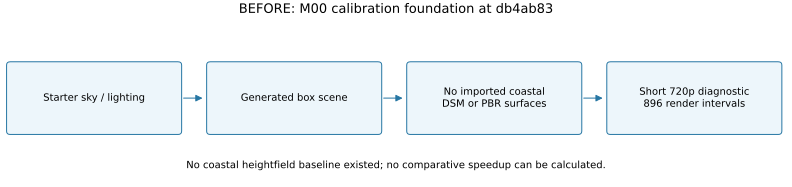

# M00 coastal import and acceptance follow-up — 2026-10-22

**Status note — 2026-10-23:** historical M00-open statements below describe the capture/report checkpoint. [Foundation closeout](2026-10-23-m00-closeout.md) supersedes their scheduling; all raw results, failures and deferred qualification tasks remain unchanged.

**Status: In Progress. This increment does not yet close M00 or start M01.**

Starting checkpoint: clean `main` at `db4ab838f705d793fc1cdcacd4c067572ccf8916`. Unity 6000.6.7f1, HDRP 17.6.0, Netcode/Entities/Transport 6.6.0 and the original quality presets remain in place. CLI 1.0.0-beta.14 was confirmed current. Live preflight found a clean original SampleScene, active HDRP and no compilation in progress. Original scenes/configuration were inspected before edits.

## What was implemented

- Acquired five real 2K Poly Haven CC0 surfaces with creator/license metadata, upstream size/MD5 checks and SHA-256 records. Imported color/normal maps and correctly packed linear HDRP terrain masks. [Manifest](../../AssetSources/Environment/acquisition-manifest.json), [asset status](../ASSET_MANIFEST.md), [licences](../ASSET_LICENSES.md).
- Downloaded the official public Copernicus GLO-90 N44/E015 DSM tile and derived a 6 km Petrčane crop centered 44.19° N / 15.16° E. The 257×257 float32 heights span 0–71.54149 m. They preserve local SI scale; no regional travel compression or vertical exaggeration is applied. A DSM includes surface objects and is not a bare-earth survey. Resampling adds no geographic detail.
- Created a separate `M00_CoastalBenchmark` scene with Unity Terrain, five terrain layers, 640 generated trunk/canopy pairs, 24 static building proxies and a static sea reference plane. The optional smoky case adds eight scene-local HDRP fog volumes. These are explicit render workload proxies, not production pine assets, actors, hydrodynamics or a fire/smoke gameplay system.
- Added a release benchmark build, explicit existing-preset selection, a separate 300–900 s benchmark timer, 30 rendered seconds of warm-up, callback intervals, FrameTimingManager CPU/main/GPU timings when available, latest draw-call counters and Unity allocated-memory samples. CSV blanks represent unavailable counters. VRAM, GC attribution, server simulation execution and transport bandwidth are not yet instrumented.
- Added a serial benchmark runner, a Linux server build entry point and a WSL acceptance script using an official Ubuntu Base runtime under ignored `Builds/`. Build/test/smoke evidence can now go to a new directory, preserving the original diagnostic dataset. Server builds request a clean build-cache inventory rather than certifying an empty incremental report.
- Benchmark packages copy required third-party notices and the applicable Copernicus licence bundle into `Legal/`. No paid/cloud lobby or gameplay model was added. Unity automatically resolved Linux x64/Arm64 SDKs and the Windows-to-Linux toolchain at 1.1.0, plus sysroot.base 1.1.0, for the installed Linux support module. Their metadata declares Unity 6000.3.0b8 minimum; actual 6000.6.7f1 x64 cross-build/run validation passed. [Dependency audit](m00-coastal-evidence/linux-toolchain-audit.json). Arm64 was not built or executed. Networking/HDRP versions are unchanged.

## Before and after




Source: [diagram generator](../../scripts/render_m00_coastal_diagrams.py). These drawings describe implemented boundaries, not a proposed gameplay loop. The original foundation had generated boxes and no imported coastal DSM/PBR assets; it has no comparable coastal performance baseline. [Visual comparison](../previews/m00-coastal/COMPARISON.md).

## Height and material conversion

For local east/north distances $x,z$ in metres relative to crop center, the spherical approximation uses $R=6{,}371{,}000\,\mathrm{m}$ and center latitude/longitude $\phi_0,\lambda_0$ in radians:

$$
\phi=\phi_0+\frac{z}{R},\qquad
\lambda=\lambda_0+\frac{x}{R\cos\phi_0}.
$$

The GeoTIFF's actual pixel scale and tie point map these coordinates to fractional raster indices. With fractional offsets $a,b$ and neighboring DSM heights $H_{00},H_{10},H_{01},H_{11}$ in metres:

$$
h=\max\!\left(0,
(1-a)(1-b)H_{00}+a(1-b)H_{10}+(1-a)bH_{01}+abH_{11}\right),
\qquad h_{\mathrm{Unity}}=\frac{h}{128\,\mathrm{m}}.
$$

The terrain spans 6000×6000 m horizontally and has a declared 128 m height range. Source sampling is nominally 90 m; the approximately 23.44 m output grid oversamples it. Projection approximation, source age, DSM vegetation/buildings, coastline resolution and sea-level clamping limit geographic fidelity. This client terrain is not yet an authoritative server collision/elevation descriptor.

Terrain mask channels are $R=0$ metallic, $G=\mathrm{AO}$, $B=128/255$ neutral height, $A=1-\mathrm{roughness}$. These are normalized data channels; albedo is sRGB. Source JPEG precision remains unchanged. Normal DX maps use Unity normal-map import with green-channel conversion. No flight, combustion, water or vegetation lifecycle equation was implemented or changed.

## Verification record

- Live Editor compilation passed and all **20 EditMode tests passed**, including five new benchmark configuration cases. [Live result](m00-coastal-evidence/editmode-tests.json).
- The closed-Editor CLI test path also passed **20/20**, zero failed. [NUnit XML](m00-coastal-evidence/batch/editmode.xml).
- First Windows benchmark release build: Succeeded, 0 errors, 509 warnings, 48.67 s, 267,439,895 bytes. [Report](m00-coastal-evidence/builds/benchmark-client-first-build.json). A later cached report is retained in the same directory. These warnings are not represented as a warning-free full build.
- Closed-Editor Windows server build: Succeeded, 0 errors, 504 warnings, 319.63 s, 141,195,972 bytes, Server subtarget, no serialized HDRP assets/project materials in its nonempty inventory. [Report](m00-coastal-evidence/batch/server-build.json).
- Closed-Editor Windows client build: Succeeded, 0 errors, 501 warnings, 261.09 s, 195,867,543 bytes. [Report](m00-coastal-evidence/batch/client-build.json). Its server/two-rendered-client smoke passed with distinct NetworkIds, 4,799 server clock ticks and all exits 0. [Process markers and executable/assembly hashes](m00-coastal-evidence/batch/smoke-summary.json).
- Linux x64 Mono server cross-build: Succeeded, 0 errors, **982 warnings**, 636.94 s, 150,510,879 bytes. [Report](m00-coastal-evidence/batch/linux-server-build.json). Its full inventory excludes coastal content and project materials; its managed assemblies exclude `Fireline.Client`. In a workspace-local Ubuntu Base 24.04.5 / GLIBC 2.39 root under WSL2, the five-second negative startup test reported null graphics, no cameras, 300 ticks, zero clients and the expected exit 4. [Runtime/assembly hashes and scope](m00-coastal-evidence/linux/startup-summary.json), [markers](m00-coastal-evidence/linux/negative-markers.txt). This is not native-host qualification or a Linux two-client/network/load test.
- The Linux build spent substantial time compiling pre-existing inference compute resources; 42 inference compute shader entries also remain in the Windows server inventory. Headless startup and HDRP/material isolation do not mean all shader code/resources were stripped. Runtime optimization remains deferred.
- All 15 runtime map files plus the heightfield match their recorded derived SHA-256 hashes. Official texture inputs passed size and MD5 checks; TIFF size/shape/finiteness and crop bounds were checked.
- `python scripts/verify_m00_environment.py` passed source/derived hashes, all five masks' actual pixel channels, 2K dimensions, every texture's Unity color/normal/mipmap/streaming flags, source PixelIsPoint raster semantics and SI heightfield orientation checkpoints. At derived indices `(z,x)=(128,128),(100,160),(180,180)`, heights are respectively 21.4973526, 29.8624268 and 48.3412132 m; no previous coastal dataset exists for a delta comparison.
- Live native Unity `TerrainData.GetHeight(x,z)` returned 21.497406, 29.8611984 and 48.3427925 m at those same checkpoints, within **0.002 m absolute tolerance** of the float32 data. The native terrain has the expected 257 resolution and 6000×128×6000 m size. [Integration results](m00-coastal-evidence/terrain-integration.json). This checks conversion/heightmap quantization, not the DSM's real-world accuracy.
- Initial actual Editor Game View capture confirmed the new terrain/materials. Advancing frames were observed at 1,062 then 3,887, with game time 7.54 then 25.64 s; entering Play alone was not treated as proof. A single Editor diagnostic snapshot reported 66 draw calls, 1,049,077 triangles, 1,806,593,925 Unity allocated bytes, CPU frame 52.9884 ms and GPU frame 5.739776 ms. This snapshot is not a build benchmark, isolated execution measurement or FPS acceptance result. An initial layout placed building proxies at sea level; their authoring coordinates and scene instances were corrected onto land before the release benchmark.
- Runtime build/benchmark follow-up results are recorded as they complete; no in-progress process is counted as a pass.
- After fixing unbounded recording during ordinary scene inspection and replacing the deprecated object-search overload, the final client and benchmark builds both succeeded: client 95.10 s / 499 warnings, benchmark 21.63 s / 639 warnings, both zero errors. [Final client](m00-coastal-evidence/final/client-build.json), [final benchmark](m00-coastal-evidence/final/benchmark-client-build.json). All 20 EditMode cases passed again; [final result](m00-coastal-evidence/final/editmode-tests.json). A fresh server/two-client smoke on the rebuilt client passed with every exit 0; [current executable/assembly hashes and markers](m00-coastal-evidence/final/smoke-summary.json).
- A subsequent visual check rejected the first smoky attempt: the local fog columns were outside HDRP's default 64 m volumetric depth. No smoky result was accepted from that attempt. The runtime fixture now clones the scene-local profile, enables volumetrics explicitly on the camera and uses a 2500 m volumetric depth. Actual Game View inspection showed eight visible fog volumes, with frame/time advancing from 324 / 3.03 s to 3517 / 26.83 s. This fixes the test fixture; it is not gameplay smoke or an optimization. [Visual audit](../previews/m00-coastal/COMPARISON.md).
- After this fixture correction, all **20 EditMode tests passed** again. [Fresh result](m00-coastal-evidence/fog-fix/editmode-tests.json). The latest benchmark build succeeded in 97.63 s with 500 warnings; foundation client in 17.35 s with 639 warnings; both zero errors. [Benchmark](m00-coastal-evidence/fog-fix/benchmark-client-build.json), [client](m00-coastal-evidence/fog-fix/client-build.json). Fresh Windows direct-IP smoke again passed: client PIDs 32764/27020, server PID 28932, distinct NetworkIds 1/2, peak two clients, 4799 clock ticks, all exits zero. [Current binary/managed-assembly hashes and markers](m00-coastal-evidence/fog-fix/smoke-summary.json). Retained server binaries came from the verified closed-Editor builds; the fog correction is confined to the client assembly.

## Reproduction

From the repository root, use Python tooling installed in ignored `Builds/AnalysisTools` (`Pillow`, `numpy`, `tifffile`, `imagecodecs`, and `matplotlib` for drawings):

```powershell
$env:PYTHONPATH = Join-Path $PWD 'Builds/AnalysisTools'
python scripts/acquire_m00_environment.py
python scripts/verify_m00_environment.py
python scripts/render_m00_coastal_diagrams.py
```

The acquisition script uses the official public API/file URLs and validates cached inputs. Obtain the linked Copernicus licence bundle before packaging. In the live Editor, `CoastalBenchmarkAuthoring.CreateScene()` only creates a missing benchmark scene, refuses dirty open scenes and restores the previous scene setup; it intentionally refuses to overwrite an existing scene.

```powershell
unity command eval --caller plugin --skill unity-cli 'Fireline.Authoring.FoundationBuild.BuildBenchmarkClient();'
# Close the clean project Editor, then exercise the batch path:
pwsh -File scripts/Build-M00.ps1 -LinuxServer -Smoke -EvidenceRoot docs/reports/m00-coastal-evidence/batch
# Run benchmarks only after builds finish and the project Editor is closed:
pwsh -File scripts/Test-M00CoastalBenchmark.ps1
```

The runner defaults to Balanced/clear+smoky. For array parameters, invoke it directly in PowerShell, e.g. `& ./scripts/Test-M00CoastalBenchmark.ps1 -Preset Balanced,'High Fidelity' -Scenario clear,smoky`. The unchanged Performant asset disables volumetrics; the runner explicitly rejects its smoky combination. Run its clear case separately rather than accepting invisible fog as a smoke workload. Each run requires 1920×1080, at least the requested duration, fresh image/metrics and a completed-render marker. Only processes owned by that invocation are stopped on failure. The first image is taken at five rendered seconds, before the 30-second measurement warm-up ends. Timing counters can lag callbacks; CPU frame timing includes waits and is not pure script execution. See [Unity's FrameTiming API](https://docs.unity3d.com/6000.0/Documentation/ScriptReference/FrameTiming.html) and [timing manager guidance](https://docs.unity3d.com/6000.0/Documentation/Manual/frame-timing-manager.html).

## Outstanding M00 gate

The corrected Balanced release pair completed: clear 59.99849 FPS average / 57.93009 1% low / 16.99410 ms p95; static fog 59.99851 / 58.11117 / 16.98840 ms. Both exit 0 after 300 s sampling plus 30 s warm-up, with actual inspected 1080p captures and available CPU/main/GPU, draw-call and memory samples. [Full benchmark, raw data, rendered chart and plain-language graph explanation](../performance/2026-10-22-m00-coastal.md). Both p95 intervals exceed 16.67 ms; no production 60 FPS pass or optimization is claimed. Uninstrumented counters and representative gameplay scenarios remain explicit follow-ups.

The user signed into Sketchfab and the official original OBJ archive was downloaded successfully. Its included README says GPL without a version/full text and credits textures to Gary BROWN, while the listing advertises CC BY 4.0. This conflicting contributor/licence record blocks import. [Actual source audit, inventory, dimensions, hashes and concrete resolution](../../AssetSources/Aircraft/CL415/AUDIT.md). No aircraft content ships; moving parts, pivots, scale, cockpit, livery rights and HDRP materials remain unverified in Unity. Authentication is no longer the blocker.

M00 remains open while required aircraft acquisition/import and representative acceptance evidence are missing. The initial coastal scene is useful benchmark infrastructure, not S1–S6 gameplay acceptance. Profile attribution/optimization remains deferred as requested; new conditions do not prove the original 83.47 ms hitch was fixed. M01 is not started while M00 remains gated.

## Final increment audit

Verified five environment sets' source/derived hashes, every mask pixel and Unity import flag, SI heightfield checkpoints, the official aircraft archive/nested source inventory and preserved notice. `verify_m00_environment.py` and `verify_cl415_archive.py` passed. All PowerShell scripts parsed and Python scripts compiled. The Performant/smoky combination was negatively tested and rejected before player launch. Documentation checks passed **232 local links across 42 Markdown files**, code/display-math delimiters, five SVG documents and all nine required README showcase sections. Asset metadata/GUID checks found no missing Fireline metas or duplicate asset GUIDs. Whitespace checks preserve native Unity YAML empty-value formatting and raw built-in asset names through explicit Git attributes; code/document checks, credential-pattern and oversized-file checks passed. Original `ProjectSettings/` and `Assets/Scenes/` have no diff; the original 896-sample dataset remains unchanged. Latest graph, BEFORE/AFTER diagrams and actual clear/static-fog release captures were visually inspected.

Physics-model comparisons are not applicable: this increment changes imported client geometry/materials and test instrumentation, not authoritative combustion, aerodynamics, water or smoke transport. The implemented geographic conversion, actual native-height numerical checks and rendered data-flow BEFORE/AFTER drawings are provided above. No missing gameplay physics is represented as implemented. This is a verified **partial M00 checkpoint**, not a milestone-completion commit.
