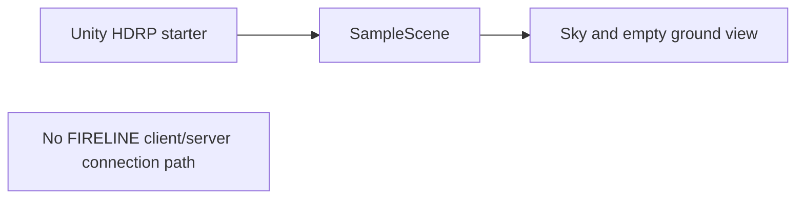
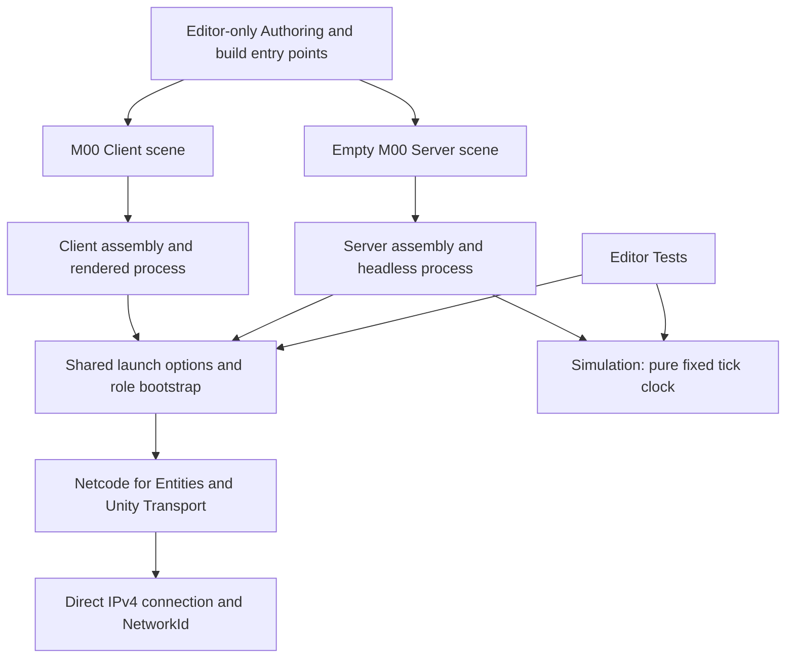

# M00 — Unity foundation checkpoint, 2026-10-22

**Status: In Progress.** This checkpoint establishes assembly, build, test and local connection foundations. Asset integration and representative performance acceptance remain open; M01–M09 are not started.

## Baseline and audit

The working tree was clean on `main` at `f93ad75` before implementation. The existing Unity project, starter scene, project version and three HDRP quality presets were inspected in place. No project recreation or package-wide upgrade was performed.

| Item | Observed result |
|---|---|
| Editor | Unity 6000.6.7f1, live Editor opened successfully |
| CLI / Pipeline | CLI 1.0.0-beta.14, update check reported current; Pipeline 0.9.0-exp.1 |
| Rendering | HDRP 17.6.0 active; default `HDRP High Fidelity`, existing Balanced and Performant presets |
| Tests | Test Framework 1.8.0; 15 foundation EditMode cases passed |
| Networking | Netcode for Entities 6.6.0 added with Package Manager Client API; Entities 6.6.0 and Transport 6.6.0 resolved |
| Other installed core dependencies | Burst 2.0.0 and Collections 6.6.0 |
| Installed build modules | Windows and Linux standalone support; Windows dedicated-server variants found |
| Reference machine | Intel Core i5-9400F, NVIDIA GTX 1660 SUPER, 16,323 MiB reported RAM, Windows 11 build 26300 |
| Existing assets | Starter scene, HDRP settings, input actions and tutorial assets; no `AssetSources/` directory or integrated FIRELINE aircraft/coastal assets |

Package compatibility was researched against Unity's official [Unity 6.6 core packages](https://docs.unity.com/en-us/engine/6000.6/manual/packages-list/packages-all/pack-core), [Netcode for Entities](https://docs.unity.com/en-us/engine/6000.6/manual/packages-list/packages-all/pack-core/com-unity-netcode), [Transport](https://docs.unity.com/en-us/engine/6000.6/manual/packages-list/packages-all/pack-core/com-unity-transport) and [HDRP](https://docs.unity.com/en-us/engine/6000.6/manual/packages-list/packages-all/pack-core/com-unity-render-pipelines-high-definition) documentation, then checked against installed package manifests and actual compilation. Unity 6.6 core packages are Editor-coupled; older 1.x Netcode examples are not the version used here. The [Dedicated Server build documentation](https://docs.unity3d.com/6000.6/Documentation/Manual/dedicated-server-build.html) specifies the Server subtarget used by the build code.

No Addressables, Entities Graphics or Unity Physics package was added. No dynamic-weather, terrain-streaming or aircraft implementation depends on assumed package features. Those integrations need their own compatibility checks when introduced.

## Previous behavior

The starter project rendered an empty HDRP scene. It had no FIRELINE assemblies, startup roles, endpoint options, standalone build entry point, smoke runner or project-specific tests. Gameplay, physics and authoritative fire state did not exist.

## Implemented foundation

- **Client:** one client ECS world; optional explicit direct-IP connection; rendered-frame capture; smoke timeout/exit status; optional diagnostic frame-interval sampler.
- **Server:** one server ECS world, explicit bind address, connection-count observation and fixed clock; validates null graphics device, no camera and no selected render pipeline.
- **Shared:** typed launch options and role bootstrap. `--fireline-*` typos, duplicates, invalid ports/addresses and missing values fail validation. Clients remain disconnected unless explicitly given a destination; server defaults to loopback.
- **Simulation:** `TickClock` has no Unity references. It measures fixed scheduled steps only; it is not the Netcode server clock or a measured server execution duration. See the [clock comparison](../physics/foundation-clock/COMPARISON.md).
- **Authoring/Tests:** Editor-only assemblies. Builds specify role-specific scenes and exclude the opposite FIRELINE runtime assembly. Existing project scenes and build scene list are preserved.
- **Build scope:** Windows x64 Mono, non-development client and dedicated-server players. The server build temporarily removes pipeline references and restores them by asset path, because a build can unload unreferenced pipeline objects. Detailed reports distinguish serialized render assets from source-script entries.

There are no in-game snapshots, gameplay commands, fire cells, wind, aircraft or persistence. A successful Netcode handshake assigns connection identities; it does not prove world-state replication or authority. `NetworkStreamInGame` is intentionally not added by this foundation.

## Verification and artifacts

Reproduction instructions: [M00 build and test guide](../M00_BUILD_AND_TEST.md). Actual commands used include the latest CLI version check, live Editor eval/inspection, Package Manager `package search/add/status`, filtered async EditMode tests, and sequential detached calls to `FoundationBuild.BuildServer()` and `BuildClient()`.

| Check | Evidence / acceptance |
|---|---|
| EditMode foundation tests | [15 passed, 0 failed](m00-evidence/editmode-tests.json) |
| Windows dedicated-server build | [Build report](m00-evidence/server-build.json) and [packed sources/assets](m00-evidence/server-packed-assets.txt); check Succeeded, errors=0, Server subtarget and no serialized HDRP assets or project materials |
| Windows release client | [Final incremental build report](m00-evidence/client-build.json): Succeeded, zero errors, 24.41 s, 195,864,357 bytes, non-development Player subtarget. Cached report returned zero new warnings; first full build took 702.71 s and reported 507 warnings |
| Local three-process smoke | [Accepted summary](m00-evidence/smoke-summary.json): server PID 11808, clients 6708/11820, NetworkIds 1/2, peak connections=2, all exits=0. Server logged null graphics/no cameras and 4,799 fixed clock ticks. Client render callbacks counted 1,190 and 1,194 frames |
| Assembly isolation | Smoke script checked client output excludes `Fireline.Server.dll` and server output excludes `Fireline.Client.dll`; executable and FIRELINE assembly hashes are saved with the summary |
| Original content and presets | Original SampleScene and Editor version unchanged. All three live quality pipeline references restored; original scene reopened after inspection. Unity-generated package settings and serialization changes are described below |
| Visual capture | Actual [BEFORE/AFTER comparison](../previews/m00-foundation/COMPARISON.md), with the final release screenshot visually inspected for geometry, shadows and valid materials |
| Performance | [720p calibration diagnostic](../performance/2026-10-22-m00-calibration.md): average 59.73 FPS, 1% low 38.23, p95 interval 17.36 ms; representative 1080p/60 FPS and server-load acceptance remain open |

The first server build compiled with zero errors but the post-build guard falsely treated HDRP source-script entries as visual assets. The guard was corrected to inspect serialized assets. Build restoration was also changed to reload pipeline references from paths after observing that unreferenced objects can be unloaded during build. These failures are implementation findings, not completed acceptance results.

The first client build failed in Netcode 6.6's `GhostBehaviourBuildProcessor`: its postprocessor deletes the physical temporary folder with `FileUtil`, while subsequent AssetDatabase folder checks can remain stale. The foundation entry point now ensures/imports that physical folder before each build. No package-cache file was modified. Subsequent full and incremental client builds passed; see the final report and [full-build warning record](m00-evidence/client-cold-build-warnings.txt).

The verified server build reported 515 warnings, including VFX Graph warnings about the temporarily absent render pipeline and Shader Graph import/compiler warnings. [Warning evidence](m00-evidence/server-build-warnings.txt) is retained; zero errors is not a claim of a warning-free build. The [negative server smoke](m00-evidence/server-negative-smoke.txt) returned the expected exit code 4 with no clients, null graphics, no cameras and 179 advancing fixed clock ticks.

The build report's `containsVisualAssets` predicate specifically checks serialized HDRP package assets, `Assets/Settings/` content and materials, excluding source scripts. Built-in entries such as Unity's splash-logo texture can still appear in the inventory. This is an HDRP/material isolation check, not a claim that all rendering code or every built-in image was removed from the binary.

The final cached incremental client report omitted packed-asset entries, so its `containsVisualAssets=false` field is not evidence of a missing renderer or an empty player. The actual client loads HDRP and renders the captured calibration scene. The verified server inventory is nonempty and was inspected; the batch script rejects empty server inventory as unavailable evidence.

The first positive connection run assigned distinct client NetworkIds 1 and 2, but was rejected as a rendered smoke: Windows hidden-window mode suppressed real rendering, screenshot capture returned null, and update-loop intervals produced invalid apparent FPS. Those samples are not benchmark evidence. The probe now requires main-camera render callbacks and successful requested capture; the runner uses visible interactive clients with part of each window exposed. Only a subsequent accepted run's samples are eligible for the performance history.

The next visual inspection rejected an early white capture: cold initialization consumed most of the initial wall-clock interval. The final probe starts its 20-second duration and five-second warm-up at the first rendered frame, with a bounded startup timeout. The final accepted screenshot shows the intended geometry, lighting and sky, and its 896 diagnostic samples cover approximately 15 rendered seconds.

## Preserved configuration and generated changes

The original `Assets/Scenes/SampleScene.unity` and `ProjectSettings/ProjectVersion.txt` have no changes. High Fidelity, Balanced and Performant retain their original asset GUIDs and runtime settings. Unity 6.6 reserialized existing quality arrays (typed scalar-array suffixes), added schema/default fields and updated HDRP build-prefilter/global-resource data during build validation. These generated migrations are included in the checkpoint rather than hidden.

Package loading/building also generated Entities/Netcode client/server settings, an App UI build-config reference, existing Unity AI package defines, an explicit Mono server backend entry and temporary preloaded-asset cleanup state. Unity Connect's existing Editor service state was reserialized. None of these is a new mandatory lobby/account dependency; the actual standalone loopback smoke requires none. No Unity package cache or existing asset GUID was replaced.

Tool command-discovery misses were resolved by using separate group/verb arguments. Historical console entries also include existing Unity AI service entitlement errors; these are separate from C# compilation and player smoke results. Raw Editor logs stay outside Git because they can contain machine/account details; committed evidence uses build summaries, project paths and specific test/runtime markers.

Final documentation/source checks passed: nine required README sections, 117 local Markdown links across 36 documents, balanced Mermaid/code fences, PowerShell syntax, Unity asset metadata, preserved original starter scene/Editor version/prompts and authored-source whitespace checks. Unity-generated YAML empty fields and the raw asset inventory retain serializer-produced trailing spaces; these are excluded from the authored C#/assembly-definition/Markdown/PowerShell/package whitespace check. Accepted runtime logs had no exception or shader-error lines. [Source hashes](m00-evidence/source-hashes.json) record the working-tree file bytes used here (line-ending normalization can change these hashes); the smoke summary separately records the tested executable/runtime assembly hashes.

Publication: implementation/evidence commit `3d006ae1aecb8ba15a850d66c7a5aae96fc0c943` was pushed to the existing repository's `main`; `git ls-remote origin refs/heads/main` matched local HEAD. The working tree was clean after that push. This subsequent documentation-only record captures the observed publication; M00 remains In Progress.

## Limits and dependency gates

- Asset acquisition/import remains open. No CL-415 rig, cockpit, terrain, vegetation or third-party texture is claimed integrated. Calibration cubes/material are project-generated.
- The calibration scene is an initial deterministic render workload only. A populated coastal/smoky benchmark, 1080p standalone profiling, CPU/GPU counters and before/after equivalence are outstanding.
- Windows release smoke is the immediate foundation gate. Linux builds/runs, WAN/firewall/NAT, packet loss, reconnect, authentication and public-host hardening remain unverified.
- No hosted CI runner/license has been configured. The batch/CI script is supplied; the live Editor verification path is the one exercised here.
- HDRP client rendering and headless Netcode startup do not establish 100-player capacity, representative 60 FPS, deterministic fire or flight fidelity.

Finish the remaining M00 asset/performance/audit evidence before advancing gameplay milestones. M01 should then implement the pure seeded authoritative fire/wind model and its tests; M02 owns replicated fire baselines/deltas and recovery.
