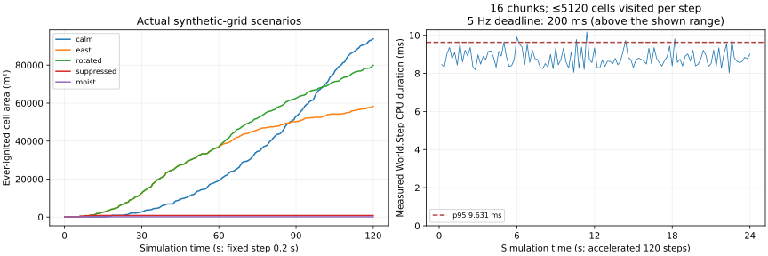

# M01 — Authoritative headless fire/wind implementation

**2026-10-23. M01 Verified — bounded headless prototype, Windows and Linux/WSL scopes below.** Starting checkpoint `46d179c1c6fea09b14d7227642726c41e62d79d7`, after the separately published M05A roadmap integration. This report describes actual server-side behavior, not playable client fire, scientific calibration or finished aircraft/ground interactions.

## Implemented behavior and architecture

- Pure C# `FireWorld`, `WindField` and typed cell/chunk/snapshot/delta contracts live in `Fireline.Simulation`, without Unity references. The server owns 5 Hz advancement, manual ignition/water and wind revisions. Client presentation has no fire mutation protocol in M01.
- Cells track six explicitly named combustion phases, SI fuel/water/elevation, moisture, normalized heat/intensity/hazard, stable vegetation IDs and irreversible vegetation char. Wind, moisture, fuel class and slope affect neighbor heating; water cools/wets without deleting fuel. Coarse hazard follows cardinal upwind transport.
- Double-buffered chunk updates prevent same-step traversal-order feedback. Capacity is 16 chunks, side ≤32, with ≤4 active plus one round-robin inactive update per step. Inactive simulation is explicitly coarser; the queue does not grow without bound.
- The dedicated-server adapter starts a named synthetic fixture in normal server operation. It is not a production incident generator or a real coastal simulation descriptor. Proof mode runs the same model/authority service in accelerated deterministic cases.
- Detached schema-1 snapshots, latest-step revision deltas and a snapshot-store interface prepare data boundaries. They do **not** implement M02 serialization, restart restore, reliable delivery, repair or client convergence.

[Equations, variable/SI definitions, exact update order, assumptions, actual BEFORE/AFTER SVGs and graph guide](../physics/fire-wind/COMPARISON.md). [Build/test reproduction](../M01_BUILD_AND_TEST.md).

## Numerical acceptance

Each case uses seed 415, 32×32 cells of 10 m, 600 steps of 0.2 s and a center ignition. The named variants change wind, rotation, suppression, moisture, slope or gusts. The finite 320 m grid clips/saturates spread; total area is not a field-validated rate-of-spread estimate.

| Case | Ever-ignited area at 120 s (m²) | East / north centroid relative to ignition (m) | Digest |
|---|---:|---:|---|
| Calm | 93,800 | −3.35 / −3.40 | `88cd6c17745a7e64` |
| East 8 m/s | 58,300 | 62.69 / −3.57 | `8b271f5012d09513` |
| North 8 m/s | 58,100 | −3.98 / 62.96 | `57191a5e12b9a4f3` |
| East → north at 60 s | 79,900 | 18.64 / 20.30 | `6e939354b06a7ef8` |
| East + manual water at 10 s | 800 | 15.00 / 0.00 | `ad9ec1e45edcc32d` |
| East + moisture 0.7 | 100 | 0.00 / 0.00 | `5385619908ac18e2` |
| Calm + eastward slope 0.2 | 76,300 | 34.46 / −3.89 | `e71fd6d7f3e48833` |
| East + gust amplitude 2 m/s | 59,200 | 61.22 / 0.02 | `873b3b05b7e439e0` |

East-repeat exactly matches east, including its digest. Two separate Windows dedicated-server processes matched **all nine case digests**, each reporting headless success and exit 0. Python independently reconstructed FNV digests from every serialized snapshot and checked CSV/JSON agreement, area and mass accounting. In the suppressed case, 14,700 kg applied equals 3920 kg retained + 10,780 kg evaporated within numerical tolerance. Source parameters are estimated gameplay tuning, not Croatian fuel calibration. The differing calm/wind total areas reflect anisotropy and finite-grid boundaries; this is not a claimed optimization or universal wind/area law.

[Raw numerical JSON](m01-evidence/simulation.json), [CSV](m01-evidence/simulation.csv), [independent analysis](m01-evidence/analysis.json), [process/binary/managed-assembly bindings](m01-evidence/headless-proof-summary.json).

## Build, unit and live-host checks

- **34/34 Unity EditMode cases passed**, including the original 20 foundation cases. Tests cover repeatability, wind rotation/gusts, moisture/slope/fuel-class response, graded suppression/reignition, water/fuel accounting, invalid coverage atomicity, rejected client mutation, char irreversibility, chunk seams/negative coordinates, stable insertion order, inactive progress/work limits, detached snapshots, revision order and smoke transport. [Final closed-Editor NUnit result](m01-evidence/editmode-final.xml); the earlier 32-case live result is retained separately.
- Windows x64 Mono dedicated server: **Succeeded**, 0 errors, **506 warnings**, 548.73 s, 141,225,106 bytes. The nonempty clean inventory excludes project presentation assets; the server has no client assembly. [Build](m01-evidence/builds/server-build.json), [inventory](m01-evidence/builds/server-packed-assets.txt). A tool response timed out at 300 s while Unity continued; the fresh successful report was verified before any retry, so no duplicate build was started.
- The updated server also passed the existing direct-IP regression with two **previously verified M00 client binaries** (not claimed freshly rebuilt): distinct NetworkIds, all exits zero, peak two clients, 4199 foundation ticks and **349 actual 5 Hz fire steps** before shutdown. [Markers/hashes](m01-evidence/network/smoke-summary.json). This checks connection compatibility/live server progression, not shared fire replication. The outer shell initially reported a stale native exit code; the fresh summary, all process exits and live simulation marker were then explicitly verified without rerunning or relabeling failed runtime results.

## Linux verification and floating-point limit

Linux x64 Mono dedicated build succeeded with **0 errors / 983 warnings**, 431.46 s and 150,535,165 bytes. [Build/inventory](m01-evidence/builds/linux-server-build.json). Two independent Linux player processes under the existing WSL2/workspace Ubuntu Base 24.04.5 / GLIBC 2.39 root each passed all nine scenarios, no graphics/cameras, exit 0, with identical per-case digests within Linux. [Markers, raw-file/binary/assembly hashes and comparison](m01-evidence/linux/headless-proof-summary.json), [raw Linux JSON](m01-evidence/linux/simulation.json), [CSV](m01-evidence/linux/simulation.csv). No native Linux hosting or Linux client networking is claimed; the existing WSL distribution reports a read-only VHD fallback, and no system repair was attempted.

Independent Python reconstruction/accounting passed on both Linux outputs. Eight case digests also match Windows exactly. The gust case differs (`873b3b05b7e439e0` Windows, `feab1b34e01be509` Linux): maximum heat difference **1.1102230246251565×10⁻¹⁶**, with **zero phase differences** and identical reported burned area for this fixture. This is observed same-runtime replay determinism, not universal cross-OS bit identity. M02 must transmit authoritative state, not depend on clients reproducing platform floating-point math. [Reproduction/verification script](../../scripts/verify_m01_linux.py).

## Performance and graph interpretation

On i5-9400F / Windows 11 build 26300, with this project Editor closed and builds complete, the 16-chunk maximum-capacity fixture recorded 120 accelerated steps, at most **5120 visited cells per step**, p95 **9.6310 ms**, maximum **10.1727 ms**, and four generation-0 GC collections. Maximum total update-age backlog was 13.2 simulated seconds across inactive chunks, not a queued wall-time stall. [Hardware/measurement scope](m01-evidence/hardware.json), [raw budget samples](m01-evidence/simulation.json).

This is Stopwatch wall-duration around CPU `World.Step`, including allocations/delta construction and OS scheduling/preemption. It excludes snapshot/file serialization, networking and the rest of the server tick. It fits the prototype's 200 ms interval on this worker; it is not a 100-player capacity or client 60 FPS result. The scenario matrix runs before the budget fixture; no explicit warm-up samples are discarded. Ordinary desktop apps/light documentation work remained present.

Area-panel ruler ticks are 30 simulated seconds horizontally and 20,000 m² vertically; samples are 0.2 s simulation steps. Timing-panel ticks are six simulated seconds and 2 ms; the dashed line is p95, while the 200 ms deadline is above the displayed range. Simulation time is accelerated and differs from elapsed wall time. These are neither render intervals nor dropped-presentation counters. [Full reader guide and final phase-grid interpretation](../physics/fire-wind/COMPARISON.md#read-the-graphs).

## Evidence limits and remaining work

No client scene, VFX, UI, terrain or imported asset changed for M01. New Unity visual screenshots and matched client render measurements are **not applicable**; numerical grids are explicitly labeled numerical plots. No new third-party asset/license/package was added. The unrelated user sky-profile edit is preserved byte-for-byte and excluded from this change.

Model calibration/field validation, thermal radiation/convection, spotting/crown fire, vertical/resolved orographic wind, refined water breakup/runoff, collider/falling-tree changes and production gameplay remain future work. Whole-host tick time, per-frame allocation/GC pauses, client CPU/GPU/FPS/draw calls/memory/VRAM and gameplay transport bandwidth are not established by these accelerated headless measurements. M02 must supply and verify the real baseline/delta/recovery protocol and three-client convergence; M03/M04/M05/M05A provide aircraft, visual and player-facing systems. M05A remains Pending.

## Publication audit

All 314 local Markdown targets resolved across 425 versioned/nonignored files; Markdown fence/math pairs, SVG XML, Python compilation, PowerShell parsing and 98 unique asset GUIDs passed. Final NUnit XML confirms 34 passed / 0 failed. Managed/server runtime evidence and independent Linux accounting were checked again. The pre-existing sky-profile change remains excluded. The next authorized increment is the requested human-readable function-comment pass, before M02 implementation.
