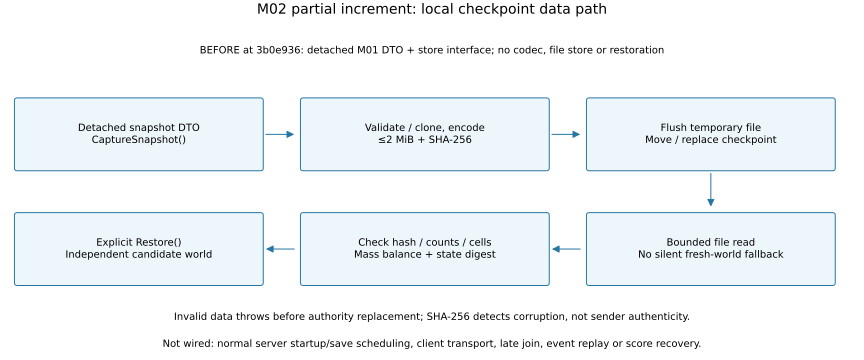

# M02 increment — Bounded checkpoint codec and restoration

**2026-10-23. M02 In Progress — verified local data-path increment; live integration remains pending.** Starting checkpoint: `3b0e936c11db3d550da8cfdc2e6fa70c37ee65a3`, after the verified M00/M01 milestones and requested source-comment pass. This is a partial increment, not completed network replication or a demonstrated server restart.

## Previous and new behavior

M01 exposed detached world DTOs, latest-step deltas and an unimplemented store interface. There was no binary checkpoint codec, local file store or world restoration factory. The new helpers encode validated data, read it back and reconstruct an independent simulation that continues with the same state digest. No client controls, scenes, assets, physics coefficients or normal server startup behavior change.

- `FireSnapshotCodec` uses explicit little-endian fields, format marker `FLS1`, schema 1 and a 2 MiB total input/output ceiling. It never instantiates types by name or accepts executable object serialization. An empty world is 144 bytes; a 16-chunk, 32×32-cell world is 1,508,000 bytes, measured by the supplementary harness. This format is uncompressed and not a finalized wire protocol.
- The decoder checks byte length/SHA-256 before parsing, then bounded counts before cell allocation, exact flags, schema and no trailing data. Invalid/truncated inputs throw; valid SHA-256 alone cannot bypass semantic validation. SHA-256 detects accidental corruption; it does **not** authenticate a sender or authorize state replacement.
- `FireWorld.Restore` validates grid, ordered unique IDs, active budget, finite numbers, enums, stable vegetation IDs, ticks, wind, combustion invariants, mass accounting and the canonical state digest. It copies cells into a new world with original scheduling cursor, revisions, wind and totals. A rejected candidate cannot mutate the existing authority. The caller owns installation; objects are not thread-safe and DTOs must not be mutated concurrently during restoration.
- `FileFireSnapshotStore` implements the existing contract with a bounded read and a same-directory temporary file, flush, then move/replace. Validation finishes before writing. A failed validation leaves the previous checkpoint intact. No fallback silently creates fresh vegetation. Single-writer/local-filesystem use is required; power-loss directory durability, concurrent writers and recovery of abandoned temporary files are not qualified.

The existing kg balances are checked with an absolute tolerance of 1e-6 kg plus relative 1e-10 for summation error. Ever-charred vegetation and exact double bits are retained. This does not change the fire model or promise cross-platform bitwise continuation; M01's gust precision limit still applies. Per-step timing counters and latest deltas are not checkpoint state; they start fresh after restoration, while chunk ages are reconstructed.

## Implemented flow



Editable source: [generator](../../scripts/render_m02_checkpoint.py). Reproduce from the repository root with `python scripts/render_m02_checkpoint.py` (Matplotlib; the existing ignored analysis runtime may supply it). SVG/PNG exports were inspected for labels and arrow direction. This is an architecture drawing, not a Game View screenshot or a future transport diagram.

## Verification

| Check | Actual result |
|---|---|
| Supplementary .NET 10.0.13 execution | Seven new NUnit tests passed; [case list/size observations](m02-checkpoint-evidence/dotnet-tests.json) |
| Unity 6000.6.7f1 EditMode | **41/41 passed, zero failures**; [NUnit report](m02-checkpoint-evidence/editmode.xml) |
| Restore then continue | Same digest for 100 future steps, including a wind change; matching delta revisions |
| Char / inactive scheduling / detachment | Preserved char, nonzero cursor and old chunk ages; DTO edits cannot mutate restored buffers |
| Envelope/parser checks | Corrupt, oversized, truncated, unknown schema, huge counts, invalid flag and trailing data rejected, including rehashed malformed payloads |
| Semantic candidate checks | NaN, wrong identity/enum/tick/order, kg imbalance, wind revision and digest errors rejected without touching live world |
| Local file integration | Create/replace/read, invalid-write preservation and corrupt-file rejection passed in a temporary Windows directory |

```powershell
unity test "$PWD" --editor-version 6000.6.7f1 --mode EditMode --filter Fireline.Tests --output Builds/M02Harness/editmode.xml --timeout 600 -- -buildTarget Win64 -nographics
```

The seven new tests are in [FireSnapshotTests.cs](../../Assets/Fireline/Tests/Editor/FireSnapshotTests.cs), using the actual codec/store/restore code. Existing simulation tests remain part of the Unity suite. The .NET execution is supplementary, not substituted for Unity acceptance. No new Windows/Linux player build, actual restart process, network traffic or three-client convergence is established by these helper tests.

## Remaining M02 acceptance

- Wire explicit checkpoint load/save into the real server lifecycle and verify state across separate process shutdown/restart. Never relabel an in-memory restore as that process proof.
- Implement client baseline serialization/delivery, ordered deltas, wind/manual-mutation metadata, revision-gap repair, heartbeat/disconnect and read-only client state.
- Verify three real clients including late join, packet delay/loss recovery, digest convergence and authoritative water/wind outcomes; capture real client evidence when presentation changes.
- Score/inventory systems and idempotent event replay do not yet exist. Do not claim recovery or no duplicated rewards from restoring only this fire snapshot.

Runtime screenshots and physics comparisons are **not applicable to this increment**, because no rendering/player flow or numerical governing model changed. New performance measurements are **not applicable** as a claimed optimization; codec/store cost and full-host/network load remain unmeasured follow-up work. The existing frame-loss register, raw M01 results and user sky-profile edit remain preserved. M05A stays planned and unimplemented.

## Final audit

Full Unity regression passed after importing all three new C# assets and metadata. [Source blob IDs and static checks](m02-checkpoint-evidence/source-audit.json) bind the candidate to the audited sources. Markdown links, SVG XML, Python syntax and diagram visual review passed. No client/server player rebuild was run for this partial helper increment; production process/runtime evidence remains pending.
