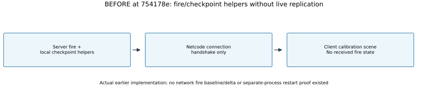

# M02 — Live authoritative replication and restart verification

**2026-10-23. Verified — bounded Windows replication/checkpoint proof.** Starting checkpoint `754178ebd1e02a3876c276cab6570b76e67f36fc`. The earlier [checkpoint helper increment](2026-10-23-m02-checkpoints.md) supplied only local data encoding/restoration. Current release players demonstrate three-client authoritative convergence, late join, separate-process restart, constant-delay/loss recovery and explicit negative cases. Jittered startup remains an observed failure below; production networking is not qualified.

## Previous behavior and current implementation

Previously, a dedicated server simulated fire while rendered clients proved only Netcode connection handshakes. Clients received no fire state; checkpoint helpers were not wired to server startup/save scheduling. The preserved calibration scene was the only client view.

The current code adds targeted baselines, ordered revision-guarded deltas, bounded fragment assembly, exact-digest acknowledgements, baseline repair, one-second heartbeats, 15-second silent-peer timeout and a read-only state display. Explicit load/save options connect the local checkpoint store to actual server startup, five-second saves and controlled shutdown. Corrupt loads fail with exit 6; failed writes use exit 7. Missing requested loads do not create a fresh world.




[Editable diagram/measurement generator](../../scripts/render_m02_replication.py): `python scripts/render_m02_replication.py`. Drawings were visually inspected for labels/arrows. The original client scene and sky profile are preserved; no aircraft, terrain, flame/smoke VFX, menu, player control or M05A system is introduced.

## Wire format, authority and bounded work

The resolved packages remain Netcode for Entities / Entities / Transport **6.6.0**, Unity **6000.6.7f1**, HDRP **17.6.0**. Compatibility was inspected in the installed package metadata/source and exercised by compilation/tests/builds, without adding packages. The installed `IRpcCommand` documentation specifies reliable ordered delivery and a one-packet message bound; `FixedString512Bytes` is supported by the installed RPC generator. [Resolved dependencies](../../Packages/packages-lock.json).

`FireFrameRpc` carries at most 480 ASCII base64 characters plus fixed metadata. A per-peer stop-and-wait target sends at most eight fragments per Unity Update callback, with at most eight subscribed peers. After an exact ACK, the next update waits at least 0.5 seconds; this is a bounded prototype stream, not production ghost/interest/bandwidth architecture or 100-player admission. Reliable RPCs introduce head-of-line blocking; production traffic scheduling remains an M08 qualification task.

A baseline is the existing canonical, validated schema-1 checkpoint. An `FPD1` delta carries the exact base digest, target tick, canonical chunk IDs and previous/next revisions, plus sorted nonoverlapping changed byte ranges in that checkpoint representation. This includes wind, manual ignition/water, mass totals and inactive scheduling metadata that the earlier latest-step cell DTO alone did not cover. Revisions may advance by multiple simulation steps between acknowledged targets; all intermediate byte differences are captured against the exact acknowledged baseline. Topology/size incompatibility or oversized patches falls back to a full baseline. Decoder bounds and canonical SHA/state validation still apply after patching; a rejected delta leaves the last valid state untouched.

Transfers are Deflate-compressed and bounded to 6000 fragments, 480 characters each, and 2 MiB decompressed protocol data. Counts are validated before assembly/allocation; duplicate identical fragments are tolerated, conflicting ones rejected. Incomplete assemblies expire after ten seconds; the server retries with a baseline after eight seconds without an ACK. Repairs are throttled. Old transfer IDs cannot replace a newer transfer on the same connection. Reconnection establishes a new Netcode connection; automatic reconnect UX is not implemented.

Only subscribe, ACK, repair and heartbeat controls exist. Unexpected control kinds and client-published fire frames are rejected. No RPC permits client ignition, water, wind or score mutation. ACKs affect delivery state only. This is not authentication, encryption, public-server hardening or denial-of-service qualification; those remain later hosting/security work. SHA-256 detects corruption rather than sender authenticity. Client code never calls `FireWorld.Step`; it displays received authoritative phases and totals.

## Reproducible acceptance scenario

`--fireline-replication-proof result.json` explicitly enables the synthetic verification fixture. Normal server operation still uses the existing M01 synthetic fixture unless an explicit checkpoint is loaded; neither fixture is a production incident generator.

The proof creates two active 16×16 chunks of 10 m cells, seed 415: normal brush at 2 kg/m² and low fuel at 0.1 kg/m² for existing char. The 5 Hz clock waits for two real clients to acknowledge baselines, then changes wind at tick 20 (4 simulated seconds), applies 14,700 kg over a 7×7 patch at tick 40 (8 s), and ignites a separate cell at tick 60 (12 s). It freezes at tick 120 (24 s) to compare an exact common target. Client #3 starts only after the suppression event; its initial baseline must already contain char. Proof-only stale-base injection for the first peer tests actual client gap detection/repair separately from transport loss.

The runner requires all three independent client process exits, real screenshots, exact final tick/digest and **identical full canonical checkpoint SHA-256**. A second fresh server process explicitly loads the saved file and three new client processes must reproduce the same state. Restart runs must not repeat the proof wind/water/ignition events. The saved tick is part of this bounded scenario's event schedule; generalized persistent command/event journals remain later work. Scores, inventory, incidents and rewards do not exist yet, so their idempotent recovery is not tested or claimed here.

```powershell
# Editor closed; use the project's audited build entry points first.
$env:FIRELINE_BUILD_EVIDENCE='docs/reports/m02-evidence/builds'
unity run "$PWD" --editor-version 6000.6.7f1 --timeout 1800 --log-file Builds/M02Start/server-build-headless.log --no-tail -- -buildTarget Win64 -nographics -executeMethod Fireline.Authoring.FoundationBuild.BuildServer
unity run "$PWD" --editor-version 6000.6.7f1 --timeout 1800 --log-file Builds/M02Start/client-build.log --no-tail -- -buildTarget Win64 -force-d3d11 -executeMethod Fireline.Authoring.FoundationBuild.BuildClient
./scripts/Test-M02Replication.ps1 -Port 8070
./scripts/Test-M02Replication.ps1 -Impaired -Port 8090
./scripts/Test-M02Negative.ps1 -Port 8080
```

The impairment proxy forwards **real UDP datagrams** with seeded random 5% drops and configured 80 ms constant delay in each direction. Report observed counts; configured delay is not measured RTT or a WAN claim. Proxies preserve bounded queue counters and distinguish random drops from deliberate blackout. The negative runner starts blackout only after a client received a real baseline; both peer timeout and client nonzero exit must occur. Another fresh server must refuse a corrupted checkpoint without emitting WORLD_READY or overwriting a valid save.

## Build recovery and graphics override

The first D3D12 Editor build crashed with device-removed error `887a0005` while allocating a 2048×1024 texture; it produced no successful build report. Temporary pipeline/quality/preloaded settings were restored before retry. Unity reports an active Personal licence; licence warnings in the failed log do not establish a continuing entitlement blocker. The server retry uses `-nographics`; the client Editor and acceptance players use `-force-d3d11` as a per-process recovery override, preserving the project's API configuration. This also prevents an equivalent API-matched rendering performance comparison with the earlier D3D12 capture. Only fresh successful reports qualify the retry.

## Verification results

| Check | Actual result / retained evidence |
|---|---|
| Unity EditMode | **48/48 pass**, 0 failed; repeated after final adapter changes (13:33 UTC, 11.567 s test execution); [NUnit XML](m02-evidence/editmode.xml). Seven additional protocol tests cover exact round trips, gaps/replay, bad revisions/truncation, topology fallback, fragment bounds and decompression bombs. |
| Windows headless release build | Succeeded, 0 errors / 505 warnings, 283.808 s, 141,360,911 bytes; [report](m02-evidence/builds/server-build.json), [nonempty packed inventory](m02-evidence/builds/server-packed-assets.txt). Runtime graphics Null, cameras 0. |
| Windows rendered release build | Succeeded, 0 errors / 501 warnings, 875.973 s, 196,026,484 bytes; [report](m02-evidence/builds/client-build.json), [inventory](m02-evidence/builds/client-packed-assets.txt). Warnings remain disclosed; zero errors is not a warning-free claim. |
| Assembly boundaries | Three role-appropriate Fireline DLLs per player, Client excluded from server / Server excluded from client; [source and binary identities](m02-evidence/build-identity.json). No new packages. |
| Source explanations / static closeout | All **214 C# function/property declarations across 26 maintained files** have summaries under five symbol configurations; [coverage](m02-evidence/comment-coverage.json). The audit compares the staged source tree with the same working source to check coverage/staging, not behavior identity against M01. PowerShell/Python syntax, local Markdown links/tables/fences, SVG XML, unique Unity metadata, capture dimensions, built-source hashes and sky preservation passed; [closeout checks](m02-evidence/closeout-checks.json). |
| Direct-IP initial + fresh restart | **8/8 process exits 0**, including six independent rendered clients and two sequential dedicated servers; [PIDs, SHA-256, state digests](m02-evidence/direct/summary.json). Initial late join starts at tick **82**, with **5 charred vegetation cells**. |
| 80 ms each way + seeded 5% UDP loss, initial + fresh restart | **8/8 process exits 0**; [PIDs, SHA-256, state digests](m02-evidence/impaired/summary.json). Initial late join receives tick **71**, with **5 charred vegetation cells**. Actual proxy counts below. No jitter pass. |
| Ordered-state repair / authority | Both initial scenarios reject the proof-only stale delta base, retain the last valid state, request/install a new baseline and converge. All clients receive rejection of invalid control kind 99 and real heartbeat pongs. No client fire mutation RPC exists. |
| Disconnection negative case | After a real baseline, deliberate UDP blackout produces server peer timeout and actual client **exit 9**, reason `heartbeat-timeout`; [summary](m02-evidence/negative/summary.json), [client markers](m02-evidence/negative/client-markers.txt), [server markers](m02-evidence/negative/server-markers.txt). |
| Corrupt-load negative case | Separate server **exit 6**, no WORLD_READY and valid destination unchanged; [markers](m02-evidence/negative/corrupt-markers.txt). The normal server in the blackout test was deliberately stopped by its owner, not counted as a clean proof exit. |
| Independent state validation | **16 actual FLS files** decoded separately with Python: identical SHA-256/FNV/state/mass across four server and twelve client results; [output](m02-evidence/independent-verification.json). Reproduce: `python scripts/verify_m02_evidence.py`. |
| Visual/graph inspection | Real BEFORE and six AFTER game screenshots, actual architecture SVGs and full/detail callback plots inspected; [visual comparison](../previews/m02-replication/COMPARISON.md). |

Every accepted final state has tick **120**, digest **`7ba53d73d78a059a`**, full canonical SHA-256 **`4408f309d4803da8b013277cfadd54cad5ac8e187266413e3b7ca7b37bdde211`**, wind north 8 m/s + gust amplitude 2 m/s, revision 2, 14,700 kg applied water, 13,132 kg retained, 1,568 kg evaporated and 225.546838 kg fuel consumed. All five charred vegetation flags persist; one cell is in the fully exhausted Charred combustion phase. Vegetation char and combustion phase are distinct fields. Mass checks use relative tolerance $10^{-10}$ and absolute tolerance $10^{-6}\,\mathrm{kg}$.

The restarts load the tick-120 checkpoint in new server PIDs, use three new client PIDs, preserve all canonical bytes and emit **no repeated proof wind/water/ignition events**. This tests controlled local checkpoint recovery, not arbitrary crash/power loss, PostgreSQL or generalized exactly-once event processing.

### Measured proxy traffic

| Phase | Proxy seconds | Received / forwarded UDP payload bytes | Observed random drops / received datagrams | Peak queued | Received / forwarded KiB/s |
|---|---:|---:|---:|---:|---:|
| initial | 44.883 | 854,530 / 816,376 | 74 / 1657 | 20 | 18.593 / 17.763 |
| restart | 13.641 | 42,652 / 39,017 | 9 / 132 | 20 | 3.054 / 2.793 |

These counts come from real loopback socket forwarding, including handshake, ACKs and retransmissions, excluding IP/UDP headers. KiB/s is payload bytes divided by proxy wall seconds and 1024, aggregated over both directions and all peers; per-peer counters and both directions are in [initial](m02-evidence/impaired/initial/proxy.json) / [restart](m02-evidence/impaired/restart/proxy.json). Startup/idle/late join share that window; do not call it steady-state per-player bandwidth. Queue drops were zero. Configured delay is 80 ms **per direction**, jitter zero; it is not a measured RTT. Direct socket bandwidth was not instrumented.

### Failed attempts and open startup limitation

One first direct attempt and three 80±30 ms jittered attempts failed their initial client-baseline deadlines and were excluded from acceptance. [Selected failure diagnostics/counters](m02-evidence/unsuccessful-attempts.json); raw paths remain local. The direct failure includes an actual Netcode handshake timeout at 5014 ms against its installed 5000 ms limit. Jittered attempts consistently left one client before the application baseline; the last observed affected proxy path had seven datagrams and zero random drops. That is evidence of a startup problem, not proof of its engine/transport/rendering cause.

The accepted impairment uses **constant** 80 ms each way plus 5% random loss, which satisfies the bounded packet-delay/loss replication check without claiming jittered startup works. Initial test launches now wait for the first client's actual baseline before starting client #2; all three overlap during convergence. Restart clients are launched together. **NET-01 follow-up in M08/M09:** reproduce cold and jitter/reordering connection setup, inspect UTP path-MTU/handshake timelines, add bounded startup failure/retry behavior and verify the original failing case before public-hosting qualification. No package setting was silently relaxed to turn these failures into passes. Reproduce the jittered runner with `./scripts/Test-M02Replication.ps1 -Impaired -Port 8090 -JitterMs 30`; its case output is separate from accepted `impaired` evidence.

## Performance and evidence limits

No 60 FPS, optimization or 100-player pass follows from this diagnostic. Render callbacks include waits/preemption/presentation behavior, not pure CPU/GPU execution or confirmed dropped presentations. Three concurrently visible 1280×720 clients, a local server and optional proxy share the worker; this is not the five-minute, one-client 1080p populated/coastal/smoky reference gate. No equivalent before/after performance pair exists, so the display's isolated cost is unmeasured. CPU/GPU execution, draw calls, GC pause attribution, VRAM and full server tick execution are unavailable here. Existing M00 896-sample hitch data and M01 numerical evidence remain unchanged.

The fire governing equations/coefficients are unchanged; a new physics comparison is not applicable. The read-only diagnostic uses project-generated phase-color pixels and Unity's built-in font over the original calibration assets, with no downloaded content. New visual captures are required because the actual client display changes. Measured interval locations and the graph guide below are included before the milestone commit.


## Callback measurements and graph reader guide

The accepted initial runs recorded the main camera's `endCameraRendering` callbacks on **i5-9400F / GTX 1660 SUPER, 16,323 MiB RAM, Windows 11 build 26300, NVIDIA driver 32.0.16.2101**, Unity 6000.6.7f1/HDRP 17.6.0, Mono release, **1280×720 Balanced, VSync=1, Direct3D11**. The Editor was closed. Three rendered clients (third joining later), one local headless server and ordinary desktop applications shared the PC; the impaired case added the Python proxy. The driver differs from historical M00; no matched improvement comparison exists. Current source/binary hashes are linked above. No production aircraft/smoke/sea workload is present.

| Case / client | Samples / seconds | Average FPS | 1% low FPS | p95 / p99 (ms) | Worst sample, start–end (s), duration |
|---|---:|---:|---:|---:|---|
| direct/client-1 | 1157 / 21.985 | 52.63 | 4.19 | 19.034 / 32.578 | #602, 10.134332–11.327469, **1193.136 ms** |
| direct/client-2 | 1145 / 21.868 | 52.36 | 4.04 | 18.670 / 27.136 | #605, 10.116415–11.283178, **1166.763 ms** |
| direct/client-3 | 468 / 7.834 | 59.74 | 33.97 | 17.177 / 23.953 | #45, 0.734047–0.783360, **49.314 ms** |
| impaired/client-1 | 1760 / 29.517 | 59.63 | 33.10 | 17.541 / 23.141 | #781, 13.101187–13.150962, **49.775 ms** |
| impaired/client-2 | 1324 / 22.202 | 59.63 | 33.54 | 17.514 / 23.012 | #298, 4.968062–5.016839, **48.777 ms** |
| impaired/client-3 | 469 / 7.817 | 60.00 | 42.70 | 17.133 / 22.845 | #254, 4.216946–4.241839, **24.893 ms** |


[PNG fallback](m02-evidence/callback-intervals.png), [independently recomputed metrics/worst locations](m02-evidence/performance-analysis.json), editable/reproducible [generator](../../scripts/render_m02_replication.py). Raw `.metrics.csv` and per-sample `.metrics.marked.csv` flags live beside each client's JSON in [direct initial](m02-evidence/direct/initial/) / [impaired initial](m02-evidence/impaired/initial/). The short restart captures finish before the five-second sampling threshold, so they have **no callback sample set**, not zero-cost frames.

- **Rows:** direct clients 1–3, then impaired clients 1–3. Each row is its own client recording. The right panel repeats the same samples with a tighter vertical scale; it is not another run.
- **Horizontal axis:** recording seconds. Ruler ticks are **5 seconds apart** (0, 5, 10, …). Zero is the start of that client's first stored interval after five **wall seconds from the replication adapter's Start**, not server startup, ignition, late join or an exactly aligned cross-client timestamp. The first interval can straddle the warm-up boundary; recordings have different lengths.
- **Vertical axis:** milliseconds between consecutive main-camera completion callbacks. An interval is one such gap, including engine work, presentation waiting and OS scheduling. The full-range left panels show all spikes. Their automatic tick spacing differs by row: **300, 250, 15, 15, 15 and 6 ms**, respectively. Read each scale independently; row heights cannot be compared as equal numerical ranges. Right panels show **14–26 ms**, with ruler ticks **2 ms apart**; gaps outside that range are clipped there and fully visible on the left.
- **Dashed line:** $1000/60 \approx 16.667$ ms, the spacing for evenly paced 60 Hz callbacks. Any interval above that budget is flagged; additional marked CSV flags identify >20 ms, >33.333 ms and the slowest 1%. An overrun does not by itself count dropped monitor presentations.
- **Arrows:** the worst real interval in each recording. `#602` means the 602nd retained sample, not 602 seconds or a simulation tick. Direct client #1 spans **10.134332–11.327469 s**, lasting **1193.136 ms**. Direct client #2 has a nearby **1166.763 ms** gap at #605. Cross-client wall alignment/event attribution is unavailable, so proximity does not prove a cause. All remaining exact locations are in the table/marked CSVs.
- **Simulation ticks are separate:** the authoritative fire step is **0.2 simulated seconds**, or **5 Hz**. Tick 120 means 24 simulated seconds in this scenario. Network send eligibility waits at least **0.5 wall seconds after ACK**; fragment work runs in Unity Update. Neither graph ruler ticks nor client callback samples count simulation steps or pure server CPU execution.
- **Statistics:** average FPS is sample count divided by summed intervals; 1% low is the reciprocal of the mean of the slowest $\lceil0.01N\rceil$ intervals. p95/p99 are nearest-rank interval percentiles. Short diagnostic runs and shared-machine startup hitches can dominate those values. No 60 FPS gate passes and no improvement is inferred by comparing direct and impaired timings.

The [frame-loss register](../performance/FRAME_LOSS_REGISTER.md#m02-measured-callback-overruns--2026-10-23) records these locations and concrete deferred profiling tasks. Potential costs in snapshot encoding/compression/patch application, main-thread UI updates, late process startup and scheduling are **suspects**, without causal CPU/GPU/GC traces. Optimization stays deferred as requested. Unity allocated memory is retained in each JSON; pure CPU/GPU frame time, draw calls, VRAM, complete host tick duration and confirmed dropped presentations remain unavailable. M00's 896 samples and original 83.47 ms hitch are unchanged.

## Scope closeout and next dependency

M02 is verified against `prompts/03_REPLICATION.md`: two clients consume authoritative stages/wind/suppression, a third sees existing char, exact separate-process restore succeeds, and actual delay/loss plus disconnect/corrupt-data checks are recorded. This is a bounded eight-subscriber RPC prototype and local checkpoint proof. M08 owns interest/adaptive traffic/load and NET-01; M07 owns PostgreSQL, crash recovery and durable idempotent events; M09 owns public hosting, Linux network runtime and production performance qualification. Fresh M02 Linux builds/runtime were **not run**; historical M01 Linux evidence is not reused as current replication evidence. Scores/inventory do not exist and therefore no score-duplication test is claimed. M03 is next, with the existing CL-415 licence/import gate still unresolved; M05A remains Pending.
