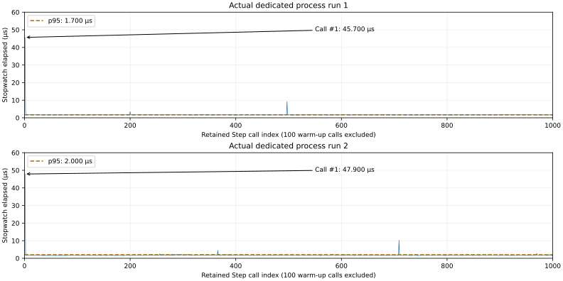

# M03 — Isolated debug-flight core

**2026-10-24. Verified partial increment; M03 In Progress.** Baseline `8af54d1a5eee658570a36601e04cb7f615370547`, checkpoint branch `checkpoint/m03-start-20261024`. Aircraft import remains [licence-blocked](../../AssetSources/Aircraft/CL415/AUDIT.md). The [M03 prompt](../../prompts/04_FLIGHT_CL415.md) permits a distinctly named isolated debug prototype; this increment contains **no aircraft mesh or graphical proxy**.

## Implemented behavior

The project previously had no flight solver. New pure C# code now computes SI air-relative lift/drag/side force, estimated thrust and control/stability moments, fixed-per-step fuel/water mass, centerline CoG/parallel-axis inertia, gravity, the full gyroscopic coupling term and normalized-quaternion 6DOF stepping. Inputs/states are bounded and a failed candidate never mutates the caller. The profile **DEBUG_FLIGHT_ONLY_V1** is estimated test data, not a CL-415 model. [Actual equations, values, BEFORE/AFTER SVGs, numeric plots, assumptions and remaining limitations](../physics/debug-flight/COMPARISON.md).

The dedicated player runs the solver only when `--fireline-flight-proof output.json` is explicitly supplied, then exits 0 or 10. Live fire initialization is skipped in that isolated mode. Normal fire/replication behavior remains when the flag is absent. The flag is rejected in clients and cannot share fire/replication proof, live load/save or timed smoke/benchmark modes. There is **no live aircraft entity, permission/ownership service, aircraft network messages, visual telemetry, collision or playable controls**. Normalized numerical input validation is not pilot authorization.

## Actual verification

| Check | Result / evidence |
|---|---|
| Unity EditMode | **57/57 passed**, zero failed; nine new flight tests plus the complete existing suite. [NUnit XML](m03-flight-evidence/editmode.xml). |
| Supplementary .NET checks | All nine flight test methods passed on the same pure source; this is supplementary to the actual Unity run, not a player-build substitute. |
| Human-readable source / static checks | All **254 C# function/property declarations across 30 maintained files** have summaries in five symbol configurations; [coverage output](m03-flight-evidence/comment-coverage.json). This compares the staged source with the same working source for coverage/staging, not behavioral identity with M02. Python/PowerShell syntax, local Markdown links/tables/fences, SVG XML, metadata, raw hashes and pre-existing sky/settings preservation are checked in [closeout output](m03-flight-evidence/closeout-checks.json). |
| Windows dedicated release build | **Succeeded, 0 errors / 505 warnings**, 253.787 s, 141,374,411 bytes. [Report](m03-flight-evidence/builds/server-build.json), [nonempty packed inventory](m03-flight-evidence/builds/server-packed-assets.txt). No presentation assets detected by the existing build audit; actual proof has Null graphics and zero cameras. |
| Two fresh player processes | Both actual exits **0**, all nine cases executed, 5400 post-step observations per process, 31 lift-polar points. [PIDs, raw file hashes, runtime DLL identities and hardware](m03-flight-evidence/process-summary.json). |
| Independent artifact verification | **10,800 observations** checked for mass/CoG/inertia, unit attitude, relative speed/dynamic pressure, dissipative aerodynamic power and bounds; analytic vacuum motion checked at every vacuum sample. Complete serialized physical trajectories and CSV bytes replay exactly across processes. [Output](m03-flight-evidence/independent-verification.json). |
| Existing fire networking regression | Current M03 server + unchanged **M02 client binaries**, two distinct server runs and six rendered clients: all eight process exits 0, late join/gap repair/restart and full canonical state hashes pass. [Process identities](m03-flight-evidence/fire-regression/direct/summary.json). Same final fire digest `7ba53d73d78a059a` and canonical SHA-256 `4408f309d4803da8b013277cfadd54cad5ac8e187266413e3b7ca7b37bdde211`. |

No fresh client or Linux build was run for this headless increment. The regression uses the previously verified M02 client explicitly; it does not establish a rebuilt M03 client or aircraft replication. Its unchanged-presentation captures remain under ignored `Builds/M03Start/fire-regression/`, and original M02 evidence/images remain untouched. New flight runtime screenshots are **not applicable**: no visual content/scene/UI changes. Numerical SVGs are not game screenshots.

The first Unity attempt timed out during Editor initialization at the configured 600 s limit, before any test verdict. The retry completed all 57 tests with the existing graphics override; no package/configuration was changed to bypass tests. Active Unity Personal entitlement was checked. The independent verifier initially required identical parsed CSV/JSON heights and found a maximum **1.1368683772161603e-13 m** decimal-format discrepancy. It now checks an explicit absolute $10^{-10}$ m serialization tolerance (seconds $10^{-12}$ s), while still requiring exact per-format replay and actual file SHA-256. Raw output was not edited. The corrected end-to-end runner was rerun and passed. No engine/transport root cause or new optimization is claimed.

## Reproduction and data

[Commands and operating boundaries](../M03_BUILD_AND_TEST.md). The final source identities and unchanged editor/package versions are recorded in [build identity](m03-flight-evidence/build-identity.json). The runner publishes only scoped FIRELINE markers; raw Unity logs remain ignored. Lossless raw artifacts: [run 1 JSON](m03-flight-evidence/run-1.json.gz), [run 1 CSV](m03-flight-evidence/run-1.csv.gz), [run 2 JSON](m03-flight-evidence/run-2.json.gz), [run 2 CSV](m03-flight-evidence/run-2.csv.gz). The CSV preserves Mono round-trip numeric strings; JSON preserves Unity's serialized state/forces and all inputs. Archives use standard gzip with timestamp zero; [independent verifier](../../scripts/analyze_m03_flight.py) runs without Unity or third-party Python libraries.

Every run contains the same explicit initial state (1000 m height, 60 m/s forward velocity, identity attitude, zero angular rate, 400 kg fuel), controls, density, wind, duration and time step recorded in the JSON. There is no aircraft RNG. The separate existing-wind case samples M01 `WindField` with seed 415, east base 8 m/s/gust 2 m/s and the original capped altitude multiplier, using weather tick $\lfloor t/0.2\rfloor$; it is not a live shared fire/flight world. Forces stored in each observation are reevaluated at the post-step state with that step's held wind.

| Case | Post-step samples / step | Final height (m) | Final east / north (m) | Final airspeed (m/s) | BEFORE / difference |
|---|---:|---:|---:|---:|---|
| ballistic_20ms | 200 / 20 ms | 921.154534 | 0.000000 / 240.000000 | 71.684909 | Unavailable: no previous flight model |
| ballistic_10ms | 400 / 10 ms | 921.350667 | 0.000000 / 240.000000 | 71.684909 | Unavailable: no previous flight model |
| ballistic_5ms | 800 / 5 ms | 921.448733 | 0.000000 / 240.000000 | 71.684909 | Unavailable: no previous flight model |
| dry | 800 / 5 ms | 963.296207 | 0.000000 / 246.095669 | 66.625966 | Unavailable: no previous flight model |
| loaded | 800 / 5 ms | 939.622152 | 0.000000 / 244.280858 | 69.769500 | Unavailable: no previous flight model |
| dry_10ms | 400 / 10 ms | 963.241817 | 0.000000 / 246.100678 | 66.624422 | Unavailable: no previous flight model |
| crosswind | 800 / 5 ms | 963.645975 | 1.463373 / 245.806445 | 66.910988 | Unavailable: no previous flight model |
| server_wind | 800 / 5 ms | 962.986908 | 1.753899 / 246.025865 | 66.182189 | Unavailable: no previous flight model |
| controls | 400 / 5 ms | 995.747199 | 2.132223 / 120.841574 | 61.448809 | Unavailable: no previous flight model |

The continuous vacuum height at four seconds is **921.5468 m**. The 20/10/5 ms results differ by **0.392266 / 0.196133 / 0.0980665 m**, matching the analytic first-order semi-implicit position error within $10^{-8}$ m. Dry-vs-loaded final height differs by **23.674054 m** under identical commands; mass, CoG and inertia all change, so this is their combined response, not an isolated mass-only effect or certified climb performance. The 5-vs-10 ms dry case differs by **0.054390 m** at four seconds. Both are untrimmed free-flight fixtures, not takeoff/landing acceptance.

## Timing method, measured results and graph guide

Hardware: **Intel(R) Core(TM) i5-9400F CPU @ 2.90GHz**, **Microsoft Windows 11 Pro build 26300**, 16324 MiB visible RAM. Mono Windows release dedicated player, Unity 6000.6.7f1; Editor closed, one proof player at a time, ordinary desktop applications present. GPU/preset/resolution/draw calls/FPS are not applicable to this Null-graphics proof. No CPU/GPU frame timing, total memory/residency, allocation bytes, full host tick duration or flight bandwidth was measured. Generation-0 collection counts are not an allocation-free proof.

The timing loop runs **100 excluded warm-up calls**, then **1000 retained independent calls** to `FlightDynamics.Step` using the same initial fixture, half throttle, zero wind, density 1.225 kg/m³ and 5 ms physical step. Each call measures `Stopwatch` elapsed around `Step`, with no JSON/CSV writing inside the timer. A returned-state accumulator prevents result elimination. These are repeated evaluations of one fixture, not 1000 real-time host ticks, a sustained flight/load test or a client frame measurement; elapsed cost includes preemption/JIT effects rather than pure hardware CPU execution time.

| Actual process | Warm-up / retained calls | p50 / p95 / p99 (ms) | Maximum (ms) / retained call | Gen-0 collections |
|---|---:|---:|---:|---:|
| Run 1 | 100 / 1000 | 0.0017000 / 0.0017000 / 0.0018000 | 0.0457000 / #1 | 0 |
| Run 2 | 100 / 1000 | 0.0017000 / 0.0020000 / 0.0023000 | 0.0479000 / #1 | 0 |

[Editable/reproducible drawing generator](../../scripts/render_m03_flight.py), [PNG fallback](m03-flight-evidence/step-timing.png), [plot scales](m03-flight-evidence/plot-scales.json). All exported figures were visually inspected for labels, bounds and arrows.

- **Panels:** run 1 and run 2 are two real dedicated processes. They share plotting scales; they are repetitions, not BEFORE/AFTER optimization results.
- **Horizontal ruler:** retained call index with ticks every **200 calls** (0, 200, …, 1000). The first sample is call **#1**, after 100 untimed warm-up calls; zero is the ruler origin, not application startup or a stored call. Calls are accelerated and have no plotted wall-time origin. Each plotted sample is one function's measured execution interval.
- **Vertical ruler:** microseconds, **10 µs per tick**, range 0–60 µs. Raw data uses milliseconds, converted by multiplying by 1000. One microsecond is $10^{-6}$ seconds. This is not a GPU frame, a render callback gap or a dropped presentation.
- **Dashed line/arrow:** each dashed line is that run's nearest-rank p95. The arrow marks its largest recorded elapsed call; the table gives the call index and duration. Their cause is unprofiled; first-retained-call spikes do not establish a render hitch or justify an optimization claim.
- **Physical step is separate:** a call advances the isolated state by **5 simulated milliseconds**. That value is not its measured CPU duration or the gap between scheduled calls. The existing fire weather clock remains 0.2 simulated seconds; neither clock is a graph ruler tick. No whole-server tick budget or 60 FPS/100-player gate follows from these microdiagnostics.

The three numerical panels and their independent axes/units/ruler spacing are explained in [the physics comparison](../physics/debug-flight/COMPARISON.md#numerical-evidence-and-limits). Its height ruler spacing is **15 m**, time ruler spacing **1 s**; its coefficient and convergence panels describe actual estimated curves and analytic discretization, not prior flight behavior. Existing M00/M02 frame-loss records remain unchanged; new solver costs are recorded for later attribution only.

## Remaining M03 work

M03 stays **In Progress**. Resolve/audit the aircraft source rights before any mesh/texture import; establish real variant definitions and verified axes/pivots; calibrate aerodynamic/engine/inertia data; implement fuel burn and variable-mass handling, collision/runway/gear/scoop constraints, server pilot ownership/input validation, aircraft state replication/correction, controls/cameras/telemetry and repeatable route/takeoff/landing checks. Aircraft water release/footprints/suppression follow those prerequisites. M05A remains Pending; NET-01 startup and deferred frame-loss attribution remain M08/M09 tasks. This partial verification does not waive any milestone acceptance requirement.
