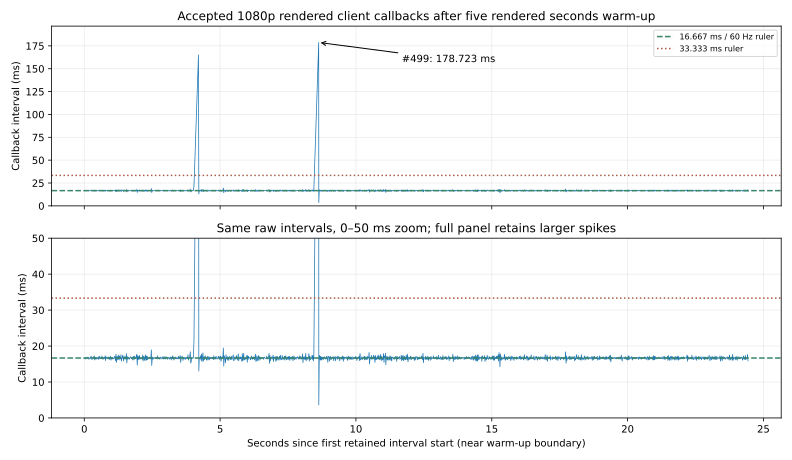
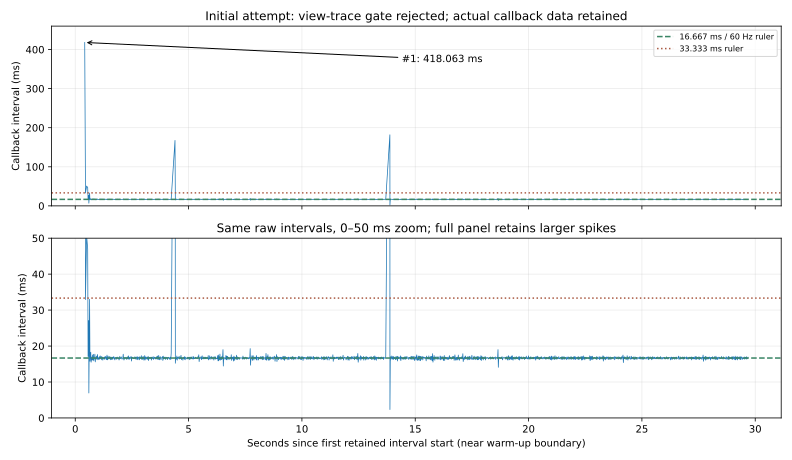

# M03 engineering aircraft view — verified partial increment, 2026-10-24

Baseline: `3035aeaa5927277f062ebafce6ea30eb65fa555c`. **M03 remains In Progress.** Connected the temporary model to received server poses in a separate synthetic-runway client, with keyboard/gamepad test controls, two external cameras, 100 ms receipt-time interpolation and engineering telemetry. Flight/contact equations are unchanged. This is a dry taxi/control/render increment, not takeoff/landing, cockpit, animations, calibrated CL-415 performance or water/suppression acceptance.

[Actual BEFORE/AFTER captures, controls, equations, generated SVGs, raw graph interpretation and asset limits](../previews/m03-flight-view/COMPARISON.md), [build/run commands](../M03_BUILD_AND_TEST.md#engineering-flight-view-and-device-proof).


## Actual checks and outcomes

| Check | Actual outcome | Evidence |
|---|---|---|
| EditMode project checks | **94/94 pass**: existing physical/authority checks plus presentation/history/options and exact scene/runway/no-collider contract | [NUnit XML](m03-flight-view-evidence/editmode.xml) |
| PlayMode device checks | **3/3 pass** with installed Input System fixture: real queued keyboard/pad state/edges, control signs/buttons, focus neutralization and bounded throttle | [NUnit XML](m03-flight-view-evidence/playmode.xml) |
| Final Windows flight-test client | Succeeded, **0 errors / 499 warnings**, 65.509 s, 202,722,545 bytes, Mono release | [Build result](m03-flight-view-evidence/builds/flight-test-client-build.json), [asset inventory](m03-flight-view-evidence/builds/flight-test-client-packed-assets.txt) |
| Fresh Windows dedicated server | Succeeded, **0 errors / 505 warnings**, 347.767 s, 141,563,628 bytes, no packaged presentation assets | [Build result](m03-flight-view-evidence/builds/server-build.json), [asset inventory](m03-flight-view-evidence/builds/server-packed-assets.txt) |
| Real role/process proof | New dedicated + visible D3D11 1080p owner + headless observer from the new client binary, loopback port 8351; **all actual exits 0** | [PIDs/runtime assembly hashes](m03-flight-view-evidence/process-summary.json) |
| Source truth and actual late join | **271 owner + 130 observer snapshots** match server publications exactly; first received ticks **1409 / 2113** respectively | [Independent verification](m03-flight-view-evidence/verification.json), [complete server publications](m03-flight-view-evidence/server.snapshots.jsonl.gz) |
| Actual presentation | **1,723 initialized display frames** independently reconstructed from source poses and receipt/sample clocks. Maximum position difference **4.03×10⁻¹⁵ m**, quaternion-component difference **1.11×10⁻¹⁶**, float Transform-position difference **0 m** | [Recorded source/display/control trace](m03-flight-view-evidence/view-owner.csv.gz), [checker](../../scripts/analyze_m03_flight_view.py) |
| Controls/cameras/ownership | **439 accepted owner inputs**; 1,730 processed keyboard and 1,730 pad events; both external cameras captured; focus gate neutral/lease expiry, explicit seat release/reclaim and final disconnect release pass | [Owner result](m03-flight-view-evidence/view-owner.json.gz), [server result](m03-flight-view-evidence/server.json.gz), [scoped markers](m03-flight-view-evidence/view-owner-markers.txt) |
| Asset/scene boundaries | Rendered runway exactly X ±22.5 m / Z -500…2500 m / top Y=0; no Unity colliders; original prefab/static scene/source materials unchanged. Opposite-role/test assemblies absent from normal players | [Scene test](../../Assets/Fireline/Tests/Editor/FlightSceneTests.cs), [final checks](m03-flight-view-evidence/final-verification.json) |
| Human source comments | All maintained C# members documented; scoped source/comment/script check passes | [Actual file/member counts and five configurations](m03-flight-view-evidence/source-comments.json) |

Every **received** source pose is matched to its actual server publication; the two final extra publications (272/131 sent versus 271/130 applied) remain unacknowledged as clients exit. This does not count unreliable network loss. The observer attempts occupied-seat claim/input and a forged pose, all rejected by the server; owner release can also cause already queued old-generation inputs to be rejected legitimately. Server ends vacant, with one input expiry and one actual pilot disconnect release, no solver fault. It completes **7336 aircraft steps** (36.680 physical s) and fire tick **183** over 36.697 wall s. An existing bounded-clock startup overrun discards 13.3301 ms wall time; it is no rendered-frame metric.

The view observed **3.600985 m northward travel**, not an airborne route or total flight-path length. Speed/altitude/ticks/seat in the HUD are received server data; throttle/gear/flaps/brake are local requests. The frame checks prove receipt-to-display math and Transform placement, **not** physical prediction accuracy or zero network latency. The first receipt history is used to initialize the checker; subsequent rows are checked within $10^{-8}$ m / $10^{-10}$ quaternion-component tolerances. They retain actual source precision; no physical solver runs in Client.

## Failed attempts retained honestly

The first scene-generation attempt expected the prefab's original display name. Unity had named the saved instance `CL415Prototype`; authoring now resolves the exact prefab asset reference. The interrupted output was verified byte-identical to the source scene before resuming; edited/generated scenes cannot be reset by that helper.

An initial test run inherited Unity's Server subtarget and excluded Client assemblies. Explicit Player subtarget compiled the client checks. The initial gamepad edge assertion in EditMode was unsuitable for Input System 1.20.1's fixture; device tests now run in supported PlayMode, with pure checks remaining EditMode. Final platform-specific pass counts above are the acceptance evidence. New code's deprecated first-object lookup was replaced with the supported unordered lookup where exactly one adapter is expected; no optimization claim follows.

The first rendered attempt had all player self-checks/exits pass, but the independent CSV checker rejected a focus transition: its recorder labeled the **next** scheduled proof gate rather than the value actually used by that frame's input sample. The recorder now stores `FlightTestView.InputFocused`. That attempt also exposed a cold rendered startup where the later-launched headless observer connected first. Harness now waits for the owner's confirmed occupied-seat trace before starting observer, and the checker requires increasing actual first-received ticks. No check was removed to get acceptance. [Attempt history, actual first-run callback statistics/hash and exclusion reason](m03-flight-view-evidence/attempt-history.json).

Initial raw logs/images remain ignored under the recorded scratch paths. Its actual **418.062896 ms callback at #1** is retained separately for deferred profiling; its presentation evidence is excluded from acceptance. The final snapshots/screenshots/timing dataset comes only from the successful replay. Different startup/cache/admission conditions prevent treating these attempts as matched speed measurements.

## Measured rendering and deferred profiling

Hardware: Intel i5-9400F, GTX 1660 SUPER, Windows 11 build 26300, driver **32.0.16.2101**, 16,323 MB Unity-reported RAM. Editor closed; Windows Mono release, **1920×1080 Balanced, retained VSync=1, per-process D3D11**. One dry aircraft (144 imported renderers), 31 primitive debug surfaces and the engineering HUD; one headless observer and existing fire/wind fixture. No coast/population/smoke/drop workload. [Environment](m03-flight-view-evidence/environment.json), [actual metrics](m03-flight-view-evidence/metrics.json), [raw intervals](m03-flight-view-evidence/metrics.csv).

| Recorded diagnostic | Actual result |
|---|---:|
| Retained intervals / elapsed recording | 1448 / 24.433480 s |
| Average / 1% low FPS | 59.262945 / 25.649861 |
| p95 / p99 callback spacing | 17.394099 / 17.924000 ms |
| Maximum | #499, **178.722903 ms**, 8.450635–8.629358 s |
| Second maximum | #243, **165.068999 ms**, 4.038424–4.203493 s |
| Intervals above 16.667 / 33.333 ms rulers | 736 / 2 |
| Peak Unity allocated bytes | 482,846,054 |

These are callback spacings and the stated callback-derived FPS summaries, **not CPU/GPU execution or confirmed dropped presentations**. CPU/GPU frame execution, draw calls, VRAM, GC/allocations, RTT and network bytes remain uninstrumented; fire/full-host tick execution is unavailable. Existing `FlightAuthority.Advance` maximum 5.6475 ms measures only that adapter, not the complete host. A short debug scene does not meet the representative five-minute coast/smoke/100-player matrix; p95 also exceeds 16.667 ms. **No 60 FPS acceptance or performance improvement is claimed.**



Reader guide: X major ruler **5 recording seconds**; accepted full Y ruler **25 ms**, lower 0–50 ms zoom Y ruler **10 ms**. Five rendered seconds warm up; origin is the start of the first retained interval near that boundary, not application launch or an aircraft tick. Every sample is one adjacent main-camera callback interval. Dashed 16.667 ms / dotted 33.333 ms are diagnostic rulers; full panel retains the annotated maximum and zoom explicitly clips higher spikes. They are not the 5 ms aircraft or 0.2 s fire step. [Exact scales](../previews/m03-flight-view/callback-timing-scales.json), [all interval start/end marks](m03-flight-view-evidence/callback-intervals.marked.csv).



The initial graph follows the same definitions but has a **100 ms full-panel Y ruler**, 10 ms zoom spacing, first interval **418.062896 ms** at recording 0–0.418063 s; it is no accepted presentation trial or matched BEFORE. [Initial scales](../previews/m03-flight-view/initial-callback-timing-scales.json), [all initial diagnostic intervals](m03-flight-view-evidence/rejected-attempt-callbacks.marked.csv.gz). Startup/capture/cache differences remain uncontrolled; no causal performance comparison.

The [presentation/control graph](../previews/m03-flight-view/COMPARISON.md#performance-graph-guide) uses a **different origin**, the proof's first ready pose. X spacing is 5 wall seconds, position Y meters, local request Y dimensionless with 0.25 rulers; the shade comes from actual sampled focus flags. It is no CPU or physics-tick plot. [Complete axes, interval, receipt-delay, history and annotations guide](../previews/m03-flight-view/COMPARISON.md#performance-graph-guide).

**FL-08** records both accepted spikes and the initial diagnostic. Observation sites are `ClientProbe.OnCameraRendered`, the two end-of-frame screenshot encoders, `FlightTestView.Update` string/uGUI updates and `LateUpdate` pose/camera work, plus surrounding HDRP/driver/GC/OS scheduling. Their temporal proximity is not attribution: no synchronized profiler/presentation timeline proves a cause. Follow up with capture-on/off, CPU/GPU/GC/presentation counters and representative scenes. Optimization remains deferred; FL-06/FL-07, HOST-01 and NET-01 remain open.

## Preservation, reproducibility and next dependencies

Checkpoint branch `codex/checkpoint-m03-flight-view-start-20261024` and ignored initial byte snapshots precede edits. The user sky edit remains unchanged and uncommitted; screenshots/binaries use that local profile, whose hash is preserved in the final evidence. Reproducing identical lighting from a fresh clone also requires that saved local profile. Five configuration hashes, static scene/prefab/source-asset diffs, serialized server asset guard, role DLL hashes, actual PNG dimensions, archived raw hashes and source comments/links are checked before commit. No project reset, package addition or project API/preset change occurred; only Unity's proven define-order side effect was restored from the initial snapshot.

Original contributor/legal files are copied into the new client build. Three flat-color HDRP materials and primitive surfaces are project-authored; no new downloaded asset, texture conversion or rights declaration. [Asset provenance and debug gear/CoG limits](../previews/m03-flight-view/COMPARISON.md#scene-assets-and-provenance). The existing source model remains a user-authorized temporary prototype.

The published compressed artifacts can be rechecked without Unity or ignored raw logs:

```powershell
python scripts/analyze_m03_flight_view.py --archive docs/reports/m03-flight-view-evidence --evidence Builds/M03ViewArchiveReplay --image docs/previews/m03-flight-view/after.png
```

The script verifies raw/hash bindings and recomputes input/focus, source-pose parity, interpolation/float placement and FPS summaries. Matplotlib is needed only for regenerating drawings via `scripts/render_m03_flight_view.py`; source/live tests are C#. [Actual final checks](m03-flight-view-evidence/final-verification.json).

Next M03 work: calibrated real gear/CoG/pivots and general airframe/terrain/obstacle collision, usable cockpit/animated surfaces, explicit aircraft/fuel configuration and airborne takeoff/route/landing checks; prediction/correction and impaired-network testing; then scoop/release/trajectory/conservation/shared suppression. This view uses no extrapolation and no predictive correction. M04 and M05A remain Pending; no production menu/settings/tutorial/control-context work starts here.
