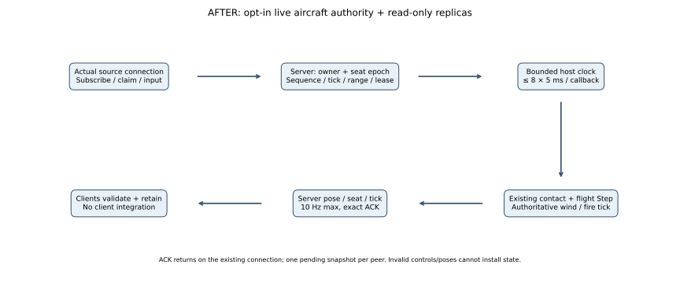
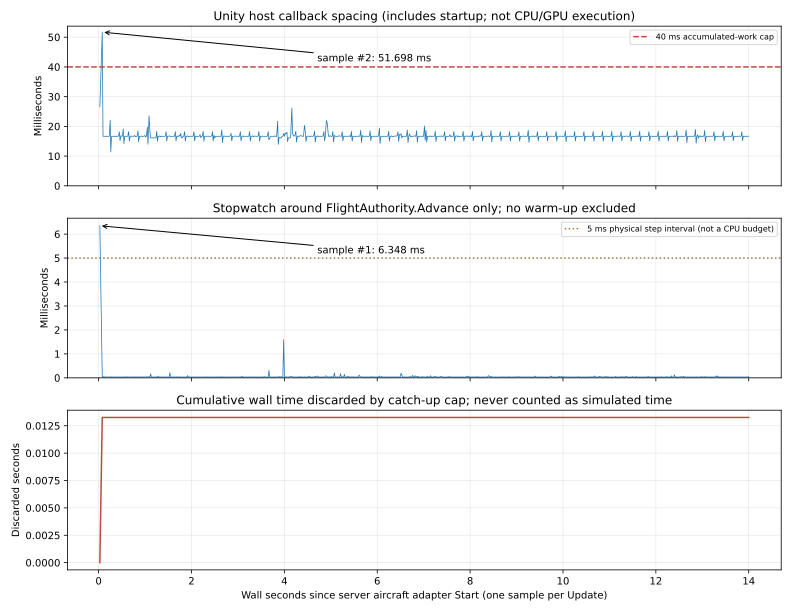

# M03 live aircraft authority — verified partial increment, 2026-10-24

Baseline: `50ce91439a536678af1d39022f7a664e27b32d84`. **M03 remains In Progress.** This change connects the existing estimated flight/contact solver to an opt-in dedicated host, transport-derived pilot ownership, validated input and read-only client pose replication. The static CL-415 preview remains separate. No playable cockpit, test controls/cameras, animation, general collision, calibrated CL-415 or water operation is claimed.

Before: accelerated numerical runway proofs only, no live aircraft protocol. After: one live dry debug aircraft, 5 ms physical steps with a maximum eight per callback, actual authoritative wind/fire-tick sampling, expiring pilot commands and bounded targeted snapshot/ACK exchange. [Implementation, SI equations, actual BEFORE/AFTER SVGs, numerical reference checks, measured plots and complete graph reader guide](../physics/live-flight-host/COMPARISON.md), [reproduction commands](../M03_BUILD_AND_TEST.md#live-debug-aircraft-and-two-client-network-proof).

## Actual verification

| Check | Actual outcome | Evidence |
|---|---|---|
| Unity EditMode suite | **89/89 pass**, including exact existing-solver comparisons, authorization/rate/lease/clock guards, invalid input and envelope freeze | [NUnit XML](m03-flight-network-evidence/editmode.xml) |
| Windows dedicated build | Succeeded, **0 errors / 505 warnings**, 161.686 s, 141,562,092 bytes; Null graphics/no cameras and no packaged presentation assets | [Build result](m03-flight-network-evidence/builds/server-build.json), [inventory](m03-flight-network-evidence/builds/server-packed-assets.txt), [runtime markers](m03-flight-network-evidence/server-markers.txt) |
| Windows aircraft-preview client build | Succeeded, **0 errors / 501 warnings**, 322.955 s, 202,676,393 bytes; client used without graphics in this proof | [Build result](m03-flight-network-evidence/builds/aircraft-preview-client-build.json), [inventory](m03-flight-network-evidence/builds/aircraft-preview-client-packed-assets.txt) |
| Real transport/processes | One dedicated + two separate Netcode client players, loopback port 8330, all actual exits **0**; observer launched three seconds after owner | [PIDs, binary/runtime hashes, hardware](m03-flight-network-evidence/process-summary.json) |
| Authority and input | 134 accepted owner inputs; deliberate zero sequence, stale epoch, NaN and future tick each rejected; observer claim/input denied; one forged pose rejected | [Server/client results and independent checks](m03-flight-network-evidence/verification.json) |
| Read-only replicas | **87 owner + 67 observer snapshots match their server publications exactly**; actual late observer begins at aircraft tick 1202 versus owner's 667 | [Compressed complete server publications](m03-flight-network-evidence/server.snapshots.jsonl.gz), [owner](m03-flight-network-evidence/owner.snapshots.jsonl.gz), [observer](m03-flight-network-evidence/observer.snapshots.jsonl.gz) |
| Lease and disconnect | Two input-expiry transitions; one pilot disconnect release; observer sees vacant seat; no solver fault | [Checked results](m03-flight-network-evidence/verification.json) |
| Failure gate | No-client actual server run returned expected **exit 12**, reason `network-proof-timeout`, after 50.019 s; it did not claim success | [External outcome](m03-flight-network-evidence/negative-result.json), [actual failed-proof state](m03-flight-network-evidence/negative-no-peer.json) |
| Human source comments | **40 C# files / 343 documented members**, five compile configurations, no missing comments; script syntax/AST/token audit passes | [Scoped audit](m03-flight-network-evidence/source-comments.json) |

The snapshot test checks every **received** pose, not every sent RPC. The server published 88 owner / 68 observer poses; each client exits with its last additional publication still unacknowledged. No unreliable-packet loss result is inferred from those final in-flight messages. Accepted request counters also include subscribe/claim; the owner's 134 input count comes from actual input replies. Server fire continued to tick 69 while aircraft completed 2797 physical steps; both clocks retain their documented separate scheduling behavior. Prototype wind is the existing east 8 m/s, gust 0 fixture (with its height multiplier), not a new regional weather scenario.

The initial test run had 86/87 passing: its sleep test incorrectly expected exactly zero forward velocity during gear settling. It was corrected to compare the eight-step neutral path directly, without changing the physical solver. Final 89-case suite adds envelope/serialization checks and passes. An earlier preliminary server build also succeeded; only the final matching binaries/results above are used for acceptance. Existing warning counts are retained honestly; no clean-warning or fresh Linux qualification is claimed. The no-peer failure gate ran while the client build was active and is used only for its timeout/exit result, not for performance comparison.

## Timing and locations retained for later optimization

Hardware: Intel i5-9400F, Windows 11 Pro build 26300, 16,324 MiB visible RAM; Windows Mono release players, Editor closed, one aircraft, two loopback clients. All **835 server aircraft Update callbacks** retained from startup; no warm-up removed. Host duration 14.001966 wall s; aircraft advanced 13.985 physical s, with a fractional remainder and **0.0132569 s** discarded by its cap.

- `FlightAuthority.Advance` Stopwatch p95 **0.0633 ms**, max **6.3483 ms at callback #1**. This covers that adapter only, not complete host/network/fire execution.
- Callback spacing p95 **18.3073 ms**, max **51.6976 ms at callback #2**, wall interval **0.0265593–0.0782569 s** after the adapter recording origin. Remainder plus gap exceeded the 40 ms work cap, discarding **13.2569 ms**. This is [HOST-01](../performance/FRAME_LOSS_REGISTER.md#m03-live-host-catch-up-observation--2026-10-24), **not a measured rendered frame drop**.
- No synchronized profiler/GC/OS trace attributes either maximum. Proof-only buffered CSV/JSONL writing and concurrent Netcode/fire/Unity work can affect callback spacing; their separate costs were not measured. Optimization remains deferred.

The report's [graph guide](../physics/live-flight-host/COMPARISON.md#measured-timing-and-graph-guide) explains 2 s horizontal rulers, physical ticks, callback samples, startup origin, Y units/spacing, cap versus execution, annotations and the separate trajectory plot. FPS/1% low/GPU/draw calls/VRAM are not applicable to Null graphics; full CPU stages, allocations/GC, RTT and bandwidth counters remain unavailable. No 60 FPS, optimization, WAN or 100-player claim.

## Preservation and remaining dependencies

Checkpoint branch `codex/checkpoint-m03-authority-start-20261024` and ignored byte snapshots precede changes. Existing user sky edit is preserved. Final configuration SHA checks cover sky, ProjectSettings, UnityConnectSettings, manifest and lockfile; only Unity's proven agent-caused define-order shuffle was restored from the start snapshot. No scene, asset, package, project graphics API, quality preset or HDRP configuration was intentionally changed.

Shared wire code gains no Simulation/HDRP reference; Server/Client role assemblies remain separate. Default operation is unchanged without the explicit debug-session option. New screenshots, asset/provenance records and PBR comparisons are **not applicable**, because the change is nonvisual and imports no assets. The [existing actual static-model image](../previews/m03-cl415-prototype/COMPARISON.md) remains current. Flight state is not persisted; this debug mode excludes M02 save/load rather than pretending aircraft recovery exists. The direct-IP `NetworkId` authorizes an already connected seat, not account authentication, unit qualifications or public admission.

Next: connect correctly offset visual body, test input/cameras/telemetry and interpolation/correction; test flight under impaired network; add general contact/calibrated airframe/fuel behavior and takeoff/landing route; then scoop/drop/dispersion/conservation and shared suppression acceptance. M04/M05A remain pending. README, TASKS, CHANGELOG, DEVELOPMENT_STATUS, physics/network/technical references, performance history and investigation register are updated with this bounded scope. [Final preservation/link/evidence checks](m03-flight-network-evidence/final-verification.json) accompany the increment.
