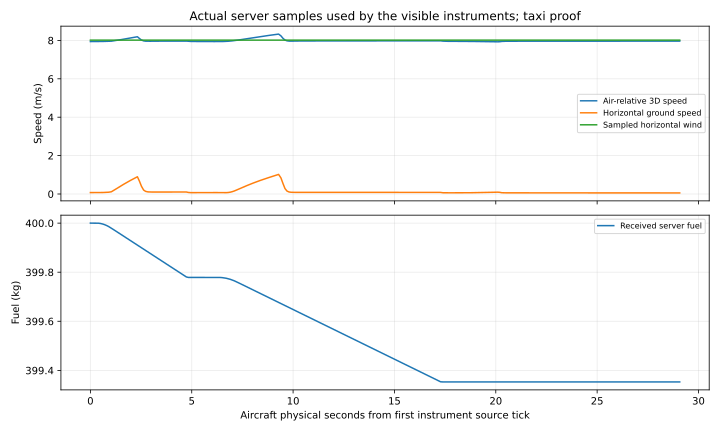
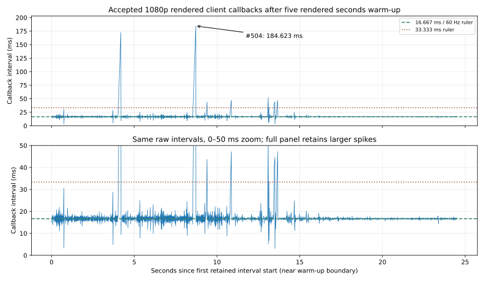

# M03 — verified read-only flight instruments, 2026-10-25

**M03 remains In Progress.** Added actual server-sampled wind to aircraft protocol v2 and a read-only engineering airdata/resource panel. Airspeed, horizontal ground speed, vertical speed/CoG altitude, pitch/bank/heading, wind, fuel/water and estimated mass/CoG now come from a validated authoritative snapshot. Corrected the previous HUD's ground-speed label, which used 3D speed. [Algorithms, SI equations, BEFORE/AFTER SVGs and actual screenshots](../previews/m03-flight-instruments/COMPARISON.md). This is a debug instrumentation increment, not the M05A cockpit/settings milestone.

## Verification and actual behavior

| Check | Actual result |
|---|---|
| Unity tests | **110/110 EditMode**, **3/3 PlayMode**, no failed tests |
| Windows dedicated release | Success; **0 errors / 510 warnings**, 393.272 s, 141,568,460 bytes; no visual assets |
| Windows flight-test release | Success; **0 errors / 499 warnings**, 343.301 s, 202,728,033 bytes |
| Numerical regression | Two actual dedicated processes exit 0; **8,800 resource samples/run**; original flight/polar and fuel trajectories exactly unchanged |
| Actual live proof | Dedicated + rendered owner + later headless observer all exit **0** |
| Published/received poses | **273 owner + 131 observer = 404** exact source matches; first ticks 3251 / 3981 confirm later admission |
| Model presentation | **1,715** independently reconstructed frames; max position difference 1.018e-15 m, quaternion component difference 1.111e-16, float-anchor error 0 m |
| Actual instrument text | **1,721** checked strings, **234** distinct; each exact displayed source/text matches independent calculation and a real server publication |
| Wind | **406** published vectors independently reconstructed from recorded wind state/seed; max difference **0 m/s** |
| Device/authority | Synthetic keyboard/gamepad, logical focus neutralization, seat release/reclaim, cameras, lease expiry, deliberate invalid/nonowner/forged pose and disconnect checks pass |
| Human source comments | **53 C# files / 427 documented members** pass five-configuration audit |

The server consumed **0.647064955 kg** fuel and advanced 9,163 aircraft substeps / 229 fire ticks. Snapshot wind is sampled at the published post-step CoG and current fire tick; it is not mislabeled as the prior integrator's pre-step sample. The existing authoritative wind field and all Simulation sources are unchanged. The independent checker uses recorded wind metadata/seed, not client-supplied wind. This bounded fixture uses seed 415, revision 1, east 8 m/s, north 0 m/s and gust amplitude 0 m/s, with the existing height factor; it does not qualify changing wind revisions or gusty flight. Latest-snapshot readouts intentionally precede the separately interpolated 100 ms-delayed cosmetic model.

All aircraft messages now use `FlightWire.Version = 2`; wind components extend the pose RPC. Matching rebuilt players are required. Old Netcode RPC collections/binaries are not qualified even though fire replication's own schema remains unchanged. No client wind/fuel mutation or local flight integrator is added.

Sources: [unit XML](m03-instrument-evidence/editmode.xml), [device XML](m03-instrument-evidence/playmode.xml), [builds and packed inventories](m03-instrument-evidence/builds/), [three actual processes/role DLL hashes](m03-instrument-evidence/runtime/process-summary.json), [independent runtime results and raw archive bindings](m03-instrument-evidence/runtime/verification.json), [exact numerical regression and process hashes](m03-instrument-evidence/physics-regression.json), [one full retained numerical raw run](m03-instrument-evidence/physics-regression.json.gz), [comments audit](m03-instrument-evidence/source-comments.json), [final preservation/evidence audit](m03-instrument-evidence/final-verification.json). The second numerical raw run remains at the recorded ignored `Builds` path; both process records are retained. [Reproducible commands and immutable archive replay](../M03_BUILD_AND_TEST.md#sampled-wind-flight-instruments).

## Failed route investigation — airborne gate remains open

Two offline .NET 10 control strategies used the unchanged pure flight/contact/fuel kernel, calm air, 400 kg initial fuel, identity attitude, CoG Y=2.05 m, gear deployed, 5 ms steps and 120 s duration. These are exploratory controls, not a shipped autopilot, calibrated CL-415 or Unity-player flight proof.

| Strategy | Highest CoG Y (m) | Final north Z (m) | Result |
|---|---:|---:|---|
| Initial half-flap, stronger rotation | 13.419045 | 6203.982300 | Exit **2**, no qualified landing/stop inside runway |
| Full-flap, reduced rotation and rate damping | 4.251864 | 5462.904011 | Exit **2**, no qualified landing/stop inside runway |

The contact rectangle ends at Z=2500 m (begins at -500 m); beyond it there is no general terrain floor. Later below-datum states in these traces expose that known collision limit. These two attempts do not establish that every piloting strategy fails. No coefficients, acceptance thresholds or simulation laws were adjusted to turn these failures into a pass. [Actual CSVs, failure outputs and source/time metadata](m03-instrument-evidence/route-investigation/), [editable runner](../../scripts/FlightRouteInvestigation/Program.cs).

CSV clock guide: every **400th 0.005 s integration step** is retained, so rows are **2 s apart**, beginning at the **post-step time 0.005 s**. No warm-up is removed. Position, speed and pitch are all post-step state; controls describe that step. This physical clock is not frame timing, profiler CPU time or a network interval. Full integration still runs every 5 ms, including unrecorded steps. No route graph or FPS claim is derived from these offline traces.

Next M03 work: investigate rotation/trim/landing behavior with documented finite-runway scenarios and real mesh/gear/CoG limits; qualify actual Unity takeoff/route/landing before progressing to water-surface/scoop/drop/conservation/shared suppression. Cockpit/part animation, general collision, aircraft calibration/refueling, prediction/correction and impaired-network flight tests remain open. M04 and M05A stay Pending; the [large-map/quality target](../LARGE_MAP_AND_QUALITY_PLAN.md) remains future work. A playable test seat/taxi view exists; a complete firefighting sortie is not ready and no calendar ETA is evidenced.

## Actual visual and performance evidence

Actual captures use the existing synthetic runway/prototype with the added top-right panel. The previous accepted fuel capture is the real BEFORE; current chase and inspection are actual `ScreenCapture` outputs, not generated illustrations. All three 1920×1080 images and four rendered drawing/plot fallbacks were inspected: text/labels/arrows remain legible. Same built-in font, scene/materials/model and original notices; no asset download or new package. [Provenance and images](../previews/m03-flight-instruments/COMPARISON.md#actual-game-captures).

Windows Mono release, Editor closed, per-process D3D11, existing **Balanced / VSync=1 / 1920×1080**, i5-9400F / GTX 1660 SUPER / 16,323 MB Unity-reported RAM / Windows 11 26300; installed driver 32.0.16.2101. One rendered client, one headless late observer, dedicated server on the same PC. Unity records Direct3D 11 level 11.1 rather than a numeric driver in [metrics](m03-instrument-evidence/runtime/metrics.json). No project quality preset changed.

After five rendered seconds warm-up, **1,440 callback intervals / 24.515733 s**: **58.737791 average / 17.839704 1% low FPS**, p95/p99 spacing **19.093599 / 24.828499 ms**, peak Unity allocated **495,136,036 bytes**. The 1% low is reciprocal of the mean of the slowest ceil(1% × 1440)=15 intervals, not reciprocal p99. Average FPS is interval count divided by summed seconds. CPU/GPU execution, draw calls, VRAM, network bandwidth and full server tick duration are unavailable; allocated memory is not total process RSS/VRAM. [Marked raw intervals](m03-instrument-evidence/runtime/callback-intervals.marked.csv).

**FL-10:** #504 **184.623405 ms** at **8.532061–8.716684 s**; #242 **172.498405 ms** at **4.016753–4.189251 s**; #760 **52.085102 ms** at **13.049114–13.101199 s**. **729** intervals exceed 16.667 ms and **10** exceed 33.333 ms. These are callback gaps including waits/presentation, not CPU/GPU execution or confirmed dropped presentations. This run is lower than the historical fuel run, but cache/startup/admission/scheduling are uncontrolled; no matched causal instrument-cost regression or optimization claim follows.

The host separately recorded six bounded-catch-up overruns, total **128.7779 ms discarded wall time**. Largest callback gap: **89.7431 ms at host elapsed 34.1454958 s**, eight steps, **52.1758 ms newly discarded**, adapter execution **0.1349 ms**. Startup callback #2 at elapsed 0.07332 s: **50.5699 ms gap**, **13.32 ms discarded**, adapter **0.0681 ms**. Overall max adapter execution **31.0643 ms**; not a full server tick measurement. Host and client graph origins differ and are not synchronized. [Host raw trace](m03-instrument-evidence/runtime/server.csv.gz), [result](m03-instrument-evidence/runtime/server.json.gz), [profiling follow-up register](../performance/FRAME_LOSS_REGISTER.md#m03-instrument-client-callbacks--2026-10-25).

## Graph reader guide

Airdata X is **aircraft physical seconds relative to the first actual instrument source tick**; labels every **5 s** are ruler marks. Each aircraft simulation tick is **0.005 s**, not a five-second ruler tick. Repeated UI frames using the same source tick are deduplicated; the plotted points are received snapshots (nominally at most 10 Hz, not a uniform 5 ms recording). Lines only connect recorded points and do not establish client prediction. No warm-up is removed from this plot. Upper Y is **m/s**, ruler spacing **2 m/s**: air-relative 3D speed, horizontal ground speed and sampled horizontal wind magnitude. Lower Y is received fuel **kg**, spacing **0.2 kg**. Near-zero ground speed alongside ~8 m/s airspeed is expected in the crosswind; fuel decreases only when the authoritative throttle burn does. No FPS threshold/zoom/CPU timing is encoded in this plot.

Callback X is **seconds since the first retained interval start**, near the end of **five rendered seconds warm-up**, with ruler labels **5 s apart**. Each sample is the measured wall-clock gap between consecutive camera-render callbacks, located at its interval end. It is neither a fire/aircraft simulation tick nor five seconds of CPU work. Full-panel Y is milliseconds, ruler labels **25 ms apart**, preserving the 184.623 ms spike; the arrow identifies sample **#504**. Lower panel shows the **same data** with Y **0–50 ms**, labels **10 ms apart**; larger spikes are clipped only in this zoom and remain visible above. Dashed/dotted lines at **16.667/33.333 ms** are 60/30 Hz time-budget rulers, not proof of presentation loss. [Exact scales](../previews/m03-flight-instruments/callback-timing-scales.json). The two graph clocks have different origins and cannot be aligned by matching their X labels.

The BEFORE/AFTER flow drawings show actual message/readout paths, not measured graphs; their arrows express data direction, without a time axis. All four SVGs have editable [generation source](../../scripts/render_m03_instruments.py); quantitative plots use the archived real data. GitHub requires no JavaScript or canvas.

## Preservation and limits

Started from `c90b6e87b6ed80b5816f338c1836e76e542482fe` on main with checkpoint `codex/checkpoint-m03-instruments-route-start-20261025`. Fresh byte snapshots bind the user's dirty sky, ProjectSettings, UnityConnectSettings, manifest and package lock; all five remain byte-identical. User settings remain unstaged. Graphics/Quality assets, all Simulation kernels, authority/contact installation, model/material/scene/source assets and packages are unchanged. Matching role assemblies and shipped legal copies were checked. Unity 6000.6.7f1 / HDRP 17.6.0 / Netcode+Entities+Transport 6.6.0 / Input System 1.20.1 retained; CLI latest check 1.0.0-beta.14. No package selection/update required.

No physical controller/native OS focus proof, fresh Linux/WAN/capacity, cockpit/animation, water or representative populated/coastal/smoky five-minute 60 FPS / Ultra qualification. Source estimates are not calibrated CL-415 instruments; CoG altitude is not radar altitude. Original asset-rights/replacement limitations remain. Optimization is explicitly deferred, with observed callback/host locations retained rather than attributed. This verified partial increment does not close M03 or start a future milestone.
