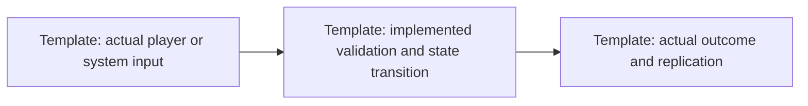

# Gameplay / architecture change — TBD system

**Unfilled template — not evidence.**

- Date / milestone / status: TBD
- BEFORE revision / AFTER revision and source symbols: TBD

## Previous behavior

TBD real previous behavior, or state that the system did not exist.

## New behavior and player impact

TBD changed controls, decisions, outcomes, failure/recovery behavior and limitations.

## Server and network implications

TBD authority, input validation, messages/schema/revisions, synchronization, persistence/migration, late join/reconnect and backward compatibility. Mark unaffected areas not applicable with reasons.

## Updated flow

Replace the flow with implemented dispatch/assignment, aircraft mission, firefighting, multiplayer, dedicated-server, persistence or incident-resolution behavior as applicable. Separate and label proposed architecture.

## Verification

| Check | Command / setup | Expected | Actual | Logs / artifacts |
|---|---|---|---|---|
| TBD | TBD | TBD | Not run | TBD |

- Applicable visual, physics and performance report links: TBD
- Missing evidence, limitations and unchecked follow-up tasks: TBD
- README, changelog, tasks and status updates: TBD
